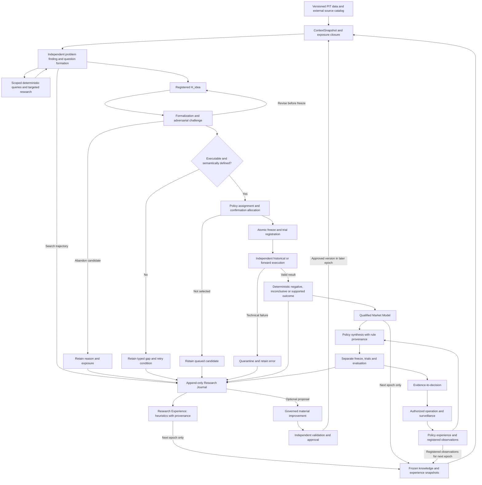

# TradingResearcher: complete architecture reading copy

This is an uncompressed Markdown document for readers that cannot import the GitHub repository or follow multiple file links. Read the reviewer instructions below before assessing the framework.

Generated from the 17 files listed below; their full text is included, not summarized. Only relative Markdown links outside code blocks are relocated to their original repository destinations. Each source SHA-256 identifies the original bytes. The original files govern; do not edit this generated copy. Rebuild with `python scripts/build_review_document.py`; check freshness with `python scripts/build_review_document.py --check`.

Scope: reviewer instructions, repository overview/instructions, current state, and all architecture documents 00-12. The original conversation archive, structured JSON companions, source review index and historical verification artifacts remain separate linked files. Do not claim to have inspected those from this copy; source disputes require the relevant original material. The framework has no application implementation.

This generated distribution file intentionally exceeds 1,000 lines to allow single-page retrieval. Maintain the separate source documents; splitting this copy would defeat that access purpose.

If your retrieval stops before `END OF COMPLETE ARCHITECTURE READING COPY`, report truncation and withhold a whole-framework verdict. Seeing that marker alone does not prove that every section was processed.

## Included sources

| File | SHA-256 of source bytes |
|---|---|
| [REVIEWING.md](REVIEWING.md) | `1aebef5b29443bee79b232ec4c2fd2e86eab2967e905d64c1175fcdf36230fe2` |
| [README.md](README.md) | `0057e5b534801cf2e4a94cc7b099ca4df09cf4f37dbd1b4aa12607731cd419d8` |
| [AGENTS.md](AGENTS.md) | `7af7654a98f4fc1dd077605791e853fea8f39520e627e82c4e90dba871357400` |
| [docs/architecture/CURRENT_STATE.md](docs/architecture/CURRENT_STATE.md) | `38ed0148f382b4ca7791231a38386b47ebdc8bdc08011127f7d61cfa7d59a3ab` |
| [docs/architecture/00_SOURCE_AUDIT.md](docs/architecture/00_SOURCE_AUDIT.md) | `0dc74b558c5241db6494b06c38f2dce9ad60c407f850155b1037ebce41a56ed6` |
| [docs/architecture/01_PROBLEM_DEFINITION.md](docs/architecture/01_PROBLEM_DEFINITION.md) | `402d50d911a003129248bfb19b19a1ac6c48d5a5c9fec01b91aa4a05564ebe9c` |
| [docs/architecture/02_DECISION_REGISTER.md](docs/architecture/02_DECISION_REGISTER.md) | `6f6f8e98fccb050861c52a20a4129952c9f2e7bb9d745bbc48558165bad80abe` |
| [docs/architecture/03_REJECTED_DECISIONS.md](docs/architecture/03_REJECTED_DECISIONS.md) | `a92670d5239a4db774f20629ef02839d61efc765242e1bd667b25f3cc58fc0bc` |
| [docs/architecture/04_DEFINITIONS.md](docs/architecture/04_DEFINITIONS.md) | `e6c28f05e8724a3ad12b5e4cec63b528d850e52dc14b5d3b41d4e7fb6cbe2a95` |
| [docs/architecture/05_REQUIREMENTS.md](docs/architecture/05_REQUIREMENTS.md) | `e02beebf43b91d8bdbded1de36d1723faf3d63e2ada994d21b72ed8854de0e0d` |
| [docs/architecture/06_MASTER_ARCHITECTURE.md](docs/architecture/06_MASTER_ARCHITECTURE.md) | `7fe412f3d3b7c4a5f89bac82849dc448ecdda634baefc6cdd32877decf4a9c32` |
| [docs/architecture/07_SCIENTIFIC_EVALUATION.md](docs/architecture/07_SCIENTIFIC_EVALUATION.md) | `5becaf08c03368a38ab92f8807af1ecf95f02755ed12495d237d599f19c5c756` |
| [docs/architecture/08_ENGINEERING_REVIEW.md](docs/architecture/08_ENGINEERING_REVIEW.md) | `ed3e479d896908abacdd7e4c366af20d02c6d442afa2b7e877ce974127b64685` |
| [docs/architecture/09_IMPLEMENTATION_BLUEPRINT.md](docs/architecture/09_IMPLEMENTATION_BLUEPRINT.md) | `f249c93abd1d40f207eb34dc06c52dd8f7089b3d6826ca145de7852fef427d53` |
| [docs/architecture/10_IMPLEMENTATION_ROADMAP.md](docs/architecture/10_IMPLEMENTATION_ROADMAP.md) | `3e9eaa40c5c42d9c95030bb604f9d2378a55f77408593c3b42ac54919ad3d53c` |
| [docs/architecture/11_OPEN_DECISIONS.md](docs/architecture/11_OPEN_DECISIONS.md) | `bb0fe61429cb292a1b1554989ce23a3e02bfbebea824cdd7c3fccb0fd209fbc5` |
| [docs/architecture/12_TRACEABILITY_MATRIX.md](docs/architecture/12_TRACEABILITY_MATRIX.md) | `d5a063ae83357e431e0d0610c58fd5925895ef07d36552fc20f4a24d68d57126` |

---

## Source file: REVIEWING.md

# Instructions for LLM reviewers

Reconstruct the system before judging it. Apply this protocol to a framework-wide critique, including a critique supplied by another model. It also applies when reading this repository through a browser rather than a coding agent. It does not require a full architecture review for a bounded wording edit or a clearly scoped local finding.

## Establish the review basis

Record the branch or commit and the scope of the assessment. Read actual file contents, not just the repository page, search snippets, filenames or another model's summary. The current default branch is `codex/architecture`; verify it rather than assuming `main`. If GitHub page extraction fails, try direct Raw files or the public contents API. Report failed or truncated reads; they do not count as completed reading.

Read the [README](README.md) and [Current State](docs/architecture/CURRENT_STATE.md), then the complete [Problem Definition](docs/architecture/01_PROBLEM_DEFINITION.md) and [Master Architecture](docs/architecture/06_MASTER_ARCHITECTURE.md). Use their references to check the [Definitions](docs/architecture/04_DEFINITIONS.md), [Decision Register](docs/architecture/02_DECISION_REGISTER.md), [Rejected Decisions](docs/architecture/03_REJECTED_DECISIONS.md) and [Open Decisions](docs/architecture/11_OPEN_DECISIONS.md). For a whole-framework review, cover the [Requirements](docs/architecture/05_REQUIREMENTS.md), [Scientific Evaluation](docs/architecture/07_SCIENTIFIC_EVALUATION.md), [Engineering Review](docs/architecture/08_ENGINEERING_REVIEW.md), [Blueprint](docs/architecture/09_IMPLEMENTATION_BLUEPRINT.md), [Roadmap](docs/architecture/10_IMPLEMENTATION_ROADMAP.md) and [Traceability](docs/architecture/12_TRACEABILITY_MATRIX.md) as well. Read long documents in bounded sections without dropping the middle.

Check provenance disputes against the [Source Audit](docs/architecture/00_SOURCE_AUDIT.md) and its source index, then the relevant original messages. A later decision can supersede an earlier example. Preserve the distinction between accepted, conditional, rejected, superseded, proposed and open positions. A review recommendation is not an accepted scientific rule.

## Demonstrate the system model before the critique

Begin the assessment with a concise, source-linked reconstruction explaining:

- The goals, success criteria and non-goals, distinguishing framework success from individual research outcomes and policy success.
- The research flow from permitted inputs through discovery, formalization, evaluation and retained outcomes, including exits and deferred work.
- The feedback loops: what can be learned from which outcomes, where it is stored, and when it may influence later work.
- Decision authority: who proposes, computes, evaluates, changes rules and authorizes action, and which boundaries connect them.
- The current implementation state and unresolved decisions, including which operations those decisions actually block.

Explain how these parts interact; a component list or statement that you "understand the framework" is insufficient. Trace one ordinary research path and one failure or early-exit path across components into their subsequent feedback. For the concern being assessed, explain what the existing safeguard does and what would remain unresolved even if it worked as specified.

There is no reliable self-certification of "complete understanding." The observable prerequisite is a coherent reconstruction with supporting references and explicit gaps. If missing access, unresolved contradictions or context loss prevents that reconstruction, withhold the overall verdict and state the limitation. Report any independently established local finding with its exact scope; do not generalize it to the whole framework. If the documentation itself cannot support a coherent model, show the conflicting passages and their consequences rather than inventing a reconciliation. No additional user approval is needed to proceed from a supported reconstruction to critique.

## Critique the reconstructed design

For each material finding, give the claim and source, the triggering condition, the existing mechanism and why it is insufficient, the resulting consequence, and the smallest relevant remedy or discriminating test. Before claiming something is absent, inspect the document that owns it and its linked decisions. Distinguish absent, specified but unimplemented, explicitly open, and empirically unverified.

Do not substitute your preferred project goals or infer that a safeguard works merely because it is specified. Accepted decisions remain legitimate subjects of criticism; identify any proposed change to them explicitly. Do not manufacture a finding to fill a checklist. Keep demonstrated contradictions, implementation gaps and empirical risks separate, and state what was not verified.

This is a review discipline, not a guarantee of model comprehension or a reason to suppress substantive criticism. Reconstruct the model again after material context loss; do not claim that an earlier reading remains available when it does not.

---

## Source file: README.md

# TradingResearcher

Source-backed architecture for an autonomous market-research framework: an LLM independently develops hypotheses, freezes executable claims before confirmation, and submits them to independent code for evaluation.

The framework must substantially accelerate both hypothesis discovery and testing while preserving scientific decision quality. The [Problem Definition](docs/architecture/01_PROBLEM_DEFINITION.md) states both goals; the [Master Architecture](docs/architecture/06_MASTER_ARCHITECTURE.md) connects research, early exits, feedback and decision authority.

**Status:** documentation and preserved conversation sources only. No application implementation, demonstrated trading edge or live deployment is included.

## Start here

**Single-page reading option:** [Complete architecture reading copy](FRAMEWORK_REVIEW.md) includes the reviewer instructions and all architecture documents 00-12 in one uncompressed Markdown file. Use its ordinary GitHub file page when repository import or multi-file retrieval fails. It is generated from the originals, not a separate summary; source archives remain linked separately.

**For LLM reviewers:** Follow [REVIEWING.md](REVIEWING.md) before a framework-wide critique. First present a source-linked reconstruction of goals, flow, feedback, authority and open boundaries. If access or context is incomplete, state the limits and withhold an overall verdict; do not treat a partial reading as the whole system.

- [Source audit and known gaps](docs/architecture/00_SOURCE_AUDIT.md)
- [Problem definition](docs/architecture/01_PROBLEM_DEFINITION.md)
- [Decision register](docs/architecture/02_DECISION_REGISTER.md)
- [Rejected and replaced alternatives](docs/architecture/03_REJECTED_DECISIONS.md)
- [Canonical definitions and preserved formulas](docs/architecture/04_DEFINITIONS.md)
- [Requirements](docs/architecture/05_REQUIREMENTS.md)
- [Master architecture](docs/architecture/06_MASTER_ARCHITECTURE.md)
- [Scientific evaluation](docs/architecture/07_SCIENTIFIC_EVALUATION.md)
- [Engineering review](docs/architecture/08_ENGINEERING_REVIEW.md)
- [Implementation blueprint](docs/architecture/09_IMPLEMENTATION_BLUEPRINT.md)
- [Proposed roadmap](docs/architecture/10_IMPLEMENTATION_ROADMAP.md)
- [Open decisions](docs/architecture/11_OPEN_DECISIONS.md)
- [Traceability matrix](docs/architecture/12_TRACEABILITY_MATRIX.md)

## Evidence and limits

The archive contains 305 message blocks from 304 numbered turns of the accessible shared conversation. Two original images, three cited document bodies and an original export were unavailable; one captured response is incomplete. Full original-source completeness is not verified. Reconstruction continued with the user's explicit authorization to retain documented source gaps.

The decision register separates accepted decisions, conditional choices, superseded positions, deferred work and new proposals. The roadmap and implementation contracts are not evidence that an application has been built.

- [Exact captured transcript](sources/full_conversation.md)
- [Source manifest and checksums](sources/capture_manifest.json)
- [Message review index](docs/architecture/SOURCE_REVIEW_INDEX.md)
- [Machine-readable architecture register](docs/architecture/ARCHITECTURE_REGISTER.json)
- [Documentation verification results](docs/architecture/DOCUMENTATION_VERIFICATION.json)

Files under `sources/` are preserved byte-for-byte. Git attributes disable text conversion for that directory. Verify their SHA-256 hashes against the capture manifest before using a new checkout for reconstruction or further analysis.

Project documentation is English (en-US); original source quotations retain their language.

---

## Source file: AGENTS.md

# Repository instructions

## Purpose and boundaries

Build toward autonomous, nontrivial LLM invention of market hypotheses, faithful formalization and freezing, and independent deterministic scientific evaluation. Preserve free discovery rather than replacing it with a closed rule catalog. The LLM must not judge its own empirical success. See the [Problem Definition](docs/architecture/01_PROBLEM_DEFINITION.md) and D001 in the [Decision Register](docs/architecture/02_DECISION_REGISTER.md).

Preserve the [Master Architecture](docs/architecture/06_MASTER_ARCHITECTURE.md) invariants: point-in-time information, inherited exposure, pre-outcome scientific commitments, independent feature certification, retained failures and unsupported ideas, separate policy evaluation, and the firewall between operations and research evidence. Keep evidence, validity, applicability and deployment authority distinct without inventing a resolution to open semantics. Historical-first research does not make exposed history unseen; v1 discovery starts at 15-minute observations (D012–D014).

## Read according to the task

- Start with the [README](README.md) and descriptive [Current State](docs/architecture/CURRENT_STATE.md).
- Before a system-level assessment, follow [REVIEWING.md](REVIEWING.md): reconstruct and substantiate the system model before critique, state gaps, and withhold an overall verdict when the reconstruction is incomplete. Use that same model for design and implementation; reuse it within a session and reconstruct it after context loss or a material change.
- For affected behavior, consult the [Decision Register](docs/architecture/02_DECISION_REGISTER.md), [Rejected Decisions](docs/architecture/03_REJECTED_DECISIONS.md), [Definitions](docs/architecture/04_DEFINITIONS.md) and [Open Decisions](docs/architecture/11_OPEN_DECISIONS.md).
- For design or implementation, read relevant sections of the [Master Architecture](docs/architecture/06_MASTER_ARCHITECTURE.md), [Requirements](docs/architecture/05_REQUIREMENTS.md), [Engineering Review](docs/architecture/08_ENGINEERING_REVIEW.md), [Implementation Blueprint](docs/architecture/09_IMPLEMENTATION_BLUEPRINT.md) and [Traceability Matrix](docs/architecture/12_TRACEABILITY_MATRIX.md). Consult the [Scientific Evaluation](docs/architecture/07_SCIENTIFIC_EVALUATION.md) when scientific validity is affected.
- For provenance disputes, use the [Source Audit](docs/architecture/00_SOURCE_AUDIT.md) and [Source Review Index](docs/architecture/SOURCE_REVIEW_INDEX.md) to locate the relevant archived messages. Do not read the entire conversation for every small change.

For wording-only edits and other bounded tasks with no architectural consequence, use the entry documents and affected files only; skip the full orientation and system recap. Do not expand the task, repeat reads already available, or ask the user to restate documented context. A historical handoff's task authorization describes that earlier task; the current explicit user request determines today's scope, subject to the scientific change-control rules below.

## Authority and change control

Accepted decisions and versioned canonical definitions govern their stated scope; respect source-confidence qualifications. Architecture summaries, examples, reviews and implementation proposals do not override them.

| Status | Treatment |
|---|---|
| NON_NEGOTIABLE / ACCEPTED | Preserve the recorded constraint or decision. |
| CONDITIONALLY_ACCEPTED | Apply only within the recorded conditions. |
| REJECTED | Consult the rejection's reason, exact scope, replacement and reconsideration conditions before proposing or implementing a similar approach. A role-specific rejection is not a blanket ban. |
| SUPERSEDED | Retain historical provenance; follow the recorded replacement. |
| PROPOSED_ONLY / DEFERRED | Neither accepted nor authorized for implementation merely by appearing in documentation; deferral is not permanent rejection. |
| OPEN / AMBIGUOUS | Resolve before affected operations; do not silently choose a scientific interpretation. Unrelated authorized work may continue. |

Never silently change project goals, scientific evidence rules, scientific contracts or canonical definitions. Material changes require explicit user approval of a reviewable proposal with rationale, affected decisions/requirements, validation, versioning and rollback (D008, D026). Label goal changes **GOAL CHANGE — USER APPROVAL REQUIRED**. OPEN-01 through OPEN-03 remain unapproved semantic proposals. Preserve prior versions and exposure history when recording approved changes.

Distinguish scientific logic from ordinary infrastructure. External runtimes, storage and backtest libraries may implement approved contracts; they cannot define evidence or change scientific meaning. Routine infrastructure work within an authorized task does not need repeated approval unless it materially changes those boundaries. Do not invent an automated approval policy for the unresolved certification boundary in OPEN-14.

## Working discipline

- Keep all authored project artifacts in English (en-US), per D043. Preserve original-language verbatim source quotations and the archived source bytes; do not translate or rewrite the original conversation archive. Document source gaps honestly and add later recovery as separately versioned evidence.
- Use the smallest coherent implementation that meets affected requirements. Logical roles do not mandate separate agents, services or databases. Avoid speculative abstractions and follow D030's bounded iteration rules.
- The [Roadmap](docs/architecture/10_IMPLEMENTATION_ROADMAP.md) proposes phases; it does not authorize starting one. Work within the user's current scope and resolve blockers for the selected work.
- Verify changes against affected requirements, acceptance criteria and existing tests. Distinguish specified future tests from executable tests and from tests actually run. For documentation, check consistency, links, whitespace and preservation of unaffected artifacts. Report changed files, exact check outcomes and unverified boundaries; do not claim scientific validity from software checks.
- After approved decisions or verified capability changes, update affected canonical documents and the descriptive handoff using the [Current State maintenance process](docs/architecture/CURRENT_STATE.md#maintaining-this-handoff-and-recording-decisions).
- If a source listed in [FRAMEWORK_REVIEW.md](FRAMEWORK_REVIEW.md) changes, regenerate that reading copy with `python scripts/build_review_document.py` and verify it with `python scripts/build_review_document.py --check`.

---

## Source file: docs/architecture/CURRENT_STATE.md

# Current state

Verified October 22, 2026. This is a descriptive handoff, not an additional source of architectural authority. The [Decision Register](docs/architecture/02_DECISION_REGISTER.md), [Rejected Decisions](docs/architecture/03_REJECTED_DECISIONS.md) and versioned [Definitions](docs/architecture/04_DEFINITIONS.md) retain their existing authority and qualifications.

## Repository and existing artifacts

- Repository: [RealMonoid/TradingResearcher](https://github.com/RealMonoid/TradingResearcher). Verified working branch: `codex/architecture`; `origin` is `https://github.com/RealMonoid/TradingResearcher.git`.
- Architecture baseline before the original repository preparation: commit `d818dc0ded5d224932638795845071d2f24ce115`. That preparation added root [AGENTS.md](AGENTS.md) and this handoff. The earlier session-understanding intervention is preserved in its review artifacts. The subsequently approved system-model revision records D068, completes the existing goal/feedback explanation and simplifies entry instructions; it does not resolve open scientific contracts or authorize framework implementation.
- The [README](README.md) indexes architecture documents 00–12: source audit, problem definition, decisions, rejections, definitions, requirements, master architecture, scientific evaluation, engineering review, blueprint, proposed roadmap, open decisions and traceability.
- [ARCHITECTURE_REGISTER.json](docs/architecture/ARCHITECTURE_REGISTER.json) is a structured documentation companion. [SOURCE_REVIEW_INDEX.md](docs/architecture/SOURCE_REVIEW_INDEX.md), [SOURCE_VERIFICATION.json](docs/architecture/SOURCE_VERIFICATION.json) and [DOCUMENTATION_VERIFICATION.json](docs/architecture/DOCUMENTATION_VERIFICATION.json) preserve review and verification evidence from the reconstruction. Those reports do not automatically cover later changes or these two preparation files.
- [sources/](sources) contains the original captured [conversation](sources/full_conversation.md), recovered DOM, message index, structured content, source inventory and [capture manifest](sources/capture_manifest.json). The capture records 304 numbered turns and 305 message blocks. It is not a verified complete original export. Missing images/files, incomplete M0302 and other provenance limits remain in the [Source Audit](docs/architecture/00_SOURCE_AUDIT.md), SRC-001 through SRC-008. Continuing with documented gaps was explicitly authorized; the archive remains unchanged.

## Actual capabilities versus target design

The repository currently provides a readable, source-linked architecture, decision and rejection history, canonical definitions, requirements, proposed interfaces and acceptance specifications. It supports architectural discussion and traceability to the preserved source.

There is no implemented framework, application test suite, build/package configuration or CI workflow. No discovery agent, compiler, feature certification service, runtime registry, freeze transaction, data connector, simulator, evidence engine, memory system, Column Library, dashboard or deployment capability exists here. The `TEST-01` through `TEST-27` entries in the [Traceability Matrix](docs/architecture/12_TRACEABILITY_MATRIX.md) are future acceptance specifications, not executed tests. Record-field tables in the [Blueprint](docs/architecture/09_IMPLEMENTATION_BLUEPRINT.md) are not complete executable schemas. Repository-instruction checks are separate from these future application tests.

As recorded in the [Engineering Review](docs/architecture/08_ENGINEERING_REVIEW.md), vectorbt is the accepted primary backend candidate; Hermes is a runtime candidate; Harness2 provides conditionally accepted improvement patterns. None is integrated or conformance-tested in this repository. That review is a documented critical pass, not an independent-person audit or application-code audit. Research performance, scientific calibration and profitability are unverified.

## Approved boundaries and unresolved work

The [Problem Definition](docs/architecture/01_PROBLEM_DEFINITION.md) and [Master Architecture](docs/architecture/06_MASTER_ARCHITECTURE.md) preserve free LLM invention, faithful H_idea-to-H_exec formalization, independent code judgment, point-in-time context and inherited exposure, frozen evaluation and selection rules, retained technical failures, separately evaluated policies and governed improvement. Unsupported ideas remain recorded with their gaps. Historical-first research and the 15-minute v1 observation minimum remain accepted; forward confirmation retains its distinct evidence origin. Logical component boundaries do not select a service topology or agent count.

The user clarification that substantially accelerating hypothesis discovery **and** testing is a framework-level success objective is now recorded as D068, REQ-027 and future TEST-27. Its current-session source is separate from the immutable archive. The Problem Definition states both goals; the Master Architecture and Blueprint connect early exits, retained gaps/errors, qualified results and the distinct feedback loops. [AGENTS.md](AGENTS.md) points to this whole instead of duplicating incident-specific reminders. Numeric targets and comparison design remain OPEN-11; no lifecycle migration, evidence upgrade or certification policy is approved.

The [System Model Review](docs/reviews/SYSTEM_MODEL_REVIEW.md) describes the pre-change findings and approved remedy. The earlier [session-understanding experiment](docs/reviews/session-understanding/README.md) applies only to its frozen instruction versions; its checker intentionally compares against those old hashes and is not a gate for this revision. Its incomplete efficacy result is retained. This revision has documentation integrity and consistency checks, not a new behavioral efficacy experiment; reliable comprehension across new sessions or compaction remains unverified.

The current [documentation checker](docs/reviews/verify_system_model.py) runs with `python docs/reviews/verify_system_model.py`; the [revision verification result](docs/reviews/SYSTEM_MODEL_UPDATE_VERIFICATION.json) records the executed checks and exact file hashes. Supplying its optional pre-edit inventory also checks preservation of all previously present review artifacts. Diagram routing checks do not verify rendering or executable scientific semantics.

[REVIEWING.md](REVIEWING.md), linked from README and AGENTS.md, now gives external LLM reviewers the same reconstruction-before-critique protocol. It requires an observable source-linked system model and bounded conclusions when context is incomplete. It changes review procedure, not scientific authority; cross-model compliance is unverified. Earlier verification snapshots retain their original scope and hashes.

[FRAMEWORK_REVIEW.md](FRAMEWORK_REVIEW.md) is a generated, uncompressed reading copy of 17 source documents for GitHub-only readers. It includes the review instructions and full architecture documents 00-12, with source hashes and relocated links. It is not a new canonical summary and does not include the original conversation archive or structured companions. `python scripts/build_review_document.py --check` checks exact regeneration. Successful public delivery does not establish that a particular LLM fetcher ingests the complete file.

Consult the complete [Open Decisions](docs/architecture/11_OPEN_DECISIONS.md) register before affected work:

| Open items | Unresolved boundary |
|---|---|
| OPEN-01 | Historical/forward lifecycle and separate validity, evidence, replication and applicability dimensions; proposed migration requires user approval. |
| OPEN-02–03 | Subgroup evidence transport and interpretation of family success rates; proposed semantic changes require user approval. |
| OPEN-04–06 | Executable language semantics, statistical confirmation rules, initial market/data authority and execution conventions. |
| OPEN-07–09 | Runtime adoption, persistence/recovery and discovery models, agent count and budgets. |
| OPEN-10–12 | Live-capital authority, framework success/stop criteria and confirmation allocation. |
| OPEN-13–15 | Applicability/dependency propagation, routine certification versus material-change approval, and source recovery. |

The [Roadmap](docs/architecture/10_IMPLEMENTATION_ROADMAP.md) recommends P1 semantic contracts followed by a technical vertical slice and later calibration. It is a proposal, not an authorized implementation phase. Earlier preparation and session-understanding tasks concern repository instructions and documentation; their scope statements do not override a later explicit user request. A framework implementation request must identify a bounded scope and acceptance evidence, with the relevant open decisions resolved before dependent work. No live trading or material self-modification is authorized by these documents.

## Maintaining this handoff and recording decisions

1. Identify affected decision, definition, requirement and open-item IDs. Consult rejection reasons and scope before revisiting an approach; inspect targeted source messages when provenance matters.
2. Record a proposed decision with rationale, alternatives, impacts and approval status. Obtain explicit user approval before applying material goal, semantic or scientific-contract changes. A discussion, example or engineering recommendation is not acceptance.
3. After approval where required, update the [Decision Register](docs/architecture/02_DECISION_REGISTER.md) and its [structured companion](docs/architecture/ARCHITECTURE_REGISTER.json). Preserve history and distinguish acceptance, rejection, supersession, proposal and unresolved status. Update the [Rejected Decisions](docs/architecture/03_REJECTED_DECISIONS.md) when an alternative's disposition changes; version affected [Definitions](docs/architecture/04_DEFINITIONS.md) rather than silently rewriting meaning.
4. Update affected requirements, architecture, blueprint, open decisions and traceability; verify the corresponding acceptance criteria and tests. Ordinary implementation details need not become new scientific decisions. Preserve the original source archive; later source recovery gets separate provenance.
5. Refresh this snapshot when verified capabilities or repository context change. State what exists, what remains conceptual and what was actually checked. Keep canonical decisions in their registers rather than resolving them in this handoff.

---

## Source file: docs/architecture/00_SOURCE_AUDIT.md

# Source Audit

Audit date: October 22, 2026 (Europe/Berlin).

**Source completeness: FULL_SOURCE_NOT_VERIFIED. Reconstruction is authorized with documented gaps.**

The shared page was accessible in the browser. Every numbered conversation turn exposed by that page was captured, including the first and last. This establishes coverage of the accessible text sequence, not completeness of the original source material. Two uploaded images are unavailable, three cited project documents were not retrieved, and one assistant response ends mid-sentence. The original request required stopping after Phase 0 when full retrieval could not be verified. That stop was honored initially. The current user then explicitly instructed: “Du bekommst die ausdrückliche Anweisung mit dokumentierten Quellenlücken weiterzuarbeiten.” This later instruction authorizes a reconstruction limited to the available source; it does not certify the missing material or authorize application code.

## Source and method

- Source: [Hypothesen Bauer — shared conversation](https://chatgpt.com/share/6ad98ddf-8728-83ed-89cb-84cf0bee5d48).
- An initial web-tool request returned `TimeoutError`.
- The in-app browser loaded the page. Dismissing the sign-in overlay using “Abgemeldet bleiben” exposed the public conversation without signing in.
- The page virtualizes its content. Initially only eight numbered turns were rendered. Empty DOM containers reserved space for other turns; their absence from the initial text snapshot did not establish missing conversation content.
- Each observed turn container was brought into view using the browser's normal UI interaction. The rendered message HTML, exact `innerText`, speaker attributes, message IDs, turn IDs, links, and image references were captured.
- A browser timeout interrupted traversal near turn 289. Capture resumed, and a separate coverage check identified and recovered turn 81. The final record contains every integer turn number from 1 through 304.
- No private endpoints, hidden application state, prior assistant summaries, or unrelated research memories were used as substitutes for the conversation.
- Clicking the original copy action for turn 302 returned an empty browser clipboard. No original Markdown export was obtained. The archive therefore explicitly identifies itself as a rendered-DOM capture.

## Coverage

| Check | Result | Evidence or limitation |
|---|---|---|
| Supplied URL accessible | Yes, through the browser | The web-tool timeout was not treated as proof that the source was inaccessible. |
| First accessible turn recovered | Yes | M0001, user; transcript lines 13–19. |
| Last accessible turn recovered | Yes | M0304, assistant; transcript lines 28928–30069. |
| Numbered conversation turns | 304 | Continuous sequence 1–304, no gaps. |
| User / assistant turns | 152 / 152 | Explicit source role attributes. |
| Message blocks with distinct source IDs | 305 | 153 user blocks and 152 assistant blocks. |
| Duplicate text with different IDs | Preserved | Turn 239 contains two identical user messages, M0239-A and M0239-B. They were not silently deduplicated. |
| Captured message characters | 972,877 | Sum of captured message `innerText` lengths. |
| Transcript line count | 30,073 | Stable physical lines in the saved UTF-8 transcript. |
| Text equality after saving | PASS, 305/305 | Each indexed text block exactly matches its captured source message; SHA-256 hashes also match. |
| Source code/preformatted blocks | 1,173 leaf `pre` elements | Preserved with text and HTML in `structured_content.json`; nested wrapper `pre` elements are not double-counted. This is a DOM-element count, not a count of independently authored code examples. |
| Rendered TeX annotations | 4 | Preserved exactly; all occur in M0280. Other formulas remain in the original captured text/HTML. |
| Distinct anchor href values | 52 | Inventory of observed links, not a claim that every citation has an accessible URL. |
| Uploaded images | 2 placeholders, 0 original images retrieved | M0001 and M0213. |
| Cited project files | 3 titles identified, 0 file bodies retrieved | Listed below. |
| Full original conversation and supporting material | NOT VERIFIED | Accessible text coverage does not resolve missing uploads, cited files, or the unfinished response. |

The page also contains one empty, zero-height turn container with ID `ef21b2d7-76c3-4158-87d8-2869566c9954`. It exposes no numbered turn, speaker, or message body. Its role and content are unknown; it is neither counted as a recovered message nor assumed to be a missing user message.

### First and last messages

- M0001 (`3daaa7ee-a8d8-48c6-bc31-ccc2e2435585`) contains an uploaded-image placeholder and the user's question about forming a hypothesis from a chart.
- M0304 (`b4c8d71c-8d0f-44a5-b569-31264016da01`) contains the final assistant response introducing and supplying the master reconstruction prompt. Its closing paragraph is present.
- There is no evidence from this public page that later messages in the private conversation do or do not exist. Completeness beyond the retrieved snapshot is unknown.

## Missing and uncertain material

| Issue ID | Source reference | Observed condition | Consequence |
|---|---|---|---|
| SRC-001 | M0001; transcript lines 13–19 | The page renders only “Bild hochgeladen”; no original image element or download URL is exposed. | The initial chart cannot be independently inspected. The assistant's description is not a replacement for its pixels. |
| SRC-002 | M0213–M0214; transcript lines 22020–22263 | The second upload is also only a placeholder. M0214 evaluates a trading-pipeline graphic. | The object being evaluated is missing. Its components and relationships cannot be verified from the image. |
| SRC-003 | M0002, M0006, M0008, M0010 | `Trading_System.md`, source file ID `file_00000000f0c0820ab06115bcabe4af02`, appears in citation metadata. | The file body and the cited original passages were not inspected. |
| SRC-004 | M0002, M0004, M0010, M0014, M0016, M0026, M0028 | `Projekt-Workflow.md`, source file ID `file_000000007d6c81f4a170d996d1d0173f`, appears in citation metadata. | The file body and the cited original passages were not inspected. |
| SRC-005 | M0002 | `Chart_Indikator_Settings.md`, source file ID `file_000000002e34820a9337dc69fa7da8a8`, appears in citation metadata. | The file body and the cited original passages were not inspected. |
| SRC-006 | M0302; transcript line 28913 | The assistant text ends with “und warum wir dieses”, without completing its sentence. Revisiting the turn showed the same ending. | An incomplete response is present in the accessible source. Whether it was interrupted originally or shortened elsewhere is unknown. Nothing was invented to complete it. |
| SRC-007 | Entire snapshot | No original Markdown/export was available. | Text equality is verified against the captured DOM, not against a separate authoritative export. Formatting and mathematical structure require the preserved HTML/structured companion records. |
| SRC-008 | Entire snapshot | The public page cannot certify the private conversation's current end or alternate branches. | No claim of complete private-history or branch coverage is made. |

The three cited documents expose titles and file-citation metadata, not accessible file bodies. Their original versions are needed; similarly named replacement files would not automatically establish source identity.

External anchor references are preserved in `source_inventory.json`. Their linked pages were not independently researched during this source-capture phase. URLs or references appearing only as prose remain in the exact transcript. Citation popovers and assistant reasoning disclosures were not expanded; no claim is made to have recovered private reasoning, citation-panel metadata, or linked documents beyond the rendered record.

Three non-favicon remote preview images occur in M0254, and two embedded SVG image data URLs occur in M0272. Their observed references and embedded data are preserved in the archive. The remote previews were not downloaded, and the graphics were not independently interpreted for requirements. They must not be confused with the two unavailable user uploads.

## Preservation and citation conventions

The transcript is a faithful plain-text view, not a reconstructed narrative. Each message body is enclosed in a literal text fence and is byte-for-byte equal after UTF-8 encoding to the captured message text. This deliberately retains UI text within message containers, including image placeholders and expansion labels. It does not silently translate German source messages into English. Editorial metadata and this audit are written in English, while original quotations retain their source language as required by the extraction instructions.

Use `M0001` through `M0304`, with `M0239-A` and `M0239-B` for the two blocks in turn 239. `message_index.json` records source IDs, roles, text hashes, and one-based physical transcript line ranges. These are local transcript line numbers, not asserted original-platform line numbers.

The raw DOM archive retains the rendered structure of formulas, code, tables, diagrams, citation labels, and message formatting. `structured_content.json` separately exposes the original code/preformatted HTML and text, TeX annotations, images, and links. A plain-text transcript alone must not be treated as complete preservation of all visual semantics.

The source files are frozen with read-only filesystem attributes and SHA-256 checksums in `capture_manifest.json`. This protects against accidental editing and detects changes; it is not a cryptographically authenticated platform export or an absolute write barrier. Future recovery should use a new versioned capture and preserve this one.

## Delivered files

| File | Purpose |
|---|---|
| `sources/full_conversation.md` | Exact message text in source order, with stable identifiers and explicit completeness warning. |
| `sources/recovered_dom.json` | Captured HTML, exact text, IDs, roles, links, images, and observed container inventory. |
| `sources/message_index.json` | Message-to-line mapping, source IDs, character counts, and per-message text hashes. |
| `sources/structured_content.json` | Preformatted/code blocks, TeX annotations, image references/data, and links. |
| `sources/source_inventory.json` | Missing uploads, cited-file metadata, observed anchor targets, and non-favicon image references. |
| `sources/capture_manifest.json` | Capture scope, counts, limitations flag, and source-file SHA-256 hashes. |
| `docs/architecture/00_SOURCE_AUDIT.md` | This audit, the initial stop and the later continuation authorization. |
| `docs/architecture/SOURCE_VERIFICATION.json` | Fresh local integrity and coverage check results, including the failed full-source gate. |

## Reconstruction status after explicit continuation authorization

Documents `01_PROBLEM_DEFINITION.md` through `12_TRACEABILITY_MATRIX.md` are now delivered. They reconstruct the available record, distinguish direct acceptance from contextual consolidation, preserve rejected alternatives and identify new recommendations. `ARCHITECTURE_REGISTER.json` is a machine-readable decision/rejection companion; `SOURCE_REVIEW_INDEX.md` indexes all captured message blocks.

The source archive remains unchanged. The earlier SOURCE_VERIFICATION.json reports capture-integrity checks and the failed full-source gate. The later DOCUMENTATION_VERIFICATION.json records fresh documentation/traceability checks after reconstruction. These are different gates: passing documentation checks does not make the original source complete.

Decision counts use the normalized units in document 02. Rejection records are finer-grained and overlap with rejected/superseded decisions; do not sum them as disjoint decisions. No count claims exhaustive recovery of every possible minor assertion in the discussion.

The reconstructed fundamental goal is autonomous, nontrivial LLM hypothesis generation with pre-test operationalization/freeze and independent code evaluation. Historical-first execution, a 15-minute minimum discovery timeframe, transitive exposure, separate policy search, controlled improvement and operational feedback boundaries qualify that goal. The architecture remains unimplemented.

## Remaining recovery work

The two original image uploads, three cited document bodies, original Markdown/export and the status of the incomplete M0302 response remain unavailable or unverified. SRC-001 through SRC-008 stay open. New recovery must use a new versioned capture and preserve this archive. No missing chart details, file contents or acceptance statements have been fabricated.

Continuation with these gaps is explicitly authorized; the user need not repeat that permission. The missing sources are not a reason to leave the requested document set undelivered.

---

## Source file: docs/architecture/01_PROBLEM_DEFINITION.md

# Problem Definition

Version: reconstruction-1 with approved clarification D068 (October 22, 2026). Original source limits remain in [00_SOURCE_AUDIT.md](docs/architecture/00_SOURCE_AUDIT.md); D068 separately records the later user clarification.

## Fundamental problem

Build an autonomous market-research workflow in which an LLM independently develops nontrivial hypotheses from market observations and available knowledge, turns them into executable specifications before testing, and submits them to independent code for evaluation on appropriately separated evidence. Preserve what was learned, what failed, what was exposed and what remains uncertain. Use that knowledge to research adaptive trading policies without confusing a good historical strategy with a supported market claim.

The decisive user constitution is M0057, reinforced by M0059 and M0107. The exact source statement is:

> Ein Agent-Workflow, in dem ein LLM aus Marktdaten und vorhandenem Wissen selbstständig nichttriviale Hypothesen entwickelt, sie vor dem Test in ausführbare Form bringt, und in dem Code sie anschließend unabhängig an neuen Daten prüft.

Source: [M0057](sources/full_conversation.md#m0057--user). D001 records its non-negotiable status.

The framework has two linked goals: autonomous nontrivial invention with faithful independent evaluation, and substantial acceleration of **both hypothesis discovery and testing** (D068). Acceleration concerns the complete research process, including useful early elimination and retained failures. It must preserve scientific decision quality and evidence boundaries; more generated or rejected ideas alone do not demonstrate success.

## Why this problem matters

The conversation starts with a chart-specific hypothesis, but quickly distinguishes noticing a pattern, forming a scientific claim and knowing whether that claim survives testing. It then asks how the generator itself can become a better researcher without merely learning to explain historical winners. An autonomous system amplifies both discovery capacity and selection bias: it can inspect many features, ask outcome-dependent questions, revise explanations, synthesize policies and recycle those results through memory. A frozen backtest alone does not control this whole process.

The desired output is therefore an auditable chain from question to evidence and decision. Profitable backtests are neither sufficient proof of the research process nor the sole definition of useful knowledge. Economic usefulness remains an eventual project gate, alongside technical validity and calibration; profitability has not been demonstrated.

## Problem-to-requirement map

| Problem | Consequence to prevent | Required response |
|---|---|---|
| PROB-01: Free invention versus controlled execution | A rule catalog or expressive bottleneck replaces discovery | REQ-001 through REQ-003 |
| PROB-02: Information contamination | Historical outcomes return through queries, papers, memory or ancestors | REQ-004, REQ-012 through REQ-016 |
| PROB-03: Selection and weak evidence | Best historical survivor is labeled scientific truth | REQ-005, REQ-019, REQ-020, REQ-024 |
| PROB-04: Meaning and dependency drift | The same name or status silently means something different | REQ-006 through REQ-008, REQ-021 |
| PROB-05: Knowledge-to-action gap | Evidence for components is treated as evidence for a policy | REQ-009, REQ-010, REQ-017, REQ-025, REQ-026 |
| PROB-06: Unbuildable scope and unmeasured quality | More agents, services and metrics substitute for useful research | REQ-018, REQ-022, REQ-023 |
| PROB-07: Scope mismatch | Five-minute examples or OHLCV-only adapters constrain the actual mandate | REQ-011, REQ-015, REQ-026 |
| PROB-08: Research speed detached from purpose | A valid research process does not materially accelerate discovery and testing, or buys speed by weakening decisions | REQ-027, with REQ-005, REQ-006, REQ-016 and REQ-020 |

## Scope evolution that must survive reconstruction

| Source interval | Change in understanding | Final consequence |
|---|---|---|
| M0001–M0028 | Chart hypothesis becomes a question about the research process; introspection and composite scores are challenged | Observe artifacts and preserve ex-ante quality separately from outcomes |
| M0029–M0056 | Variation, causal uncertainty and multiple discovery routes | Controlled diversity; no mandatory mechanism or SPC chart |
| M0057–M0074 | User constitution, autonomous roles, compiler, certification, formulas and errors | Strict confirmation boundary; free ideas and retained language gaps |
| M0075–M0100 | Adaptive policies, hypothesis relationships and revised time scope | Minimal dependency graph; 15-minute minimum discovery; swing allowed |
| M0101–M0138 | Historical-first, no simple generator, queries, multimodal data, problem finding and second policy search | Exposure lineage and distinct research/policy trials |
| M0139–M0174 | Reuse, provenance, evidence budget, base rates, calibration, memory and governed improvement | Own scientific core; no automatic evidence upgrade or self-modification |
| M0175–M0208 | Quantitative claims, dashboards, web research, scope governance and robustness | Explicit universes, costs, fitted-parameter tests; no universal statistical recipe |
| M0209–M0248 | Adversarial checks, operational firewall, placebos and infrastructure candidates | Narrow external adapters; implementation priorities still deferred |
| M0249–M0290 | Column Library, paths, null design, component analysis, bounded computation and sanity | Reusable diagnostics without leakage or free confirmations |
| M0291–M0304 | Request for original-source reconstruction and explicit rejected decisions | The handoff must preserve chronology and rationale, not summarize only the endpoint |
| Later user clarification, October 22, 2026 (D068) | Accelerating discovery and testing is an explicit framework success objective | Trace it to REQ-027 and TEST-27; keep measurement choices open under OPEN-11 |

## Success and non-goals

Success requires a freely generated claim to pass through formalization, provenance, freeze, independent execution and reproducible evidence classification without manual scientific repair. The complete pipeline must behave acceptably under null and planted-signal calibration, then meet a predefined economic-usefulness gate within an evidence budget. Numeric budgets and thresholds are open, not silently supplied here.

Framework success also requires a measured substantial acceleration of discovery and testing under a predefined comparison with matched task scope, decision quality and evidence access (REQ-027). The reference workflow or prior version, time/cost measures, improvement threshold and assessment design remain OPEN-11; D015's rejected comparator generator is not authorized by this requirement. Distinguish processing existing observations from waiting for new outcomes. Historical-first research can reject or refine candidates quickly while stronger independent confirmation remains a separate constraint.

A hypothesis succeeds or fails under its own frozen evaluation policy. A policy needs its own evidence and operational assessment. The framework is evaluated on the quality, efficiency, calibration and usefulness of the whole process: a valid negative hypothesis result can be useful progress without proving framework success, and a supported hypothesis does not by itself validate a policy. The [Master Architecture](docs/architecture/06_MASTER_ARCHITECTURE.md) connects these levels and their feedback paths.

The framework is not a fixed strategy generator, an LLM judge of truth, a mandatory ontology, an unconstrained historical optimizer, or an automatic capital-allocation mandate. It may use known effects, data-first observations and cross-domain analogies, but must not require one discovery route. A failed hypothesis can be useful research; a technically invalid run is neither support nor falsification.

This deliverable is documentation, not implementation. It does not recover the missing chart or original project-file bodies, demonstrate an edge, verify a live strategy, or establish that a candidate dependency is production-ready.

---

## Source file: docs/architecture/02_DECISION_REGISTER.md

# Decision Register

Version: reconstruction-1 with approved clarification D068 (October 22, 2026). D001-D067 retain their reconstructed provenance; D068 records a later user clarification separately from the archived conversation. No new application implementation is authorized by this register.

## Reading authority and counts

Statuses describe recovered decisions, not implementation completion. A quoted proposal is not acceptance; an explicit acceptance refers to the immediately preceding qualified reply. Contextual consolidation is labeled and has weaker attribution than a direct user instruction. The final master prompt is not used as retrospective acceptance. Counts use the atomic decision units below and are not counts of approval messages.

| Status | Count |
|---|---:|
| NON_NEGOTIABLE | 1 |
| ACCEPTED | 46 |
| REJECTED | 1 |
| CONDITIONALLY_ACCEPTED | 5 |
| SUPERSEDED | 6 |
| DEFERRED | 6 |
| PROPOSED_ONLY | 1 |
| AMBIGUOUS | 1 |
| OPEN | 1 |

Rejection records in [03_REJECTED_DECISIONS.md](docs/architecture/03_REJECTED_DECISIONS.md) record rejected alternatives at finer granularity. Do not add their count to this table as if these were disjoint decisions. Components and requirement IDs resolve in documents 05 and 06. Dependencies mean the referenced requirement and components must hold; D001 and D008 constrain every normative decision.

## Chronological decisions

### D001 — Free LLM invention, executable freeze, independent code judgment

**Status:** NON_NEGOTIABLE. **Normative:** true.

**Problem:** A template selector or self-scoring narrator cannot answer the original research problem.

**Decision, reason and alternative:** Retain freedom before confirmation and prevent outcome-driven claim repair; closed rule catalogs and LLM verdicts are excluded.

**Affected components / dependencies:** CMP-02, CMP-03, CMP-04, CMP-06; REQ-001; D001 and D008.

**Source and acceptance:** [M0057](sources/full_conversation.md#m0057--user) (L5598-L5606); [M0059](sources/full_conversation.md#m0059--user) (L5690-L5690); [M0107](sources/full_conversation.md#m0107--user) (L12455-L12455). Direct user constitution and reinforcement.

**Change control:** User approval for semantic or goal changes; unresolved implementation choices remain proposals.

### D002 — Separate H_idea and H_exec; retain unexecutable ideas

**Status:** ACCEPTED. **Normative:** true.

**Problem:** A compiler can silently narrow discovery.

**Decision, reason and alternative:** Formalize without changing the claim; retain DATA_GAP, LANGUAGE_GAP and evaluation gaps for retry, rather than deleting unusual ideas.

**Affected components / dependencies:** CMP-02, CMP-03; REQ-002; D001 and D008.

**Source and acceptance:** [M0061](sources/full_conversation.md#m0061--user) (L5817-L5825); [M0062](sources/full_conversation.md#m0062--assistant) (L5835-L6396); [M0067](sources/full_conversation.md#m0067--user) (L7383-L7392); [M0071](sources/full_conversation.md#m0071--user) (L8730-L8737); [M0074](sources/full_conversation.md#m0074--assistant) (L9306-L9395). User instruction plus requested handoff.

**Change control:** User approval for semantic or goal changes; unresolved implementation choices remain proposals.

### D003 — Express differences, associations, changes, boundaries and interactions

**Status:** ACCEPTED. **Normative:** true.

**Problem:** A flat rule schema cannot represent the permitted research space.

**Decision, reason and alternative:** Support binary and continuous outcomes and extensible semantics; mechanisms produce testable consequences. No closed hypothesis menu.

**Affected components / dependencies:** CMP-03, CMP-04; REQ-002; D001 and D008.

**Source and acceptance:** [M0067](sources/full_conversation.md#m0067--user) (L7383-L7392); [M0068](sources/full_conversation.md#m0068--assistant) (L7402-L8546); [M0071](sources/full_conversation.md#m0071--user) (L8730-L8737); [M0088](sources/full_conversation.md#m0088--assistant) (L10833-L10961); [M0090](sources/full_conversation.md#m0090--assistant) (L10981-L11135). Direct requested specification; later clarification.

**Change control:** User approval for semantic or goal changes; unresolved implementation choices remain proposals.

### D004 — Certified feature compositions and separately certified new primitives

**Status:** ACCEPTED. **Normative:** true.

**Problem:** Unreviewed computations can introduce leakage or semantic errors.

**Decision, reason and alternative:** Spec author supplies independent golden cases; implementation cannot certify itself. Revoked versions invalidate dependent evidence.

**Affected components / dependencies:** CMP-03, CMP-04, CMP-08; REQ-003; D001 and D008.

**Source and acceptance:** [M0061](sources/full_conversation.md#m0061--user) (L5817-L5825); [M0062](sources/full_conversation.md#m0062--assistant) (L5835-L6396); [M0065](sources/full_conversation.md#m0065--user) (L7144-L7188); [M0066](sources/full_conversation.md#m0066--assistant) (L7198-L7373); [M0067](sources/full_conversation.md#m0067--user) (L7383-L7392); [M0068](sources/full_conversation.md#m0068--assistant) (L7402-L8546). Direct user specification in M0067.

**Change control:** User approval for semantic or goal changes; unresolved implementation choices remain proposals.

### D005 — Point-in-time context and immutable research epochs

**Status:** ACCEPTED. **Normative:** true.

**Problem:** Shared mutable context contaminates independent search.

**Decision, reason and alternative:** Same permitted snapshot, isolated discovery perspectives, artifact exchange and next-epoch knowledge updates; no shared live brainstorming state.

**Affected components / dependencies:** CMP-01, CMP-02, CMP-07; REQ-004; D001 and D008.

**Source and acceptance:** [M0063](sources/full_conversation.md#m0063--user) (L6406-L6406); [M0064](sources/full_conversation.md#m0064--assistant) (L6416-L7134); [M0068](sources/full_conversation.md#m0068--assistant) (L7402-L8546); [M0071](sources/full_conversation.md#m0071--user) (L8730-L8737); [M0110](sources/full_conversation.md#m0110--assistant) (L12547-L12633); [M0111](sources/full_conversation.md#m0111--user) (L12643-L12662); [M0112](sources/full_conversation.md#m0112--assistant) (L12672-L12794). User autonomy request and retained design.

**Change control:** User approval for semantic or goal changes; unresolved implementation choices remain proposals.

### D006 — Code assigns evaluation policy, family and evidence status

**Status:** ACCEPTED. **Normative:** true.

**Problem:** The generator could choose easy sample sizes or declare success.

**Decision, reason and alternative:** Freeze policy and dependencies before evaluation; N_min and family assignment follow predefined rules independent of the generator.

**Affected components / dependencies:** CMP-04, CMP-06; REQ-005; D001 and D008.

**Source and acceptance:** [M0065](sources/full_conversation.md#m0065--user) (L7144-L7188); [M0066](sources/full_conversation.md#m0066--assistant) (L7198-L7373); [M0067](sources/full_conversation.md#m0067--user) (L7383-L7392); [M0068](sources/full_conversation.md#m0068--assistant) (L7402-L8546); [M0071](sources/full_conversation.md#m0071--user) (L8730-L8737); [M0072](sources/full_conversation.md#m0072--assistant) (L8747-L9286). Direct requested specification.

**Change control:** User approval for semantic or goal changes; unresolved implementation choices remain proposals.

### D007 — Append-only error tracking distinct from negative evidence

**Status:** ACCEPTED. **Normative:** true.

**Problem:** Technical failures can be mistaken for falsification.

**Decision, reason and alternative:** Separate ErrorEvent/Incident/Defect, quarantine by severity, retain resolution history; errors provide no evidence for or against H.

**Affected components / dependencies:** CMP-04, CMP-05, CMP-06, CMP-11; REQ-006; D001 and D008.

**Source and acceptance:** [M0069](sources/full_conversation.md#m0069--user) (L8556-L8556); [M0070](sources/full_conversation.md#m0070--assistant) (L8566-L8720); [M0071](sources/full_conversation.md#m0071--user) (L8730-L8737); [M0072](sources/full_conversation.md#m0072--assistant) (L8747-L9286); [M0288](sources/full_conversation.md#m0288--assistant) (L26682-L26842); [M0289](sources/full_conversation.md#m0289--user) (L26852-L26852). Direct user request and later acceptance.

**Change control:** User approval for semantic or goal changes; unresolved implementation choices remain proposals.

### D008 — Canonical versioned definitions and formulas

**Status:** ACCEPTED. **Normative:** true.

**Problem:** Stable names can conceal semantic changes.

**Decision, reason and alternative:** Preserve M0072 section 6 formulas; changes to meaning need proposal, impact analysis and approval; editorial corrections may preserve meaning.

**Affected components / dependencies:** CMP-04, CMP-06, CMP-12; REQ-007; D001 and D008.

**Source and acceptance:** [M0071](sources/full_conversation.md#m0071--user) (L8730-L8737); [M0072](sources/full_conversation.md#m0072--assistant) (L8747-L9286); [M0241](sources/full_conversation.md#m0241--user) (L23913-L23913); [M0242](sources/full_conversation.md#m0242--assistant) (L23923-L23972); [M0243](sources/full_conversation.md#m0243--user) (L23982-L23982). Direct instruction and explicit acceptance.

**Change control:** User approval for semantic or goal changes; unresolved implementation choices remain proposals.

### D009 — Minimal provenance and dependency graph

**Status:** ACCEPTED. **Normative:** true.

**Problem:** A broad epistemic ontology turns interpretations into facts.

**Decision, reason and alternative:** Boolean logic belongs inside a hypothesis; retain genealogy, REQUIRES, evidence overlap and joint testing. Broad semantic relations remain proposals.

**Affected components / dependencies:** CMP-03, CMP-07, CMP-08; REQ-008; D001 and D008.

**Source and acceptance:** [M0085](sources/full_conversation.md#m0085--user) (L10586-L10586); [M0086](sources/full_conversation.md#m0086--assistant) (L10596-L10813); [M0089](sources/full_conversation.md#m0089--user) (L10971-L10971); [M0090](sources/full_conversation.md#m0090--assistant) (L10981-L11135); [M0091](sources/full_conversation.md#m0091--user) (L11145-L11153); [M0092](sources/full_conversation.md#m0092--assistant) (L11163-L11299). Contextual consolidation; no standalone acceptance turn.

**Change control:** User approval for semantic or goal changes; unresolved implementation choices remain proposals.

### D010 — Hypotheses and policies have separate evidence

**Status:** ACCEPTED. **Normative:** true.

**Problem:** A useful claim does not validate a strategy assembled from it.

**Decision, reason and alternative:** Policy synthesis is a second search with separate trials, provenance and validation; composite success does not prove each component.

**Affected components / dependencies:** CMP-06, CMP-09; REQ-009; D001 and D008.

**Source and acceptance:** [M0083](sources/full_conversation.md#m0083--user) (L10333-L10333); [M0084](sources/full_conversation.md#m0084--assistant) (L10343-L10576); [M0113](sources/full_conversation.md#m0113--user) (L12804-L12804); [M0114](sources/full_conversation.md#m0114--assistant) (L12814-L13085); [M0137](sources/full_conversation.md#m0137--user) (L15763-L15766); [M0138](sources/full_conversation.md#m0138--assistant) (L15776-L16032); [M0139](sources/full_conversation.md#m0139--user) (L16042-L16042); [M0141](sources/full_conversation.md#m0141--user) (L16275-L16277). User additions and explicit continuation.

**Change control:** User approval for semantic or goal changes; unresolved implementation choices remain proposals.

### D011 — Mechanisms are optional discovery routes, testable when claimed

**Status:** ACCEPTED. **Normative:** true.

**Problem:** Narrative plausibility can masquerade as causal evidence.

**Decision, reason and alternative:** Allow theory-first, data-first and recombination; causal claims require premises, competing explanations and independent consequences.

**Affected components / dependencies:** CMP-02, CMP-03, CMP-06; REQ-010; D001 and D008.

**Source and acceptance:** [M0093](sources/full_conversation.md#m0093--user) (L11309-L11309); [M0094](sources/full_conversation.md#m0094--assistant) (L11319-L11491); [M0095](sources/full_conversation.md#m0095--user) (L11501-L11510); [M0096](sources/full_conversation.md#m0096--assistant) (L11520-L11684); [M0111](sources/full_conversation.md#m0111--user) (L12643-L12662); [M0112](sources/full_conversation.md#m0112--assistant) (L12672-L12794); [M0193](sources/full_conversation.md#m0193--user) (L20788-L20788); [M0194](sources/full_conversation.md#m0194--assistant) (L20798-L20910); [M0195](sources/full_conversation.md#m0195--user) (L20920-L20920). Later explicit acceptance in M0195.

**Change control:** User approval for semantic or goal changes; unresolved implementation choices remain proposals.

### D012 — V1 discovery starts at 15 minutes; swing horizons allowed

**Status:** ACCEPTED. **Normative:** true.

**Problem:** Earlier 5-minute examples overconstrain the goal.

**Decision, reason and alternative:** Observation timeframe differs from outcome and invalidation horizons. Exclude 5-minute discovery in v1, not all future execution uses.

**Affected components / dependencies:** CMP-01, CMP-03; REQ-011; D001 and D008.

**Source and acceptance:** [M0097](sources/full_conversation.md#m0097--user) (L11694-L11694); [M0098](sources/full_conversation.md#m0098--assistant) (L11704-L11790). Direct user scope change.

**Change control:** User approval for semantic or goal changes; unresolved implementation choices remain proposals.

### D013 — Historical backtest-first with separate test backend

**Status:** ACCEPTED. **Normative:** true.

**Problem:** Duplicating execution logic obscures scientific responsibility.

**Decision, reason and alternative:** Research owns exposure, freeze and evidence; backend owns calculations and simulation. Historical OOS, walk-forward and forward remain distinct.

**Affected components / dependencies:** CMP-01, CMP-05, CMP-06; REQ-012; D001 and D008.

**Source and acceptance:** [M0101](sources/full_conversation.md#m0101--user) (L11978-L11978); [M0102](sources/full_conversation.md#m0102--assistant) (L11988-L12157); [M0105](sources/full_conversation.md#m0105--user) (L12189-L12262); [M0106](sources/full_conversation.md#m0106--assistant) (L12272-L12445); [M0153](sources/full_conversation.md#m0153--user) (L17440-L17441); [M0154](sources/full_conversation.md#m0154--assistant) (L17451-L17643); [M0155](sources/full_conversation.md#m0155--user) (L17653-L17653). Direct user change plus later evidence qualification.

**Change control:** User approval for semantic or goal changes; unresolved implementation choices remain proposals.

### D014 — Transitive data exposure inheritance

**Status:** ACCEPTED. **Normative:** true.

**Problem:** Knowledge and memory can launder previously seen outcomes.

**Decision, reason and alternative:** A descendant inherits exposure of all used artifacts and queries; rollback never restores freshness. Unknown model exposure is not clean holdout.

**Affected components / dependencies:** CMP-01, CMP-02, CMP-07, CMP-08; REQ-013; D001 and D008.

**Source and acceptance:** [M0102](sources/full_conversation.md#m0102--assistant) (L11988-L12157); [M0106](sources/full_conversation.md#m0106--assistant) (L12272-L12445); [M0112](sources/full_conversation.md#m0112--assistant) (L12672-L12794); [M0153](sources/full_conversation.md#m0153--user) (L17440-L17441); [M0154](sources/full_conversation.md#m0154--assistant) (L17451-L17643); [M0155](sources/full_conversation.md#m0155--user) (L17653-L17653); [M0166](sources/full_conversation.md#m0166--assistant) (L18223-L18400); [M0167](sources/full_conversation.md#m0167--user) (L18410-L18410). Retained principle explicitly accepted with memory.

**Change control:** User approval for semantic or goal changes; unresolved implementation choices remain proposals.

### D015 — Rule-based or combinatorial baseline generator

**Status:** REJECTED. **Normative:** false.

**Problem:** A competing generator changes the research question and adds machinery.

**Decision, reason and alternative:** Keep statistical comparators and process placebos; do not build a baseline hypothesis agent.

**Affected components / dependencies:** CMP-02, CMP-06; REQ-001; D001 and D008.

**Source and acceptance:** [M0107](sources/full_conversation.md#m0107--user) (L12455-L12455); [M0108](sources/full_conversation.md#m0108--assistant) (L12465-L12501); [M0190](sources/full_conversation.md#m0190--assistant) (L20585-L20739); [M0191](sources/full_conversation.md#m0191--user) (L20749-L20749); [M0220](sources/full_conversation.md#m0220--assistant) (L22551-L22716); [M0221](sources/full_conversation.md#m0221--user) (L22726-L22726). Direct user rejection.

**Change control:** User approval for semantic or goal changes; unresolved implementation choices remain proposals.

### D016 — Research reasoner performs problem finding and adaptive pre-freeze search

**Status:** ACCEPTED. **Normative:** true.

**Problem:** Prompting for a fixed number of ideas invites superficial variations.

**Decision, reason and alternative:** Use tensions, question formation, deterministic queries, counterexamples and bounded reasoning budgets; do not prescribe answers.

**Affected components / dependencies:** CMP-01, CMP-02; REQ-014; D001 and D008.

**Source and acceptance:** [M0109](sources/full_conversation.md#m0109--user) (L12511-L12537); [M0110](sources/full_conversation.md#m0110--assistant) (L12547-L12633); [M0111](sources/full_conversation.md#m0111--user) (L12643-L12662); [M0112](sources/full_conversation.md#m0112--assistant) (L12672-L12794); [M0119](sources/full_conversation.md#m0119--user) (L13471-L13473); [M0121](sources/full_conversation.md#m0121--user) (L13878-L13878); [M0122](sources/full_conversation.md#m0122--assistant) (L13888-L14078); [M0129](sources/full_conversation.md#m0129--user) (L14827-L14827); [M0130](sources/full_conversation.md#m0130--assistant) (L14837-L15103); [M0223](sources/full_conversation.md#m0223--user) (L22769-L22769); [M0224](sources/full_conversation.md#m0224--assistant) (L22779-L22997); [M0225](sources/full_conversation.md#m0225--user) (L23007-L23007). Direct user emphasis; explicit acceptance of adaptive search.

**Change control:** User approval for semantic or goal changes; unresolved implementation choices remain proposals.

### D017 — Entry, exit, sizing, management and adaptive updates are research objects

**Status:** ACCEPTED. **Normative:** true.

**Problem:** Static downstream rules can erase the value of adaptive research.

**Decision, reason and alternative:** Freeze state reactions and update rules; do not rewrite policy after losses. No mandatory linear progression through all claim roles.

**Affected components / dependencies:** CMP-03, CMP-09; REQ-009; D001 and D008.

**Source and acceptance:** [M0113](sources/full_conversation.md#m0113--user) (L12804-L12804); [M0114](sources/full_conversation.md#m0114--assistant) (L12814-L13085). Direct user scope expansion.

**Change control:** User approval for semantic or goal changes; unresolved implementation choices remain proposals.

### D018 — Technical, fundamental, on-chain and other financial information permitted

**Status:** ACCEPTED. **Normative:** true.

**Problem:** Predetermined weights or OHLCV-only inputs constrain invention.

**Decision, reason and alternative:** The generator hypothesizes relevance and integration; model release times, revisions, confirmation and processing latency.

**Affected components / dependencies:** CMP-01, CMP-03, CMP-05; REQ-015; D001 and D008.

**Source and acceptance:** [M0115](sources/full_conversation.md#m0115--user) (L13095-L13095); [M0116](sources/full_conversation.md#m0116--assistant) (L13105-L13255); [M0161](sources/full_conversation.md#m0161--user) (L17939-L17947); [M0162](sources/full_conversation.md#m0162--assistant) (L17957-L18158); [M0163](sources/full_conversation.md#m0163--user) (L18168-L18168). Direct user instruction and PIT acceptance.

**Change control:** User approval for semantic or goal changes; unresolved implementation choices remain proposals.

### D019 — Four distinct memories with inherited provenance

**Status:** ACCEPTED. **Normative:** true.

**Problem:** Experience, observations and established market claims can be conflated.

**Decision, reason and alternative:** Separate Research Journal, Market Model, Research Experience Memory and Policy Experience; heuristics guide search, never upgrade evidence.

**Affected components / dependencies:** CMP-07, CMP-08, CMP-09; REQ-016; D001 and D008.

**Source and acceptance:** [M0125](sources/full_conversation.md#m0125--user) (L14382-L14382); [M0126](sources/full_conversation.md#m0126--assistant) (L14392-L14575); [M0165](sources/full_conversation.md#m0165--user) (L18212-L18213); [M0166](sources/full_conversation.md#m0166--assistant) (L18223-L18400); [M0167](sources/full_conversation.md#m0167--user) (L18410-L18410); [M0168](sources/full_conversation.md#m0168--assistant) (L18420-L18458). Explicit acceptance in M0167.

**Change control:** User approval for semantic or goal changes; unresolved implementation choices remain proposals.

### D020 — Evidence, current applicability and deployment permission are different axes

**Status:** ACCEPTED. **Normative:** true.

**Problem:** Replicated knowledge may degrade; uncertain action is not scientific proof.

**Decision, reason and alternative:** Use evidence-to-decision with explicit risk, confirmation and withdrawal conditions; no automatic status-to-capital ladder.

**Affected components / dependencies:** CMP-06, CMP-08, CMP-09, CMP-10; REQ-017; D001 and D008.

**Source and acceptance:** [M0137](sources/full_conversation.md#m0137--user) (L15763-L15766); [M0138](sources/full_conversation.md#m0138--assistant) (L15776-L16032); [M0141](sources/full_conversation.md#m0141--user) (L16275-L16277); [M0142](sources/full_conversation.md#m0142--assistant) (L16287-L16439); [M0145](sources/full_conversation.md#m0145--user) (L16690-L16691); [M0146](sources/full_conversation.md#m0146--assistant) (L16701-L16868); [M0147](sources/full_conversation.md#m0147--user) (L16878-L16893); [M0148](sources/full_conversation.md#m0148--assistant) (L16903-L17083); [M0185](sources/full_conversation.md#m0185--user) (L19995-L19995); [M0186](sources/full_conversation.md#m0186--assistant) (L20005-L20327). Contextual retained design; capital thresholds not accepted.

**Change control:** User approval for semantic or goal changes; unresolved implementation choices remain proposals.

### D021 — Every policy rule has a basis and scope/parameter provenance

**Status:** ACCEPTED. **Normative:** true.

**Problem:** A policy can smuggle pretrained trading folklore into supposedly tested rules.

**Decision, reason and alternative:** Record EVIDENCE_BACKED, UNTESTED_ASSUMPTION or OPERATIONAL_CONSTRAINT; also scope relation, parameter origin and conflicts. Register new assumptions.

**Affected components / dependencies:** CMP-09, CMP-08; REQ-009; D001 and D008.

**Source and acceptance:** [M0141](sources/full_conversation.md#m0141--user) (L16275-L16277); [M0142](sources/full_conversation.md#m0142--assistant) (L16287-L16439); [M0143](sources/full_conversation.md#m0143--user) (L16449-L16460); [M0144](sources/full_conversation.md#m0144--assistant) (L16470-L16680); [M0185](sources/full_conversation.md#m0185--user) (L19995-L19995); [M0186](sources/full_conversation.md#m0186--assistant) (L20005-L20327). Direct user basis rule; dimensional refinements retained.

**Change control:** User approval for semantic or goal changes; unresolved implementation choices remain proposals.

### D022 — Selective reuse of external infrastructure

**Status:** CONDITIONALLY_ACCEPTED. **Normative:** true.

**Problem:** Rebuilding generic plumbing wastes effort; importing fitness logic changes the goal.

**Decision, reason and alternative:** Own scientific core; reuse only isolated components after interface, license and conformance checks. RD-Agent/OpenEvolve are references, not chosen foundations.

**Affected components / dependencies:** CMP-02, CMP-05, CMP-12; REQ-018; D001 and D008.

**Source and acceptance:** [M0139](sources/full_conversation.md#m0139--user) (L16042-L16042); [M0140](sources/full_conversation.md#m0140--assistant) (L16052-L16265); [M0229](sources/full_conversation.md#m0229--user) (L23324-L23324); [M0231](sources/full_conversation.md#m0231--user) (L23378-L23378); [M0232](sources/full_conversation.md#m0232--assistant) (L23388-L23680); [M0233](sources/full_conversation.md#m0233--user) (L23690-L23690); [M0235](sources/full_conversation.md#m0235--user) (L23736-L23736); [M0236](sources/full_conversation.md#m0236--assistant) (L23746-L23805); [M0237](sources/full_conversation.md#m0237--user) (L23815-L23815). User asks reuse; later candidate-specific acceptance.

**Change control:** User approval for semantic or goal changes; unresolved implementation choices remain proposals.

### D023 — Evidence budget and confirmation queue

**Status:** ACCEPTED. **Normative:** true.

**Problem:** Cheap hypotheses can exhaust finite independent information.

**Decision, reason and alternative:** Prioritize ex-ante quality, testability, nonredundancy and decision relevance; preserve nonselected ideas. Forward evidence remains necessary for clean confirmation.

**Affected components / dependencies:** CMP-02, CMP-04, CMP-06; REQ-019; D001 and D008.

**Source and acceptance:** [M0153](sources/full_conversation.md#m0153--user) (L17440-L17441); [M0154](sources/full_conversation.md#m0154--assistant) (L17451-L17643); [M0155](sources/full_conversation.md#m0155--user) (L17653-L17653); [M0156](sources/full_conversation.md#m0156--assistant) (L17663-L17681). Explicit acceptance in M0155.

**Change control:** User approval for semantic or goal changes; unresolved implementation choices remain proposals.

### D024 — Primary support is not truth; base-rate interpretation is separate from power

**Status:** ACCEPTED. **Normative:** true.

**Problem:** Rare real effects can produce many false positive discoveries.

**Decision, reason and alternative:** N_min uses outcome base rate, not subjective probability that H is true. Family evidence informs interpretation with uncertainty; replication remains separate.

**Affected components / dependencies:** CMP-06, CMP-08; REQ-005; D001 and D008.

**Source and acceptance:** [M0157](sources/full_conversation.md#m0157--user) (L17691-L17692); [M0158](sources/full_conversation.md#m0158--assistant) (L17702-L17883); [M0159](sources/full_conversation.md#m0159--user) (L17893-L17893); [M0160](sources/full_conversation.md#m0160--assistant) (L17903-L17929). Explicit acceptance in M0159.

**Change control:** User approval for semantic or goal changes; unresolved implementation choices remain proposals.

### D025 — Framework itself must be falsifiable and calibrated end to end

**Status:** ACCEPTED. **Normative:** true.

**Problem:** A pipeline could document nonsense indefinitely.

**Decision, reason and alternative:** Freeze technical, calibration and economic gates; test null worlds and planted effects through discovery and policy selection, not only the statistics code.

**Affected components / dependencies:** CMP-02, CMP-05, CMP-06, CMP-09; REQ-020; D001 and D008.

**Source and acceptance:** [M0161](sources/full_conversation.md#m0161--user) (L17939-L17947); [M0162](sources/full_conversation.md#m0162--assistant) (L17957-L18158); [M0163](sources/full_conversation.md#m0163--user) (L18168-L18168); [M0164](sources/full_conversation.md#m0164--assistant) (L18178-L18202). Explicit acceptance in M0163.

**Change control:** User approval for semantic or goal changes; unresolved implementation choices remain proposals.

### D026 — Material self-improvement requires proposals, approval, validation and rollback

**Status:** ACCEPTED. **Normative:** true.

**Problem:** An agent can improve apparent results by changing its scientific rules.

**Decision, reason and alternative:** Version every change, preserve failed probes and exposure, restore earlier versions; no in-place material self-modification.

**Affected components / dependencies:** CMP-12, CMP-02, CMP-07; REQ-021; D001 and D008.

**Source and acceptance:** [M0169](sources/full_conversation.md#m0169--user) (L18468-L18600); [M0170](sources/full_conversation.md#m0170--assistant) (L18610-L18868); [M0171](sources/full_conversation.md#m0171--user) (L18878-L18878); [M0172](sources/full_conversation.md#m0172--assistant) (L18888-L19083); [M0173](sources/full_conversation.md#m0173--user) (L19093-L19093); [M0174](sources/full_conversation.md#m0174--assistant) (L19103-L19114). Direct instruction and explicit acceptance.

**Change control:** User approval for semantic or goal changes; unresolved implementation choices remain proposals.

### D027 — Quantitatively disappointable claims; EV and downside for policies

**Status:** ACCEPTED. **Normative:** true.

**Problem:** Correct direction alone can hide economically irrelevant effects.

**Decision, reason and alternative:** Specify comparator, estimand, horizon, relevant effect and falsifier; policy claims add net EV, downside and execution conditions.

**Affected components / dependencies:** CMP-03, CMP-06, CMP-09; REQ-005; D001 and D008.

**Source and acceptance:** [M0175](sources/full_conversation.md#m0175--user) (L19124-L19124); [M0176](sources/full_conversation.md#m0176--assistant) (L19134-L19244); [M0177](sources/full_conversation.md#m0177--user) (L19254-L19254); [M0178](sources/full_conversation.md#m0178--assistant) (L19264-L19515). Direct user correction; retained in final architecture.

**Change control:** User approval for semantic or goal changes; unresolved implementation choices remain proposals.

### D028 — Diagnostic versioned dashboards, no single agent success score

**Status:** ACCEPTED. **Normative:** true.

**Problem:** Metric optimization can corrupt research behavior.

**Decision, reason and alternative:** Show technical reliability, cost, gaps, diversity, trials, evidence maturity and policy health with denominators; no automatic Sharpe or novelty reward.

**Affected components / dependencies:** CMP-11; REQ-022; D001 and D008.

**Source and acceptance:** [M0179](sources/full_conversation.md#m0179--user) (L19525-L19525); [M0180](sources/full_conversation.md#m0180--assistant) (L19535-L19798); [M0185](sources/full_conversation.md#m0185--user) (L19995-L19995); [M0186](sources/full_conversation.md#m0186--assistant) (L20005-L20327). Direct user dashboard requirement.

**Change control:** User approval for semantic or goal changes; unresolved implementation choices remain proposals.

### D029 — Targeted external research allowed with provenance and time boundaries

**Status:** ACCEPTED. **Normative:** true.

**Problem:** Pretrained knowledge is incomplete and can reinforce confirmation bias.

**Decision, reason and alternative:** Prefer claim-appropriate academic/primary sources; seek counterevidence; external evidence never becomes internal replication automatically.

**Affected components / dependencies:** CMP-01, CMP-02, CMP-07; REQ-014; D001 and D008.

**Source and acceptance:** [M0181](sources/full_conversation.md#m0181--user) (L19808-L19808); [M0182](sources/full_conversation.md#m0182--assistant) (L19818-L19949); [M0183](sources/full_conversation.md#m0183--user) (L19959-L19959); [M0184](sources/full_conversation.md#m0184--assistant) (L19969-L19985). Direct instruction and explicit acceptance.

**Change control:** User approval for semantic or goal changes; unresolved implementation choices remain proposals.

### D030 — Implementation anti-bloat and two-iteration stop

**Status:** ACCEPTED. **Normative:** true.

**Problem:** A research design can expand into an unbuildable platform.

**Decision, reason and alternative:** Current-scope work only; simplest sufficient design; review files over 1,000 lines; monitor costs/runtime; stop after two iterations without meaningful improvement.

**Affected components / dependencies:** CMP-11, CMP-12; REQ-023; D001 and D008.

**Source and acceptance:** [M0187](sources/full_conversation.md#m0187--user) (L20337-L20343); [M0188](sources/full_conversation.md#m0188--assistant) (L20353-L20544); [M0223](sources/full_conversation.md#m0223--user) (L22769-L22769); [M0224](sources/full_conversation.md#m0224--assistant) (L22779-L22997); [M0225](sources/full_conversation.md#m0225--user) (L23007-L23007). Direct user instruction; reinforced acceptance.

**Change control:** User approval for semantic or goal changes; unresolved implementation choices remain proposals.

### D031 — Causal time-series evaluation and full selection accounting

**Status:** ACCEPTED. **Normative:** true.

**Problem:** End-model parameter counts hide actual search freedom.

**Decision, reason and alternative:** Register outcome-driven feature, threshold, policy and generator choices; use sensible policy comparators and costs. No universal walk-forward method.

**Affected components / dependencies:** CMP-04, CMP-05, CMP-06; REQ-024; D001 and D008.

**Source and acceptance:** [M0189](sources/full_conversation.md#m0189--user) (L20554-L20575); [M0190](sources/full_conversation.md#m0190--assistant) (L20585-L20739); [M0191](sources/full_conversation.md#m0191--user) (L20749-L20749); [M0192](sources/full_conversation.md#m0192--assistant) (L20759-L20778). Explicit acceptance in M0191.

**Change control:** User approval for semantic or goal changes; unresolved implementation choices remain proposals.

### D032 — Mechanisms predict applicability and negative cases before test

**Status:** ACCEPTED. **Normative:** true.

**Problem:** A story fitted only to winners cannot discriminate explanations.

**Decision, reason and alternative:** Derive stronger/weaker/absent regions from structural premises; keep UNKNOWN mechanisms legitimate for empirical discovery.

**Affected components / dependencies:** CMP-02, CMP-03, CMP-06; REQ-010; D001 and D008.

**Source and acceptance:** [M0193](sources/full_conversation.md#m0193--user) (L20788-L20788); [M0194](sources/full_conversation.md#m0194--assistant) (L20798-L20910); [M0195](sources/full_conversation.md#m0195--user) (L20920-L20920); [M0196](sources/full_conversation.md#m0196--assistant) (L20930-L20957). Explicit acceptance in M0195.

**Change control:** User approval for semantic or goal changes; unresolved implementation choices remain proposals.

### D033 — Freeze claim scope and test universe separately

**Status:** ACCEPTED. **Normative:** true.

**Problem:** Successful selected instruments can be generalized beyond tested coverage.

**Decision, reason and alternative:** Specify primary, suitable negative-control and optional replication universes; additions after results are new exploration.

**Affected components / dependencies:** CMP-03, CMP-04, CMP-06; REQ-005; D001 and D008.

**Source and acceptance:** [M0197](sources/full_conversation.md#m0197--user) (L20967-L20967); [M0198](sources/full_conversation.md#m0198--assistant) (L20977-L21102); [M0199](sources/full_conversation.md#m0199--user) (L21112-L21112); [M0200](sources/full_conversation.md#m0200--assistant) (L21122-L21144). Explicit acceptance in M0199.

**Change control:** User approval for semantic or goal changes; unresolved implementation choices remain proposals.

### D034 — Agents for open reasoning; deterministic workflows for specified operations

**Status:** ACCEPTED. **Normative:** true.

**Problem:** Agent discretion at scientific boundaries undermines reproducibility.

**Decision, reason and alternative:** Use narrow tools, just-in-time retrieval, brain/hands separation and untrusted-content boundaries; LLM formalization is schema-checked, not an evidential judge.

**Affected components / dependencies:** CMP-01, CMP-02, CMP-03, CMP-04, CMP-06; REQ-004; D001 and D008.

**Source and acceptance:** [M0201](sources/full_conversation.md#m0201--user) (L21154-L21154); [M0202](sources/full_conversation.md#m0202--assistant) (L21164-L21430); [M0203](sources/full_conversation.md#m0203--user) (L21440-L21440); [M0204](sources/full_conversation.md#m0204--assistant) (L21450-L21470). Explicit acceptance in M0203.

**Change control:** User approval for semantic or goal changes; unresolved implementation choices remain proposals.

### D035 — Fitted parameters need sensitivity checks; ensembles are new claims

**Status:** ACCEPTED. **Normative:** true.

**Problem:** A sharp winning optimum may reflect search luck.

**Decision, reason and alternative:** Predefine neighborhoods and stress parameter, tail, regime and cost dependence. DSR/PBO are conditional methods, not universal gates.

**Affected components / dependencies:** CMP-05, CMP-06, CMP-09; REQ-024; D001 and D008.

**Source and acceptance:** [M0205](sources/full_conversation.md#m0205--user) (L21480-L21540); [M0206](sources/full_conversation.md#m0206--assistant) (L21550-L21727); [M0207](sources/full_conversation.md#m0207--user) (L21737-L21737); [M0208](sources/full_conversation.md#m0208--assistant) (L21747-L21768). Explicit acceptance of qualified M0206.

**Change control:** User approval for semantic or goal changes; unresolved implementation choices remain proposals.

### D036 — Adversarial falsification before freeze is not validation

**Status:** ACCEPTED. **Normative:** true.

**Problem:** A plausible narrative or model consensus is weak assurance.

**Decision, reason and alternative:** LLMs propose concrete attacks; code checks available cases. Surviving criticism is ex-ante information only; post-freeze repair creates a new version.

**Affected components / dependencies:** CMP-02, CMP-03, CMP-06; REQ-010; D001 and D008.

**Source and acceptance:** [M0209](sources/full_conversation.md#m0209--user) (L21778-L21779); [M0210](sources/full_conversation.md#m0210--assistant) (L21789-L21968); [M0211](sources/full_conversation.md#m0211--user) (L21978-L21978); [M0212](sources/full_conversation.md#m0212--assistant) (L21988-L22015). Explicit acceptance in M0211.

**Change control:** User approval for semantic or goal changes; unresolved implementation choices remain proposals.

### D037 — Operational feedback firewall

**Status:** ACCEPTED. **Normative:** true.

**Problem:** Bad fills or short PnL spells must not rewrite market evidence.

**Decision, reason and alternative:** Route operations to policy experience/deployment; registered anomalies enter future research epochs; applicability changes use predefined monitoring rules.

**Affected components / dependencies:** CMP-08, CMP-09, CMP-10, CMP-11; REQ-025; D001 and D008.

**Source and acceptance:** [M0213](sources/full_conversation.md#m0213--user) (L22025-L22026); [M0214](sources/full_conversation.md#m0214--assistant) (L22036-L22263); [M0215](sources/full_conversation.md#m0215--user) (L22273-L22273); [M0216](sources/full_conversation.md#m0216--assistant) (L22283-L22451); [M0217](sources/full_conversation.md#m0217--user) (L22461-L22461); [M0218](sources/full_conversation.md#m0218--assistant) (L22471-L22508). Direct restriction and explicit acceptance; missing image not reconstructed.

**Change control:** User approval for semantic or goal changes; unresolved implementation choices remain proposals.

### D038 — Best-of-N symmetry and process-matched placebo calibration

**Status:** ACCEPTED. **Normative:** true.

**Problem:** A selected real winner is unfairly compared with one unselected null candidate.

**Decision, reason and alternative:** Reproduce selection freedom, nuisance exposure and execution constraints; compare on evidence fresh to both sides.

**Affected components / dependencies:** CMP-05, CMP-06, CMP-09; REQ-020; D001 and D008.

**Source and acceptance:** [M0219](sources/full_conversation.md#m0219--user) (L22518-L22541); [M0220](sources/full_conversation.md#m0220--assistant) (L22551-L22716); [M0221](sources/full_conversation.md#m0221--user) (L22726-L22726); [M0222](sources/full_conversation.md#m0222--assistant) (L22736-L22759). Explicit acceptance in M0221.

**Change control:** User approval for semantic or goal changes; unresolved implementation choices remain proposals.

### D039 — Adaptive compute and failure diagnosis before repetition

**Status:** ACCEPTED. **Normative:** true.

**Problem:** More tokens do not solve missing data, premises or representation.

**Decision, reason and alternative:** Distinguish knowledge, premise, data, search, representation and evaluation gaps; log trajectory and budget; diagnoses remain hypotheses.

**Affected components / dependencies:** CMP-02, CMP-11; REQ-014; D001 and D008.

**Source and acceptance:** [M0223](sources/full_conversation.md#m0223--user) (L22769-L22769); [M0224](sources/full_conversation.md#m0224--assistant) (L22779-L22997); [M0225](sources/full_conversation.md#m0225--user) (L23007-L23007); [M0226](sources/full_conversation.md#m0226--assistant) (L23017-L23046). Explicit acceptance in M0225.

**Change control:** User approval for semantic or goal changes; unresolved implementation choices remain proposals.

### D040 — Harness2 principles for controlled generator improvement

**Status:** CONDITIONALLY_ACCEPTED. **Normative:** true.

**Problem:** An improver with final evaluation access can overfit its own acceptance test.

**Decision, reason and alternative:** Propose/probe/compose only behind protected evaluation and approval; adapt selected patterns, not an uncontrolled recursion foundation.

**Affected components / dependencies:** CMP-12; REQ-021; D001 and D008.

**Source and acceptance:** [M0227](sources/full_conversation.md#m0227--user) (L23056-L23056); [M0228](sources/full_conversation.md#m0228--assistant) (L23066-L23314); [M0229](sources/full_conversation.md#m0229--user) (L23324-L23324); [M0230](sources/full_conversation.md#m0230--assistant) (L23334-L23368). Explicit acceptance of role-limited recommendation.

**Change control:** User approval for semantic or goal changes; unresolved implementation choices remain proposals.

### D041 — Hermes as agent-runtime candidate

**Status:** CONDITIONALLY_ACCEPTED. **Normative:** true.

**Problem:** Generic provider/tool/session infrastructure need not be rebuilt.

**Decision, reason and alternative:** Keep evidence/knowledge ownership outside runtime; isolate profiles, memory and tools. Candidate selection is not proof of integration.

**Affected components / dependencies:** CMP-02, CMP-07; REQ-018; D001 and D008.

**Source and acceptance:** [M0231](sources/full_conversation.md#m0231--user) (L23378-L23378); [M0232](sources/full_conversation.md#m0232--assistant) (L23388-L23680); [M0233](sources/full_conversation.md#m0233--user) (L23690-L23690); [M0234](sources/full_conversation.md#m0234--assistant) (L23700-L23726). Explicit acceptance of candidate role, not unconditional dependency.

**Change control:** User approval for semantic or goal changes; unresolved implementation choices remain proposals.

### D042 — vectorbt as primary backtest backend candidate

**Status:** CONDITIONALLY_ACCEPTED. **Normative:** true.

**Problem:** A concrete fast calculation backend is needed behind a stable contract.

**Decision, reason and alternative:** Own adapter and scientific semantics; validate path-dependent execution and edition/license suitability before adoption.

**Affected components / dependencies:** CMP-05; REQ-012; D001 and D008.

**Source and acceptance:** [M0235](sources/full_conversation.md#m0235--user) (L23736-L23736); [M0236](sources/full_conversation.md#m0236--assistant) (L23746-L23805); [M0237](sources/full_conversation.md#m0237--user) (L23815-L23815); [M0238](sources/full_conversation.md#m0238--assistant) (L23825-L23843). Explicit acceptance as primary candidate.

**Change control:** User approval for semantic or goal changes; unresolved implementation choices remain proposals.

### D043 — English en-US project language

**Status:** ACCEPTED. **Normative:** true.

**Problem:** Mixed terms and languages create avoidable semantic drift.

**Decision, reason and alternative:** All project artifacts use English; source quotations retain language; user conversation language is independent.

**Affected components / dependencies:** CMP-12; REQ-007; D001 and D008.

**Source and acceptance:** [M0239-A](sources/full_conversation.md#m0239-a--user) (L23853-L23853); [M0239-B](sources/full_conversation.md#m0239-b--user) (L23863-L23863); [M0240](sources/full_conversation.md#m0240--assistant) (L23873-L23903). Direct user language policy; duplicate blocks preserved.

**Change control:** User approval for semantic or goal changes; unresolved implementation choices remain proposals.

### D044 — Column Library includes event and trade diagnostics

**Status:** ACCEPTED. **Normative:** true.

**Problem:** Feature inputs alone miss why and when trade paths differ.

**Decision, reason and alternative:** Reusable columns need semantic/PIT definitions; broad candidate-event research is an option, not a mandatory discovery route.

**Affected components / dependencies:** CMP-01, CMP-05, CMP-07; REQ-026; D001 and D008.

**Source and acceptance:** [M0251](sources/full_conversation.md#m0251--user) (L24512-L24512); [M0255](sources/full_conversation.md#m0255--user) (L24776-L24776); [M0256](sources/full_conversation.md#m0256--assistant) (L24786-L24852); [M0257](sources/full_conversation.md#m0257--user) (L24862-L24862); [M0258](sources/full_conversation.md#m0258--assistant) (L24872-L24894). Direct request plus accepted corrected podcast interpretation.

**Change control:** User approval for semantic or goal changes; unresolved implementation choices remain proposals.

### D045 — Entry, evolving intra-trade and full-path columns stay separate

**Status:** ACCEPTED. **Normative:** true.

**Problem:** Full-trade MAE/MFE leak future information into earlier decisions.

**Decision, reason and alternative:** Decision-time values use only accumulated observations; one path can support exploration of many ideas but not independent confirmations.

**Affected components / dependencies:** CMP-01, CMP-03, CMP-05; REQ-026; D001 and D008.

**Source and acceptance:** [M0259](sources/full_conversation.md#m0259--user) (L24904-L24904); [M0260](sources/full_conversation.md#m0260--assistant) (L24914-L25021); [M0261](sources/full_conversation.md#m0261--user) (L25031-L25037); [M0262](sources/full_conversation.md#m0262--assistant) (L25047-L25121); [M0263](sources/full_conversation.md#m0263--user) (L25131-L25131). Direct intra-trade request and accepted consolidation.

**Change control:** User approval for semantic or goal changes; unresolved implementation choices remain proposals.

### D046 — Broad discovery and controlled confirmation

**Status:** ACCEPTED. **Normative:** true.

**Problem:** A rich column library can become unregistered filter optimization.

**Decision, reason and alternative:** Preserve continuous information where meaningful; register every selected filter and combination; confirm new claims independently.

**Affected components / dependencies:** CMP-02, CMP-04, CMP-05, CMP-06; REQ-026; D001 and D008.

**Source and acceptance:** [M0261](sources/full_conversation.md#m0261--user) (L25031-L25037); [M0262](sources/full_conversation.md#m0262--assistant) (L25047-L25121); [M0263](sources/full_conversation.md#m0263--user) (L25131-L25131); [M0264](sources/full_conversation.md#m0264--assistant) (L25141-L25149). Explicit acceptance in M0263.

**Change control:** User approval for semantic or goal changes; unresolved implementation choices remain proposals.

### D047 — Column relationship robustness, not mandatory monotonicity

**Status:** ACCEPTED. **Normative:** true.

**Problem:** A winning threshold can hide unstable or nonlinear structure.

**Decision, reason and alternative:** Inspect distribution and time stability; match filter selection rate and relevant exposure; count the complete search.

**Affected components / dependencies:** CMP-05, CMP-06; REQ-024; D001 and D008.

**Source and acceptance:** [M0265](sources/full_conversation.md#m0265--user) (L25159-L25165); [M0266](sources/full_conversation.md#m0266--assistant) (L25175-L25372); [M0267](sources/full_conversation.md#m0267--user) (L25382-L25382); [M0268](sources/full_conversation.md#m0268--assistant) (L25392-L25400). Explicit acceptance in M0267.

**Change control:** User approval for semantic or goal changes; unresolved implementation choices remain proposals.

### D048 — Signal and policy decomposition where suitable

**Status:** ACCEPTED. **Normative:** true.

**Problem:** Net PnL obscures whether entry, exit, sizing or market effect contributes.

**Decision, reason and alternative:** Use event studies and component diagnostics; choosing a decay peak exit is a new selection. No mandatory positive entry edge before exit research.

**Affected components / dependencies:** CMP-05, CMP-06, CMP-09; REQ-009; D001 and D008.

**Source and acceptance:** [M0271](sources/full_conversation.md#m0271--user) (L25637-L25643); [M0272](sources/full_conversation.md#m0272--assistant) (L25653-L25771); [M0273](sources/full_conversation.md#m0273--user) (L25781-L25781); [M0274](sources/full_conversation.md#m0274--assistant) (L25791-L25797). Explicit acceptance in M0273.

**Change control:** User approval for semantic or goal changes; unresolved implementation choices remain proposals.

### D049 — Hypothesis-specific null contract and selection-aware tests

**Status:** ACCEPTED. **Normative:** true.

**Problem:** A correct test can still answer the wrong question.

**Decision, reason and alternative:** State destroyed relationships, preserved structure, benchmark and assumptions; fixed-family max-statistics differ from rerunning adaptive search.

**Affected components / dependencies:** CMP-05, CMP-06; REQ-020; D001 and D008.

**Source and acceptance:** [M0275](sources/full_conversation.md#m0275--user) (L25807-L25810); [M0276](sources/full_conversation.md#m0276--assistant) (L25820-L25964); [M0277](sources/full_conversation.md#m0277--user) (L25974-L25974); [M0278](sources/full_conversation.md#m0278--assistant) (L25984-L25994). Explicit acceptance in M0277.

**Change control:** User approval for semantic or goal changes; unresolved implementation choices remain proposals.

### D050 — Diversification, meta-labeling and resampling as optional policy methods

**Status:** CONDITIONALLY_ACCEPTED. **Normative:** true.

**Problem:** Combining strategies or shuffled trades can be mistaken for new evidence.

**Decision, reason and alternative:** Evaluate combined policies independently; preserve attribution; dependence-aware path-risk diagnostics do not establish future risk.

**Affected components / dependencies:** CMP-05, CMP-06, CMP-09; REQ-009; D001 and D008.

**Source and acceptance:** [M0279](sources/full_conversation.md#m0279--user) (L26004-L26008); [M0280](sources/full_conversation.md#m0280--assistant) (L26018-L26248); [M0281](sources/full_conversation.md#m0281--user) (L26258-L26258); [M0282](sources/full_conversation.md#m0282--assistant) (L26268-L26278). Explicit acceptance of qualified methods.

**Change control:** User approval for semantic or goal changes; unresolved implementation choices remain proposals.

### D051 — Bounded exhaustive computation allowed; no generator replacement

**Status:** ACCEPTED. **Normative:** true.

**Problem:** Calculation scale can hide enormous data mining freedom.

**Decision, reason and alternative:** Use brute force for columns, diagnostics, sensitivity, attacks and calibration; record outcome selection and independent confirmation.

**Affected components / dependencies:** CMP-02, CMP-05, CMP-06; REQ-024; D001 and D008.

**Source and acceptance:** [M0283](sources/full_conversation.md#m0283--user) (L26288-L26288); [M0284](sources/full_conversation.md#m0284--assistant) (L26298-L26615); [M0285](sources/full_conversation.md#m0285--user) (L26625-L26625); [M0286](sources/full_conversation.md#m0286--assistant) (L26635-L26662). User asks to add qualified M0284.

**Change control:** User approval for semantic or goal changes; unresolved implementation choices remain proposals.

### D052 — Deterministic sanity gates at critical transitions

**Status:** ACCEPTED. **Normative:** true.

**Problem:** Simple data, timing or accounting mistakes can dominate results.

**Decision, reason and alternative:** Check data, claim and simulation invariants; technical failure quarantines execution, never disproves H; no plausibility score veto.

**Affected components / dependencies:** CMP-01, CMP-03, CMP-05, CMP-06; REQ-006; D001 and D008.

**Source and acceptance:** [M0287](sources/full_conversation.md#m0287--user) (L26672-L26672); [M0288](sources/full_conversation.md#m0288--assistant) (L26682-L26842); [M0289](sources/full_conversation.md#m0289--user) (L26852-L26852); [M0290](sources/full_conversation.md#m0290--assistant) (L26862-L26874). Explicit acceptance in M0289.

**Change control:** User approval for semantic or goal changes; unresolved implementation choices remain proposals.

### D053 — Future-only primary evaluation environment

**Status:** SUPERSEDED. **Normative:** false.

**Problem:** Earlier prospective-only flow does not represent later backtest-first scope.

**Decision, reason and alternative:** Replace primary execution mode with historical-first plus separately labeled forward confirmation; preserve original formulas as historical versions.

**Affected components / dependencies:** CMP-05, CMP-06; REQ-012; D001 and D008.

**Source and acceptance:** [M0062](sources/full_conversation.md#m0062--assistant) (L5835-L6396); [M0068](sources/full_conversation.md#m0068--assistant) (L7402-L8546); [M0072](sources/full_conversation.md#m0072--assistant) (L8747-L9286); [M0101](sources/full_conversation.md#m0101--user) (L11978-L11978); [M0102](sources/full_conversation.md#m0102--assistant) (L11988-L12157); [M0153](sources/full_conversation.md#m0153--user) (L17440-L17441); [M0154](sources/full_conversation.md#m0154--assistant) (L17451-L17643); [M0155](sources/full_conversation.md#m0155--user) (L17653-L17653). Superseded explicitly by user M0101.

**Change control:** User approval for semantic or goal changes; unresolved implementation choices remain proposals.

### D054 — Generator receives context but cannot use tools

**Status:** SUPERSEDED. **Normative:** false.

**Problem:** No-tools simplification prevents later approved measurement and literature research.

**Decision, reason and alternative:** Permit scoped deterministic queries and targeted web research with exposure/provenance controls.

**Affected components / dependencies:** CMP-01, CMP-02; REQ-014; D001 and D008.

**Source and acceptance:** [M0061](sources/full_conversation.md#m0061--user) (L5817-L5825); [M0062](sources/full_conversation.md#m0062--assistant) (L5835-L6396); [M0110](sources/full_conversation.md#m0110--assistant) (L12547-L12633); [M0112](sources/full_conversation.md#m0112--assistant) (L12672-L12794); [M0181](sources/full_conversation.md#m0181--user) (L19808-L19808); [M0182](sources/full_conversation.md#m0182--assistant) (L19818-L19949); [M0183](sources/full_conversation.md#m0183--user) (L19959-L19959). Superseded by direct user M0181.

**Change control:** User approval for semantic or goal changes; unresolved implementation choices remain proposals.

### D055 — Per-hypothesis generated test code as default

**Status:** SUPERSEDED. **Normative:** false.

**Problem:** Generator-produced statistics can change semantics or judge its own claim.

**Decision, reason and alternative:** Declarative H_exec and deterministic compiler replace it; new feature implementation remains a separately certified infrastructure path.

**Affected components / dependencies:** CMP-03, CMP-04; REQ-002; D001 and D008.

**Source and acceptance:** [M0058](sources/full_conversation.md#m0058--assistant) (L5616-L5680); [M0065](sources/full_conversation.md#m0065--user) (L7144-L7188); [M0066](sources/full_conversation.md#m0066--assistant) (L7198-L7373); [M0067](sources/full_conversation.md#m0067--user) (L7383-L7392); [M0068](sources/full_conversation.md#m0068--assistant) (L7402-L8546); [M0074](sources/full_conversation.md#m0074--assistant) (L9306-L9395). Later user-requested compiler specification.

**Change control:** User approval for semantic or goal changes; unresolved implementation choices remain proposals.

### D056 — Broad semantic epistemic graph as mandatory core

**Status:** SUPERSEDED. **Normative:** false.

**Problem:** Interpreted contradictions/refinements were presented too confidently.

**Decision, reason and alternative:** Replace with provenance, hard dependencies and evidence overlap; optional proposed relations are not facts.

**Affected components / dependencies:** CMP-08; REQ-008; D001 and D008.

**Source and acceptance:** [M0086](sources/full_conversation.md#m0086--assistant) (L10596-L10813); [M0089](sources/full_conversation.md#m0089--user) (L10971-L10971); [M0090](sources/full_conversation.md#m0090--assistant) (L10981-L11135); [M0092](sources/full_conversation.md#m0092--assistant) (L11163-L11299). Assistant retracts under user challenge.

**Change control:** User approval for semantic or goal changes; unresolved implementation choices remain proposals.

### D057 — Rigid evidence-status-to-capital ladder

**Status:** SUPERSEDED. **Normative:** false.

**Problem:** Evidence alone does not determine benefit, downside or operational readiness.

**Decision, reason and alternative:** Use separate evidence-to-decision policy with bounded uncertainty and explicit withdrawal conditions.

**Affected components / dependencies:** CMP-10; REQ-017; D001 and D008.

**Source and acceptance:** [M0145](sources/full_conversation.md#m0145--user) (L16690-L16691); [M0146](sources/full_conversation.md#m0146--assistant) (L16701-L16868); [M0147](sources/full_conversation.md#m0147--user) (L16878-L16893); [M0148](sources/full_conversation.md#m0148--assistant) (L16903-L17083). Later contextual revision, no numerical limits accepted.

**Change control:** User approval for semantic or goal changes; unresolved implementation choices remain proposals.

### D058 — 5-minute discovery examples as current scope

**Status:** SUPERSEDED. **Normative:** false.

**Problem:** Early examples conflict with later explicit minimum timeframe.

**Decision, reason and alternative:** V1 minimum 15 minutes; lower-timeframe execution may be reconsidered separately.

**Affected components / dependencies:** CMP-01, CMP-03; REQ-011; D001 and D008.

**Source and acceptance:** [M0050](sources/full_conversation.md#m0050--assistant) (L4710-L4801); [M0072](sources/full_conversation.md#m0072--assistant) (L8747-L9286); [M0097](sources/full_conversation.md#m0097--user) (L11694-L11694); [M0098](sources/full_conversation.md#m0098--assistant) (L11704-L11790). Direct user scope change.

**Change control:** User approval for semantic or goal changes; unresolved implementation choices remain proposals.

### D059 — Full causal meta-evaluation of generator quality

**Status:** DEFERRED. **Normative:** false.

**Problem:** Heavy methodology can precede basic instrumentation and evidence.

**Decision, reason and alternative:** Instrument first; consider paired generator-version studies when enough data exist. Never reintroduce rejected rule-based baseline.

**Affected components / dependencies:** CMP-11, CMP-12; REQ-022; D001 and D008.

**Source and acceptance:** [M0016](sources/full_conversation.md#m0016--assistant) (L691-L953); [M0017](sources/full_conversation.md#m0017--user) (L963-L976); [M0018](sources/full_conversation.md#m0018--assistant) (L986-L1097); [M0020](sources/full_conversation.md#m0020--assistant) (L1125-L1273); [M0022](sources/full_conversation.md#m0022--assistant) (L1311-L1436); [M0044](sources/full_conversation.md#m0044--assistant) (L3468-L3731); [M0107](sources/full_conversation.md#m0107--user) (L12455-L12455); [M0108](sources/full_conversation.md#m0108--assistant) (L12465-L12501). Explicitly staged in source; no deadline committed.

**Change control:** User approval for semantic or goal changes; unresolved implementation choices remain proposals.

### D060 — Universal SPC control charts and thresholds

**Status:** DEFERRED. **Normative:** false.

**Problem:** No stable per-version distribution is established.

**Decision, reason and alternative:** Freeze metric definitions, collect observations and assess assumptions before choosing charts. No causal attribution from chart alarms alone.

**Affected components / dependencies:** CMP-11; REQ-022; D001 and D008.

**Source and acceptance:** [M0041](sources/full_conversation.md#m0041--user) (L3116-L3131); [M0042](sources/full_conversation.md#m0042--assistant) (L3141-L3423); [M0043](sources/full_conversation.md#m0043--user) (L3433-L3458); [M0044](sources/full_conversation.md#m0044--assistant) (L3468-L3731). Not chosen in source.

**Change control:** User approval for semantic or goal changes; unresolved implementation choices remain proposals.

### D061 — Exact initial agent count and provider diversity

**Status:** DEFERRED. **Normative:** false.

**Problem:** Logical independence does not specify deployment topology.

**Decision, reason and alternative:** Keep multiple independent perspectives in target design; choose count and cost after a conformance experiment.

**Affected components / dependencies:** CMP-02; REQ-004; D001 and D008.

**Source and acceptance:** [M0064](sources/full_conversation.md#m0064--assistant) (L6416-L7134); [M0068](sources/full_conversation.md#m0068--assistant) (L7402-L8546); [M0072](sources/full_conversation.md#m0072--assistant) (L8747-L9286); [M0110](sources/full_conversation.md#m0110--assistant) (L12547-L12633); [M0186](sources/full_conversation.md#m0186--assistant) (L20005-L20327); [M0246](sources/full_conversation.md#m0246--assistant) (L24018-L24339); [M0247](sources/full_conversation.md#m0247--user) (L24349-L24349). Open in handoff; implementation discussion deferred.

**Change control:** User approval for semantic or goal changes; unresolved implementation choices remain proposals.

### D062 — Exact statistical policies, family taxonomy and sample targets

**Status:** DEFERRED. **Normative:** false.

**Problem:** Examples are not a validated numerical protocol.

**Decision, reason and alternative:** Resolve before affected confirmation runs; do not invent alpha, N_min, calendars or replication count.

**Affected components / dependencies:** CMP-04, CMP-06; REQ-005; D001 and D008.

**Source and acceptance:** [M0068](sources/full_conversation.md#m0068--assistant) (L7402-L8546); [M0072](sources/full_conversation.md#m0072--assistant) (L8747-L9286); [M0186](sources/full_conversation.md#m0186--assistant) (L20005-L20327); [M0246](sources/full_conversation.md#m0246--assistant) (L24018-L24339); [M0247](sources/full_conversation.md#m0247--user) (L24349-L24349). Explicit open technical specification.

**Change control:** User approval for semantic or goal changes; unresolved implementation choices remain proposals.

### D063 — Exact storage, retrieval, schemas and runtime versions

**Status:** DEFERRED. **Normative:** false.

**Problem:** Architecture roles do not select a database or tested release.

**Decision, reason and alternative:** Propose small implementations and contracts in blueprint; no silent dependency adoption.

**Affected components / dependencies:** CMP-01, CMP-02, CMP-07; REQ-018; D001 and D008.

**Source and acceptance:** [M0186](sources/full_conversation.md#m0186--assistant) (L20005-L20327); [M0232](sources/full_conversation.md#m0232--assistant) (L23388-L23680); [M0246](sources/full_conversation.md#m0246--assistant) (L24018-L24339); [M0247](sources/full_conversation.md#m0247--user) (L24349-L24349). Open/deferred technical choices.

**Change control:** User approval for semantic or goal changes; unresolved implementation choices remain proposals.

### D064 — Capital amounts and live deployment thresholds

**Status:** DEFERRED. **Normative:** false.

**Problem:** Scientific architecture cannot determine personal risk authority.

**Decision, reason and alternative:** Keep live execution out of initial research implementation; require explicit deployment policy before real capital.

**Affected components / dependencies:** CMP-10; REQ-017; D001 and D008.

**Source and acceptance:** [M0146](sources/full_conversation.md#m0146--assistant) (L16701-L16868); [M0148](sources/full_conversation.md#m0148--assistant) (L16903-L17083); [M0186](sources/full_conversation.md#m0186--assistant) (L20005-L20327). Explicitly not fixed.

**Change control:** User approval for semantic or goal changes; unresolved implementation choices remain proposals.

### D065 — Single-agent vertical slice implementation order

**Status:** PROPOSED_ONLY. **Normative:** false.

**Problem:** Feasibility is unproven and large initial scope is risky.

**Decision, reason and alternative:** Useful engineering recommendation, not a replacement for independent target roles; user deferred prioritization at M0247.

**Affected components / dependencies:** CMP-02, CMP-04, CMP-05, CMP-06; REQ-023; D001 and D008.

**Source and acceptance:** [M0245](sources/full_conversation.md#m0245--user) (L24008-L24008); [M0246](sources/full_conversation.md#m0246--assistant) (L24018-L24339); [M0247](sources/full_conversation.md#m0247--user) (L24349-L24349). Recommendation explicitly not implemented.

**Change control:** User approval for semantic or goal changes; unresolved implementation choices remain proposals.

### D066 — Scope subset automatically inherits evidence

**Status:** AMBIGUOUS. **Normative:** false.

**Problem:** A subgroup can differ from the average effect in its parent population.

**Decision, reason and alternative:** Preserve M0144 statement but flag transportability conditions; do not silently treat subset evidence as confirmed.

**Affected components / dependencies:** CMP-06, CMP-09; REQ-009; D001 and D008.

**Source and acceptance:** [M0143](sources/full_conversation.md#m0143--user) (L16449-L16460); [M0144](sources/full_conversation.md#m0144--assistant) (L16470-L16680). Scientific contradiction requiring resolution.

**Change control:** User approval for semantic or goal changes; unresolved implementation choices remain proposals.

### D067 — Historical state machine and status-axis migration

**Status:** OPEN. **Normative:** false.

**Problem:** M0072 prospective lifecycle and one status field do not cover later multi-axis evidence.

**Decision, reason and alternative:** Preserve old definitions; propose a versioned historical branch and orthogonal status dimensions for approval.

**Affected components / dependencies:** CMP-04, CMP-06, CMP-08; REQ-007; D001 and D008.

**Source and acceptance:** [M0071](sources/full_conversation.md#m0071--user) (L8730-L8737); [M0072](sources/full_conversation.md#m0072--assistant) (L8747-L9286); [M0101](sources/full_conversation.md#m0101--user) (L11978-L11978); [M0102](sources/full_conversation.md#m0102--assistant) (L11988-L12157); [M0138](sources/full_conversation.md#m0138--assistant) (L15776-L16032); [M0146](sources/full_conversation.md#m0146--assistant) (L16701-L16868); [M0148](sources/full_conversation.md#m0148--assistant) (L16903-L17083); [M0241](sources/full_conversation.md#m0241--user) (L23913-L23913); [M0242](sources/full_conversation.md#m0242--assistant) (L23923-L23972); [M0243](sources/full_conversation.md#m0243--user) (L23982-L23982). Unresolved implementation semantics.

**Change control:** User approval for semantic or goal changes; unresolved implementation choices remain proposals.

### D068 — Accelerate hypothesis discovery and testing as framework success

**Status:** ACCEPTED. **Normative:** true.

**Problem:** Scientific evaluation requirements can obscure the purpose of accelerating the whole research process, including useful early elimination and learning from unsuccessful work.

**Decision, reason and alternative:** Substantially accelerate both hypothesis discovery and testing while preserving free invention, independent evaluation and decision quality. Evaluate this as framework success alongside technical validity, calibration and economic usefulness; neither idea throughput, rejection count nor supported-claim count alone is sufficient. A predefined comparable workflow or prior version must match task scope, decision quality and evidence access. The reference, measures, substantial-improvement threshold and experiment design remain OPEN-11; no rejected comparator generator or relaxed evidence rule is authorized.

**Affected components / dependencies:** CMP-02, CMP-03, CMP-04, CMP-05, CMP-06, CMP-07, CMP-11, CMP-12; REQ-027; D001, D008, D013, D019, D025, D028 and D036.

**Source and acceptance:** SESSION-2026-10-22, direct user clarification in the current repository conversation, outside the immutable M0001-M0304 archive. Verbatim excerpts:

> Eine Anforderung bei der Idee zu diesem Framework war es, die Hypothesensuche UND Tests massiv zu beschleunigen, Das ist, das zweite Ziel was das framework leisten soll

> Das wäre ein Erfolgskriterium für das framework selbst. Hypothesen dürfen schnell sterben, und es gibt im Framework mechanismen dafür

The user subsequently approved the documentation remedy in the [System Model Review](docs/reviews/SYSTEM_MODEL_REVIEW.md#smallest-proposed-remedy) with "ja mach das". That approval covers canonical propagation, complete feedback presentation and simpler entry instructions; it does not approve the still-open scientific semantics. This entry records the clarified goal rather than asserting that the original archive contains these later messages.

**Change control:** Preserve the original D001-D067 records, canonical definitions and source bytes. Numerical acceptance and affected scientific contracts require their own review before use. The clarification is versioned here and in the structured register; its implementation can be rolled back as a documentation revision without erasing this source/approval history.

---

## Source file: docs/architecture/03_REJECTED_DECISIONS.md

# Rejected, Replaced and Deferred Alternatives

This is a scope-sensitive exclusion register. Rejection of a framework role does not reject every function of that framework. Rejections made by the assistant in the evolving discussion are not represented as verbatim user vetoes. Source links identify the proposer, the qualification/rejection and any subsequent user acceptance. Deferred items are not permanent bans. See [02_DECISION_REGISTER.md](docs/architecture/02_DECISION_REGISTER.md) for current authority.

Records: 47. Classifications are counted in DOCUMENTATION_VERIFICATION.json after checks.

## REJ-001 — Closed catalog or combinatorial generator

**Proposer:** Assistant control-baseline proposal. **Classification:** PERMANENT_CONSTRAINT.

**Why:** Replacing LLM invention with known rules changes the goal.

**Exact scope:** Generator role only; statistical baselines and matched placebos remain required.

**Replacement:** Free LLM invention with independent tests. **Related decisions:** D001, D015.

**Reconsideration:** Only explicit approved goal/semantic change.

**Chronological evidence:** [M0057](sources/full_conversation.md#m0057--user) (L5598-L5606); [M0058](sources/full_conversation.md#m0058--assistant) (L5616-L5680); [M0106](sources/full_conversation.md#m0106--assistant) (L12272-L12445); [M0107](sources/full_conversation.md#m0107--user) (L12455-L12455); [M0108](sources/full_conversation.md#m0108--assistant) (L12465-L12501).

## REJ-002 — LLM judges its own empirical success

**Proposer:** Earlier generic agent pattern. **Classification:** PERMANENT_CONSTRAINT.

**Why:** Narrative judgment can move criteria after outcomes.

**Exact scope:** Scientific status assignment; interpretation may remain agentic.

**Replacement:** Deterministic versioned policy. **Related decisions:** D001, D006.

**Reconsideration:** Only explicit approved goal/semantic change.

**Chronological evidence:** [M0057](sources/full_conversation.md#m0057--user) (L5598-L5606); [M0058](sources/full_conversation.md#m0058--assistant) (L5616-L5680); [M0065](sources/full_conversation.md#m0065--user) (L7144-L7188); [M0066](sources/full_conversation.md#m0066--assistant) (L7198-L7373); [M0068](sources/full_conversation.md#m0068--assistant) (L7402-L8546).

## REJ-003 — Arbitrary generated test Python per hypothesis

**Proposer:** Assistant. **Classification:** REPLACED_BY_BETTER_APPROACH.

**Why:** Statistics and semantics can drift per experiment.

**Exact scope:** Default H_exec execution, not separately certified feature implementation.

**Replacement:** Declarative compiler. **Related decisions:** D002, D055.

**Reconsideration:** Allowed only within the stated scope; document new evidence, costs and an approved change where material.

**Chronological evidence:** [M0058](sources/full_conversation.md#m0058--assistant) (L5616-L5680); [M0065](sources/full_conversation.md#m0065--user) (L7144-L7188); [M0066](sources/full_conversation.md#m0066--assistant) (L7198-L7373); [M0067](sources/full_conversation.md#m0067--user) (L7383-L7392); [M0068](sources/full_conversation.md#m0068--assistant) (L7402-L8546); [M0074](sources/full_conversation.md#m0074--assistant) (L9306-L9395).

## REJ-004 — Mandatory human approval for every new primitive

**Proposer:** User-supplied critique. **Classification:** REJECTED_FOR_SPECIFIC_ROLE.

**Why:** Routine manual review conflicts with autonomous research.

**Exact scope:** Routine primitives may use independent automated certification; material framework changes still need approval.

**Replacement:** Spec author golden cases and independent validator. **Related decisions:** D004, D026.

**Reconsideration:** Allowed only within the stated scope; document new evidence, costs and an approved change where material.

**Chronological evidence:** [M0065](sources/full_conversation.md#m0065--user) (L7144-L7188); [M0066](sources/full_conversation.md#m0066--assistant) (L7198-L7373); [M0068](sources/full_conversation.md#m0068--assistant) (L7402-L8546); [M0072](sources/full_conversation.md#m0072--assistant) (L8747-L9286).

## REJ-005 — Scope baseline uses only qualifying events

**Proposer:** Potential implementation interpretation. **Classification:** PERMANENT_CONSTRAINT.

**Why:** It removes the comparator population.

**Exact scope:** Binary baseline over the complete predefined scope.

**Replacement:** All eligible scope cases and conditional subset. **Related decisions:** D006, D008.

**Reconsideration:** Only explicit approved goal/semantic change.

**Chronological evidence:** [M0061](sources/full_conversation.md#m0061--user) (L5817-L5825); [M0062](sources/full_conversation.md#m0062--assistant) (L5835-L6396); [M0072](sources/full_conversation.md#m0072--assistant) (L8747-L9286).

## REJ-006 — Discovery must start with theory or a known mechanism

**Proposer:** User-supplied critiques. **Classification:** PERMANENT_CONSTRAINT.

**Why:** It excludes legitimate data-first discoveries.

**Exact scope:** Mechanism required only when a causal claim is made.

**Replacement:** Theory-first, data-first and recombination. **Related decisions:** D011, D032.

**Reconsideration:** Only explicit approved goal/semantic change.

**Chronological evidence:** [M0051](sources/full_conversation.md#m0051--user) (L4811-L4812); [M0052](sources/full_conversation.md#m0052--assistant) (L4822-L5142); [M0053](sources/full_conversation.md#m0053--user) (L5152-L5152); [M0054](sources/full_conversation.md#m0054--assistant) (L5162-L5436); [M0093](sources/full_conversation.md#m0093--user) (L11309-L11309); [M0094](sources/full_conversation.md#m0094--assistant) (L11319-L11491); [M0095](sources/full_conversation.md#m0095--user) (L11501-L11510); [M0096](sources/full_conversation.md#m0096--assistant) (L11520-L11684); [M0128](sources/full_conversation.md#m0128--assistant) (L14628-L14817).

## REJ-007 — Mandatory known replicated seed for every idea

**Proposer:** Discussed user suggestion. **Classification:** REJECTED_FOR_SPECIFIC_ROLE.

**Why:** Seeds are useful context but a closed boundary would limit invention.

**Exact scope:** Open discovery remains permitted.

**Replacement:** Optional anchor-based and open discovery. **Related decisions:** D011.

**Reconsideration:** Allowed only within the stated scope; document new evidence, costs and an approved change where material.

**Chronological evidence:** [M0093](sources/full_conversation.md#m0093--user) (L11309-L11309); [M0094](sources/full_conversation.md#m0094--assistant) (L11319-L11491).

## REJ-008 — One compulsory seven-level hypothesis ladder

**Proposer:** User-supplied proposal. **Classification:** REPLACED_BY_BETTER_APPROACH.

**Why:** Interactions can exist without an aggregate main effect; exits can matter independently.

**Exact scope:** No compulsory prerequisite of positive entry edge.

**Replacement:** Typed claims and justified hard dependencies. **Related decisions:** D009, D017, D048.

**Reconsideration:** Allowed only within the stated scope; document new evidence, costs and an approved change where material.

**Chronological evidence:** [M0081](sources/full_conversation.md#m0081--user) (L9864-L10129); [M0082](sources/full_conversation.md#m0082--assistant) (L10139-L10323); [M0091](sources/full_conversation.md#m0091--user) (L11145-L11153); [M0092](sources/full_conversation.md#m0092--assistant) (L11163-L11299).

## REJ-009 — Broad epistemic knowledge graph as factual core

**Proposer:** Assistant. **Classification:** REPLACED_BY_BETTER_APPROACH.

**Why:** Contradicts/refines links are interpretations, not objective facts.

**Exact scope:** V1 core; optional proposed relations may be retained as such.

**Replacement:** Provenance, dependencies, evidence overlap and joint tests. **Related decisions:** D009, D056.

**Reconsideration:** Allowed only within the stated scope; document new evidence, costs and an approved change where material.

**Chronological evidence:** [M0086](sources/full_conversation.md#m0086--assistant) (L10596-L10813); [M0089](sources/full_conversation.md#m0089--user) (L10971-L10971); [M0090](sources/full_conversation.md#m0090--assistant) (L10981-L11135); [M0092](sources/full_conversation.md#m0092--assistant) (L11163-L11299).

## REJ-010 — AND/OR combination inherits component evidence

**Proposer:** Potential inference. **Classification:** PERMANENT_CONSTRAINT.

**Why:** New mixtures and interactions change the estimand and scope.

**Exact scope:** Combined claims and policies require their own tests.

**Replacement:** Boolean AST plus separate composite claim. **Related decisions:** D003, D010.

**Reconsideration:** Only explicit approved goal/semantic change.

**Chronological evidence:** [M0087](sources/full_conversation.md#m0087--user) (L10823-L10823); [M0088](sources/full_conversation.md#m0088--assistant) (L10833-L10961); [M0090](sources/full_conversation.md#m0090--assistant) (L10981-L11135); [M0092](sources/full_conversation.md#m0092--assistant) (L11163-L11299); [M0137](sources/full_conversation.md#m0137--user) (L15763-L15766); [M0138](sources/full_conversation.md#m0138--assistant) (L15776-L16032).

## REJ-011 — Five-minute input to v1 discovery

**Proposer:** Earlier assistant examples. **Classification:** REJECTED_FOR_V1.

**Why:** User deliberately moved discovery to 15 minutes and swing horizons.

**Exact scope:** Not a universal prohibition on future execution data.

**Replacement:** Observation timeframe at least 15 minutes. **Related decisions:** D012, D058.

**Reconsideration:** Allowed only within the stated scope; document new evidence, costs and an approved change where material.

**Chronological evidence:** [M0050](sources/full_conversation.md#m0050--assistant) (L4710-L4801); [M0072](sources/full_conversation.md#m0072--assistant) (L8747-L9286); [M0097](sources/full_conversation.md#m0097--user) (L11694-L11694); [M0098](sources/full_conversation.md#m0098--assistant) (L11704-L11790).

## REJ-012 — Prospective-only primary research environment

**Proposer:** Earlier assistant architecture. **Classification:** REPLACED_BY_BETTER_APPROACH.

**Why:** User chose historical backtests as primary environment.

**Exact scope:** Does not remove need for true forward confirmation.

**Replacement:** Historical-first with evidence-origin labels. **Related decisions:** D013, D053.

**Reconsideration:** Allowed only within the stated scope; document new evidence, costs and an approved change where material.

**Chronological evidence:** [M0062](sources/full_conversation.md#m0062--assistant) (L5835-L6396); [M0068](sources/full_conversation.md#m0068--assistant) (L7402-L8546); [M0072](sources/full_conversation.md#m0072--assistant) (L8747-L9286); [M0101](sources/full_conversation.md#m0101--user) (L11978-L11978); [M0102](sources/full_conversation.md#m0102--assistant) (L11988-L12157).

## REJ-013 — No generator tools

**Proposer:** User initial simplification and assistant. **Classification:** REPLACED_BY_BETTER_APPROACH.

**Why:** Numerical questions and targeted literature research are later allowed.

**Exact scope:** Only scoped pre-freeze access; no evaluator secrets.

**Replacement:** Logged deterministic queries and sourced research. **Related decisions:** D016, D029, D054.

**Reconsideration:** Allowed only within the stated scope; document new evidence, costs and an approved change where material.

**Chronological evidence:** [M0061](sources/full_conversation.md#m0061--user) (L5817-L5825); [M0062](sources/full_conversation.md#m0062--assistant) (L5835-L6396); [M0110](sources/full_conversation.md#m0110--assistant) (L12547-L12633); [M0112](sources/full_conversation.md#m0112--assistant) (L12672-L12794); [M0181](sources/full_conversation.md#m0181--user) (L19808-L19808); [M0182](sources/full_conversation.md#m0182--assistant) (L19818-L19949); [M0183](sources/full_conversation.md#m0183--user) (L19959-L19959).

## REJ-014 — Repeated holdout reuse labeled independent OOS

**Proposer:** Potential implementation pattern. **Classification:** PERMANENT_CONSTRAINT.

**Why:** Direct and ancestral outcome exposure contaminate new claims.

**Exact scope:** Includes memory, market model, web and rollback lineage.

**Replacement:** Transitive exposure tracking. **Related decisions:** D014, D023.

**Reconsideration:** Only explicit approved goal/semantic change.

**Chronological evidence:** [M0102](sources/full_conversation.md#m0102--assistant) (L11988-L12157); [M0106](sources/full_conversation.md#m0106--assistant) (L12272-L12445); [M0154](sources/full_conversation.md#m0154--assistant) (L17451-L17643); [M0166](sources/full_conversation.md#m0166--assistant) (L18223-L18400); [M0167](sources/full_conversation.md#m0167--user) (L18410-L18410).

## REJ-015 — Universal N=100, 12-month freeze or mandatory statistical method

**Proposer:** Early suggestions and quoted critiques. **Classification:** REJECTED_FOR_SPECIFIC_ROLE.

**Why:** Power, dependence, scope and stopping differ by question.

**Exact scope:** Reject universal prescription, not the methods themselves.

**Replacement:** Predefined hypothesis-appropriate EvaluationPolicy. **Related decisions:** D006, D031, D035.

**Reconsideration:** Allowed only within the stated scope; document new evidence, costs and an approved change where material.

**Chronological evidence:** [M0010](sources/full_conversation.md#m0010--assistant) (L228-L352); [M0013](sources/full_conversation.md#m0013--user) (L487-L491); [M0014](sources/full_conversation.md#m0014--assistant) (L501-L660); [M0019](sources/full_conversation.md#m0019--user) (L1107-L1115); [M0020](sources/full_conversation.md#m0020--assistant) (L1125-L1273); [M0021](sources/full_conversation.md#m0021--user) (L1283-L1301); [M0022](sources/full_conversation.md#m0022--assistant) (L1311-L1436); [M0065](sources/full_conversation.md#m0065--user) (L7144-L7188); [M0066](sources/full_conversation.md#m0066--assistant) (L7198-L7373); [M0190](sources/full_conversation.md#m0190--assistant) (L20585-L20739); [M0206](sources/full_conversation.md#m0206--assistant) (L21550-L21727).

## REJ-016 — Single weighted generator-quality or research-value score

**Proposer:** Assistant early proposal. **Classification:** REPLACED_BY_BETTER_APPROACH.

**Why:** Arbitrary weights and Goodhart incentives confuse process and outcome.

**Exact scope:** Initial monitoring; no accepted weight vector.

**Replacement:** Separate ex-ante quality, evidence, economics and cost. **Related decisions:** D028, D059.

**Reconsideration:** Allowed only within the stated scope; document new evidence, costs and an approved change where material.

**Chronological evidence:** [M0012](sources/full_conversation.md#m0012--assistant) (L372-L477); [M0015](sources/full_conversation.md#m0015--user) (L670-L681); [M0016](sources/full_conversation.md#m0016--assistant) (L691-L953); [M0017](sources/full_conversation.md#m0017--user) (L963-L976); [M0018](sources/full_conversation.md#m0018--assistant) (L986-L1097); [M0027](sources/full_conversation.md#m0027--user) (L1629-L1645); [M0028](sources/full_conversation.md#m0028--assistant) (L1655-L1834).

## REJ-017 — Trade quality as a subset of hypothesis quality

**Proposer:** Assistant notation. **Classification:** REPLACED_BY_BETTER_APPROACH.

**Why:** The objects are different assessment dimensions, not sets in that relation.

**Exact scope:** Conceptual interpretation.

**Replacement:** Separate Q_Trade, Q_H and Q_Research. **Related decisions:** D028.

**Reconsideration:** Allowed only within the stated scope; document new evidence, costs and an approved change where material.

**Chronological evidence:** [M0012](sources/full_conversation.md#m0012--assistant) (L372-L477); [M0015](sources/full_conversation.md#m0015--user) (L670-L681); [M0016](sources/full_conversation.md#m0016--assistant) (L691-L953).

## REJ-018 — Filled falsifier field equals falsifiability

**Proposer:** User-supplied critique. **Classification:** REJECTED_FOR_SPECIFIC_ROLE.

**Why:** Completeness is mechanically measurable; testability is substantive.

**Exact scope:** Diagnostic metric semantics.

**Replacement:** Protocol completeness separate from ex-ante quality. **Related decisions:** D028, D060.

**Reconsideration:** Allowed only within the stated scope; document new evidence, costs and an approved change where material.

**Chronological evidence:** [M0043](sources/full_conversation.md#m0043--user) (L3433-L3458); [M0044](sources/full_conversation.md#m0044--assistant) (L3468-L3731).

## REJ-019 — Complexity growth proves degeneration

**Proposer:** User-supplied critique. **Classification:** REJECTED_FOR_SPECIFIC_ROLE.

**Why:** Additional conditions can yield new testable content.

**Exact scope:** Complexity is an investigation signal, not a verdict.

**Replacement:** Versioned complexity and novel-consequence review. **Related decisions:** D028.

**Reconsideration:** Allowed only within the stated scope; document new evidence, costs and an approved change where material.

**Chronological evidence:** [M0043](sources/full_conversation.md#m0043--user) (L3433-L3458); [M0044](sources/full_conversation.md#m0044--assistant) (L3468-L3731).

## REJ-020 — Embedding similarity is scientific redundancy truth

**Proposer:** User-supplied metric idea. **Classification:** REJECTED_FOR_SPECIFIC_ROLE.

**Why:** Text similarity differs from equivalent empirical claims.

**Exact scope:** Optional screening only; not automatic rejection.

**Replacement:** Structural diagnostics and explicit interpretation. **Related decisions:** D028.

**Reconsideration:** Allowed only within the stated scope; document new evidence, costs and an approved change where material.

**Chronological evidence:** [M0043](sources/full_conversation.md#m0043--user) (L3433-L3458); [M0044](sources/full_conversation.md#m0044--assistant) (L3468-L3731); [M0110](sources/full_conversation.md#m0110--assistant) (L12547-L12633); [M0112](sources/full_conversation.md#m0112--assistant) (L12672-L12794).

## REJ-021 — Immediate SPC/Nelson rules on heterogeneous success rates

**Proposer:** Discussion and quoted critique. **Classification:** DEFERRED_NOT_REJECTED.

**Why:** No stable per-version process baseline or attribution is established.

**Exact scope:** Specific charts can be reconsidered after measured distributions.

**Replacement:** Instrument first and investigate alarms. **Related decisions:** D060.

**Reconsideration:** Allowed only within the stated scope; document new evidence, costs and an approved change where material.

**Chronological evidence:** [M0039](sources/full_conversation.md#m0039--user) (L2965-L2965); [M0040](sources/full_conversation.md#m0040--assistant) (L2975-L3106); [M0041](sources/full_conversation.md#m0041--user) (L3116-L3131); [M0042](sources/full_conversation.md#m0042--assistant) (L3141-L3423); [M0043](sources/full_conversation.md#m0043--user) (L3433-L3458); [M0044](sources/full_conversation.md#m0044--assistant) (L3468-L3731).

## REJ-022 — Builder pattern as central architecture layer

**Proposer:** User inquiry and assistant evaluation. **Classification:** REJECTED_FOR_SPECIFIC_ROLE.

**Why:** It adds no scientific boundary beyond schemas and compiler.

**Exact scope:** Local helper remains possible if simpler.

**Replacement:** Spec-driven boundary; local implementation discretion. **Related decisions:** D002.

**Reconsideration:** Allowed only within the stated scope; document new evidence, costs and an approved change where material.

**Chronological evidence:** [M0073](sources/full_conversation.md#m0073--user) (L9296-L9296); [M0074](sources/full_conversation.md#m0074--assistant) (L9306-L9395).

## REJ-023 — Mandatory human novelty/originality score or maximum semantic distance

**Proposer:** User-supplied diversity proposal. **Classification:** REJECTED_FOR_SPECIFIC_ROLE.

**Why:** Distant ideas can be nonsense; similarity can hide useful boundaries.

**Exact scope:** No rejection of cross-domain discovery.

**Replacement:** Structural mappings and falsifiable consequences. **Related decisions:** D016.

**Reconsideration:** Allowed only within the stated scope; document new evidence, costs and an approved change where material.

**Chronological evidence:** [M0047](sources/full_conversation.md#m0047--user) (L4431-L4431); [M0048](sources/full_conversation.md#m0048--assistant) (L4441-L4690); [M0109](sources/full_conversation.md#m0109--user) (L12511-L12537); [M0110](sources/full_conversation.md#m0110--assistant) (L12547-L12633); [M0149](sources/full_conversation.md#m0149--user) (L17093-L17094); [M0150](sources/full_conversation.md#m0150--assistant) (L17104-L17267).

## REJ-024 — Single anomaly detector as exclusive discovery gate

**Proposer:** User-supplied proposal. **Classification:** REJECTED_FOR_SPECIFIC_ROLE.

**Why:** It determines what the LLM is allowed to notice.

**Exact scope:** Can be an optional input, not exclusive gate.

**Replacement:** Problem finding from multiple context sources. **Related decisions:** D016.

**Reconsideration:** Allowed only within the stated scope; document new evidence, costs and an approved change where material.

**Chronological evidence:** [M0109](sources/full_conversation.md#m0109--user) (L12511-L12537); [M0110](sources/full_conversation.md#m0110--assistant) (L12547-L12633); [M0111](sources/full_conversation.md#m0111--user) (L12643-L12662); [M0112](sources/full_conversation.md#m0112--assistant) (L12672-L12794); [M0129](sources/full_conversation.md#m0129--user) (L14827-L14827); [M0130](sources/full_conversation.md#m0130--assistant) (L14837-L15103).

## REJ-025 — Different data slices by default for independent agents

**Proposer:** User-supplied proposal. **Classification:** REJECTED_FOR_SPECIFIC_ROLE.

**Why:** Differences then confound input variation and reasoning variation.

**Exact scope:** Separate experimental mode remains possible.

**Replacement:** Same permitted snapshot, independent reasoning. **Related decisions:** D005.

**Reconsideration:** Allowed only within the stated scope; document new evidence, costs and an approved change where material.

**Chronological evidence:** [M0109](sources/full_conversation.md#m0109--user) (L12511-L12537); [M0110](sources/full_conversation.md#m0110--assistant) (L12547-L12633); [M0111](sources/full_conversation.md#m0111--user) (L12643-L12662); [M0112](sources/full_conversation.md#m0112--assistant) (L12672-L12794).

## REJ-026 — Fixed technical/fundamental/on-chain weights

**Proposer:** Illustrative alternative. **Classification:** REJECTED_FOR_SPECIFIC_ROLE.

**Why:** Weights are empirical hypotheses, not architecture truths.

**Exact scope:** No prohibition on frozen hypothesized weighting.

**Replacement:** Hypothesized information integration/update rules. **Related decisions:** D018.

**Reconsideration:** Allowed only within the stated scope; document new evidence, costs and an approved change where material.

**Chronological evidence:** [M0115](sources/full_conversation.md#m0115--user) (L13095-L13095); [M0116](sources/full_conversation.md#m0116--assistant) (L13105-L13255).

## REJ-027 — Policy without rule provenance or disguised negative conflict

**Proposer:** Potential failure mode. **Classification:** PERMANENT_CONSTRAINT.

**Why:** Rules otherwise invent unsupported market knowledge.

**Exact scope:** Explicit counterclaims remain allowed as untested hypotheses.

**Replacement:** Basis, scope, parameters and conflict records. **Related decisions:** D021.

**Reconsideration:** Only explicit approved goal/semantic change.

**Chronological evidence:** [M0141](sources/full_conversation.md#m0141--user) (L16275-L16277); [M0142](sources/full_conversation.md#m0142--assistant) (L16287-L16439); [M0143](sources/full_conversation.md#m0143--user) (L16449-L16460); [M0144](sources/full_conversation.md#m0144--assistant) (L16470-L16680).

## REJ-028 — Automatic evidence-status-to-capital ladder

**Proposer:** User proposal and assistant first refinement. **Classification:** REPLACED_BY_BETTER_APPROACH.

**Why:** Evidence does not alone determine downside or readiness.

**Exact scope:** No accepted numerical capital thresholds.

**Replacement:** Evidence-to-decision with bounded authorization. **Related decisions:** D020, D057.

**Reconsideration:** Allowed only within the stated scope; document new evidence, costs and an approved change where material.

**Chronological evidence:** [M0145](sources/full_conversation.md#m0145--user) (L16690-L16691); [M0146](sources/full_conversation.md#m0146--assistant) (L16701-L16868); [M0147](sources/full_conversation.md#m0147--user) (L16878-L16893); [M0148](sources/full_conversation.md#m0148--assistant) (L16903-L17083).

## REJ-029 — LLM-invented numerical prior and N_min based on belief in H

**Proposer:** User-supplied base-rate discussion. **Classification:** REJECTED_FOR_SPECIFIC_ROLE.

**Why:** Power design and posterior credibility answer different questions.

**Exact scope:** Empirical family interpretation may be estimated with uncertainty.

**Replacement:** Keep outcome base rate separate from effect prevalence. **Related decisions:** D024.

**Reconsideration:** Allowed only within the stated scope; document new evidence, costs and an approved change where material.

**Chronological evidence:** [M0157](sources/full_conversation.md#m0157--user) (L17691-L17692); [M0158](sources/full_conversation.md#m0158--assistant) (L17702-L17883); [M0159](sources/full_conversation.md#m0159--user) (L17893-L17893); [M0160](sources/full_conversation.md#m0160--assistant) (L17903-L17929).

## REJ-030 — Autonomous material self-modification

**Proposer:** User-supplied self-improvement proposal. **Classification:** PERMANENT_CONSTRAINT.

**Why:** It can alter standards to generate apparent progress.

**Exact scope:** Research proposals are autonomous; activation is not.

**Replacement:** Approval, isolated validation, versioning, rollback. **Related decisions:** D026, D040.

**Reconsideration:** Only explicit approved goal/semantic change.

**Chronological evidence:** [M0169](sources/full_conversation.md#m0169--user) (L18468-L18600); [M0170](sources/full_conversation.md#m0170--assistant) (L18610-L18868); [M0171](sources/full_conversation.md#m0171--user) (L18878-L18878); [M0172](sources/full_conversation.md#m0172--assistant) (L18888-L19083); [M0173](sources/full_conversation.md#m0173--user) (L19093-L19093).

## REJ-031 — Adopt RD-Agent/OpenEvolve fitness selection as scientific core

**Proposer:** Framework comparison. **Classification:** REJECTED_FOR_SPECIFIC_ROLE.

**Why:** Winner optimization is not evidence classification.

**Exact scope:** Reuse generic plumbing only where isolated.

**Replacement:** Own scientific model and orchestrator. **Related decisions:** D022.

**Reconsideration:** Allowed only within the stated scope; document new evidence, costs and an approved change where material.

**Chronological evidence:** [M0131](sources/full_conversation.md#m0131--user) (L15113-L15113); [M0132](sources/full_conversation.md#m0132--assistant) (L15123-L15274); [M0133](sources/full_conversation.md#m0133--user) (L15284-L15284); [M0134](sources/full_conversation.md#m0134--assistant) (L15294-L15505); [M0139](sources/full_conversation.md#m0139--user) (L16042-L16042); [M0140](sources/full_conversation.md#m0140--assistant) (L16052-L16265).

## REJ-032 — POPPER-generated statistics as direct verdict authority

**Proposer:** Framework comparison. **Classification:** REJECTED_FOR_SPECIFIC_ROLE.

**Why:** Formal error control needs applicable assumptions and valid tests.

**Exact scope:** Implication decomposition useful; no blind drop-in validator.

**Replacement:** Frozen independent evaluator. **Related decisions:** D006, D022.

**Reconsideration:** Allowed only within the stated scope; document new evidence, costs and an approved change where material.

**Chronological evidence:** [M0135](sources/full_conversation.md#m0135--user) (L15515-L15515); [M0136](sources/full_conversation.md#m0136--assistant) (L15525-L15753); [M0140](sources/full_conversation.md#m0140--assistant) (L16052-L16265).

## REJ-033 — Universal DSR/CPCV/PBO gate or naive global trial count

**Proposer:** User-supplied proposal. **Classification:** REJECTED_FOR_SPECIFIC_ROLE.

**Why:** Not all outcomes are Sharpe; dependence and method assumptions matter.

**Exact scope:** Optional appropriate methods remain available.

**Replacement:** EvaluationPolicy with full search/dependence provenance. **Related decisions:** D035.

**Reconsideration:** Allowed only within the stated scope; document new evidence, costs and an approved change where material.

**Chronological evidence:** [M0205](sources/full_conversation.md#m0205--user) (L21480-L21540); [M0206](sources/full_conversation.md#m0206--assistant) (L21550-L21727); [M0207](sources/full_conversation.md#m0207--user) (L21737-L21737).

## REJ-034 — Ban fixed numerical parameters; force distributions everywhere

**Proposer:** User-supplied proposal. **Classification:** PERMANENT_CONSTRAINT.

**Why:** It prevents the generator from stating quantitative claims.

**Exact scope:** Fitted parameters still need sensitivity checks.

**Replacement:** FIXED_EX_ANTE, DERIVED, FITTED provenance. **Related decisions:** D027, D035.

**Reconsideration:** Only explicit approved goal/semantic change.

**Chronological evidence:** [M0205](sources/full_conversation.md#m0205--user) (L21480-L21540); [M0206](sources/full_conversation.md#m0206--assistant) (L21550-L21727); [M0207](sources/full_conversation.md#m0207--user) (L21737-L21737).

## REJ-035 — Remove best 5 percent of trades as universal pass gate

**Proposer:** User-supplied proposal. **Classification:** REJECTED_FOR_SPECIFIC_ROLE.

**Why:** Legitimate positively skewed strategies rely on rare winners.

**Exact scope:** Useful labeled stress diagnostic when appropriate.

**Replacement:** Tail concentration and hypothesis-specific robustness. **Related decisions:** D035.

**Reconsideration:** Allowed only within the stated scope; document new evidence, costs and an approved change where material.

**Chronological evidence:** [M0205](sources/full_conversation.md#m0205--user) (L21480-L21540); [M0206](sources/full_conversation.md#m0206--assistant) (L21550-L21727); [M0207](sources/full_conversation.md#m0207--user) (L21737-L21737).

## REJ-036 — Automatically deploy the average of a robust parameter cluster

**Proposer:** User-supplied proposal. **Classification:** REJECTED_FOR_SPECIFIC_ROLE.

**Why:** An ensemble is another policy claim with its own selection.

**Exact scope:** May be proposed and independently tested.

**Replacement:** Separate ensemble registration/evaluation. **Related decisions:** D035.

**Reconsideration:** Allowed only within the stated scope; document new evidence, costs and an approved change where material.

**Chronological evidence:** [M0205](sources/full_conversation.md#m0205--user) (L21480-L21540); [M0206](sources/full_conversation.md#m0206--assistant) (L21550-L21727); [M0207](sources/full_conversation.md#m0207--user) (L21737-L21737).

## REJ-037 — Survival of model criticism proves reality

**Proposer:** User-supplied assertion. **Classification:** PERMANENT_CONSTRAINT.

**Why:** Models can share blind spots; absence of found falsifiers is not market evidence.

**Exact scope:** No adversarial-survival evidence score.

**Replacement:** Checkable challenges before freeze. **Related decisions:** D036.

**Reconsideration:** Only explicit approved goal/semantic change.

**Chronological evidence:** [M0209](sources/full_conversation.md#m0209--user) (L21778-L21779); [M0210](sources/full_conversation.md#m0210--assistant) (L21789-L21968); [M0211](sources/full_conversation.md#m0211--user) (L21978-L21978).

## REJ-038 — Raw live losses rewrite prompts or market truth

**Proposer:** Missing graphic discussion and user restriction. **Classification:** PERMANENT_CONSTRAINT.

**Why:** Execution, policy and market causes differ.

**Exact scope:** Image itself unavailable; only explicit textual boundary reconstructed.

**Replacement:** Feedback firewall and future registered research. **Related decisions:** D037.

**Reconsideration:** Only explicit approved goal/semantic change.

**Chronological evidence:** [M0213](sources/full_conversation.md#m0213--user) (L22025-L22026); [M0214](sources/full_conversation.md#m0214--assistant) (L22036-L22263); [M0215](sources/full_conversation.md#m0215--user) (L22273-L22273); [M0216](sources/full_conversation.md#m0216--assistant) (L22283-L22451); [M0217](sources/full_conversation.md#m0217--user) (L22461-L22461).

## REJ-039 — Selected real winner versus unselected null candidate

**Proposer:** User-supplied critique. **Classification:** PERMANENT_CONSTRAINT.

**Why:** Unequal selection freedom inflates apparent skill.

**Exact scope:** No requirement for a rejected baseline generator.

**Replacement:** Process-matched selection and fresh comparison. **Related decisions:** D038, D049.

**Reconsideration:** Only explicit approved goal/semantic change.

**Chronological evidence:** [M0219](sources/full_conversation.md#m0219--user) (L22518-L22541); [M0220](sources/full_conversation.md#m0220--assistant) (L22551-L22716); [M0221](sources/full_conversation.md#m0221--user) (L22726-L22726); [M0275](sources/full_conversation.md#m0275--user) (L25807-L25810); [M0276](sources/full_conversation.md#m0276--assistant) (L25820-L25964); [M0277](sources/full_conversation.md#m0277--user) (L25974-L25974).

## REJ-040 — One universal null destroys all structure or preserves the claimed effect

**Proposer:** User-supplied critique. **Classification:** REJECTED_FOR_SPECIFIC_ROLE.

**Why:** Different scientific questions require different nulls.

**Exact scope:** Preserve nuisance structure, destroy only specified target relation.

**Replacement:** Explicit null-model contract. **Related decisions:** D049.

**Reconsideration:** Allowed only within the stated scope; document new evidence, costs and an approved change where material.

**Chronological evidence:** [M0275](sources/full_conversation.md#m0275--user) (L25807-L25810); [M0276](sources/full_conversation.md#m0276--assistant) (L25820-L25964); [M0277](sources/full_conversation.md#m0277--user) (L25974-L25974).

## REJ-041 — Full-path MAE/MFE used as entry information

**Proposer:** Potential Column Library misuse. **Classification:** PERMANENT_CONSTRAINT.

**Why:** Final extrema were not available at entry.

**Exact scope:** Useful retrospective diagnostics, not causal inputs.

**Replacement:** Entry/evolving/full-path time semantics. **Related decisions:** D045.

**Reconsideration:** Only explicit approved goal/semantic change.

**Chronological evidence:** [M0259](sources/full_conversation.md#m0259--user) (L24904-L24904); [M0260](sources/full_conversation.md#m0260--assistant) (L24914-L25021); [M0261](sources/full_conversation.md#m0261--user) (L25031-L25037); [M0262](sources/full_conversation.md#m0262--assistant) (L25047-L25121); [M0263](sources/full_conversation.md#m0263--user) (L25131-L25131).

## REJ-042 — Mandatory continuous columns, quintiles or monotonicity

**Proposer:** User-supplied column proposals. **Classification:** REJECTED_FOR_SPECIFIC_ROLE.

**Why:** Discrete events and nonlinear effects can be real.

**Exact scope:** Use these methods when appropriate, not as discovery veto.

**Replacement:** Distributional and temporal diagnostics. **Related decisions:** D046, D047.

**Reconsideration:** Allowed only within the stated scope; document new evidence, costs and an approved change where material.

**Chronological evidence:** [M0261](sources/full_conversation.md#m0261--user) (L25031-L25037); [M0262](sources/full_conversation.md#m0262--assistant) (L25047-L25121); [M0263](sources/full_conversation.md#m0263--user) (L25131-L25131); [M0265](sources/full_conversation.md#m0265--user) (L25159-L25165); [M0266](sources/full_conversation.md#m0266--assistant) (L25175-L25372); [M0267](sources/full_conversation.md#m0267--user) (L25382-L25382).

## REJ-043 — Positive main signal required before exit/sizing research

**Proposer:** User-supplied hierarchy and event-study discussion. **Classification:** REJECTED_FOR_SPECIFIC_ROLE.

**Why:** Path-dependent policies can have value without standalone entry edge.

**Exact scope:** Component diagnostics need not be a linear gate.

**Replacement:** Separate policy and signal hypotheses. **Related decisions:** D017, D048.

**Reconsideration:** Allowed only within the stated scope; document new evidence, costs and an approved change where material.

**Chronological evidence:** [M0081](sources/full_conversation.md#m0081--user) (L9864-L10129); [M0082](sources/full_conversation.md#m0082--assistant) (L10139-L10323); [M0091](sources/full_conversation.md#m0091--user) (L11145-L11153); [M0092](sources/full_conversation.md#m0092--assistant) (L11163-L11299); [M0271](sources/full_conversation.md#m0271--user) (L25637-L25643); [M0272](sources/full_conversation.md#m0272--assistant) (L25653-L25771); [M0273](sources/full_conversation.md#m0273--user) (L25781-L25781).

## REJ-044 — Trade shuffling establishes alpha or new independent future risk

**Proposer:** User-supplied resampling proposal. **Classification:** REJECTED_FOR_SPECIFIC_ROLE.

**Why:** Reordering does not create new returns and can destroy dependence.

**Exact scope:** Conditional path-risk diagnostic only.

**Replacement:** Dependence-aware resampling with explicit assumptions. **Related decisions:** D050.

**Reconsideration:** Allowed only within the stated scope; document new evidence, costs and an approved change where material.

**Chronological evidence:** [M0279](sources/full_conversation.md#m0279--user) (L26004-L26008); [M0280](sources/full_conversation.md#m0280--assistant) (L26018-L26248); [M0281](sources/full_conversation.md#m0281--user) (L26258-L26258).

## REJ-045 — Blind unbounded strategy enumeration replaces discovery

**Proposer:** User brute-force question. **Classification:** REJECTED_FOR_SPECIFIC_ROLE.

**Why:** It selects historical winners without preserving hypothesis-led research.

**Exact scope:** Bounded analytical computation remains allowed.

**Replacement:** LLM questions plus registered computation. **Related decisions:** D051.

**Reconsideration:** Allowed only within the stated scope; document new evidence, costs and an approved change where material.

**Chronological evidence:** [M0283](sources/full_conversation.md#m0283--user) (L26288-L26288); [M0284](sources/full_conversation.md#m0284--assistant) (L26298-L26615); [M0285](sources/full_conversation.md#m0285--user) (L26625-L26625).

## REJ-046 — Sanity score or plausibility veto by an LLM

**Proposer:** User sanity-check question. **Classification:** REJECTED_FOR_SPECIFIC_ROLE.

**Why:** Unusual hypotheses are not technical errors.

**Exact scope:** Checks enforce objective consistency, not conventional wisdom.

**Replacement:** Deterministic invariant/metamorphic checks. **Related decisions:** D052.

**Reconsideration:** Allowed only within the stated scope; document new evidence, costs and an approved change where material.

**Chronological evidence:** [M0287](sources/full_conversation.md#m0287--user) (L26672-L26672); [M0288](sources/full_conversation.md#m0288--assistant) (L26682-L26842); [M0289](sources/full_conversation.md#m0289--user) (L26852-L26852).

## REJ-047 — Full infrastructure before a feasibility slice

**Proposer:** Assistant implementation critique. **Classification:** DEFERRED_NOT_REJECTED.

**Why:** User deferred implementation prioritization; no final sequence chosen.

**Exact scope:** Do not claim the recommended slice was already approved.

**Replacement:** Reviewable proposed staged roadmap. **Related decisions:** D065.

**Reconsideration:** Allowed only within the stated scope; document new evidence, costs and an approved change where material.

**Chronological evidence:** [M0245](sources/full_conversation.md#m0245--user) (L24008-L24008); [M0246](sources/full_conversation.md#m0246--assistant) (L24018-L24339); [M0247](sources/full_conversation.md#m0247--user) (L24349-L24349).

---

## Source file: docs/architecture/04_DEFINITIONS.md

# Canonical Definitions and Formula Preservation

Version: reconstruction-1. Semantic governance: D008, M0071–M0072 and M0241–M0243. English explanations do not replace original mathematical definitions. Material changes require user approval. Ambiguity blocks affected future operations, not the present source-limited documentation work.

## Definition registry

| ID | Term | Meaning / boundary | Source |
|---|---|---|---|
| DEF-001 | PIT context | Allowed data, certified features, knowledge and history snapshots at t; event time alone is insufficient | M0072 §6.1 |
| DEF-002 | Generator version | Concrete model, prompt/protocol and allowed context/runtime configuration; material changes create a new version | M0072 §6.2 |
| DEF-003 | H_idea / H_exec | Free possibly incomplete idea versus operationalized machine-readable claim; an executable draft is not yet frozen | M0072 §6.3 |
| DEF-004 | Relationship forms | Difference, association, change, boundary and interaction are expression capabilities, not a closed idea catalog | M0072 §6.4 |
| DEF-005 | General/state/episode | Population claim, current-state assertion and case-specific expectation; one successful episode does not confirm a general claim | M0072 §6.5 |
| DEF-006 | Feature | Versioned function/composition with all inputs and parameters specified; add units, missingness and time semantics to its execution contract | M0072 §6.6; M0067 |
| DEF-007 | Scope baseline | Binary outcome rate over all eligible cases in the frozen scope, not only cases satisfying the hypothesis condition | M0072 §6.7 |
| DEF-008 | Delta | Conditional rate minus scope rate; a raw contrast, not significance, causality or economic edge | M0072 §6.8 |
| DEF-009 | Q_H_pre / V_H_OOS | Ex-ante quality frozen before outcome versus empirical validation result with evidence-origin qualification | M0072 §6.9; M0102; M0154 |
| DEF-010 | Non-executable rate | NOT_TESTABLE_YET ideas divided by registered ideas in a declared cohort/version, by reason; zero denominator is undefined | M0072 §6.10 |
| DEF-011 | Trial counts | Generated, frozen, evaluated and supported are different stages; negatives and failures remain in history | M0072 §6.11 |
| DEF-012 | N_min | Policy-determined required sample using outcome type, relevant effect, outcome base rate, power where relevant, error control and dependence | M0072 §6.12; M0158 |
| DEF-013 | Feature availability | All required information must actually have been available before use; bar label is insufficient | M0072 §6.13 |
| DEF-014 | Replication | New evidence not used for initial support is necessary; overlap, ancestry and dependence still need assessment | M0072 §6.14; M0092 |
| DEF-015 | Dependency invalidation | Revoked relevant infrastructure removes usability of dependent evidence; retain old record and append invalidation | M0072 §6.15 |
| DEF-016 | Primary lifecycle | The original prospective lifecycle is preserved below; historical execution needs an explicit versioned extension | M0072 §6.16; M0101–M0102 |
| DEF-017 | Not testable | Preserve the idea and typed missing capability; retry on relevant infrastructure change; no empirical negative result | M0072 §6.17 |
| DEF-018 | Primary outcomes | TESTED_NEGATIVE, TESTED_INCONCLUSIVE and SUPPORTED_INITIAL follow the frozen rule; non-significance is not automatically negative | M0072 §6.18 |
| DEF-019 | Replication lifecycle | Separate replication plan and result; failure does not automatically prove a zero effect | M0072 §6.19 |
| DEF-020 | Technical error | Affected execution provides no support or falsification of the market claim | M0072 §6.20 |
| DEF-021 | Fixed horizon | Evaluate primary result only at frozen trigger; no opportunistic early success | M0072 §6.21 |
| DEF-022 | Sequential evaluation | A valid sequential policy must be frozen before testing; repeated peeking alone is not valid | M0072 §6.22 |
| DEF-023 | Hypothesis / policy | Empirical claim versus action prescription; a combination has its own evidence | M0084; M0138; M0144 |
| DEF-024 | Evidence origin | TRAINING_EXPOSED_HISTORY, MODEL_UNSEEN_HISTORY and TRUE_FORWARD retain different provenance; unknown exposure cannot be certified unseen | M0154–M0156 |
| DEF-025 | Exposure | Information influencing an idea or any used ancestor, including queries, sources, memory and selection feedback | M0106; M0112; M0166–M0168 |
| DEF-026 | SUPPORTED_INITIAL | Passed predefined primary test; not a probability that the hypothesis is true | M0158–M0160 |
| DEF-027 | Current applicability | Whether prior supported knowledge applies under current monitored conditions; distinct from historical evidence | M0138; M0146; M0216 |
| DEF-028 | Rule basis / parameter origin | EVIDENCE_BACKED, UNTESTED_ASSUMPTION or OPERATIONAL_CONSTRAINT; separately FIXED_EX_ANTE, DERIVED or FITTED | M0142; M0144 |
| DEF-029 | Scope relation | IN_SCOPE, SCOPE_SUBSET, EXTRAPOLATION or INCOMPATIBLE; automatic subset transport is disputed in OPEN-02 | M0144 |
| DEF-030 | Memory classes | Journal: events; Market Model: qualified claims; Research Experience: heuristics; Policy Experience: operational/policy learning | M0166–M0168 |
| DEF-031 | Time coordinates | Observation timeframe, event/effective time, available_at, processing latency, outcome and invalidation horizons are distinct | M0098; M0116; M0162 |
| DEF-032 | Column classes | Entry-known values, evolving decision-time state, completed full-path diagnostics | M0260; M0262 |
| DEF-033 | Derived availability | Maximum required-input availability plus relevant processing latency strengthens the original availability predicate | M0162–M0164 |
| DEF-034 | Selection trial | Outcome-dependent choice among claims, features, parameters, policies or generator versions; retain candidates, data and selector | M0190; M0220; M0276 |
| DEF-035 | Null contract | Exact null, target relationship destroyed, nuisance structure preserved, benchmark and validity assumptions | M0276–M0278 |
| DEF-036 | Meaningful improvement | Acceptance criterion met, reproducible defect fixed, measured risk reduced, required function completed or relevant cost/performance improvement without regression | M0187–M0188; M0224 |
| DEF-037 | Nontrivial novelty | Useful new relation, boundary, transfer or consequence; no promise of global originality and no mandatory novelty score | M0048; M0110; M0150 |
| DEF-038 | State / effect persistence | Continued state membership versus duration of a relevant relationship; neither implies the other | M0082 |

## Later formulas and qualifications

FORM-001 through FORM-022 identify subsections 6.1 through 6.22 of the exact quotation below, including symbolic definitions and transitions. Later expressions are separately attributed; examples do not establish universal estimators or thresholds.

| ID | Expression in ASCII | Meaning / limit | Source |
|---|---|---|---|
| FORM-023 | `effect_H = E(Y given Conditions_H, Scope_H) - E(Y given Scope_H)` | Editorial rendering of continuous outcome contrast; not causal identification | M0080 |
| FORM-024 | `net_edge = gross_edge - fees - spread - slippage - market_impact` | Original expression; model components must avoid double counting | M0080 |
| FORM-025 | `PPV = (power * pi) / ((power * pi) + (alpha * (1 - pi)))` | ASCII rendering of idealized mixture; not automatically an individual posterior after adaptive selection | M0158 |
| FORM-026 | `feature_available_at = max(required_input_available_at) + required_processing_latency` | Later explicit availability refinement | M0162 |
| FORM-027 | `delta_R(h) = E[R(t,t+h) given Signal_t] - E[R(t,t+h) given Scope_t]` | Editorial rendering of event-study contrast; choosing the winning horizon is another selection | M0272 |
| FORM-028 | `variance_P = w1^2*variance_1 + w2^2*variance_2 + 2*w1*w2*rho12*sigma1*sigma2` | ASCII rendering of two-strategy covariance formula; historical correlation is not a future guarantee | M0280 |

Exact TeX annotations for M0280 remain in `sources/structured_content.json`. For FORM-025, pi=0.01, power=0.8 and alpha=0.05 gives approximately 13.91%; pi=0.05 gives 45.71%. These are arithmetic illustrations, not measured research success rates.

## Unresolved semantics

- OPEN-01: Historical branch and orthogonal evidence/validity/applicability dimensions must not rewrite the original state machine.
- OPEN-02: A supported aggregate does not guarantee support in every scope subset.
- OPEN-03: Replication frequency is not an unbiased estimate of true-effect prevalence.
- OPEN-04: Corr notation alone does not specify nonlinear dependence, weighting, missingness or the estimator.
- The scope baseline includes conditioned cases. Independent-sample uncertainty formulas are inappropriate unless justified by the actual design.
- A probabilistic claim is not falsified by every single nonoccurrence. Counterexamples must target the actual population or distributional assertion.

## Exact original quotation: M0072 section 6

The following German source quotation is retained under the English-language policy's quotation exception. Its original expressions and explanatory text are unchanged. The registry above interprets them but does not override them.

Source block SHA-256: `67090081ba1ed08f025ac36cff300cd9550e51d5907edeb6f928b6a8fd6de647`.

~~~~text
6. Verbindliche Formeln und Definitionen
6.1 Point-in-Time-Kontext
C_t = { D_<=t, F_t, K_t, R_t }

C_t ist der vollständige zulässige Informationskontext eines Generatoraufrufs zum Zeitpunkt t.

D_<=t sind sämtliche zulässigen Marktdaten, die zum Zeitpunkt t bereits verfügbar waren.

F_t ist die zum Zeitpunkt t zertifizierte Feature-Bibliothek.

K_t ist der zu diesem Zeitpunkt gültige Snapshot der Wissensbasis.

R_t ist die zulässige Research-Historie, soweit sie keine verbotenen zukünftigen Informationen enthält.

D_>t not_in C_t

D_>t bezeichnet alle Markt- oder Outcome-Daten, die zeitlich nach dem Point-in-Time-Snapshot t liegen.

not_in bedeutet, dass diese Informationen dem Generator vor Freeze und prospektiver Prüfung technisch nicht zugänglich sein dürfen.

6.2 Generatorparameter
G = G(D_t; M, P, C)

G ist eine konkrete Hypothesengenerator-Instanz.

D_t ist der zulässige Point-in-Time-Datenstand.

M ist die konkrete Modellversion.

P ist das verwendete Prompt-/Generierungsprotokoll.

C ist der zusätzliche zugelassene Kontext einschließlich Wissensbasis, Featurekatalog und Runtime-Konfiguration.

Eine materielle Änderung an M, P oder C erzeugt eine neue Generatorversion.

6.3 Zwei Hypothesenrepräsentationen
H_idea != H_exec

H_idea ist die freie, noch nicht zwingend ausführbare Hypothesenidee.

H_exec ist die vollständig operationalisierte, maschinenlesbare Hypothese für Compiler und Testengine.

Die Ungleichheit bedeutet, dass beide Artefakte unterschiedliche Funktionen besitzen und nicht zusammengelegt werden dürfen.

6.4 Hypothesenklassen
Unterschiedshypothese
mu_1 != mu_2

mu_1 ist der Erwartungswert bzw. die zentrale Zielgröße der ersten definierten Gruppe oder Bedingung.

mu_2 ist die entsprechende Zielgröße der zweiten Gruppe oder Bedingung.

!= bezeichnet eine ungerichtete Unterschiedshypothese.

Eine gerichtete Fassung kann entsprechend als mu_1 > mu_2 oder mu_1 < mu_2 spezifiziert werden.

Zusammenhangshypothese
Corr(X, Y) != 0

X und Y sind zwei definierte Merkmale oder Größen.

Corr(X, Y) bezeichnet ein vorab festgelegtes Zusammenhangsmaß; die konkrete Auswertungsmethode muss zum behaupteten Zusammenhang passen.

!= 0 bedeutet, dass ein systematischer Zusammenhang behauptet wird.

Veränderungshypothese
mu_after != mu_before

mu_before ist die definierte Zielgröße vor einem Ereignis oder Zustandswechsel.

mu_after ist dieselbe Zielgröße nach dem definierten Ereignis oder Zustandswechsel.

!= bezeichnet eine behauptete Veränderung.

Randbedingung
effect(A, B | C)

A und B sind die Größen, zwischen denen eine Beziehung behauptet wird.

C ist eine Bedingung oder ein Geltungsbereich, unter dem die Beziehung untersucht wird.

Die konkrete Effektdefinition wird in H_exec spezifiziert.

Interaktion / Moderator
effect(A, B) depends_on C

A und B definieren die primäre Beziehung.

C ist ein Moderator bzw. eine Variable, von deren Ausprägung sich Stärke oder Richtung der primären Beziehung ändern soll.

depends_on muss in der Hypothesensprache in eine konkrete ausführbare Interaktion übersetzt werden.

6.5 Allgemeine, State- und Episodenhypothese
H_general
H_state
H_episode

H_general ist eine allgemeine Behauptung über eine wiederkehrende Klasse von Marktfällen.

H_state ist eine Hypothese über den aktuellen Zustand eines konkreten Marktes zu einem bestimmten Zeitpunkt.

H_episode ist eine bedingte Erwartung über die weitere Entwicklung eines konkreten aktuellen Falls.

Diese drei Klassen dürfen nicht als Evidenzebenen miteinander verwechselt werden. Ein korrektes einzelnes H_episode bestätigt nicht automatisch H_general.

6.6 Feature-Definition
F = f(X_1, X_2, ..., X_n; theta)

F ist ein berechenbares Feature.

f ist die versionierte Berechnungsfunktion bzw. Komposition zertifizierter Primitive.

X_1 ... X_n sind die benötigten Eingangsgrößen.

theta sind sämtliche Parameter der Feature-Berechnung.

Alle Inputs und Parameter müssen vor Verwendung in einer eingefrorenen Hypothese eindeutig spezifiziert sein.

6.7 Basisrate und bedingtes Outcome
base_rate_H = P(Y | Scope_H)

base_rate_H ist die Basisrate des Outcomes für Hypothese H.

Y ist das definierte Outcome.

Scope_H ist der vor Freeze definierte Geltungsbereich von H.

Alle prospektiv auftretenden Fälle in Scope_H werden zur Basisrate gezählt, unabhängig davon, ob die Hypothesenbedingungen erfüllt sind.

conditional_rate_H = P(Y | Conditions_H, Scope_H)

conditional_rate_H ist die Outcome-Rate für Fälle, die sowohl zum Scope gehören als auch die eingefrorenen Bedingungen der Hypothese erfüllen.

Conditions_H sind die in H_exec festgelegten Bedingungen.

Scope_H ist derselbe Geltungsbereich wie bei base_rate_H.

6.8 Baseline-relative Hypothesenabweichung
delta_H = P(Y | Conditions_H, Scope_H) - P(Y | Scope_H)

delta_H ist die rohe bedingte Abweichung der Hypothese von ihrer Basisrate.

Y ist das definierte Outcome.

Conditions_H sind die eingefrorenen Hypothesenbedingungen.

Scope_H ist der eingefrorene Geltungsbereich.

Ein positives delta_H bedeutet bei einem positiv definierten Outcome eine höhere Rate unter den Hypothesenbedingungen als in der gesamten Scope-Population. Es ist noch kein Signifikanz- oder Evidenzmaß.

6.9 Ex-ante-Hypothesenqualität und OOS-Validierung
Q_H_pre

Q_H_pre bezeichnet die vor Kenntnis des Validierungs-Outcomes festgehaltene Qualität einer Hypothese nach den definierten Prozesskriterien.

Diese Größe darf nicht rückwirkend aufgrund des Testergebnisses verändert werden.

V_H_OOS

V_H_OOS bezeichnet das empirische Validierungsergebnis einer Hypothese auf den dafür vorgesehenen unabhängigen bzw. prospektiven Daten.

Q_H_pre und V_H_OOS sind getrennte Größen.

6.10 Nicht-Ausführbarkeitsrate
non_executable_rate = N_not_testable / N_H_idea

non_executable_rate ist der Anteil registrierter Hypothesenideen, die mit der aktuellen Infrastruktur nicht ausführbar sind.

N_not_testable ist die Anzahl der H_idea, die den Status NOT_TESTABLE_YET erhalten.

N_H_idea ist die Gesamtzahl registrierter Hypothesenideen im betrachteten Zeitraum bzw. in der betrachteten Version.

Die Rate ist nach Nicht-Ausführbarkeitsgrund aufzuschlüsseln.

6.11 Trial-Register-Zählgrößen
N_generated
N_frozen
N_evaluated
N_supported

N_generated ist die Anzahl registrierter H_idea.

N_frozen ist die Anzahl der Hypothesen, die mit vollständigem Auswertungsplan eingefroren wurden.

N_evaluated ist die Anzahl abgeschlossener primärer Evaluationen.

N_supported ist die Anzahl der Hypothesen, denen die Status-Engine nach der vorab festgelegten Policy einen Support-Status zugewiesen hat.

Keine dieser Größen darf gescheiterte oder negative Hypothesen aus dem Register entfernen.

6.12 N_min
N_min = EvaluationPolicy(outcome_type, minimum_relevant_effect, pre_freeze_base_rate, power_target, error_control, dependence_design)

N_min ist die minimale für die primäre Evaluation erforderliche Fallzahl.

outcome_type ist der Typ des Outcomes.

minimum_relevant_effect ist die vorab definierte kleinste praktisch relevante Effektgröße.

pre_freeze_base_rate ist die zulässige, vor Freeze bestimmte Basisratenannahme.

power_target ist das vorab definierte Power-Ziel, sofern für das gewählte Evaluationsverfahren relevant.

error_control bezeichnet die vorab festgelegte Fehler- bzw. Multiple-Testing-Policy.

dependence_design beschreibt die für die Stichprobenlogik relevante Abhängigkeitsstruktur.

Die konkrete Funktion EvaluationPolicy ist noch technisch auszuarbeiten; der Generator darf N_min nicht selbst wählen.

6.13 Feature-Verfügbarkeit
feature_available_at(t) only_if all_required_inputs_available_at_or_before(t)

feature_available_at(t) bedeutet, dass ein Feature zum Zeitpunkt t als Input einer Hypothese verwendet werden darf.

all_required_inputs_available_at_or_before(t) bedeutet, dass sämtliche für seine Berechnung verwendeten Informationen spätestens zu diesem Zeitpunkt tatsächlich bekannt waren.

Der Zeitstempel des zugrunde liegenden Marktintervalls allein genügt nicht; maßgeblich ist der tatsächliche Availability-Zeitpunkt.

6.14 Evidenzstatus
SUPPORTED_REPLICATED requires new_evidence_not_used_for SUPPORTED_INITIAL

SUPPORTED_INITIAL ist der erste durch die festgelegte Evaluation Policy vergebene positive Evidenzstatus.

SUPPORTED_REPLICATED ist ein separater höherer Status.

new_evidence_not_used_for SUPPORTED_INITIAL bedeutet, dass die Replikation auf Evidenz beruhen muss, die nicht bereits für den initialen Support verwendet wurde.

6.15 Dependency-Invalidierung
revoked_dependency => dependent_result_status = INVALIDATED_BY_DEPENDENCY

revoked_dependency ist eine widerrufene Feature-, Compiler-, Daten- oder sonstige relevante Infrastrukturversion.

dependent_result_status ist der Evidenzstatus jedes Testergebnisses, das von dieser Dependency abhängt.

INVALIDATED_BY_DEPENDENCY bedeutet, dass das Ergebnis nicht länger als gültige Evidenz verwendet werden darf, bis es mit zulässigen Dependencies neu berechnet wurde.

6.16 Primärer Hypothesen-State-Übergang
IDEA_CREATED
-> FORMALIZING
-> EXECUTABLE
-> EVALUATION_POLICY_ASSIGNED
-> FROZEN
-> COLLECTING_PROSPECTIVE_CASES
-> READY_FOR_EVALUATION
-> EVALUATED

IDEA_CREATED bedeutet, dass eine H_idea registriert wurde.

FORMALIZING bedeutet, dass daraus eine ausführbare Spezifikation erstellt wird.

EXECUTABLE bedeutet, dass Compiler und Dependencies die Ausführung zulassen.

EVALUATION_POLICY_ASSIGNED bedeutet, dass alle für den Freeze notwendigen Auswertungsregeln feststehen.

FROZEN bedeutet, dass Hypothese, Dependencies und Evaluation Plan unveränderlich versioniert wurden.

COLLECTING_PROSPECTIVE_CASES bedeutet, dass neue Fälle nach dem eingefrorenen Scope gesammelt werden.

READY_FOR_EVALUATION bedeutet, dass die vorab definierte Evaluationsbedingung erreicht wurde.

EVALUATED bedeutet, dass die primäre Code-Evaluation abgeschlossen ist.

6.17 Alternativer State bei fehlender Ausführbarkeit
FORMALIZING -> NOT_TESTABLE_YET

NOT_TESTABLE_YET bedeutet, dass die Idee erhalten bleibt, aber mit der aktuellen Daten-, Feature-, Sprach- oder Evaluationsinfrastruktur noch nicht ausgeführt werden kann.

NOT_TESTABLE_YET -> RETRY_ON_INFRA_CHANGE

RETRY_ON_INFRA_CHANGE bedeutet, dass eine passende Infrastrukturänderung eine erneute automatische Prüfung der Hypothese auslösen darf.

6.18 Ergebnisstatus nach Evaluation
EVALUATED -> TESTED_NEGATIVE
EVALUATED -> TESTED_INCONCLUSIVE
EVALUATED -> SUPPORTED_INITIAL

TESTED_NEGATIVE bedeutet, dass die vorab definierte primäre Evaluation gegen die Hypothese ausfiel.

TESTED_INCONCLUSIVE bedeutet, dass die Evaluation keine ausreichende Entscheidung nach der festgelegten Policy zulässt.

SUPPORTED_INITIAL bedeutet, dass die primäre Evaluation die vorab definierten Support-Kriterien erfüllt.

6.19 Replikationsstatus
SUPPORTED_INITIAL -> REPLICATION_TRACK

REPLICATION_TRACK bedeutet, dass die Hypothese auf neuer, nicht für den initialen Support verwendeter Evidenz weiter geprüft wird.

REPLICATION_TRACK -> SUPPORTED_REPLICATED
REPLICATION_TRACK -> REPLICATION_FAILED

SUPPORTED_REPLICATED bedeutet erfolgreiche Replikation nach der dafür festgelegten Policy.

REPLICATION_FAILED bedeutet, dass die Replikationsprüfung die festgelegten Anforderungen nicht erfüllt hat.

6.20 Fehlerregel
technical_error => no_evidence_for_or_against_H

technical_error ist ein technischer Fehler wie Datenfehler, Look-ahead-Verletzung, Featurefehler, Compilerfehler, Executionfehler, Evaluationfehler oder Isolation Violation.

no_evidence_for_or_against_H bedeutet, dass ein davon betroffener Fall oder Testlauf nicht als empirische Unterstützung oder Widerlegung der Hypothese gewertet werden darf.

6.21 Fixed-Horizon-Evaluation
evaluate_H only_when evaluation_trigger_H is reached

evaluate_H ist die primäre Hypothesenauswertung.

evaluation_trigger_H ist die vor Freeze festgelegte Bedingung, etwa N_min oder ein fixes Datum.

Vor Erreichen des Triggers darf ein Zwischenstand nicht opportunistisch als endgültiges Testergebnis behandelt werden.

6.22 Sequential-Evaluation
sequential_evaluation_allowed only_if sequential_policy_H frozen_before_test

sequential_evaluation_allowed bedeutet, dass eine Hypothese während der Datensammlung formal laufend ausgewertet werden darf.

sequential_policy_H ist das dafür verwendete, vor Freeze spezifizierte sequenzielle Verfahren.

Ohne eine solche eingefrorene Policy ist wiederholtes Nachsehen keine zulässige primäre Evaluation.
~~~~

---

## Source file: docs/architecture/05_REQUIREMENTS.md

# Requirements and Observable Acceptance

These requirements consolidate the source-backed decisions; they do not select still-open numeric thresholds or infrastructure products. Each acceptance condition below is a future implementation test specification, not a test reported as executed. Decision/source provenance is in [02_DECISION_REGISTER.md](docs/architecture/02_DECISION_REGISTER.md).

| ID | Required behavior | Observable acceptance condition | Verification |
|---|---|---|---|
| REQ-001 | LLM invents hypotheses; code independently evaluates | A novel free-form idea is retained and operationalized; neither a closed rule menu nor the LLM can assign empirical support | TEST-01 |
| REQ-002 | Separate idea and executable claim; expressive extensible language | Fixtures cover difference, association, change, boundary and interaction with binary/continuous outcomes and AND/OR/NOT; unsupported concepts retain a typed gap | TEST-02 |
| REQ-003 | Versioned certified features and primitives | Independent golden cases, temporal causality, units, missing data and dependency revocation pass; implementer cannot self-approve | TEST-03 |
| REQ-004 | Frozen PIT contexts and isolated roles | Two discovery runs see the same allowed epoch input and cannot access each other's scratch state, future data or evaluator-owned outputs | TEST-04 |
| REQ-005 | Complete claim, universe and evaluation contract before freeze | Missing comparator, estimand, horizon, effect criterion, family policy, stopping rule or required versions rejects freeze with exact reason | TEST-05 |
| REQ-006 | Technical failure is distinct from negative evidence | Injected data/compiler/backend failure creates an error record and quarantines the affected run without assigning TESTED_NEGATIVE | TEST-06 |
| REQ-007 | Canonical definitions and English project artifacts | Every experiment resolves exact definition versions; incompatible reinterpretation is rejected; quotations keep source language | TEST-07 |
| REQ-008 | Minimal provenance and typed dependency semantics | Cycles/unknown versions are detected; hard infrastructure revocation propagates; genealogy or a proposed contradiction does not automatically invalidate evidence | TEST-08 |
| REQ-009 | Policies are separately tested claims with rule provenance | Every rule identifies basis, scope relation, parameter origin and conflicts; combined policy has its own freeze, trials and evidence | TEST-09 |
| REQ-010 | Mechanisms and adversarial checks produce testable implications | A causal claim has premises, observable consequences, alternative explanation and predicted boundaries; survival of critique grants no evidence status | TEST-10 |
| REQ-011 | V1 discovery observation timeframe at least 15 minutes | Five-minute discovery input is rejected by configured scope while an hours/days outcome on 15-minute inputs is accepted | TEST-11 |
| REQ-012 | Separate backtest adapter, historical and forward evidence | Identical frozen request can be replayed; result includes data/cost/fill/execution versions; backend cannot write evidence status | TEST-12 |
| REQ-013 | Exposure propagates through all used ancestry | A hypothesis using a memory derived from an old holdout cannot use that holdout as independent confirmation; rollback does not clear exposure | TEST-13 |
| REQ-014 | Adaptive pre-freeze search with sourced queries and tools | Search actions, responses, parameters, timestamps, permissions and costs are logged; external instructions cannot mutate scientific policy | TEST-14 |
| REQ-015 | Broad data domains with availability/vintage semantics | Revised fundamental/on-chain data are unavailable before actual release/confirmation/provider availability and processing time | TEST-15 |
| REQ-016 | Four memories with distinct authority | Experience can influence search but cannot upgrade market evidence; negative, conflicting and retired entries remain retrievable | TEST-16 |
| REQ-017 | Evidence-to-decision separate from evidence status | A deployment policy can restrict action without changing scientific evidence; no status implicitly authorizes a capital amount | TEST-17 |
| REQ-018 | External runtime/backend behind narrow owned contracts | Candidate capability, version and license review recorded; conformance fixtures run before adoption; unsupported operations fail explicitly | TEST-18 |
| REQ-019 | Confirmation queue allocates finite fresh evidence | Selected and nonselected ideas remain recorded; allocation is frozen before confirmatory outcomes; insufficient evidence remains inconclusive | TEST-19 |
| REQ-020 | End-to-end null/signal/process calibration | Same selection opportunities are exercised on real and null processes; outcomes include uncertainty and power, with fresh evaluation data | TEST-20 |
| REQ-021 | Material improvements need approval and rollback | Unapproved activation is denied; rejected/failed probes remain registered; rollback restores configuration but not evidence freshness | TEST-21 |
| REQ-022 | Diagnostic dashboards with stable denominators | Metrics identify version, cohort, censoring and sample count; technical and research outcomes cannot be merged into a single success score | TEST-22 |
| REQ-023 | Small bounded implementation and measured stopping | Each change maps to current acceptance criteria; two no-improvement iterations stop; oversized components and cost overruns trigger review | TEST-23 |
| REQ-024 | Full selection provenance and suitable robustness tests | Winning filter/parameter is traceable to all evaluated alternatives; sensitivity/null design is preregistered and method-specific | TEST-24 |
| REQ-025 | Operational feedback firewall | Raw fills/PnL cannot modify claims, protocols or evidence; registered observations enter a later research epoch through controlled interfaces | TEST-25 |
| REQ-026 | Event/trade Column Library with three timing classes | Full-path extrema cannot be joined into entry features; evolving state is truncated at decision time; exploratory reuse is not independent confirmation | TEST-26 |
| REQ-027 | Substantially accelerate both hypothesis discovery and testing while preserving decision quality | A preregistered comparison with a named workflow or prior version measures discovery and test-cycle time/cost under matched scope, decision quality and evidence access; reports early exits, gaps, errors, inconclusive results and completed tests separately; meets the improvement threshold without weakening technical/scientific gates | TEST-27 |

TEST-27 is a future framework-level acceptance specification for D068, not an executed benchmark or a new statistical policy. OPEN-11 must select the reference, measures, quality criteria, improvement threshold and comparison design before results. Historical processing time and waiting for genuinely new outcomes must be distinguished. This does not authorize D015's rejected baseline generator, make the number of rejections a reward, or replace D025's calibration and economic gates.

## Nonfunctional requirements

Persist an artifact before acknowledging success. Repeated delivery or retry must not create duplicate primary trials or contradictory freezes. Preserve enough source, code, data and configuration identifiers to reconstruct a deterministic evaluation within declared numeric tolerances. LLM proposal regeneration is not guaranteed to be bit-identical; the stored proposal and its provenance are the reproducibility unit.

Access boundaries must be enforced by the host, not merely described in prompts. Logs must reference secrets without retaining secret values. External text and memory are data, not instructions that grant permissions. Use bounded resource policies with explicit exhaustion states, while preserving the freedom to submit an idea that cannot yet be executed.

Latency, throughput, token budgets, storage retention, availability targets and calibration tolerances are unresolved quantitative requirements (OPEN-05, OPEN-09, OPEN-11). No unmeasured performance claims are made.

---

## Source file: docs/architecture/06_MASTER_ARCHITECTURE.md

# Master Architecture

This reconstructs the source-backed target architecture. Component boundaries are logical responsibilities, not a commitment to twelve services or twelve agents. Concrete persistence, runtime topology and unresolved semantics remain proposals. Read decisions, definitions and open issues together.

The [Problem Definition](docs/architecture/01_PROBLEM_DEFINITION.md) sets the linked goals of autonomous invention with independent evaluation and substantially accelerated discovery and testing (D001, D068). The workflow below retains progress from unsuccessful research as well as supported claims. Its information paths explain responsibilities; they are not an approved replacement for the legacy state machine.

## Scientific invariants

1. The LLM invents H_idea; independent code evaluates the frozen executable claim (D001).
2. Missing language or data capability preserves an idea and its gap; it does not prohibit that idea (D002–D004).
3. The freeze binds the claim, evaluation, dependencies, data permissions and selection policy before confirmatory outcomes become visible (D006, D031).
4. Information exposure follows all used ancestry, including memory and queries (D014).
5. Technical invalidity, empirical outcome, evidence origin, replication and applicability are different concepts (D007, D020, D024).
6. Policy construction is another search. Evidence for its inputs is not evidence for the combined action rule (D010, D021).
7. External frameworks cannot own scientific meaning or status transitions (D022, D040–D042).
8. Material semantic or generator changes require an approved, versioned proposal with validation and rollback (D008, D026).
9. Operations can initiate research through controlled observations; they cannot rewrite research truth (D037).
10. Diagnostic quality, novelty, cost and throughput metrics are not autonomous reward functions (D028).

## Main information flow

The diagram does not imply that every hypothesis must pass through strategy synthesis or live deployment. Historical backtests are the primary research environment (D013); fresh confirmation has separate admissibility, allocation and evidence-origin rules (D014, D023). Processing years of existing data is distinct from waiting years for new outcomes. Exact lifecycle/status mapping, evaluation/stopping rules and confirmation allocation remain OPEN-01, OPEN-05 and OPEN-12.

Abandonment after a pre-freeze attack, a retained capability gap, an inconclusive result and technical failure are not interchangeable with a frozen empirical negative. Any stage can report technical failure through error tracking; the execution branch illustrates that shared path. Valid negative results follow the frozen policy. Early formal evaluation requires the pre-frozen sequential policy in DEF-022; a fixed-horizon test still obeys DEF-021. Revision before freeze retains trajectory and exposure; revision after freeze creates a descendant. These boundaries allow fast elimination without promising that every claim can be decided quickly.

All branches retain their records. Gaps may return for formalization when the relevant capability changes; unselected candidates remain available under the allocation policy. Their experiences can inform later permitted snapshots without granting empirical support. Qualified Market Model entries retain negative/conflicting evidence and limitations as well as support. Policy synthesis may also introduce explicitly registered untested assumptions and operational constraints (D021); it is not gated on a compulsory positive entry effect (D017, D048).

## Components and owned artifacts

| ID | Responsibility | Inputs → outputs | Must not own |
|---|---|---|---|
| CMP-01 | Data, sources and Context Builder | Versioned records, feature catalog, permissions, knowledge snapshot → ContextSnapshot, QueryRecord, availability and exposure references | Scientific support status; hidden future data in context |
| CMP-02 | Discovery Runtime / Research Reasoner | Allowed snapshot and scoped tools → questions, search trajectory, H_idea, attack proposals | Final evidence, global policy edits or arbitrary evaluator access |
| CMP-03 | Formalization and Feature Specification | H_idea, definitions, certified catalog → H_exec draft, FeatureDefinition, independent golden cases, typed gaps | Post-outcome claim repair; quiet replacement of the idea |
| CMP-04 | Compiler, Freeze and Registries | Draft, certified dependencies, EvaluationPlan, exposure assessment → compiled representation, FrozenManifest, immutable TrialRecord | Choosing favorable results; approving semantic changes |
| CMP-05 | Independent Execution / Backtest Adapter | Frozen request, authorized data, cost/fill/execution versions → result artifacts, case/trade paths, diagnostics | Evidence status, discovery memory or deployment permission |
| CMP-06 | Evaluation and Evidence Engine | Valid result, frozen criteria, family/search context → EvidenceRecord and uncertainty | LLM discretionary verdicts; retroactive criterion changes |
| CMP-07 | Research Journal and Experience | Append-only events, source links, outcomes → historical records and qualified heuristics | Converting reflection into empirical support |
| CMP-08 | Market Model, Dependencies and Validity | Evidence and typed lineage → versioned KnowledgeSnapshot, affected-object flags | Erasing old tests or treating every relation as hard causality |
| CMP-09 | Policy Synthesis and Policy Experience | Qualified claims, explicit assumptions/constraints → PolicySpec, rule provenance, policy trial requests | Inheriting whole-policy validation from components |
| CMP-10 | Deployment Decision and Surveillance | Policy evidence, applicability, risk authority, operations → permission, bounded operating state, registered anomalies | Granting itself capital or upgrading research evidence |
| CMP-11 | Error Tracking and Observability | Run events, costs, artifacts → incidents, dashboards, diagnostic scorecards | A universal success score or automatic prompt changes |
| CMP-12 | Definition and Improvement Governance | Current definitions, proposed changes, validation and rollback plans → approved versions and activation records | Unapproved in-place material change |

## Roles and rights

Roles can share a process where the host preserves the same access restrictions. Different model labels alone are not independence. A deterministic validator and independent fixtures are stronger than asking the implementing model to approve its own output.

| Role | Read | Write / request | Forbidden |
|---|---|---|---|
| Discovery agent | Frozen allowed context; catalog; permitted query/source responses | Questions, ideas, trajectory, feature requests | Holdout outcomes; peer scratch state; evidence decisions |
| Critic / challenger | Candidate and same permitted evidence | Counterexamples, alternative explanations, pre-freeze revisions | Empirical support or unregistered post-freeze repair |
| Formalizer / feature spec author | Candidate, canonical definitions and catalog | Executable draft, semantic assumptions, synthetic golden cases | Unstated scientific changes or final evaluation data |
| Feature implementer | Approved feature spec and permitted development cases | Candidate implementation version | Self-certification; changed golden-case expected values |
| Feature validator | Spec, independent cases and candidate implementation | Certification/revocation record | Retrofitting scientific expectations to observed market results |
| Registry/compiler workflow | Required immutable inputs and policies | Freeze, lifecycle events, trial/dependency records | Claim invention or outcome-dependent thresholds |
| Backend executor | Frozen request and authorized evaluation partition | Raw results and execution errors | Context/knowledge edits; evidence status |
| Evidence engine | Frozen policy and validated outputs | Primary/replication EvidenceRecord | Altered hypothesis or subjective plausibility gate |
| Interpreter / memory curator | Retained research trajectories, errors, gaps and qualified evidence | Narrative interpretation, derived heuristic proposal | Evidence upgrade or exposure erasure |
| Policy builder | Qualified knowledge and explicit operational constraints | Rules, assumptions, policy candidates and trial requests | Inventing unmarked market knowledge |
| Improvement proposer/composer | Development probes and permitted experience | ImprovementProposal and candidate version | Final acceptance signal; activation of a material change |
| User / authorized governance workflow | Reviewable proposal and validation report | Semantic/material approval, deployment constraints | Retroactive erasure of exposure or trial history |

## Artifact lineage and minimal data model

Every immutable artifact needs an ID, schema/definition version, creator role/version, creation time, content hash, source references and typed dependency references. Logical links must be queryable without requiring a graph database. Required domain artifacts:

- ContextSnapshot: research time, data/knowledge/experience versions, permissions and exposure closure.
- QueryRecord and ExternalSourceRecord: exact request, parameters, response reference, time, source provenance and exposure consequences.
- H_idea: claim, question, source/parent IDs, causal assertions if any and current formalization gaps.
- H_exec: precise claim, scope, condition expression, outcome, comparator, horizon, universe, parameter origin, dependency and definition references.
- FeatureDefinition / CertificationRecord: semantics, units, input availability, parameters, deterministic implementation version, independent cases and certificate state.
- EvaluationPlan: estimand, relevant effect, eligibility, exclusions, dependence, family/selection policy, N_min or trigger, stopping, null/control contract, uncertainty, replication and status mapping.
- FrozenManifest / TrialRecord: content-addressed closure of the executable request and all governing versions, data permissions, freeze time and idempotency identity.
- ExecutionResult / EvidenceRecord: raw case/result references and numerical environment; validity, origin and primary/replication outcome under the frozen policy.
- KnowledgeEntry / ExperienceEntry: separate claim or heuristic meaning, evidence references, exposure ancestry, conflicts and applicability.
- PolicySpec: rule basis, scope relation, parameter origins, assumptions, constraints, dependencies, update rules and separate evaluation plan.
- ImprovementProposal / ErrorEvent: reason, affected versions, diagnostics, validation, approval/rollback or resolution history.

Exact schemas are not recovered finished implementations. The blueprint specifies their minimal contracts. A free-text field is not a substitute for the machine semantics needed at the confirmation boundary.

## Freeze and state transitions

**Current intent versus preserved lifecycle:** D013/D053 establish historical-first primary research. DEF-016 and the original formulas remain in [04_DEFINITIONS.md](docs/architecture/04_DEFINITIONS.md) for provenance; the prospective transition list does not require all research to wait for future observations. OPEN-01 proposes a versioned historical/forward branch with distinct evidence, validity and applicability dimensions and still blocks an executable replacement. The diagram explains accepted responsibilities without assigning new lifecycle enums or approving that migration.

Regardless of storage representation, a freeze is valid only when the exact input closure is immutable, the selected evaluation plan is assigned, the confirmation allocation/exposure check passes and the trial is durably recorded. Compile and certify before this transaction. After freeze, rebuilding a representation must match the frozen compiler and semantic version; changing the claim or method creates a new record.

Retries repeat execution of the same frozen request. They do not create extra independent evidence. A result-dependent change creates a child hypothesis or policy with inherited exposure, new trial identity and a new freeze. Failed attempts remain recorded.

## Feedback and revocation

The loops have different authority (D019, D026, D037):

| Loop | Feedback and destination | Permitted consequence |
|---|---|---|
| Market knowledge | Valid qualified evidence -> Market Model -> later context | Use claims with their origin, uncertainty, scope and dependencies |
| Research experience | Search trajectories, abandoned ideas, gaps, errors and test outcomes -> Journal -> heuristic interpretation -> later context | Guide search; do not upgrade evidence or conceal inherited exposure |
| Policy experience | Separate policy tests and operations -> Policy Experience / surveillance -> policy research or registered later research observations | Diagnose construction and operating behavior; no direct rewrite of market truth |
| Material improvement | Observed research/process problems -> versioned proposal -> independent validation and approval -> later researcher configuration | Activate an authorized change; rollback preserves failed probes and exposure |

Feedback availability is not proof that learning improves results. Framework-level improvement requires the separate assessment in D025/D068. Entry, evolving-state and completed-path diagnostics can accelerate reuse through the Column Library, but retain their time semantics and do not create independent evidence (D044-D046).

Infrastructure revocation invalidates affected evidence usability through hard dependencies. Mere genealogy, shared evidence or proposed contradictions do not all have the same propagation semantics. A degraded scientific prerequisite marks dependent policies for review according to their dependency type. It does not establish which market mechanism caused a loss.

Operations send costs, fills and incidents to Policy Experience and surveillance. Only governed monitoring can change applicability. Research receives registered questions at a later epoch, never an unmediated instruction to rescue a bad trade. Champion/challenger policy selection is itself trial-accounted.

---

## Source file: docs/architecture/07_SCIENTIFIC_EVALUATION.md

# Scientific Evaluation

This is an independent critical assessment of the reconstructed design, not a report of completed market experiments. No profitability, calibration, power or independence claim has been empirically verified. Source decisions remain separate from the recommendations below.

## What is scientifically strong

The design treats discovery as adaptive and confirmation as constrained. It tracks selection beyond the final strategy, preserves failures and separates market claims from policy decisions. Transitive exposure, independent code, policy search accounting, genuine forward evidence and end-to-end process placebos address important failure channels that an isolated backtest does not see (D001, D014, D023–D025, D031, D038, D049).

None of those controls establishes that the LLM will generate valuable hypotheses. They make that question testable. The framework must retain technical-validity, calibration and economic-usefulness gates with fixed budgets and explicit failure criteria; their numeric values remain OPEN-05.

## Evaluation contract before confirmation

1. State the actual claim and estimand, units, direction and minimum relevant effect. Separate an association from a causal mechanism and a market effect from policy value.
2. Define claim scope, primary universe, justified negative controls and any planned replication universe. Record achievable coverage and limits to generalization.
3. Define event eligibility, duplicate/overlapping cases, horizon, missingness, censoring and permissible exclusions before observing confirmatory outcomes.
4. Declare data and model exposure, source availability, all used ancestry and evidence origin. Unknown model training exposure is not proof of independence.
5. Assign the statistical method, dependence assumptions, effect/interval reporting, power or precision design, family/selection rule and stopping policy independently of the generator.
6. Define the exact support, negative and inconclusive criteria. Failing to reject a null is not automatically evidence against a materially relevant effect.
7. Freeze costs, execution conventions and realistic alternatives for policy claims. Record parameter fitting and every outcome-dependent selection.
8. Specify replication independence, selection-aware controls and invalidity handling. Technical errors quarantine affected execution and require investigation, not a market verdict.

## Evidence origin and freshness

Historical backtests remain the primary development environment. They support exploration, falsification, operationalization and qualified evaluation. MODEL_UNSEEN_HISTORY requires credible model/version and information-boundary evidence, including retrieved sources and memory. A commercial model's advertised cutoff alone cannot certify complete ignorance.

TRUE_FORWARD means the relevant outcomes did not exist at freeze. It protects against prior knowledge of those outcomes, but does not by itself solve optional stopping, correlated cases, execution errors, selection over many claims or later feedback reuse. Once outcomes inform a new claim or its ancestors, they are not fresh evidence for that descendant.

Use sample IDs and interval provenance to measure overlap; different hypothesis IDs, instruments or calendar partitions do not imply independent evidence. Common market shocks and overlapping holding windows can reduce effective information. No universal sample count or one-year rule is imposed.

## Scope baseline and claim interpretation

M0072 defines the scope baseline using all eligible scope cases and the conditional rate using a subset. Preserve that definition. Because these estimates overlap, treating them as independent samples is generally inappropriate. If the intended scientific question instead compares conditioned cases with their complement, that is a different estimand and requires a new explicit definition.

M0144's claim that SCOPE_SUBSET is automatically unproblematic is scientifically too strong. An aggregate association can disappear or reverse within a subgroup. **PROPOSED CHANGE — USER APPROVAL REQUIRED (OPEN-02):** a subset relation should certify set membership only; evidence transport must separately satisfy predefined coverage and heterogeneity conditions. Until resolved, affected policy claims cannot be advertised as confirmed merely through subset membership.

M0158 illustrates family prevalence using replicated/tested counts. Those observations depend on power, replication selection, censoring and the truth criterion. **PROPOSED CHANGE — USER APPROVAL REQUIRED (OPEN-03):** preserve family outcome diagnostics but do not label their raw ratio as the probability a new effect is true or compute posterior support without a validated estimator. Low replication rates remain useful diagnostics with uncertainty.

## Multiplicity, adaptive search and controls

The trial ledger records search opportunities, not only successful freezes. It includes feature selection, horizons, filters, policy variants, generator probes and stopping decisions when outcomes influence selection. A total count alone does not describe dependence or adaptive selection sufficiently for every correction.

For a fixed candidate family, a suitable joint statistic or multiplicity method may be specified. For an adaptive research process, calibration may need to rerun the selection mechanism under the null. Match nuisance exposure and execution constraints without conditioning away the claimed mechanism. A null preserving trend asks a different question from a null removing temporal predictability. Store both the destroyed relation and preserved structures.

DSR is relevant to selection-biased Sharpe assessment; it is not an all-purpose verdict for binary, mechanism or observability claims. POPPER is a useful methodological reference for sequential falsification, but its validity is not inherited merely by reusing an agent loop. See the original [DSR paper](https://papers.ssrn.com/sol3/papers.cfm?abstract_id=2460551) and [POPPER paper](https://proceedings.mlr.press/v267/huang25n.html), consulted October 22, 2026. No method from either paper has been implemented or validated here.

## Full-process calibration specification

| Experiment | Required symmetry / ground truth | Report | Failure implication |
|---|---|---|---|
| Null worlds | Defined absence of the target exploitable relation; realistic nuisance structure where relevant | False-support rate with uncertainty across independent worlds/seeds | Scientific control failure if outside preregistered tolerance |
| Planted effects | Known effects spanning basic, boundary, interaction, decay and adaptive cases | Discovery power, effect/scope recovery, invalidation accuracy | Capability limit, or a representation/data defect requiring diagnosis |
| Process placebos | Same candidate and selection opportunities, including policy synthesis and fit depth | Selected real result versus selected placebo distribution on fresh data | Apparent skill may be explained by selection |
| Dependence stress | Overlapping cases, common shocks, regimes and clustered volatility | Sensitivity to dependence and resampling assumptions | Claimed uncertainty or error control may be invalid |
| Technical sentinels | Deliberate unavailable features, late revisions, duplicate trials, mutated manifests | Rejection/quarantine and complete audit trail | Engineering validity failure; no market conclusion |

Use enough independent calibration repetitions to estimate uncertainty; values must be chosen before results. Calibrating only a convenient Gaussian random walk is insufficient for claims about richer null structures. Synthetic success does not prove real-market economic value, and known planted effects must not leak into the discovery instructions as answers.

## Policy and Column Library evaluation

Event studies may separate signal response/decay from entry, exit, sizing and net policy performance. They are diagnostics rather than a compulsory linear hierarchy. Selecting the best decay horizon, filter or sizing rule is a new trial. The full combination needs its own evaluation even if all components look individually useful.

Entry columns must be known at entry. Evolving trade-state values are truncated at the decision time. Final MAE/MFE, time-to-extreme and complete path statistics are outcomes/diagnostics. Reusing one recorded path for many explorations does not multiply independent evidence; changing path-dependent execution or size may require resimulation.

Fitted parameters require predefined sensitivity tests. Broad stable relationships are preferable diagnostics to isolated peaks, but monotonicity, quintiles and continuous variables are not universal requirements. Tail-concentrated profits are not automatically invalid; removing best trades is a labeled stress test, not a universal rejection rule. Trade-order shuffling changes paths without creating new return observations and must preserve relevant dependence when used for risk diagnostics.

## Remaining scientific risks

Unknown model pretraining contamination, finite fresh evidence, low-power rare events, failure to account for all adaptive choices, and transportability dominate the epistemic risk. Economic costs, nonstationarity, execution realism and decision-time observability dominate the gap from supported claims to a useful policy. Neither multiple agents nor better documentation removes these risks; the tests and uncertainty reporting above are how they become observable.

---

## Source file: docs/architecture/08_ENGINEERING_REVIEW.md

# Independent Engineering Review

Review basis: the preserved conversation, reconstructed decisions and the current documentation-only workspace. This is a fresh critical engineering pass independent of the source assistant's recommendations. It is not an independent-person audit, an application-code review or an executed integration assessment.

## Assessment

The scientific responsibilities are coherent, but the design is not implementation-ready until a few contracts are resolved. The largest practical risk is treating prose about isolation, freeze and provenance as if those boundaries were already enforced. The smallest useful implementation needs a real LLM idea, a typed formalization boundary, a deterministic executor, an atomic freeze and a reconstructable evidence record. Agent/runtime breadth should follow measured need.

M0246 recommended a vertical slice; M0247 deferred that implementation discussion. The roadmap here is therefore a reviewable recommendation under the current documentation task, not a recovered approval to implement or to replace the multi-perspective target.

## Findings

| ID / priority | Finding and consequence | Required resolution / verification | Authority |
|---|---|---|---|
| ENG-01 / critical | Flat example schemas cannot express all accepted claim forms; a narrow compiler could quietly become a rule catalog | Typed expression/estimand contract; fixtures for all five forms and typed gaps; TEST-02 | D002–D003; OPEN-04 |
| ENG-02 / critical | Model prompts alone cannot protect holdout data or evaluator output | Host-enforced capabilities, isolated contexts and separate result-writing authority; TEST-04/13/14 | D005, D014, D034 |
| ENG-03 / critical | Freeze, trial registration and artifact storage can diverge after a crash | Atomic manifest/registry transaction or explicit recovery protocol; deterministic idempotency; TEST-05 | Implementation recommendation supporting D006 |
| ENG-04 / critical | Exposure is not just a list of time ranges attached to one H | Maintain transitive artifact-level lineage including query answers, external sources and memories; preserve contamination on rollback; TEST-13 | D014, D019, D026 |
| ENG-05 / critical | One mutable status conflates execution, evidence, applicability and deployment | Versioned state model; retain original M0072 semantics; OPEN-01 must resolve before affected implementation | D008, D020, D067 |
| ENG-06 / high | Feature certification can be circular if generated expected values share implementation bugs | Separate author/spec fixtures from implementation; hand-checkable cases, causality and metamorphic tests; TEST-03 | D004 |
| ENG-07 / high | Policy subset transport and family prevalence can create false confidence | Resolve OPEN-02 and OPEN-03; do not encode disputed interpretations as facts | D066, D024 |
| ENG-08 / high | Backend speed does not establish faithful fills or arbitrary path-dependent management | Capability matrix and synthetic accounting/path cases; unsupported behavior returns explicit failure; TEST-12/18 | D013, D042 |
| ENG-09 / high | Automatic runtime memory/skills can mutate the effective generator version mid-epoch | Freeze runtime profile; route material changes to proposals; provenance-preserving retrieval/compression; TEST-16/21 | D005, D019, D026, D041 |
| ENG-10 / high | Score-blind improvement in a library does not guarantee protected network/file access | Independent final evaluation authority and capability tests; no final score to proposer/composer | D040; current Harness2 README caveat below |
| ENG-11 / high | Source chronology contains multiple shorthand status names and later qualifications | Preserve aliases as historical records, bind canonical versions and prohibit unsupported migrations; TEST-07 | D008 |
| ENG-12 / medium | Many logical roles could become unnecessary services | Start with owned modules and narrow interfaces; add deployment boundaries only for proven isolation/scale need | D030 |
| ENG-13 / medium | Repeated failures and negative research could disappear into retry behavior | Append-only error and trial history, bounded retries, no duplicate scientific trials; TEST-06/23 | D007, D030 |
| ENG-14 / medium | Dashboard ratios can compare immature cohorts or different metric definitions | Version definitions and expose denominators, pending replications and time-to-outcome; TEST-22 | D028 |

## External integration review

Read-only primary-source verification performed October 22, 2026. This refresh confirms only the stated repository/documentation observations. It does not confirm installation, pinned versions, security, performance, legal suitability or API compatibility. Historical source claims of a detailed code audit are not adopted as evidence that this reconstruction performed one.

| Candidate | Recovered role / decision | Current primary-source observation | Recommendation and boundary |
|---|---|---|---|
| vectorbt | Primary backend candidate, accepted in M0237–M0238; D042 | [README](https://github.com/polakowo/vectorbt/blob/master/README.md) describes vectorized pandas/NumPy/Numba research, portfolio statistics and random signals; it distinguishes PRO capabilities including limit orders and leverage. [License](https://github.com/polakowo/vectorbt/blob/master/LICENSE.md) includes Apache 2.0 with Commons Clause | Keep the selected candidate behind VectorBTAdapter. Pin release and edition; test exact cost/fill/path behavior. Review intended use against full license before distribution; no legal conclusion is asserted |
| Hermes Agent | Serious runtime candidate, not selected scientific core; M0232–M0234; D041 | [README](https://github.com/NousResearch/hermes-agent/blob/main/README.md) presents provider/tool/session/memory functionality, automatic skill learning and MIT licensing | Candidate for generic runtime. Its automatic learning cannot silently change the frozen researcher; isolate or disable incompatible mutation paths and verify conformance |
| Harness2 | Role-limited improvement patterns; M0228–M0230; D040 | [README](https://github.com/google-research/harness2/blob/main/README.md) describes Propose–Probe–Compose with fixed model weights and Apache 2.0; setup targets Linux/Python 3.12. It explicitly warns that executor network access is unrestricted and Codex sandboxing disabled by default | Use as a pattern/source candidate only after isolation adaptation. Default setup is not evidence separation; Windows compatibility and restricted execution are unverified |
| RD-Agent(Q) | Workflow/provenance patterns; source comparison M0132/M0140 | Not independently re-audited in this pass | Do not inherit factor/model fitness optimization or a mandatory dependency; inspect exact source/version/license before copying code |
| OpenEvolve | Worker/provider/checkpoint ideas; M0132/M0134/M0140 | Not independently re-audited in this pass | Generic patterns only; reject population fitness as scientific truth. No requirement to install alongside Hermes |
| AI Scientist / AlphaEvolve | Architecture comparisons and inspiration; M0134/M0140 | Not independently re-audited in this pass | No selected core dependency. Do not reproduce historic publication/availability claims as verified current facts |
| POPPER | Implication/falsification reference; M0136/M0140 | Original [ICML paper](https://proceedings.mlr.press/v267/huang25n.html) describes agentic sequential falsification | Methodological reference, not plug-in evidence authority; financial dependence and test validity still need independent justification |

## Recommendation categories

**Keep:** scientific ownership, free discovery, expression-gap preservation, immutable evidence lineage, policy separation, operational firewall and the accepted scope.

**Simplify without changing goals:** logical modules in one application where permissions remain enforceable; one append-only event store with typed projections rather than one database per registry; one narrow runtime adapter and one test backend candidate. These are engineering proposals, not historical database decisions.

**Resolve before encoding:** lifecycle/status migration, subset transportability, family prevalence interpretation, executable language semantics, statistical rules and source/data authority. These are concrete open decisions in document 11.

**Defer:** full runtime integration, live deployment, rich dashboards, semantic relation inference, elaborate generator meta-learning and broad source-domain expansion until each has a demonstrated milestone need. Deferred capability remains in the target architecture.

No recommendation changes the fundamental goal. Any future replacement of free LLM invention, independent evaluation or confirmation separation must be labeled **GOAL CHANGE — USER APPROVAL REQUIRED**. No such goal change is proposed here.

---

## Source file: docs/architecture/09_IMPLEMENTATION_BLUEPRINT.md

# Implementation Blueprint

Status: documentation proposal, not implemented code. Source-backed behavior is mandatory as recorded in the decision register; implementation choices below are recommendations. Resolve the blocking open decisions before executing the affected milestone. Do not interpret this blueprint as user authorization for live trading or material framework self-modification.

## Minimal coherent implementation shape

Use a modular application with explicit ownership of context, discovery, formalization, registry/freeze, backend execution and evidence. Keep immutable artifact bodies in content-addressed storage and an indexed transaction-capable registry for identities, events and dependency edges. A local database plus files is a candidate starting point, not an accepted product choice. A separate graph database, message broker, vector store and service mesh are not initially justified.

Use one orchestrator that routes artifacts and enforces permissions, not one that selects scientific conclusions. Roles can be sequential in an engineering smoke test. Target independent discovery perspectives must later be demonstrated with separate state and identical allowed context; a one-agent smoke test is not proof of that requirement.

## Interface contracts

Names below are proposed contract identifiers, not promises about third-party APIs.

| ID | Interface / caller → owner | Request | Response and failure behavior |
|---|---|---|---|
| IF-01 | BuildContext: orchestrator → CMP-01 | Research time, data/knowledge/experience versions, scope and permission profile | Immutable snapshot and exposure closure; deny unresolved availability or unauthorized ancestry |
| IF-02 | DiscoveryTools: CMP-02 → CMP-01/CMP-07 | Bounded query or source/retrieval request with snapshot and purpose | Referenced response plus exposure event, availability, trust label and cost; no evaluator/holdout access |
| IF-03 | SubmitIdea / Formalize: CMP-02 → CMP-03 | H_idea, parent/source references and snapshot | H_exec draft with semantic-difference report, or typed gap retaining original idea |
| IF-04 | CertifyFeature / Compile: CMP-03 → CMP-04 | Feature spec or H_exec, definition/compiler versions, certified dependencies | Certificate or typed validation error; deterministic compiled representation with hash |
| IF-05 | FreezeTrial: orchestrator → CMP-04 | Complete executable artifact, assigned policy, selected allocation and exposure assessment | Durable FrozenManifest and TrialRecord atomically; same idempotency key returns same result, conflicting payload rejected |
| IF-06 | Execute: CMP-04 → CMP-05 | FrozenManifest, authorized evaluation partition, cost/fill/execution versions and seed if needed | ExecutionResult with raw case/path references, accounting checks and environment; typed unsupported/invalid/transient failure |
| IF-07 | Evaluate: CMP-05 → CMP-06 | Verified result hash and frozen EvaluationPlan | Immutable EvidenceRecord with effect/uncertainty and policy-determined outcome; invalid run cannot become empirical negative |
| IF-08 | RecordResearch / PublishKnowledge / Experience: producing roles → CMP-07; CMP-06 → CMP-08 | Search trajectories, abandonment, gaps, queue decisions, errors, policy results or qualified evidence, with event type and full ancestry | Append journal events regardless of evaluation completion; derive labeled heuristics separately; only valid qualified evidence updates market evidence; new context snapshots only for future epochs |
| IF-09 | RevokeDependency: validator → CMP-08 | Version, defect evidence and authority | Append invalidation event and affected-object set; no deletion; preserve distinction from scientific contradiction |
| IF-10 | SubmitPolicy: CMP-09 → CMP-04 | PolicySpec, rule basis/scope/parameters/conflicts, own EvaluationPlan | Separate registered policy trial or explicit gap; no inherited whole-policy support |
| IF-11 | Authorize / Observe: CMP-10 ↔ CMP-11 | Evidence/applicability/risk authority or operational event | Bounded deployment decision or registered surveillance observation; no direct generator/evidence mutation |
| IF-12 | Propose / Approve / Rollback: CMP-12 | Current/new versions, reason, impact, probes, independent validation and rollback plan | Proposal state and explicitly authorized activation event; retain failed changes and all exposure |
| IF-13 | ReadDiagnostics: reviewer → CMP-11 | Cohort, artifact, version and metric definition | Counts, costs, gaps and evidence/operations views with denominators; read-only projection |

## Required record fields before the first real evaluation

| Record | Minimum semantic fields | Constraint |
|---|---|---|
| Artifact envelope | artifact_id, artifact_type, schema_version, definition_refs, created_at, creator_version, content_hash, source_refs, dependency_refs | Immutable payload; unknown version is an error |
| ContextSnapshot | research_time, data_snapshot_refs, knowledge_snapshot, experience_snapshot, feature_catalog_version, permissions, exposure_refs | Snapshot closure determines permitted tools and data |
| H_idea | claim_text, question_ref, generator_version, context_ref, parents, source_refs, causal_assertions, gaps | No requirement that a new idea already fits the language |
| H_exec | idea_ref, claim_kind, estimand, scope, test_universe, condition_ast, outcome, comparator, horizons, parameter_origins, feature_refs | Each semantic choice is explicit; missing meaning prevents freeze |
| FeatureDefinition | input_refs, units, output_type, algorithm/composition, parameters, availability_rule, missingness_rule, specification_version, golden_case_refs | New primitive needs independent certification |
| EvaluationPlan | claim_ref, effect_criterion, family_policy, eligibility, dependence_design, sample/precision_plan, stopping_rule, null/control_contract, uncertainty_method, status_rules, replication_plan, code_version | Values assigned before confirmation; no universal hardcoded alpha or N_min |
| FrozenManifest | h_exec_hash, compiler_version, policy_hash, dependency_closure_hash, data_access_manifest, trial_id, frozen_at, allocation_ref, definition_refs | Atomic durable commitment before outcome access |
| ExecutionResult | request_hash, data_snapshot, case_ids, raw_output_refs, data/feature/cost/fill/execution_versions, seed/environment, checks, errors | Backend does not assign evidence status |
| EvidenceRecord | trial_ref, result_hash, evaluation_version, effect/interval/statistics, primary_outcome, origin, validity, replication_ref, limitations | Status representation depends on OPEN-01; do not flatten distinct axes |
| PolicySpec | rules, basis_refs, assumptions, scope_relations, parameter_origins, conflicts, update_rules, operational_constraints, own_plan | Assumptions can create research candidates, not silent facts |

These field lists are contract requirements, not complete JSON Schemas. Concrete scalar types, enumerations, timestamp/decimal encodings and migration rules must be specified together with executable validation fixtures in Phase P1. A cosmetic schema that accepts arbitrary prose in the estimand field is not sufficient.

## Expression-language requirements

The language needs typed scalar/time-series/event expressions, comparisons, AND/OR/NOT, scope and outcome definitions, lag/window semantics, units and temporal availability. It must express the five accepted relationship forms and both binary and continuous outcomes. Mechanisms are represented through measurable implications rather than a special truth-granting mechanism label.

The compiler validates syntax, types, referenced definitions, temporal eligibility, supported estimators and dependency certification. It must not reject ideas merely because they are unfamiliar. Return DATA_GAP, FEATURE_GAP, LANGUAGE_GAP, SEMANTIC_AMBIGUITY or EVALUATION_GAP as appropriate; preserve the idea, required capability and retry trigger. These exact error-code spellings are proposed API choices.

Language extensions use a versioned proposal, semantics, conformance cases, migration impact and approval where material. Never translate a new claim into a convenient old rule while retaining the same idea ID as if meaning had not changed.

## Transaction, recovery and concurrency design

Persist artifact content and verify its hash before committing the manifest reference. The registry transaction commits freeze, trial identity and data-access authorization together. If external storage cannot participate atomically, use an explicit staged/committed lifecycle and recovery procedure; an uncommitted object grants no evaluation authority.

Use compare-and-set on expected artifact/version state for transitions. A retry key identifies the same execution, not another scientific trial. Backend retries may produce multiple attempts attached to one trial; contradictory successful outputs require investigation, not selection of the better result. Crash recovery must replay safely without duplicate support records.

Exposure edges are monotonic audit facts. Revocation or rollback appends a state change; it does not erase lineage. Dependency cycles in execution closure are invalid. Genealogical relations and shared-evidence links have separate semantics from executable dependency edges.

## Worked lifecycle and failure paths

A discovery agent receives a 15-minute-or-higher snapshot and notices an expectation violation. It asks a deterministic measurement question; the query and answer become discovery exposure. It submits a free H_idea. The formalizer preserves the claim and maps its outcome/conditions to certified features. If a required measurement is unavailable, the original idea is retained as NOT_TESTABLE_YET with a capability request.

A concrete pre-freeze attack may instead lead to revision or abandonment. IF-08 records that trajectory, a retained gap or an unselected candidate without requiring an EvidenceRecord. Research Experience can derive a labeled heuristic for later retrieval; the record does not become a primary negative or supported claim. A gap's retry condition depends on a relevant capability change. Any stage's technical failure is recorded through error tracking and the journal, with the affected execution quarantined.

For an executable candidate, code checks semantics, assigns the frozen evaluation family/plan and checks evidence eligibility. The selected confirmation request is committed atomically. The backend executes the authorized partition and returns raw cases plus versions. The evidence engine verifies the manifest, applies the frozen rule and records a result. Interpretation may explain the result but cannot alter it. A future knowledge snapshot includes the qualified result and its exposure ancestry.

The valid result may be negative, inconclusive or supported; each is retained with its evidence origin and limits. Primary research uses historical data, while genuinely fresh/forward confirmation has distinct eligibility and allocation rules. The [Master Architecture](docs/architecture/06_MASTER_ARCHITECTURE.md#freeze-and-state-transitions) explains the current intent versus the preserved prospective lifecycle. OPEN-01/05/12 must resolve executable transitions, evaluation/stopping policy and allocation before affected operations; these examples introduce no new status enum or universal early-stop rule.

If a feature is later revoked, dependent results become unusable according to the canonical invalidation rule. Recalculation creates a new execution/evidence record using certified dependencies and the appropriate retained or new scientific contract; it must not erase the old failure. If a result inspires a narrower claim, that claim is a new descendant and inherits all relevant exposure.

## Capability probes before dependency adoption

For vectorbt, specify synthetic paths with known entries, exits, fees, slippage, no trades, multiple instruments, same-bar ambiguities and evolving state. Compare outputs with independently calculated expected results. Verify whether required path dependence, cash/leverage/contract accounting and edition capabilities are supported. Do not infer support from fast array sweeps.

For Hermes, verify permitted-tool-only operation, immutable session context, profile isolation, provenance-preserving retrieval and suppression/routing of material automatic skill or memory changes. For Harness2 patterns, demonstrate that proposer/composer cannot reach final validation data or scores through files, tools or network. All probes remain unexecuted in this task.

## Build boundaries

No application code, packages, dependencies, agent runtime, database, live API connection or deployment is created by this deliverable. The next authorized implementation task should select one phase and its explicit acceptance criteria, resolve its blocking decisions, and retain the same source-backed invariants.

---

## Source file: docs/architecture/10_IMPLEMENTATION_ROADMAP.md

# Proposed Implementation Roadmap

This roadmap is a new engineering recommendation for review. It does not convert M0246's deferred implementation advice into an accepted historical decision. No phase is implemented by this documentation task. Preserve independent target roles even when a smaller engineering test exercises them sequentially.

| Phase | Deliverable and purpose | Entry dependencies | Exit evidence | Explicitly outside this phase |
|---|---|---|---|---|
| P0 — Source and authority | Source-limited architecture, decisions, rejections, definitions and open issues | Current continuation authorization; immutable archive | All required documents, valid internal references and archive integrity checks | Application implementation; claim of complete original sources |
| P1 — Semantic contracts | Executable artifact schemas, definition versions, expression semantics, state/validity model and independent fixtures | OPEN-01, OPEN-04; scope/authority subset of OPEN-05/06 resolved | TEST-02/03/05/07/08 and invalid examples reject for the correct reasons | Broad runtime stack, real-market support claims |
| P2 — Technical vertical slice | One genuine LLM idea through preserved formalization, atomic freeze, controlled backend and evidence report | P1; selected data/cost contract, backend version and exact evaluation protocol | TEST-01/06/11/12/15/18; a reproducible report without manual scientific repair | Profitability gate; full dashboards; live deployment |
| P3 — Isolation and exposure | Independent discovery perspectives, scoped tools, complete ancestry, four memory views and robust recovery | P2; OPEN-07/08/09 decisions relevant to trial | TEST-04/13/14/16/21; injected unauthorized access and crash/duplicate attempts fail safely | Automatic material self-improvement |
| P4 — End-to-end scientific calibration | Null worlds, planted signals and matched adaptive search calibration; finite confirmation queue | P3; statistical and success thresholds preregistered under OPEN-05/11/12 | TEST-19/20/24 with uncertainty, power and selected-null symmetry; negative outcomes retained | Declaring real-market alpha from synthetic calibration |
| P5 — Qualified historical research and Column Library | Historical campaigns, event/path diagnostics and genuinely future confirmation track | P4 gates pass; approved data authority and evidence budget | TEST-22/26; PIT event/path joins verified, fresh data lineage and evidence origin reported | Recycling spent history as new confirmation |
| P6 — Policy synthesis and optional controlled operation | Separate policy trials, provenance, evidence-to-decision and feedback firewall | Research validity established; OPEN-02/03 resolved for affected use; OPEN-10 before any real operation | TEST-09/10/17/25; combined-policy validation and bounded authority with withdrawal conditions | Automatic capital permissions, live evidence upgrades |
| P7 — Governed improvement and measured expansion | Candidate runtime reuse, generator improvement probes, richer diagnostics and additional domains only when justified | Specific observed deficiency, approved proposal and isolated evaluation | TEST-18/21/23/27 plus required regression suite; OPEN-11 comparison protocol before an acceleration claim; rollback preserves exposure | General self-modification or platform expansion for hypothetical reuse |

## Proposed first implementation task

Start with P1 contract fixtures and the unresolved lifecycle representation. Then exercise the P2 slice on a small, versioned dataset and a predefined evaluation plan. Use an actual free LLM hypothesis in the integrated slice; separately use synthetic fixtures to verify the deterministic machinery. A hardcoded test hypothesis is useful for engineering but does not demonstrate the core invention requirement.

Do not select a profitable historical result as the software acceptance criterion. Accept only a traceable, reproducible, semantically faithful run with appropriate negative/error handling. A valid TESTED_NEGATIVE result can pass the engineering gate.

## Stop and restart rules

Every implementation iteration must name the current requirement, expected observable improvement and verification. Two consecutive iterations without meaningful improvement stop autonomous iteration and produce a concise cause/next-decision record. Material budget overruns, unsupported dependencies, ambiguous scientific semantics and failed isolation checks stop the affected work until resolved.

Files above 1,000 lines trigger decomposition review, not automatic splitting. Token cost, execution latency and UI render time are measured only where relevant. No latency SLO or currency budget is invented here. These are engineering stop rules; they are distinct from the framework's preregistered scientific/economic success or abandonment criteria.

Rollback restores an earlier approved configuration. It never restores pristine evidence or removes unsuccessful trials. A failed phase does not license loosening its acceptance conditions after seeing results.

---

## Source file: docs/architecture/11_OPEN_DECISIONS.md

# Open Decisions, Contradictions and Approval Boundaries

The current user explicitly authorized completion with documented source gaps. None of the items below prevents delivery of these documents. They block only the specified future implementation or scientific claim. No approval is presumed and no question needs to be repeated to finish the present task.

## Open register

| ID / priority | Problem and affected work | Proposed resolution / options | Authority and approval boundary |
|---|---|---|---|
| OPEN-01 / blocking P1 | Original M0072 states are prospective and combine concepts later separated; historical-first requires a coherent lifecycle | Versioned historical/forward execution branch; orthogonal execution validity, primary evidence, origin, replication and applicability; retain legacy definitions | **PROPOSED CHANGE — USER APPROVAL REQUIRED.** D008, D020, D067; no migration performed |
| OPEN-02 / blocking affected policy support | M0144 assumes subset scope is safe; aggregate evidence may not support a subgroup | Scope inclusion checks set membership only; separately require transportability/coverage/heterogeneity conditions before evidence-backed designation | **PROPOSED CHANGE — USER APPROVAL REQUIRED.** D066; preserve historical wording |
| OPEN-03 / blocking numerical family priors | Replicated/tested ratio is confounded by power, censoring and selected replication | Keep rates as descriptive diagnostics; use no truth-probability or posterior until an estimator and calibration are specified | **PROPOSED CHANGE — USER APPROVAL REQUIRED.** D024; no new numerical prior |
| OPEN-04 / blocking P1 | Five claim forms, boolean structure, continuous outcomes and adaptive policies lack complete executable grammar | Define typed expressions, estimands, time/units/missingness and language-extension conformance; preserve unsupported ideas | Technical choice under D002–D004; semantic changes need D008 approval |
| OPEN-05 / blocking confirmation | Alpha/error policy, family assignment, effect sizes, N_min/precision, stopping and replication rules are unspecified | Select hypothesis-appropriate policies before outcomes; define negative versus inconclusive and case dependence | D006, D031, D062; examples are not defaults |
| OPEN-06 / blocking real data | Initial market/instruments, providers, history, PIT availability, revisions, costs and fill models are unspecified | Choose a bounded initial universe with auditable data rights and execution conventions; keep broad-domain capability extensible | D012, D018, D042; new data authority may require user choice |
| OPEN-07 / before runtime adoption | Hermes is a candidate; exact version, invocation model, isolation and license/dependency inventory untested | Compare narrow adapter conformance and operational cost before dependency adoption; do not build a second platform | D022, D041, D063 |
| OPEN-08 / before persistence implementation | Database/file layout, schema migrations, hash serialization and crash recovery are unspecified | Prefer a simple transaction-capable index and immutable payloads; define serialization, retention, backup and restore | New engineering proposal, not accepted historical stack |
| OPEN-09 / before scaled discovery | Agent count, models, search modes, budgets and material overrun thresholds remain open | Measure a small isolated multi-perspective run with same allowed snapshot; cost/latency diagnostics before scale | D005, D028, D030, D061 |
| OPEN-10 / blocking live capital | Deployment thresholds, risk ownership, capital limits and operational authority absent | Keep research/paper simulation separate; define explicit risk limits, withdrawal, promotion and rollback before live action | D020, D064; current task authorizes no trades |
| OPEN-11 / blocking claims of framework success | Calibration/economic success and stop thresholds, and the comparison design and threshold for accelerated discovery AND testing, are unspecified | Before results, select a comparable workflow or prior version, matched scope/quality/evidence access, discovery and test-cycle time/cost measures and substantial-improvement threshold; freeze calibration, budget, confirmation opportunities and economic gates | D025, D068, REQ-027; acceleration is accepted, its measurement choices remain open; no rejected comparator generator is authorized |
| OPEN-12 / before confirmation allocation | Evidence-budget allocation and overlapping candidate-family treatment not finalized | Preserve free ideas; specify ex-ante selection, quotas/queue, simultaneous-testing dependencies and reuse rules | D023, D038, D049 |
| OPEN-13 / before current-knowledge monitoring | Applicability/decay thresholds and typed scientific dependency consequences are incomplete | Distinguish hard infrastructure invalidation, applicability review, scientific contradiction and operational degradation | D009, D020, D037 |
| OPEN-14 / before feature/language changes | Early routine autonomous certification versus later approval of material changes needs a clear boundary | Existing-language feature composition can follow approved certification; new semantics/compiler/language or evidence rules need material-change review | D004, D026; interpretation requires explicit policy before automation |
| OPEN-15 / source confidence | Missing images, cited files, incomplete M0302 and absent original export | Continue with current source limits; later add versioned recovery, compare provenance and re-audit affected decisions | SRC-001 through SRC-008; continuation explicitly authorized, no fabricated replacement |

## Resolved historical tensions

| Earlier position | Later resolution | What must not return |
|---|---|---|
| Forward-only primary evaluation | User M0101 chooses historical-first; M0153–M0156 preserves strongest clean forward confirmation | Treating all historical OOS as model-unseen, or removing forward evidence |
| No generator tools | M0110–M0112 permits measured queries; M0181–M0184 explicitly permits targeted sourced research | Unlogged exploratory queries or unrestricted historical future-source access |
| Broad semantic knowledge graph | M0090 retracts mandatory interpreted graph; M0092 preserves minimal consequential relations | Treating model-inferred contradiction as automatic invalidation |
| Per-hypothesis Python testing | M0066–M0068/M0074 favor declarative compiler | Uncertified generated evaluation code as verdict authority |
| Fixed status-to-capital ladder | M0148 separates evidence and action under uncertainty | Automatic deployment amount from one evidence label |
| 5-minute examples | M0097–M0098 sets v1 observation minimum to 15 minutes | Mistaking old examples for current scope |
| A simple comparator generator | M0107 directly rejects it | Reintroducing it under the label of necessary baseline; statistical controls still remain |

## Changes requiring approval

OPEN-01 through OPEN-03 are the concrete semantic change proposals in this review. They have not been applied as historical decisions or implemented. Other entries are missing technical/risk selections whose decision owner must be assigned before affected work. No accepted goal change is proposed. Any future removal of free invention, independent code judgment, evidence separation or the accepted research scope must carry **GOAL CHANGE — USER APPROVAL REQUIRED**.

The architecture cannot resolve the private conversation's unavailable material by inference. If new primary sources contradict a contextual reconstruction, preserve both versions and record the correction with affected IDs instead of quietly replacing history.

---

## Source file: docs/architecture/12_TRACEABILITY_MATRIX.md

# Traceability Matrix

Archived source references resolve through [SOURCE_REVIEW_INDEX.md](docs/architecture/SOURCE_REVIEW_INDEX.md) and `sources/message_index.json`. SESSION-2026-10-22 is a later source recorded separately in D068 and the structured register. Tests below are specified future acceptance tests, not executed application tests. Implementation phases are proposals.

## Forward trace: problem to implementation evidence

| Problem | Requirement | Decisions | Components | Interfaces | Test | Phase |
|---|---|---|---|---|---|---|
| PROB-01 | REQ-001 | D001, D015 | CMP-02, CMP-03, CMP-04, CMP-06 | IF-03, IF-07 | TEST-01 | P2 |
| PROB-01 | REQ-002 | D002, D003, D055 | CMP-02, CMP-03, CMP-04 | IF-03, IF-04 | TEST-02 | P1 |
| PROB-01 | REQ-003 | D004 | CMP-03, CMP-04, CMP-08 | IF-04, IF-09 | TEST-03 | P1 |
| PROB-02 | REQ-004 | D005, D034, D061 | CMP-01, CMP-02, CMP-03, CMP-04, CMP-06, CMP-07 | IF-01, IF-02 | TEST-04 | P3 |
| PROB-03 | REQ-005 | D006, D024, D027, D033, D062 | CMP-03, CMP-04, CMP-06, CMP-08, CMP-09 | IF-05, IF-07 | TEST-05 | P1/P4 |
| PROB-04 | REQ-006 | D007, D052 | CMP-01, CMP-03, CMP-04, CMP-05, CMP-06, CMP-11 | IF-06, IF-07, IF-13 | TEST-06 | P2 |
| PROB-04 | REQ-007 | D008, D043, D067 | CMP-04, CMP-06, CMP-08, CMP-12 | IF-04, IF-12 | TEST-07 | P1 |
| PROB-04 | REQ-008 | D009, D056 | CMP-03, CMP-07, CMP-08 | IF-08, IF-09 | TEST-08 | P1/P3 |
| PROB-05 | REQ-009 | D010, D017, D021, D048, D050, D066 | CMP-03, CMP-05, CMP-06, CMP-08, CMP-09 | IF-10, IF-07 | TEST-09 | P6 |
| PROB-05 | REQ-010 | D011, D032, D036 | CMP-02, CMP-03, CMP-06 | IF-03, IF-07 | TEST-10 | P2/P6 |
| PROB-07 | REQ-011 | D012, D058 | CMP-01, CMP-03 | IF-01, IF-04 | TEST-11 | P2 |
| PROB-02 | REQ-012 | D013, D042, D053 | CMP-01, CMP-05, CMP-06 | IF-06, IF-07 | TEST-12 | P2 |
| PROB-02 | REQ-013 | D014 | CMP-01, CMP-02, CMP-07, CMP-08 | IF-01, IF-02, IF-08 | TEST-13 | P3 |
| PROB-02 | REQ-014 | D016, D029, D039, D054 | CMP-01, CMP-02, CMP-07, CMP-11 | IF-02, IF-03 | TEST-14 | P3 |
| PROB-07 | REQ-015 | D018 | CMP-01, CMP-03, CMP-05 | IF-01, IF-06 | TEST-15 | P2/P5 |
| PROB-02 | REQ-016 | D019 | CMP-07, CMP-08, CMP-09 | IF-08 | TEST-16 | P3 |
| PROB-05 | REQ-017 | D020, D057, D064 | CMP-06, CMP-08, CMP-09, CMP-10 | IF-11 | TEST-17 | P6 |
| PROB-06 | REQ-018 | D022, D041, D063 | CMP-01, CMP-02, CMP-05, CMP-07, CMP-12 | IF-02, IF-06, IF-12 | TEST-18 | P2/P7 |
| PROB-03 | REQ-019 | D023 | CMP-02, CMP-04, CMP-06 | IF-05 | TEST-19 | P4 |
| PROB-03 | REQ-020 | D025, D038, D049 | CMP-02, CMP-05, CMP-06, CMP-09 | IF-06, IF-07 | TEST-20 | P4 |
| PROB-04 | REQ-021 | D026, D040 | CMP-02, CMP-07, CMP-12 | IF-12 | TEST-21 | P3/P7 |
| PROB-06 | REQ-022 | D028, D059, D060 | CMP-11, CMP-12 | IF-13 | TEST-22 | P5 |
| PROB-06 | REQ-023 | D030, D065 | CMP-02, CMP-04, CMP-05, CMP-06, CMP-11, CMP-12 | IF-12, IF-13 | TEST-23 | P1/P7 |
| PROB-03 | REQ-024 | D031, D035, D047, D051 | CMP-02, CMP-04, CMP-05, CMP-06, CMP-09 | IF-05, IF-06, IF-07 | TEST-24 | P4 |
| PROB-05 | REQ-025 | D037 | CMP-08, CMP-09, CMP-10, CMP-11 | IF-11, IF-08 | TEST-25 | P6 |
| PROB-05 | REQ-026 | D044, D045, D046 | CMP-01, CMP-02, CMP-03, CMP-04, CMP-05, CMP-06, CMP-07 | IF-01, IF-06 | TEST-26 | P5 |
| PROB-08 | REQ-027 | D068, D013, D019, D025, D028, D036 | CMP-02, CMP-03, CMP-04, CMP-05, CMP-06, CMP-07, CMP-11, CMP-12 | IF-03, IF-06, IF-08, IF-13 | TEST-27 | P7; before framework success claim |

## Reverse trace: every decision has a disposition

| Decision | Status | Source messages | Requirement | Implementation disposition |
|---|---|---|---|---|
| D001 | NON_NEGOTIABLE | M0057, M0059, M0107 | REQ-001 | Implement behavior subject to unresolved semantics and phase approval. |
| D002 | ACCEPTED | M0061, M0062, M0067, M0071, M0074 | REQ-002 | Implement behavior subject to unresolved semantics and phase approval. |
| D003 | ACCEPTED | M0067, M0068, M0071, M0088, M0090 | REQ-002 | Implement behavior subject to unresolved semantics and phase approval. |
| D004 | ACCEPTED | M0061, M0062, M0065, M0066, M0067, M0068 | REQ-003 | Implement behavior subject to unresolved semantics and phase approval. |
| D005 | ACCEPTED | M0063, M0064, M0068, M0071, M0110, M0111, M0112 | REQ-004 | Implement behavior subject to unresolved semantics and phase approval. |
| D006 | ACCEPTED | M0065, M0066, M0067, M0068, M0071, M0072 | REQ-005 | Implement behavior subject to unresolved semantics and phase approval. |
| D007 | ACCEPTED | M0069, M0070, M0071, M0072, M0288, M0289 | REQ-006 | Implement behavior subject to unresolved semantics and phase approval. |
| D008 | ACCEPTED | M0071, M0072, M0241, M0242, M0243 | REQ-007 | Implement behavior subject to unresolved semantics and phase approval. |
| D009 | ACCEPTED | M0085, M0086, M0089, M0090, M0091, M0092 | REQ-008 | Implement behavior subject to unresolved semantics and phase approval. |
| D010 | ACCEPTED | M0083, M0084, M0113, M0114, M0137, M0138, M0139, M0141 | REQ-009 | Implement behavior subject to unresolved semantics and phase approval. |
| D011 | ACCEPTED | M0093, M0094, M0095, M0096, M0111, M0112, M0193, M0194, M0195 | REQ-010 | Implement behavior subject to unresolved semantics and phase approval. |
| D012 | ACCEPTED | M0097, M0098 | REQ-011 | Implement behavior subject to unresolved semantics and phase approval. |
| D013 | ACCEPTED | M0101, M0102, M0105, M0106, M0153, M0154, M0155 | REQ-012 | Implement behavior subject to unresolved semantics and phase approval. |
| D014 | ACCEPTED | M0102, M0106, M0112, M0153, M0154, M0155, M0166, M0167 | REQ-013 | Implement behavior subject to unresolved semantics and phase approval. |
| D015 | REJECTED | M0107, M0108, M0190, M0191, M0220, M0221 | REQ-001 | Exclusion/precedent only; do not implement as current behavior. |
| D016 | ACCEPTED | M0109, M0110, M0111, M0112, M0119, M0121, M0122, M0129, M0130, M0223, M0224, M0225 | REQ-014 | Implement behavior subject to unresolved semantics and phase approval. |
| D017 | ACCEPTED | M0113, M0114 | REQ-009 | Implement behavior subject to unresolved semantics and phase approval. |
| D018 | ACCEPTED | M0115, M0116, M0161, M0162, M0163 | REQ-015 | Implement behavior subject to unresolved semantics and phase approval. |
| D019 | ACCEPTED | M0125, M0126, M0165, M0166, M0167, M0168 | REQ-016 | Implement behavior subject to unresolved semantics and phase approval. |
| D020 | ACCEPTED | M0137, M0138, M0141, M0142, M0145, M0146, M0147, M0148, M0185, M0186 | REQ-017 | Implement behavior subject to unresolved semantics and phase approval. |
| D021 | ACCEPTED | M0141, M0142, M0143, M0144, M0185, M0186 | REQ-009 | Implement behavior subject to unresolved semantics and phase approval. |
| D022 | CONDITIONALLY_ACCEPTED | M0139, M0140, M0229, M0231, M0232, M0233, M0235, M0236, M0237 | REQ-018 | Implement behavior subject to unresolved semantics and phase approval. |
| D023 | ACCEPTED | M0153, M0154, M0155, M0156 | REQ-019 | Implement behavior subject to unresolved semantics and phase approval. |
| D024 | ACCEPTED | M0157, M0158, M0159, M0160 | REQ-005 | Implement behavior subject to unresolved semantics and phase approval. |
| D025 | ACCEPTED | M0161, M0162, M0163, M0164 | REQ-020 | Implement behavior subject to unresolved semantics and phase approval. |
| D026 | ACCEPTED | M0169, M0170, M0171, M0172, M0173, M0174 | REQ-021 | Implement behavior subject to unresolved semantics and phase approval. |
| D027 | ACCEPTED | M0175, M0176, M0177, M0178 | REQ-005 | Implement behavior subject to unresolved semantics and phase approval. |
| D028 | ACCEPTED | M0179, M0180, M0185, M0186 | REQ-022 | Implement behavior subject to unresolved semantics and phase approval. |
| D029 | ACCEPTED | M0181, M0182, M0183, M0184 | REQ-014 | Implement behavior subject to unresolved semantics and phase approval. |
| D030 | ACCEPTED | M0187, M0188, M0223, M0224, M0225 | REQ-023 | Implement behavior subject to unresolved semantics and phase approval. |
| D031 | ACCEPTED | M0189, M0190, M0191, M0192 | REQ-024 | Implement behavior subject to unresolved semantics and phase approval. |
| D032 | ACCEPTED | M0193, M0194, M0195, M0196 | REQ-010 | Implement behavior subject to unresolved semantics and phase approval. |
| D033 | ACCEPTED | M0197, M0198, M0199, M0200 | REQ-005 | Implement behavior subject to unresolved semantics and phase approval. |
| D034 | ACCEPTED | M0201, M0202, M0203, M0204 | REQ-004 | Implement behavior subject to unresolved semantics and phase approval. |
| D035 | ACCEPTED | M0205, M0206, M0207, M0208 | REQ-024 | Implement behavior subject to unresolved semantics and phase approval. |
| D036 | ACCEPTED | M0209, M0210, M0211, M0212 | REQ-010 | Implement behavior subject to unresolved semantics and phase approval. |
| D037 | ACCEPTED | M0213, M0214, M0215, M0216, M0217, M0218 | REQ-025 | Implement behavior subject to unresolved semantics and phase approval. |
| D038 | ACCEPTED | M0219, M0220, M0221, M0222 | REQ-020 | Implement behavior subject to unresolved semantics and phase approval. |
| D039 | ACCEPTED | M0223, M0224, M0225, M0226 | REQ-014 | Implement behavior subject to unresolved semantics and phase approval. |
| D040 | CONDITIONALLY_ACCEPTED | M0227, M0228, M0229, M0230 | REQ-021 | Implement behavior subject to unresolved semantics and phase approval. |
| D041 | CONDITIONALLY_ACCEPTED | M0231, M0232, M0233, M0234 | REQ-018 | Implement behavior subject to unresolved semantics and phase approval. |
| D042 | CONDITIONALLY_ACCEPTED | M0235, M0236, M0237, M0238 | REQ-012 | Implement behavior subject to unresolved semantics and phase approval. |
| D043 | ACCEPTED | M0239-A, M0239-B, M0240 | REQ-007 | Implement behavior subject to unresolved semantics and phase approval. |
| D044 | ACCEPTED | M0251, M0255, M0256, M0257, M0258 | REQ-026 | Implement behavior subject to unresolved semantics and phase approval. |
| D045 | ACCEPTED | M0259, M0260, M0261, M0262, M0263 | REQ-026 | Implement behavior subject to unresolved semantics and phase approval. |
| D046 | ACCEPTED | M0261, M0262, M0263, M0264 | REQ-026 | Implement behavior subject to unresolved semantics and phase approval. |
| D047 | ACCEPTED | M0265, M0266, M0267, M0268 | REQ-024 | Implement behavior subject to unresolved semantics and phase approval. |
| D048 | ACCEPTED | M0271, M0272, M0273, M0274 | REQ-009 | Implement behavior subject to unresolved semantics and phase approval. |
| D049 | ACCEPTED | M0275, M0276, M0277, M0278 | REQ-020 | Implement behavior subject to unresolved semantics and phase approval. |
| D050 | CONDITIONALLY_ACCEPTED | M0279, M0280, M0281, M0282 | REQ-009 | Implement behavior subject to unresolved semantics and phase approval. |
| D051 | ACCEPTED | M0283, M0284, M0285, M0286 | REQ-024 | Implement behavior subject to unresolved semantics and phase approval. |
| D052 | ACCEPTED | M0287, M0288, M0289, M0290 | REQ-006 | Implement behavior subject to unresolved semantics and phase approval. |
| D053 | SUPERSEDED | M0062, M0068, M0072, M0101, M0102, M0153, M0154, M0155 | REQ-012 | Exclusion/precedent only; do not implement as current behavior. |
| D054 | SUPERSEDED | M0061, M0062, M0110, M0112, M0181, M0182, M0183 | REQ-014 | Exclusion/precedent only; do not implement as current behavior. |
| D055 | SUPERSEDED | M0058, M0065, M0066, M0067, M0068, M0074 | REQ-002 | Exclusion/precedent only; do not implement as current behavior. |
| D056 | SUPERSEDED | M0086, M0089, M0090, M0092 | REQ-008 | Exclusion/precedent only; do not implement as current behavior. |
| D057 | SUPERSEDED | M0145, M0146, M0147, M0148 | REQ-017 | Exclusion/precedent only; do not implement as current behavior. |
| D058 | SUPERSEDED | M0050, M0072, M0097, M0098 | REQ-011 | Exclusion/precedent only; do not implement as current behavior. |
| D059 | DEFERRED | M0016, M0017, M0018, M0020, M0022, M0044, M0107, M0108 | REQ-022 | Keep open or deferred; no implied approval. |
| D060 | DEFERRED | M0041, M0042, M0043, M0044 | REQ-022 | Keep open or deferred; no implied approval. |
| D061 | DEFERRED | M0064, M0068, M0072, M0110, M0186, M0246, M0247 | REQ-004 | Keep open or deferred; no implied approval. |
| D062 | DEFERRED | M0068, M0072, M0186, M0246, M0247 | REQ-005 | Keep open or deferred; no implied approval. |
| D063 | DEFERRED | M0186, M0232, M0246, M0247 | REQ-018 | Keep open or deferred; no implied approval. |
| D064 | DEFERRED | M0146, M0148, M0186 | REQ-017 | Keep open or deferred; no implied approval. |
| D065 | PROPOSED_ONLY | M0245, M0246, M0247 | REQ-023 | Keep open or deferred; no implied approval. |
| D066 | AMBIGUOUS | M0143, M0144 | REQ-009 | Keep open or deferred; no implied approval. |
| D067 | OPEN | M0071, M0072, M0101, M0102, M0138, M0146, M0148, M0241, M0242, M0243 | REQ-007 | Keep open or deferred; no implied approval. |
| D068 | ACCEPTED | SESSION-2026-10-22 | REQ-027 | Accepted acceleration objective; measurement choices remain OPEN-11. |

## Coverage and orphan rules

Every requirement must map to at least one source-backed decision, component, interface, acceptance test and phase. Every rejection must reference source messages and at least one decision. Every important proposed departure must reference an open decision. A referenced ID existing does not establish that its scientific interpretation is correct; semantic review remains necessary.

Source gaps affect confidence rather than being filled by generated requirements: SRC-001 and SRC-003 through SRC-005 particularly affect early chart/project context; SRC-002 affects the missing pipeline image, but D037 has independent textual user approval; SRC-006 through SRC-008 limit completeness of the overall source record.

## Present verification versus future verification

DOCUMENTATION_VERIFICATION.json records checks actually executed on these documents and the immutable archive. TEST-01 through TEST-27 are not executed. D068/REQ-027/TEST-27 were added after the reconstruction verification report; that report does not validate this later revision. No application, backtest, live data, runtime, schema compiler or statistical calibration was implemented or tested.

---

END OF COMPLETE ARCHITECTURE READING COPY
