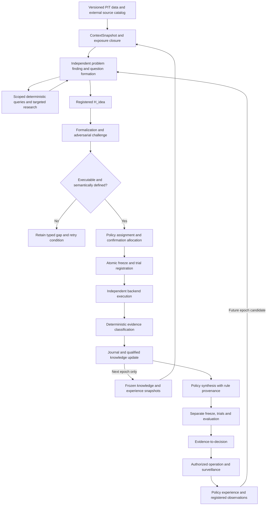

# Master Architecture

This reconstructs the source-backed target architecture. Component boundaries are logical responsibilities, not a commitment to twelve services or twelve agents. Concrete persistence, runtime topology and unresolved semantics remain proposals. Read decisions, definitions and open issues together.

## Scientific invariants

1. The LLM invents H_idea; independent code evaluates the frozen executable claim (D001).
2. Missing language or data capability preserves an idea and its gap; it does not prohibit that idea (D002–D004).
3. The freeze binds the claim, evaluation, dependencies, data permissions and selection policy before confirmatory outcomes become visible (D006, D031).
4. Information exposure follows all used ancestry, including memory and queries (D014).
5. Technical invalidity, empirical outcome, evidence origin, replication and applicability are different concepts (D007, D020, D024).
6. Policy construction is another search. Evidence for its inputs is not evidence for the combined action rule (D010, D021).
7. External frameworks cannot own scientific meaning or status transitions (D022, D040–D042).
8. Material semantic or generator changes require an approved, versioned proposal with validation and rollback (D008, D026).
9. Operations can initiate research through controlled observations; they cannot rewrite research truth (D037).
10. Diagnostic quality, novelty, cost and throughput metrics are not autonomous reward functions (D028).

## Main information flow

The diagram does not imply that every hypothesis must pass through strategy synthesis or live deployment. Historical and forward runs use different admissibility and evidence-origin rules. Technical checks guard each critical transition.

## Components and owned artifacts

| ID | Responsibility | Inputs → outputs | Must not own |
|---|---|---|---|
| CMP-01 | Data, sources and Context Builder | Versioned records, feature catalog, permissions, knowledge snapshot → ContextSnapshot, QueryRecord, availability and exposure references | Scientific support status; hidden future data in context |
| CMP-02 | Discovery Runtime / Research Reasoner | Allowed snapshot and scoped tools → questions, search trajectory, H_idea, attack proposals | Final evidence, global policy edits or arbitrary evaluator access |
| CMP-03 | Formalization and Feature Specification | H_idea, definitions, certified catalog → H_exec draft, FeatureDefinition, independent golden cases, typed gaps | Post-outcome claim repair; quiet replacement of the idea |
| CMP-04 | Compiler, Freeze and Registries | Draft, certified dependencies, EvaluationPlan, exposure assessment → compiled representation, FrozenManifest, immutable TrialRecord | Choosing favorable results; approving semantic changes |
| CMP-05 | Independent Execution / Backtest Adapter | Frozen request, authorized data, cost/fill/execution versions → result artifacts, case/trade paths, diagnostics | Evidence status, discovery memory or deployment permission |
| CMP-06 | Evaluation and Evidence Engine | Valid result, frozen criteria, family/search context → EvidenceRecord and uncertainty | LLM discretionary verdicts; retroactive criterion changes |
| CMP-07 | Research Journal and Experience | Append-only events, source links, outcomes → historical records and qualified heuristics | Converting reflection into empirical support |
| CMP-08 | Market Model, Dependencies and Validity | Evidence and typed lineage → versioned KnowledgeSnapshot, affected-object flags | Erasing old tests or treating every relation as hard causality |
| CMP-09 | Policy Synthesis and Policy Experience | Qualified claims, explicit assumptions/constraints → PolicySpec, rule provenance, policy trial requests | Inheriting whole-policy validation from components |
| CMP-10 | Deployment Decision and Surveillance | Policy evidence, applicability, risk authority, operations → permission, bounded operating state, registered anomalies | Granting itself capital or upgrading research evidence |
| CMP-11 | Error Tracking and Observability | Run events, costs, artifacts → incidents, dashboards, diagnostic scorecards | A universal success score or automatic prompt changes |
| CMP-12 | Definition and Improvement Governance | Current definitions, proposed changes, validation and rollback plans → approved versions and activation records | Unapproved in-place material change |

## Roles and rights

Roles can share a process where the host preserves the same access restrictions. Different model labels alone are not independence. A deterministic validator and independent fixtures are stronger than asking the implementing model to approve its own output.

| Role | Read | Write / request | Forbidden |
|---|---|---|---|
| Discovery agent | Frozen allowed context; catalog; permitted query/source responses | Questions, ideas, trajectory, feature requests | Holdout outcomes; peer scratch state; evidence decisions |
| Critic / challenger | Candidate and same permitted evidence | Counterexamples, alternative explanations, pre-freeze revisions | Empirical support or unregistered post-freeze repair |
| Formalizer / feature spec author | Candidate, canonical definitions and catalog | Executable draft, semantic assumptions, synthetic golden cases | Unstated scientific changes or final evaluation data |
| Feature implementer | Approved feature spec and permitted development cases | Candidate implementation version | Self-certification; changed golden-case expected values |
| Feature validator | Spec, independent cases and candidate implementation | Certification/revocation record | Retrofitting scientific expectations to observed market results |
| Registry/compiler workflow | Required immutable inputs and policies | Freeze, lifecycle events, trial/dependency records | Claim invention or outcome-dependent thresholds |
| Backend executor | Frozen request and authorized evaluation partition | Raw results and execution errors | Context/knowledge edits; evidence status |
| Evidence engine | Frozen policy and validated outputs | Primary/replication EvidenceRecord | Altered hypothesis or subjective plausibility gate |
| Interpreter / memory curator | Completed qualified evidence | Narrative interpretation, derived heuristic proposal | Evidence upgrade or exposure erasure |
| Policy builder | Qualified knowledge and explicit operational constraints | Rules, assumptions, policy candidates and trial requests | Inventing unmarked market knowledge |
| Improvement proposer/composer | Development probes and permitted experience | ImprovementProposal and candidate version | Final acceptance signal; activation of a material change |
| User / authorized governance workflow | Reviewable proposal and validation report | Semantic/material approval, deployment constraints | Retroactive erasure of exposure or trial history |

## Artifact lineage and minimal data model

Every immutable artifact needs an ID, schema/definition version, creator role/version, creation time, content hash, source references and typed dependency references. Logical links must be queryable without requiring a graph database. Required domain artifacts:

- ContextSnapshot: research time, data/knowledge/experience versions, permissions and exposure closure.
- QueryRecord and ExternalSourceRecord: exact request, parameters, response reference, time, source provenance and exposure consequences.
- H_idea: claim, question, source/parent IDs, causal assertions if any and current formalization gaps.
- H_exec: precise claim, scope, condition expression, outcome, comparator, horizon, universe, parameter origin, dependency and definition references.
- FeatureDefinition / CertificationRecord: semantics, units, input availability, parameters, deterministic implementation version, independent cases and certificate state.
- EvaluationPlan: estimand, relevant effect, eligibility, exclusions, dependence, family/selection policy, N_min or trigger, stopping, null/control contract, uncertainty, replication and status mapping.
- FrozenManifest / TrialRecord: content-addressed closure of the executable request and all governing versions, data permissions, freeze time and idempotency identity.
- ExecutionResult / EvidenceRecord: raw case/result references and numerical environment; validity, origin and primary/replication outcome under the frozen policy.
- KnowledgeEntry / ExperienceEntry: separate claim or heuristic meaning, evidence references, exposure ancestry, conflicts and applicability.
- PolicySpec: rule basis, scope relation, parameter origins, assumptions, constraints, dependencies, update rules and separate evaluation plan.
- ImprovementProposal / ErrorEvent: reason, affected versions, diagnostics, validation, approval/rollback or resolution history.

Exact schemas are not recovered finished implementations. The blueprint specifies their minimal contracts. A free-text field is not a substitute for the machine semantics needed at the confirmation boundary.

## Freeze and state transitions

Original states and formulas remain in [04_DEFINITIONS.md](04_DEFINITIONS.md). The source's later historical-first choice requires a new execution branch. OPEN-01 proposes a versioned lifecycle with historical execution and prospective collection as different modes, while validity and applicability are separate dimensions. This proposal is not silently made normative here.

Regardless of storage representation, a freeze is valid only when the exact input closure is immutable, the selected evaluation plan is assigned, the confirmation allocation/exposure check passes and the trial is durably recorded. Compile and certify before this transaction. After freeze, rebuilding a representation must match the frozen compiler and semantic version; changing the claim or method creates a new record.

Retries repeat execution of the same frozen request. They do not create extra independent evidence. A result-dependent change creates a child hypothesis or policy with inherited exposure, new trial identity and a new freeze. Failed attempts remain recorded.

## Feedback and revocation

Infrastructure revocation invalidates affected evidence usability through hard dependencies. Mere genealogy, shared evidence or proposed contradictions do not all have the same propagation semantics. A degraded scientific prerequisite marks dependent policies for review according to their dependency type. It does not establish which market mechanism caused a loss.

Operations send costs, fills and incidents to Policy Experience and surveillance. Only governed monitoring can change applicability. Research receives registered questions at a later epoch, never an unmediated instruction to rescue a bad trade. Champion/challenger policy selection is itself trial-accounted.
