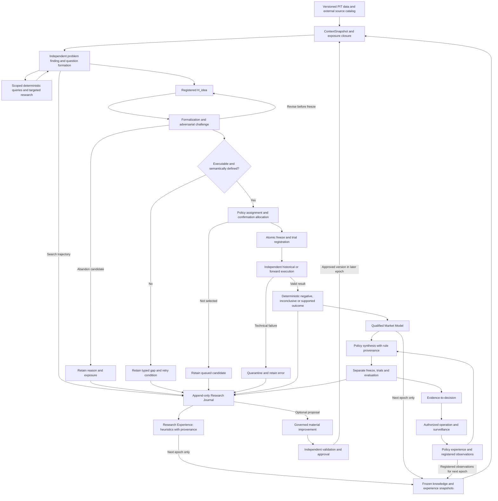

# Master Architecture

This reconstructs the source-backed target architecture. Component boundaries are logical responsibilities, not a commitment to twelve services or twelve agents. D071-D085 select a scoped persistence, adapter and semantic contract; runtime implementation and empirical validation remain absent. Read decisions, definitions and open issues together.

The [Problem Definition](01_PROBLEM_DEFINITION.md) sets the linked goals of autonomous invention with independent evaluation and substantially accelerated discovery and testing (D001, D068). The workflow below retains progress from unsuccessful research as well as supported claims. Its information paths explain responsibilities; the versioned replacement for scoped new records is research-contract/1.0, while the legacy state machine remains preserved.

## Scientific invariants

1. The LLM invents H_idea; independent code evaluates the frozen executable claim (D001).
2. Missing language or data capability preserves an idea and its gap; it does not prohibit that idea (D002–D004).
3. The freeze binds the claim, evaluation, dependencies, data permissions and selection policy before confirmatory outcomes become visible (D006, D031).
4. Information exposure follows all used ancestry, including memory and queries (D014).
5. Technical invalidity, empirical outcome, evidence origin, replication and applicability are different concepts (D007, D020, D024).
6. Policy construction is another search. Evidence for its inputs is not evidence for the combined action rule (D010, D021).
7. External frameworks cannot own scientific meaning or status transitions (D022, D040–D042).
8. Material semantic or generator changes require an approved, versioned proposal with validation and rollback (D008, D026).
9. Operations can initiate research through controlled observations; they cannot rewrite research truth (D037).
10. Diagnostic quality, novelty, cost and throughput metrics are not autonomous reward functions (D028).

## Main information flow

The diagram does not imply that every hypothesis must pass through strategy synthesis or live deployment. Historical backtests are the primary research environment (D013); fresh confirmation has separate admissibility, allocation and evidence-origin rules (D014, D023). Processing years of existing data is distinct from waiting years for new outcomes. D071/D075/D082 and document 14 now specify the scoped lifecycle, evaluation/stopping rules and batch allocation.

Abandonment after a pre-freeze attack, a retained capability gap, an inconclusive result and technical failure are not interchangeable with a frozen empirical negative. Any stage can report technical failure through error tracking; the execution branch illustrates that shared path. Valid negative results follow the frozen policy. Early formal evaluation requires the pre-frozen sequential policy in DEF-022; a fixed-horizon test still obeys DEF-021. Revision before freeze retains trajectory and exposure; revision after freeze creates a descendant. These boundaries allow fast elimination without promising that every claim can be decided quickly.

All branches retain their records. Gaps may return for formalization when the relevant capability changes; unselected candidates remain available under the allocation policy. Their experiences can inform later permitted snapshots without granting empirical support. Qualified Market Model entries retain negative/conflicting evidence and limitations as well as support. Policy synthesis may also introduce explicitly registered untested assumptions and operational constraints (D021); it is not gated on a compulsory positive entry effect (D017, D048).

## Components and owned artifacts

| ID | Responsibility | Inputs → outputs | Must not own |
|---|---|---|---|
| CMP-01 | Data, sources and Context Builder | Versioned records, feature catalog, permissions, knowledge snapshot → ContextSnapshot, QueryRecord, availability and exposure references | Scientific support status; hidden future data in context |
| CMP-02 | Discovery Runtime / Research Reasoner | Allowed snapshot and scoped tools → questions, search trajectory, H_idea, attack proposals | Final evidence, global policy edits or arbitrary evaluator access |
| CMP-03 | Formalization and Feature Specification | H_idea, definitions, certified catalog → H_exec draft, FeatureDefinition, independent golden cases, typed gaps | Post-outcome claim repair; quiet replacement of the idea |
| CMP-04 | Compiler, Freeze and Registries | Draft, certified dependencies, EvaluationPlan, exposure assessment → compiled representation, FrozenManifest, immutable TrialRecord | Choosing favorable results; approving semantic changes |
| CMP-05 | Independent Execution / Backtest Adapter | Frozen request, authorized data, cost/fill/execution versions → result artifacts, case/trade paths, diagnostics | Evidence status, discovery memory or deployment permission |
| CMP-06 | Evaluation and Evidence Engine | Valid result, frozen criteria, family/search context → EvidenceRecord and uncertainty | LLM discretionary verdicts; retroactive criterion changes |
| CMP-07 | Research Journal and Experience | Append-only events, source links, outcomes → historical records and qualified heuristics | Converting reflection into empirical support |
| CMP-08 | Market Model, Dependencies and Validity | Evidence and typed lineage → versioned KnowledgeSnapshot, affected-object flags | Erasing old tests or treating every relation as hard causality |
| CMP-09 | Policy Synthesis and Policy Experience | Qualified claims, explicit assumptions/constraints → PolicySpec, rule provenance, policy trial requests | Inheriting whole-policy validation from components |
| CMP-10 | Deployment Decision and Surveillance | Policy evidence, applicability, risk authority, operations → permission, bounded operating state, registered anomalies | Granting itself capital or upgrading research evidence |
| CMP-11 | Error Tracking and Observability | Run events, costs, artifacts → incidents, dashboards, diagnostic scorecards | A universal success score or automatic prompt changes |
| CMP-12 | Definition and Improvement Governance | Current definitions, proposed changes, validation and rollback plans → approved versions and activation records | Unapproved in-place material change |

## Roles and rights

Roles can share a process where the host preserves the same access restrictions. Different model labels alone are not independence. A deterministic validator and independent fixtures are stronger than asking the implementing model to approve its own output.

| Role | Read | Write / request | Forbidden |
|---|---|---|---|
| Discovery agent | Frozen allowed context; catalog; permitted query/source responses | Questions, ideas, trajectory, feature requests | Holdout outcomes; peer scratch state; evidence decisions |
| Critic / challenger | Candidate and same permitted evidence | Counterexamples, alternative explanations, pre-freeze revisions | Empirical support or unregistered post-freeze repair |
| Formalizer / feature spec author | Candidate, canonical definitions and catalog | Executable draft, semantic assumptions, synthetic golden cases | Unstated scientific changes or final evaluation data |
| Feature implementer | Approved feature spec and permitted development cases | Candidate implementation version | Self-certification; changed golden-case expected values |
| Feature validator | Spec, independent cases and candidate implementation | Certification/revocation record | Retrofitting scientific expectations to observed market results |
| Registry/compiler workflow | Required immutable inputs and policies | Freeze, lifecycle events, trial/dependency records | Claim invention or outcome-dependent thresholds |
| Backend executor | Frozen request and authorized evaluation partition | Raw results and execution errors | Context/knowledge edits; evidence status |
| Evidence engine | Frozen policy and validated outputs | Primary/replication EvidenceRecord | Altered hypothesis or subjective plausibility gate |
| Interpreter / memory curator | Retained research trajectories, errors, gaps and qualified evidence | Narrative interpretation, derived heuristic proposal | Evidence upgrade or exposure erasure |
| Policy builder | Qualified knowledge and explicit operational constraints | Rules, assumptions, policy candidates and trial requests | Inventing unmarked market knowledge |
| Improvement proposer/composer | Development probes and permitted experience | ImprovementProposal and candidate version | Final acceptance signal; activation of a material change |
| User / authorized governance workflow | Reviewable proposal and validation report | Semantic/material approval, deployment constraints | Retroactive erasure of exposure or trial history |

## Artifact lineage and minimal data model

Every immutable artifact needs an ID, schema/definition version, creator role/version, creation time, content hash, source references and typed dependency references. Logical links must be queryable without requiring a graph database. Required domain artifacts:

- ContextSnapshot: research time, data/knowledge/experience versions, permissions and exposure closure.
- QueryRecord and ExternalSourceRecord: exact request, parameters, response reference, time, source provenance and exposure consequences.
- H_idea: claim, question, source/parent IDs, causal assertions if any and current formalization gaps.
- H_exec: precise claim, scope, condition expression, outcome, comparator, horizon, universe, parameter origin, dependency and definition references.
- FeatureDefinition / CertificationRecord: semantics, units, input availability, parameters, deterministic implementation version, independent cases and certificate state.
- EvaluationPlan: estimand, relevant effect, eligibility, exclusions, dependence, family/selection policy, N_min or trigger, stopping, null/control contract, uncertainty, replication and status mapping.
- FrozenManifest / TrialRecord: content-addressed closure of the executable request and all governing versions, data permissions, freeze time and idempotency identity.
- ExecutionResult / EvidenceRecord: raw case/result references and numerical environment; validity, origin and primary/replication outcome under the frozen policy.
- KnowledgeEntry / ExperienceEntry: separate claim or heuristic meaning, evidence references, exposure ancestry, conflicts and applicability.
- PolicySpec: rule basis, scope relation, parameter origins, assumptions, constraints, dependencies, update rules and separate evaluation plan.
- ImprovementProposal / ErrorEvent: reason, affected versions, diagnostics, validation, approval/rollback or resolution history.

Exact schemas are not recovered finished implementations. The blueprint specifies their minimal contracts. A free-text field is not a substitute for the machine semantics needed at the confirmation boundary.

## Freeze and state transitions

**Current intent versus preserved lifecycle:** D013/D053 establish historical-first primary research. DEF-016 and the original formulas remain in [04_DEFINITIONS.md](04_DEFINITIONS.md) for provenance; the prospective transition list does not require all research to wait for future observations. D071 now adopts the versioned historical/forward branch and distinct axes in document 14 section 1. Historical execution reaches readiness from the frozen information trigger without calendar waiting. Legacy records retain their original definition version and unknown fields; the approval does not fabricate a completed runtime migration.

Regardless of storage representation, a freeze is valid only when the exact input closure is immutable, the selected evaluation plan is assigned, the confirmation allocation/exposure check passes and the trial is durably recorded. Compile and certify before this transaction. After freeze, rebuilding a representation must match the frozen compiler and semantic version; changing the claim or method creates a new record.

Retries repeat execution of the same frozen request. They do not create extra independent evidence. A result-dependent change creates a child hypothesis or policy with inherited exposure, new trial identity and a new freeze. Failed attempts remain recorded.

### Evaluation boundary across selection and reuse

D014/D031/D046/D070 apply before and after the final rule is chosen. A candidate-level plan evaluates that frozen claim or policy on admissible evidence. A procedure-level plan evaluates the specified search or adaptation process, including its permitted fitting, selection and feedback. Nested evaluation is one possible design, not a mandatory architecture stage. Selecting columns or transformations on outer outcomes before refitting in folds does not establish an independent procedure assessment. The [scientific supplement](07_SCIENTIFIC_EVALUATION.md#overfitting-controls-across-the-research-process) explains the distinction and method limits.

CMP-01 owns actual input/availability and exposure closure; CMP-02/03 retain search and fitting provenance; CMP-04 binds that closure and the assigned plan; CMP-06 judges only the inference permitted by it. CMP-07 and CMP-11 retain the origin of assessment information used through memory or diagnostics, including coarse pass/fail or ranking feedback. Using such information to select a descendant carries exposure into its next context. Retaining a valid original result and denying its reuse as independent confirmation for a changed descendant are compatible. Existing records/interfaces carry these facts; they do not require a separate service or a new lifecycle enum.

## Feedback and revocation

The loops have different authority (D019, D026, D037):

| Loop | Feedback and destination | Permitted consequence |
|---|---|---|
| Market knowledge | Valid qualified evidence -> Market Model -> later context | Use claims with their origin, uncertainty, scope and dependencies |
| Research experience | Search trajectories, abandoned ideas, gaps, errors and test outcomes -> Journal -> heuristic interpretation -> later context | Guide search; do not upgrade evidence or conceal inherited exposure |
| Policy experience | Separate policy tests and operations -> Policy Experience / surveillance -> policy research or registered later research observations | Diagnose construction and operating behavior; no direct rewrite of market truth |
| Material improvement | Observed research/process problems -> versioned proposal -> independent validation and approval -> later researcher configuration | Activate an authorized change; rollback preserves failed probes and exposure |

Feedback availability is not proof that learning improves results. Framework-level improvement requires the separate assessment in D025/D068. Entry, evolving-state and completed-path diagnostics can accelerate reuse through the Column Library, but retain their time semantics and do not create independent evidence (D044-D046).

D069-D070 make this separation operational through the [Generator Feedback and Evaluation Contract](13_GENERATOR_FEEDBACK_AND_EVALUATION.md). CMP-07 records observations, heuristic interpretations, review triggers and later use separately; CMP-01 propagates exposure through retrieval, CMP-11 reports cohorts and diagnostics, and CMP-06 retains exclusive evidence authority. IF-08 records a use before its downstream result, including early gaps/errors. Candidate improvements and final assessment remain separated under CMP-12. More memory, fewer duplicates or easier compilation alone cannot establish economic improvement.

The economic objective is profitably usable hypotheses after realistic costs, not superiority to quantitative firms or another generator. Unknown success does not block construction or a valid scoped investigation. Absolute-usefulness assessments require their own economic criteria; only comparison claims require a competing configuration or workflow. D068 still evaluates process acceleration, while D015 and independent statistical controls retain their existing scope.

Infrastructure revocation invalidates affected evidence usability through hard dependencies. Mere genealogy, shared evidence or proposed contradictions do not all have the same propagation semantics. A degraded scientific prerequisite marks dependent policies for review according to their dependency type. It does not establish which market mechanism caused a loss.

Operations send costs, fills and incidents to Policy Experience and surveillance. Only governed monitoring can change applicability. Research receives registered questions at a later epoch, never an unmediated instruction to rescue a bad trade. Champion/challenger policy selection is itself trial-accounted.

D087's [temporal diagnostic invocation contract](16_TEMPORAL_DIAGNOSTIC_INVOCATION.md) makes that governed monitoring runnable without a human reminder when a bound plan's eligible completed-outcome batch reaches its frozen checkpoint. Each intended use also checks scope and freshness. CMP-01 supplies versioned eligible data; CMP-10/11 route and retain due checks; CMP-06 alone evaluates approved scientific rules; CMP-08 records permitted time-scoped applicability. Missing capability or information remains visible. No evidence rewrite or live authority follows from an alarm.

D088's [monitoring visibility and reporting contract](17_MONITORING_VISIBILITY_AND_REPORTING.md) uses the same records and CMP-11 dashboard for a weekly wall-clock report, including weeks without new data, and prompt notices for actionable events. CMP-12 can launch an authorized bounded method-comparison plan once ready and retain its outcome for review; it cannot automatically adopt a scientific method. The LLM may render a source-linked message but has no evidence or capital authority. Reporting ticks do not advance D087's quantitative checkpoints.

## Adopted bounded implementation contract

[Research-contract/1.0](14_RETAIL_RESEARCH_CONTRACT.md) governs the initial work unit without changing the component graph. CMP-01 brokers verified inputs; CMP-02 uses two isolated sequential perspectives and bounded calls; CMP-03 preserves free ideas while formalizing typed AST drafts and feature specifications. CMP-04 compiles and independently certifies approved meanings, then commits registry, freeze and allocation in one SQLite transaction with canonical envelopes and content-addressed external blobs. CMP-05 returns raw execution facts; CMP-06 alone applies the frozen scientific policy. Both share a verified immutable manifest, not model-visible evaluator storage.

CMP-07/08 retain qualified outcomes, invalidity, dependencies and exposure. A report separates scientific outcome from STOP/RETAIN_GAP/CONTINUE_WITHIN_BUDGET/QUEUE_FURTHER_EVIDENCE. CMP-09 requests separate policy trials under realistic costs or explicitly qualified scenarios; CMP-05 executes them and CMP-06 alone evaluates their evidence. CMP-10 has no order authority in v1. CMP-11/12 observe cohorts, costs and declared success gates, with governed changes. New meanings remain subject to D008/D026; routine conformance within D084's envelope does not need repeated approval.

A normal historical path may finish with supported, negative or inconclusive evidence. An unavailable primitive exits with a retained gap; invalid data exits without a market verdict; budget exhaustion terminates without favorable partial release. All are retrievable inputs to later governed work, not automatic Market Model truth.

## Agent inquiry discipline

D086 adopts [agent-inquiry/1.0](15_AGENT_INQUIRY_DISCIPLINE.md) within existing responsibilities. CMP-02 identifies the object and clarification purpose, permits open exploration and challenges assumptions without an objection quota. CMP-03 exposes changes between the original question and H_exec through its semantic-difference/gap path. CMP-07 retains concise sourced investigation summaries separately from interpretations. CMP-06 continues to apply only the frozen scientific policy. IF-02/03/08 carry the records; existing work boundaries and budgets support review without a new controller, score, role or per-tool form. No runtime behavior or improvement has been demonstrated.

## Implemented infrastructure boundary

The approved [local coordination slice](09_IMPLEMENTATION_BLUEPRINT.md#implemented-local-coordination-slice) now supplies a runnable task queue, immutable scoped artifacts, authenticated worker identities, fenced attempts and trusted operational completion checks. Its generic time/event triggers do not implement scientific checkpoints or report delivery. This is partial infrastructure for existing components, not a new scientific authority or a completed component graph. A task's technical completion cannot write an EvidenceRecord, activate a method or authorize capital. The [runtime guide](../../trading_researcher/README.md) and [verification](../reviews/LOCAL_COORDINATION_VERIFICATION_2026-10-24.json) state the exact implemented and tested boundary.
