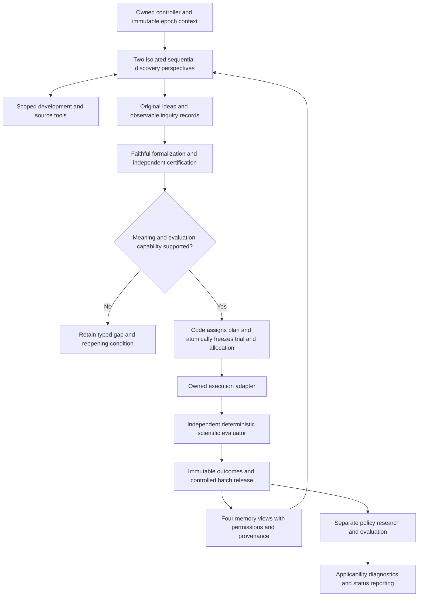

# Integrating the researcher, memories and scientific evaluation

October 24, 2026 — **PROPOSED ONLY.** This report recommends an integration; it does not adopt a new contract, authorize a paid run, or implement the proposed capabilities.

## Recommendation

Extend the existing local controller with a small provider adapter, a controlled research loop, four typed memory views, and an independently implemented scientific pipeline. Keep durable records and scientific authority in the owned application. Start with direct provider API/SDK calls; introduce additional orchestration infrastructure only for a demonstrated missing capability.

“Brain” is a useful informal name for the model plus the loop that supplies context and routes its tool requests. Anthropic uses the term this way while separating it from tools and durable session history ([V3](SOURCES.md)). It is not another indispensable AI component. Our missing capabilities are specific and already largely specified: open discovery, faithful formalization, research memory, scientific freeze and evaluation.

This is the best fit to the inspected constraints, not a benchmark-proven global optimum. The conclusion follows from the [system reconstruction](SYSTEM_MODEL.md), the [primary-source register](SOURCES.md), and the approved [retail contract](../../architecture/14_RETAIL_RESEARCH_CONTRACT.md). Provider quality, retrieval effectiveness, calibration, costs and economic usefulness still need measurement.

## What exists and what must be built

The controller already provides jobs, immutable context/artifact storage, scoped broker access, attempts, leases, operational release, generic schedules and recovery. Its current workers perform source-copy and arithmetic demonstrations. Those are useful infrastructure checks, but there is no connected open LLM research loop or complete scientific evaluator. The AmiBroker utility demonstrates a bounded data round trip, not general strategy evaluation. Detailed source links and limits are in the [system model](SYSTEM_MODEL.md#implementation-and-reuse-evidence).

The proposal preserves free `H_idea` invention and the five expressive claim forms of the accepted AST. It does not turn discovery into enumeration of a signal catalog. A finite implementation can support a subset of executable semantics initially, while retaining unsupported ideas accurately as gaps. A complete integration claim requires the full accepted scope and corresponding evidence; a first vertical slice must be labeled partial.

The diagram shows logical roles; it does not require separate services or separate models. Released information can influence later epochs only with inherited exposure. Nothing in this flow submits orders.

## 1. LLM researcher: direct adapter inside a bounded loop

### Choice of orchestration

| Option | Fit and benefit | Cost or unresolved issue | Recommendation |
|---|---|---|---|
| Existing controller plus direct provider API/SDK | Reuses current ownership, durable artifacts, retries and context boundary; a small loop can implement model-directed tool use | We must implement call bookkeeping, budget enforcement and provider normalization | **Start here**, consistent with D077 |
| General agent SDK around the same owned interfaces | Can package recurring loop/tracing behavior; OpenAI documents this as an alternative to application-managed tool calling | Must show that hidden state, handoffs, retries and memory preserve our boundaries; may duplicate the controller | Add only for a measured capability or maintenance benefit |
| Hosted managed-agent runtime | A possible supplier of durable sessions and execution infrastructure; newer Anthropic guidance describes this separation | Need validated export, access control, provenance, cancellation, costs and reproducible configuration; hosted history cannot become the sole scientific registry | A later adapter option, not a prerequisite |
| Broad autonomous platform with automatic skill/memory changes | Potential convenience for general tasks | Unreviewed changes can alter the generator, retrieval and exposure mid-epoch | Do not enable those behaviors for scientific runs; Hermes remains an optional bounded adapter under D041/D077 |

The source basis for model-directed tool interaction is A1 and V1/V5; choosing this repository's existing controller is a project engineering deduction. No provider or model is declared the winner without a framework-specific comparison.

### Proposed loop and adapter contract

1. The controller creates an epoch profile: approved contract IDs, frozen base context, data and memory versions, tool allowlist, model/prompt configuration, budget and stopping conditions.
2. Run the two accepted discovery perspectives sequentially. Give each the same permitted base snapshot and private scratch. Exchange completed artifacts only at the approved boundary. Two labels or two model vendors do not prove independence.
3. A provider call receives explicit messages and tool schemas. Its normalized response contains public output, requested tool calls, refusal/incomplete/error status, provider request ID and reported usage. Retain exact submitted/returned artifacts where available, with credentials excluded. Do not request or depend on private chain-of-thought.
4. The host validates and authorizes each requested operation. Initial tools are scoped source lookup, development-data measurements, memory lookup, capability inspection, idea submission and gap registration. No arbitrary shell, filesystem, network or evaluator-data access is exposed to the model.
5. Each returned observation is recorded before the next model call. A provider retry, timeout or partial response remains an attempt in the same causal history. Ambiguous delivery/usage is recorded as unknown; a local idempotency key does not promise exactly-once provider billing.
6. The host terminates or hands off according to the existing resource and scientific rules. It preserves unfinished and overflow ideas. No extra reasoning loop changes an inconclusive result into support.

Keep the immutable base snapshot separate from the growing run transcript. Each tool return adds an append-only observation and a derived context reference; it does not edit the original snapshot. Formalization and freeze must include every piece of information actually shown, including search snippets and returned metadata, not only the sources the model chooses to cite. Retain required provider continuation state inside the same role boundary; resetting the prompt must not reset exposure or budget history.

D079 already specifies two perspectives, at most 12 total model calls across discovery/challenge/formalization, 80,000 input-plus-output tokens, 30 minutes per epoch and eight frozen primary claims. These are ceilings, not targets. The host should reserve worst-case remaining output and currency allowance before dispatch and reconcile actual usage afterward. Separate the accepted batch/calibration compute caps from model caps. Unknown billing stays visible; a paid run requires its own currency cap and credentials. This report performs no paid research run and estimates no unmeasured savings.

## 2. Memory: one registry, four views with different authority

Use the existing single-writer SQLite direction, extending domain records and replayable projections rather than installing four unrelated memory products. Large blobs follow D078's staged, content-addressed storage contract. Current generic artifact tables are a foundation; they do not yet implement this domain model.

| Memory | What it retains | Write authority and use |
|---|---|---|
| Research Journal | Ideas, queries, observations, sources, abandoned paths, gaps, freezes, attempts and outcomes | Host records actual events; models may submit labeled drafts. Complete history remains the reference for audits and recovery |
| Market Model | Qualified findings, uncertainty, scope, evidence dependencies, contradictions and applicability | Only validated evidence/update rules can change evidential status. A model can propose a relation or explanation, not promote it to supported |
| Research Experience | Observed failures/successes and separately labeled interpretations about how to investigate | A reflection is an unverified heuristic with provenance until separately assessed. Retrieval and actual use are logged |
| Policy Experience | Separate policy trials, implementation assumptions, costs, fills, risks and incidents | Operational and simulation experience stays distinguishable from market evidence; a loss cannot rewrite an original scientific result |

Proposed common record fields are `record_id`, `record_type`, `schema_version`, `created_at`, `source_ids`, `parent_ids`, `scope`, `exposure_ids`, `authority/status`, and links to superseding or contradictory records. Type-specific records add availability time, trial/plan/model versions, uncertainty or validity as appropriate. These fields refine interfaces for review; they do not replace canonical definitions. Refer to immutable large inputs by hash rather than copying them into every record.

Start retrieval with explicit metadata filters and exact/text search over authorized records. Evaluate whether a full-text index is useful before adding it; embeddings or a separate vector store are optional subsequent indexes, not truth stores. They would need measured gains on the same memory test set and a versioned retrieval policy. A graph database is not required to retain dependency edges.

The retrieval sequence should be:

1. Resolve role, epoch, snapshot, time and exposure permissions **before** search and ranking. Disallowed records must not affect snippets, counts, suggestions or ranks returned to the model.
2. Retrieve a bounded bundle containing record IDs, original passages or typed facts, provenance, scope, uncertainty and relevant conflicts. Returning fewer tokens is an optimization to test, not evidence that all important context survived.
3. Persist the query, retrieval policy/version, returned bundle and actual context use. Any summary remains a derived artifact linked to its complete source ancestry.
4. Preserve raw records and earlier versions when a summary is corrected or an entry is retired. Absence of evidence, contradiction, staleness and invalidity remain different states.

A2–A4 and V2 motivate tests for feedback quality, source recovery, temporal changes and compression loss. They do not determine our memory authority. The latter comes from D014/D019 and the [generator feedback contract](../../architecture/13_GENERATOR_FEEDBACK_AND_EVALUATION.md). In particular, compressing a test result into “avoid this pattern” does not make its descendants unexposed.

## 3. Formalization and scientific evaluation: an owned deterministic core

Structured model output can make records easier to parse. It cannot certify meaning; OpenAI explicitly notes that schema-conforming output can contain mistakes ([V6](SOURCES.md)). Use a staged boundary:

| Stage | Required behavior | Refusal/gap condition |
|---|---|---|
| Preserve idea | Keep the original claim, scope, assumptions and uncertainty | No silent rewriting into a convenient supported template |
| Formalize | Produce `H_exec` with typed AST, units, missingness, timestamps, outcome horizon and an explicit semantic mapping to `H_idea` | Ambiguous meaning or missing data/primitive/estimator remains a typed gap |
| Certify | Evaluate primitives against independently fixed semantics and golden cases | Implementer-generated expected values cannot self-certify; new scientific meaning follows D084 review |
| Assign and freeze | Code assigns estimator, effect boundary, information requirement, family/multiplicity, partition, stopping and selection rules; freeze trial and allocation atomically | Missing closure or conflicting allocation blocks assessment |
| Execute | The owned backend evaluates the frozen expression and returns reproducible inputs, outputs and validity diagnostics | Corrupt data, unsupported paths or mismatched manifest produce technical invalidity, not a market negative |
| Evaluate | Independent code applies the frozen rule and records evidence with uncertainty and origin | No post-result threshold, estimator, seed or favorable-case selection |

Begin with the adopted mean/rate contrast candidate only where its assumptions and claim type fit. Implement the joint block resampling and sensitivity envelope exactly as specified, including aligned instruments, overlapping outcomes, undefined-draw handling and the registered numerical method. The candidate still needs conformance and calibration before scientific runtime adoption. Other AST forms can remain expressive but require their own valid estimator profiles; the contrast procedure is not a universal evaluator.

For the directional profile, the lower interval bound exceeding the practical boundary supports the defined effect; an upper bound below it is negative for that practically relevant effect; otherwise the result is inconclusive. Negative does not mean proof of exactly zero. A finite dataset can finish inconclusively at its fixed cutoff. There is no requirement to wait indefinitely for more observations.

Keep backend choice downstream of semantics. A small independent reference interpreter/fixture calculator should define expected behavior for conformance; it is not a replacement baseline hypothesis generator. Vectorbt remains the recorded primary backend candidate. The existing AmiBroker utility can become an additional adapter after equivalent timing, missingness, shared-cash, costs and path fixtures pass. Neither engine decides significance. If a policy changes fills, exits or capital interaction, resimulate it rather than filtering an old trade list.

### Why not adopt a research paper's complete agent system?

POPPER is a close methodological relative, but its conditional-validity and training-independence assumptions need explicit evidence. Its adaptive sequential inference also differs from our accepted fixed-batch design ([A5](SOURCES.md)). Replacing the latter would be a scientific change requiring its own review and approval. Dwork and Cawley–Talbot reinforce the need to assess adaptive selection, rather than treating repeated feedback as independent validation ([A6–A7](SOURCES.md)).

We therefore reuse design ideas about explicit experiments and external feedback while keeping the adopted evaluator. Exposure logging is necessary for honest claims; it is not a statistical cure. Unknown historical/model exposure remains unknown, even if all software checks pass.

## 4. Three distinct evaluation layers

| Layer | What to test | What passing permits |
|---|---|---|
| Agent and memory behavior | Tool permissions, exact provenance, budget enforcement, source retrieval, faithful mappings, preserved failures, contradiction handling, recovery and actual saved outcome | A bounded claim that the workflow performs these operations correctly |
| Scientific computation and calibration | Independent fixtures, freeze/allocation integrity, appropriate null/boundary/alternative/dependence worlds and the actual selection process at its declared stage | Only the validity/calibration scope supported by those tests |
| Economic usefulness and acceleration | Separately frozen policy, realistic costs/risk, admissible assessment, and matched prior workflow with uncertainty and failures retained | The corresponding economic or efficiency claim, only after evidence exists |

V4/V8 support transcript and outcome tests for agents. They do not authorize substituting LLM grades for scientific inference. Human review and an optional calibrated model rubric can help identify ambiguous formalization or poor explanations; neither may award empirical support. Testing must include unusual retained ideas, not reward converting everything into executable templates or generating easy rejections.

Use development cases for prompt/retrieval/model tuning and separately reserved assessment cases for a reported improvement. Log evaluated variants and failed/pending runs. A full-process calibration must rerun the actual discovery, selection and feedback opportunities; evaluating a fixed calculator alone cannot satisfy it. Preserve D081's staged approach: full causal attribution of generator improvement is not a prerequisite for a first informative historical study.

## 5. Monitoring and reporting integration

Connect the existing generic scheduler to the domain events already adopted in D087/D088. A completed-outcome event must verify maturity, availability and the bound plan before creating a due diagnostic job. A 15-minute bar cannot masquerade as a completed 24-hour outcome. Corrections retain checkpoint identity and causal history.

Authorized method comparisons start when their prerequisites are ready; otherwise persist the exact missing input and reopening condition. Weekly status reporting remains independent of scientific checkpoints and reports pending/blocked state even without new data. Use a durable, deduplicated delivery outbox and retain delivery failures. An LLM can render a source-bound report; a deterministic template must still be able to report status. The quantitative method and notification destination are unresolved inputs, not choices silently made by this proposal. No message or automation is created by this review.

## 6. AI Psychiatry: apply observable controls selectively

The explicitly invoked [AI Psychiatry skill](C:/Users/monoi/.codex/plugins/cache/openai-curated-remote/ai-psychiatry/0.6.0/skills/all-the-medicine/SKILL.md) was used to lock the research objective, reconstruct before recommending, track evidence and audit completion. The local package is a workflow-control source, not peer-reviewed proof of agent improvement. Its full control inventory and dispositions are in [research-state.json](research-state.json).

For the future researcher, reuse the principles already compatible with D086/D030: explicit purpose, observed finding and source, warranted conclusion, remaining uncertainty, next action, causal attempt history and bounded repair. Select a relevant control when an observable failure occurs. Do not prepend every diagnostic prompt to every call or demand private reasoning transcripts. Host code must enforce permissions, budgets and evidence authority even when a prompt fails.

Whether these additional prompts improve completion or only add latency is an empirical operational question. Compare the same task cases, tools and budget with and without the proposed prompt change; keep failures and cost. A material research-generator or retrieval change must be versioned and reviewed. Do not equate installing this plugin with completing the scientific framework or improving model weights.

## 7. Proposed delivery sequence and acceptance evidence

These are proposed implementation packages, not an instruction to start them now. Each package has a bounded outcome; later claims require their own evidence.

| Package | Deliverable | Acceptance and boundary |
|---|---|---|
| P1 — Domain records and storage closure | Versioned records for ideas, observations, gaps, four memory views, dependencies, frozen trials and allocations; blob recovery where needed | Projection replay, canonical-byte/hash fixtures, transaction conflicts and crash/backup recovery; cannot certify research from a persisted JSON object |
| P2 — Connected research and formalization | Direct provider adapter, scoped tools, two isolated perspectives, complete observed-context lineage and host-enforced budgets | Free ideas, faithful mappings or explicit gaps; refusal/partial/timeout cases; denied evaluator access; no silent meaning changes. A mock provider is only an infrastructure test |
| P3 — Scientific execution and narrow calibration | Owned AST execution adapter and the approved applicable estimator; independent cases; versioned calibration report | Existing D075/D081 requirements, including boundary/dependence worlds and uncertainty bounds. An unfinished calibration does not certify the evaluator |
| P4 — First genuine historical research slice | An actual freely invented idea traverses P1–P3 to a faithful report, with complete batch retention and later permitted feedback | A valid negative/inconclusive report is acceptable. A hand-written arithmetic example is not this result. Unsupported ideas remain visible; restricted coverage is explicit |
| P5 — Broader policy, memory and monitoring behavior | Additional certified semantics/estimators; separately assessed policy; D087/D088 domain adapters; retrieval improvements only as justified | Shared-cash/path/cost fixtures, scoped applicability and reporting tests, then economic/process assessments; no promotion to live trading |

P1–P3 have dependencies but can be developed with deterministic fixtures before paid calls. A reference example tests plumbing; it does not replace P4's freely invented idea. Initial versions of all four memory views belong in P1, even if policy experience has no real entries yet. Do not claim populated scientific knowledge merely because a table exists.

P4 still needs actual data/version/availability/rights checks, exact model/prompt settings, applicable computation profiles and a currency cap for paid execution. P5 needs cost and policy inputs and a bound diagnostic method. These are future run/readiness inputs, not blockers to delivering this proposal. No calendar schedule or implementation-cost estimate is asserted without measuring the work.

## 8. Change control, validation and rollback

| Proposed integration area | Existing authority and requirements | Decision treatment |
|---|---|---|
| Provider loop and tool access | D005/D034/D041/D077/D079; REQ-004/013/018/023 | Implement existing limits; exact provider/prompt and capabilities are explicit profiles. Material generator changes follow D026 |
| Four memories and retrieval | D014/D019/D070/D078/D083; REQ-007/008/013/016/028–030 | Preserve definitions; review/version material ranking, summarization or experience-use changes |
| Formalization and certification | D002–D004/D074/D084; REQ-002/003/011/026 | Independent certification within accepted semantics may be automatic; new meaning or uncertain membership requires review |
| Freeze, inference and separate policy | D006/D017/D021/D075/D081/D082; REQ-005/009/019/020/024/029 | Implement accepted profiles, calibrate before adoption; different inference rules require an explicitly approved scientific change |
| Diagnostics and reporting | D080/D087/D088; REQ-017/022/025 | Implement invocation/visibility, do not choose a quantitative method or capital authority implicitly |

Version schemas, provider configuration, prompts, retrieval policy, feature certificates, estimator profiles, backend adapters and the aggregate run manifest. Preserve original bytes and old definitions. Any migration needs explicit replay/compatibility checks and a backup before activation. A deployment/configuration rollback can restore a prior implementation; it cannot erase trials, failed attempts or information already seen.

The [validation plan](VALIDATION_AND_AUDIT.md) lists concrete counterexamples and maps this research deliverable to evidence. It distinguishes checks executed now from tests proposed for future implementation. Canonical architecture documents remain unchanged by this report. After an approved capability is implemented and verified, update its canonical coverage and Current State under the repository's maintenance process.

## Decision-ready conclusion

Recommend the local, owned integration above. It satisfies the architectural direction with the fewest additional dependencies and keeps future providers, retrieval indexes and execution backends replaceable. Evidence supports the mechanisms and identifies their limits; it does not establish performance of the unbuilt system.

The next implementation scope, if authorized, should be P1–P4 as a bounded end-to-end research milestone, with the stated gates and explicit partial coverage. Adding a generic “Brain” or attaching a model to the current demo alone would leave the central scientific and memory responsibilities unfinished.

## October 26 addendum: failure risks and bounded feasibility checks

**Status: user-requested review integration; investigations remain pending.** Source: the October 26 repository chat in which the user supplied Claude's three possible failure modes, discussed their evidential limits, and requested incorporation where appropriate. The original October 24 proposal above is preserved. Later implementation authorization and the immediate work priority are recorded in the [execution plan](IMPLEMENTATION_SEQUENCE_2026-10-25.md#immediate-priority-bounded-feasibility-checkpoint-october-26-2026) and [progress register](../implementation-2026-10-25/progress.json). This addendum refines that checkpoint's questions; it does not adopt the external critique wholesale, change scientific contracts or claim a completed feasibility assessment.

### Risk 1: valid computations yield too little decision-relevant information

A valid TESTED_INCONCLUSIVE result may complete a technical trial without supplying useful evidence about the claimed market relationship. If the pilot repeatedly cannot distinguish practically relevant alternatives, procedural correctness alone does not meet the research objective. An information gap can inform later question selection, but repeatedly rediscovering the same precision limit is not sufficient progress. Journal feedback, scientific evidence and framework usefulness remain distinct.

The critique's approximately 70-basis-point support threshold for 24-hour returns is an unverified simulation result, not a universal property of the pilot. Its script was not supplied here. Precision depends on condition prevalence and persistence, its relation to outcomes, dependence, horizon, missingness and the actual frozen family size. Eight claims are a cap, not a required count. A null-only interval-width exercise does not establish detection probability at relevant alternatives or show that negative classifications are generally unreachable.

Use the existing checkpoint to assess attainable precision and detection separately from error control, with explicit assumptions and uncertainty at zero, delta and 2*delta where applicable. [Contract sections 5.4 and 11](../../architecture/14_RETAIL_RESEARCH_CONTRACT.md) already require information planning and planted-effect detection; an always-inconclusive test cannot satisfy the detection gate merely by avoiding false support. An all-inconclusive authorized batch is a reason to inspect precision, effect location and retained diagnostics, not automatic proof of failure. Do not create repeated assessment batches or independent-evidence claims outside the existing allocation/exposure rules to investigate it. No new numerical stopping or success threshold is introduced here.

### Risk 2: prerequisites consume the effort intended for research

Individually defensible simulation, retention and review additions can cumulatively postpone the first genuine research report. Warning signs include repeated work without a measured benefit or removal of a named blocker, increasing projected workload costs, and a prerequisite list that expands faster than the path to that report closes. Artifact counts or dense code alone do not prove failure or that only an agent can maintain the system; the latter remains an unassessed engineering concern.

The checkpoint must connect each proposed next addition to a concrete blocker and a bounded observable result. Reuse existing calculations and evidence, measure representative resource costs, and retain the existing D030 budget/iteration discipline. Do not require proof that a synthetic model reproduces every market behavior: justify the assumptions and relevant stress cases, then state the supported scope and what remains unknown. Additional simulation families cannot by themselves establish market adequacy. Preserve unfinished work without making its completion a prerequisite for the checkpoint. No blanket ban on needed documentation or new decision records follows.

### Risk 3: technical success does not establish independent or economically useful evidence

Assess three separate limits rather than treating one successful pipeline run as their resolution:

| Limit | Bounded check and warranted interpretation |
|---|---|
| Evidence independence | Review exact model/version provenance, direct and inherited exposure, source access and permitted partition use. Unknown training exposure is neither proof of exposure nor proof of unseen history. A post-cutoff date alone does not establish clean assessment, and an uncalibrated run does not repair exposure. Preserve qualified historical findings under the adopted contract. |
| Economic feasibility | Use applicable verified cost inputs where available, otherwise clearly labeled scenarios and break-even cost curves under contract section 6. Relate costs to holding period, turnover, execution and the actual conditional payoff. A 15-minute observation grid does not require a trade every 15 minutes; a condition-minus-scope effect is not strategy net profit. Scenarios can expose implausible economics but cannot certify realistic profitability. |
| Faithful expressibility | Where existing permissions allow a genuine discovery/formalization probe, retain original ideas, mappings and typed capability gaps. Identify whether a specific missing feature, operator or evaluator blocks a relevant idea. Versioned feature references can supply measurements without every feature becoming a new AST operator. Neither a canned executable example nor the original NQ/VWAP example alone justifies changing the adopted universe or expanding the entire language. |

### What the checkpoint can decide

Keep one bounded investigation and one concise continuation decision in the existing execution/progress path. Alongside precision, computational cost and concrete blockers, include the economic scenario limits and genuine-idea mapping evidence above when available; otherwise name the missing inputs. Do not spend or access protected outcomes beyond existing authorization. Material profile, estimator, semantic or evidence-policy changes still require a reviewable D008/D026 proposal.

An early probe may identify an uninformative profile, unaffordable computation or a decisive representation gap quickly. Passing it establishes only the demonstrated feasibility scope. It does not establish final evaluator or full-process calibration, model-unseen evidence, economic usefulness or framework success. COMPUTED_UNCALIBRATED is a computation status, not scientific admission or completion of the genuine scientific research milestone. No guaranteed completion in days or new calendar deadline is inferred from the external critique.

## October 29 proposal: faithful execution of the retained single-instrument ETH idea

**ACCEPTED on October 29, 2026 as D089 / [bounded-math/1.0](../../architecture/18_BOUNDED_MATH_PRIMITIVES.md).** The user selected "Begrenzte Erweiterung freigeben (empfohlen)" after reviewing this scope. The proposal was PROPOSED_ONLY before that answer; approval does not certify its implementation. This proposal follows the [actual exploratory observation](../implementation-2026-10-25/feasibility-exploration-2026-10-29.json). Two isolated real-model perspectives invented ideas; neither has an executable formalization or completed meaning review. The second idea uses an ETH taker-buy/turnover burst, an intrabar excursion with little retained gain, a preceding 96-bar volume median and a one-hour logarithmic return. The first additionally needs paired ETH/BTC alignment. No market outcome has been calculated for either idea.

### Proposed scope and rationale

Add only the two missing mathematical specifications needed by the single-instrument second idea, in an optional versioned expression/execution profile. Preserve both original ideas, failed attempts and their exposure. Do not replace the original logarithmic return with a simple return, median with mean, or invalid/unknown conditions with false. Paired cross-instrument traversal for the first idea remains a separate retained gap; no market-outcome-based selection has occurred.

1. `trailing_median(arg, bars)` uses exactly the declared positive number of same-instrument grid observations, including the expression's anchor, with existing causal availability rules. Sort finite real values with identical units; odd windows select the middle value and even windows take the exact arithmetic mean of the two central values. Any missing/unavailable observation makes the window missing. An explicit lag places the original idea's window before its signal bar. No nearest-row substitution, shortened window, quantile interpolation choice or fitted state is introduced.
2. A natural-logarithm outcome operator accepts a dimensionless, strictly positive finite real ratio. Nonpositive, missing or unavailable input yields a named invalid/missing result; no clipping or substitution. It is initially permitted only in the outcome expression, not as a new decision-time indicator. Preserve the original future anchor and exact price keys.
3. Because logarithms are generally irrational, never label a binary-float approximation an exact rational result. The new outcome profile must retain proven outward rational bounds containing the mathematical value. For this basis-point outcome, require an interval width no greater than `10^-12` basis points per observed outcome; inability to prove that bound is a numerical gap. This is a proposed computational accuracy requirement, not an effect-size or scientific acceptance threshold. Descriptive conditional and scope means, and their difference, propagate the bounds conservatively with exact arithmetic. Do not discard those bounds in any later inference; scientific use remains unavailable until its separately required estimator/calibration work is completed.

The existing three-valued operators remain unchanged. The formalizer must demonstrate the idea's complete-input/invalid-input unknown rule using admitted composition, or retain a further semantic gap. These two proposed capabilities do not promise that all remaining mapping issues will pass review.

### Affected authority, validation and rollback

This adds language meaning under D002–D004/D074/D084, affects REQ-002/003/005/011/026 and contract sections 4 and 14, and therefore follows D008/D026. It changes no project goal, market universe, partition, delta, statistical gate, evidence rule, spending permission or live-capital authority. Approval authorizes this bounded specification and its implementation/certification; it does not approve a favorable empirical result or a larger language program.

Use an explicit new optional expression/execution version; retain `research-ast/1` and all existing source capsules/results verbatim. Independent fixed expectations must cover median ties and even/odd windows, units, absent timestamps, delay, boundaries, log domains and certified numerical enclosures; also test causality, resource limits, dependency closure, replay and conservative aggregate bounds. A separately authenticated meaning review must compare the original idea with its exact candidate. Only a faithful, qualified development candidate may produce a descriptive report. New scientific classification requires its original outstanding gates, including return-model/calibration support.

Successful acceptance requires independent implementation conformance, the original idea passing faithful meaning review, and a reproducible, bounded-error descriptive calculation. An explicit remaining gap is a valid bounded stopping outcome, but leaves the extension and research milestone incomplete; no simpler replacement is counted as completion. Rollback disables the optional profile for future work and selects the old profile, while preserving every attempt, original idea, error bound, artifact and exposure record. The context-size bottleneck is an independently measured infrastructure problem and grants no permission to truncate scientific content or enlarge the original epoch.

October 29 implementation observation: [independent conformance and owned integration](../implementation-2026-10-25/bounded-math-verification-2026-10-29.json) supported the optional primitives and descriptive enclosures. A separately recorded [actual reopening](../implementation-2026-10-25/bounded-math-observation-2026-10-29.json) fitted both model stages within its full-path reservation. It returned no executable candidate and an uncertain independent review. At that checkpoint, the plan called for a bounded offline composition check; the null response alone proved no expression limitation. Those original ideas, failures and costs remain preserved.

Later October 29 observation: the independently checked [case diagnostics integration](../implementation-2026-10-25/case-diagnostics-verification-2026-10-29.json) removed a concrete reporting gap. After one retained output-limit failure, the [bounded correction](../implementation-2026-10-25/eth-diagnostic-output-correction-2026-10-29.json) obtained a full candidate, faithful independent model judgment, qualified development calculation and separate replay. No condition-true cases occurred. Direct formula verification nevertheless found one incorrectly excluded outcome: 8,626 are observed under the original rule, versus 8,625 under the current calculation. A conformance-pass or model judgment cannot override that counterexample. Successful acceptance remains incomplete. The current execution plan permits only a separately versioned, independently checked correction to remove non-required container-row prerequisites under D089 and contract section 14.2; required missing inputs and all original scientific commitments remain unchanged.

Subsequent correction: [required-inputs/1 verification](../implementation-2026-10-25/required-input-verification-2026-10-29.json) now passes independent synthetic lifecycle tests and an explicitly separate engineering replay against the original formula: all 8,640 conditions and 8,626 observed outcomes agree, including the formerly excluded observation. The [new actual model handoff](../implementation-2026-10-25/eth-required-input-correction-2026-10-29.json) still stops before compilation on incorrectly rooted semantic pointers and absent reviewer-visible cutoff-equivalence evidence. Independent inspection refutes its additional stale-parameter-origin allegation; all 29 origins are correct. This is a verified implementation correction plus retained research-admission gaps, not completed D089 original-report acceptance or scientific readiness. The single execution plan owns the bounded offline follow-up.

## October 29 proposal: one bounded feedback-informed research epoch

**Status: ACCEPTED on October 29, 2026 (D090).** The user selected "Einmalige Ausnahme freigeben (empfohlen)" for this exact proposal. [research-epoch-feedback-budget/1.0](../../architecture/19_RESEARCH_EPOCH_FEEDBACK_BUDGET.md) records the one-use scope and approval-time source hash. Implementation and actual admission require separate verification. The original proposal below is retained as rationale; approval changes only this scoped D079 resource policy, not scientific meaning or ordinary epoch ceilings.

### Measured need and smallest bounded alternative

The original ETH idea has reached a faithful descriptive information gap with no conditioned cases. Keep its dates, thresholds, meaning, result and complete history unchanged. A separate free-discovery unit can use that closed feedback without claiming independent confirmation. The [prior input preflight](../implementation-2026-10-25/scientific-admission-boundary-2026-10-29.json) counted 139,522 initial tokens for the two perspectives. The explicit `discovery-source-view/3` reference-paging implementation reduces this to 56,230 measured tokens while preserving every idea/gap body, job/attempt description and qualification. All five original envelopes were reconstructed exactly from retained pages, and old source views remain unchanged. This is an input-size result, not proof of unchanged model quality or an admitted research run.

Even these reduced inputs plus 12,000 reserved discovery output tokens leave only 11,770 of the current 80,000-token ceiling. The last successful faithful formalization and independent review required a predeclared 79,015-token reservation. That prior reservation is a resource planning reference, not an exact prediction for an as-yet uninvented idea. Lowering output limits, omitting original meaning or failed work, splitting epochs to evade the cap, and forcing a simpler hypothesis are not approved remedies.

Approve **at most one new development-only epoch with a 240,000-token aggregate ceiling**, retaining the ordinary 80,000-token ceiling for every other epoch and the existing per-call ceiling. It retains exactly two isolated sequential perspectives, at most 12 total model calls, 1,800 seconds, no automatic retries or successor epoch, and a **USD 1 ceiling inside the existing USD 5 aggregate authorization**. Latest recorded use is USD 1.8657225, leaving USD 3.1342775; recheck the shared ledger and tariff before admission. No new provider or credential authority is granted. Continue the existing OpenAI model profile; actual mixed-provider work remains separately unverified.

The proposed tranche follows an explicit conservative reservation, not a target to consume:

| Component | Input reservation | Output reservation | Total tokens |
|---|---:|---:|---:|
| First perspective initial call | 28,238 (28,110 measured + 128 margin) | 6,000 | 34,238 |
| Second perspective initial call | 28,248 (28,120 measured + 128 margin) | 6,000 | 34,248 |
| Up to one tool-followup call per perspective | 80,000 combined (40,000 each) | 12,000 combined | 92,000 |
| One faithful formalization | 27,015 | 18,000 | 45,015 |
| Its separate meaning review | 30,000 | 4,000 | 34,000 |
| **Reserved total** | **193,501** | **46,000** | **239,501** |

These allowances preserve the ability to use the existing optional development measurement or necessary reference access, subject to exact packet admission; they do not guarantee that every tool response or future idea fits. All current access, exposure, time, lease and currency checks still apply. The two initial requests must be recounted under the actually frozen profile. Before any next call, count its entire input and reserve the remaining downstream allowance; if it cannot fit, retain the stage-specific resource gap. No truncation, automatic repair, selection by favorable outcomes or transfer of unused allowance to a new epoch follows. Preserve both generated ideas and all intermediate records. Predetermine selection of one primary idea for the reserved downstream path without outcome inspection; unsupported or ambiguous meaning remains a gap.

At the current conservative tariff, the reserved inputs/outputs bound USD 0.9437525; the remaining 499 tokens cost at most USD 0.00499 at the higher output rate. Both remain below USD 1, subject to renewed tariff/configuration checks. These are reservation calculations, not an invoice or actual new expenditure. No research inference was dispatched during this preflight.

### Validation, authority and rollback

Affected: D079 and contract section 9; D008/D026 change control; REQ-004/014/022/023/030 and shared call accounting. On approval, record this optional one-use overlay and its explicit adoption without rewriting historical contracts or granting a global larger default. Bind the single epoch to the approved overlay and persistent consumption record; test duplicate/parallel claims, rollback/restart, unknown usage, overflow and unchanged ordinary-epoch limits before actual dispatch. Preserve original call/token/time ceilings in old frozen profiles and the USD 5 ledger. Approval does not admit scientific classification, assessment data, a new effect profile, reduced review quality or capital use.

Keep the complete provider/model/version/UTC receipts, costs, elapsed time, every attempt, unsupported idea and final gap/result. Independently check any executable candidate and repeat the existing qualified computation/replay path without scientific relabeling. Source-presentation structural preservation does not establish behavioral quality equivalence; a failed or uncertain meaning review must stop the affected calculation. Reaching the finite cap is an explicit STOP/RETAIN_GAP, not scientific rejection.

Rollback disables the unused overlay for future admission; if consumed, halt further dispatch while preserving settled/pending accounting, sources, contexts and results. It never resets or recycles the single grant. Keeping the existing 80,000-token ceiling is a valid alternative and leaves this complete feedback-informed path unadmitted. No unrelated simulator, market, provider, language or workflow expansion is included.

## October 29 proposal: bounded primitive reuse and one BTC continuation

**Status: ACCEPTED on October 29, 2026 (D091).** The user instructed "fortsetzen" in direct response to the concrete pending approval request. [bounded-math-reuse/1.0](../../architecture/20_BOUNDED_MATH_REUSE.md) records the scope and exact approval provenance. The original proposal below remains rationale. This proposal is separate from the consumed and revoked D090 exception. It neither resets that grant nor activates a new hypothesis. The purpose is to reuse already implemented mathematical meanings in another faithfully formalized development hypothesis, with a finite continuation of the already selected BTC idea.

### Observed need and proposed scope

The [finite D090 attempt](../implementation-2026-10-25/feedback-research-2026-10-29.json) retains both new ideas. Its predetermined primary idea is `a83f61a8d9c99c4e8bfde5c7bc1f2c4b0ce6bf40c313b9a8dc456176f386fc32`: single-instrument BTC, the original January-March 2023 development scope, a two-bar buyer-dominance/trade-frequency condition relative to its exact preceding 16-bar baselines, and the original one-hour logarithmic outcome. Preserve its complete source, dates, thresholds, missingness, endpoint timing and diagnostic requirements. No replacement discovery or selection by outcome is proposed. The second idea and its blocked job remain unchanged.

Two observed infrastructure limits have been corrected offline: exact idea-text retention now permits 65,536 code points, and an opt-in lossless reference dictionary reduces the old complete formalization input from 30,160 to 21,230 measured tokens. Every source body and reference reconstructs exactly; this is not proof of model-quality equivalence. The [verification record](../implementation-2026-10-25/auxiliary-transport-verification-2026-10-29.json) also records the discarded policy-changing placement and restored legacy assessment currency. No inference was dispatched during these corrections.

A subsequent [finite synthetic preflight](../implementation-2026-10-25/btc-expression-preflight-2026-10-29.json) narrows one remaining uncertainty: the original condition has a source-qualified engineering representation using 214 nodes/19 levels of existing scalar AST1, with 184 declared synthetic cases matching a separately written direct formula. The retained raw definition already requires integer trade counts; no new generic integer operator or larger expression limit is shown necessary for this source. This does not activate the proposed scope, supply the eventual model candidate, establish independent meaning acceptance or verify its outcome/diagnostics. A corrected fixture expectation and the precise source-domain assumptions are retained in the evidence. No additional model/count call occurred.

[D089 / bounded-math-primitives/1.0](../../architecture/18_BOUNDED_MATH_PRIMITIVES.md) currently activates its optional primitives only for the original retained ETH idea. Approve a separately versioned `bounded-math-reuse/1.0` scope extension for **new single-instrument development hypotheses using exactly those existing meanings**: trailing median; natural logarithm only inside outcomes; outward bounded numerical results; and the already qualified required-input and diagnostic implementations. The original ETH acceptance has been completed descriptively. This proposal adds no operator, arithmetic interpretation, numerical tolerance, missingness rule, timestamp convention, effect threshold or scientific estimator.

Each new use must still establish its own exact operator membership, owned feature/reference conformance, complete original-idea mapping, current independent meaning review, required-input/availability qualification and separate execution replay. Uncertain membership or an unsupported detail remains a gap under D084 and contract section 14; approval is not a blanket certificate. Cross-instrument operations, decision-time logarithms, protected assessment and bounded scientific inference remain outside this extension. No training-independence, calibrated classification, economic usefulness or capital authority follows.

### One finite continuation and its resources

Approve **one separately recorded continuation of the retained primary BTC idea**, with no new discovery: at most one complete formalization call and one independent meaning-review call, at most 80,000 input-plus-output tokens and 1,800 seconds, and **USD 0.50 within the existing USD 5 aggregate authorization**. D090 remains consumed and revoked. This is an explicit additional continuation decision, not an automatic retry or migration of its remaining allowance. Latest aggregate usage is 597,039 tokens and a conservative USD 2.0401575; recheck the shared ledger and actual frozen tariff before admission.

| Role | Maximum input, including count margin | Maximum output | Maximum total |
|---|---:|---:|---:|
| Faithful formalizer, high reasoning | 28,000 | 18,000 | 46,000 |
| Independent meaning reviewer | 30,000 | 4,000 | 34,000 |
| **Entire continuation** | **58,000** | **22,000** | **80,000** |

At the installed dated conservative rate of USD 0.0000025/input token and USD 0.000010/output token, this bounds USD 0.365, below USD 0.50. This arithmetic is a reservation estimate, not a current price verification or invoice. A changed tariff must be revalidated against both caps. Use the existing OpenAI model profile with recorded requested/reported model, catalog version, unknown immutable snapshot where applicable, UTC admission/settlement, elapsed time, usage and cost for every call.

Freeze both full inputs under the tested optional lossless wire representation. Count the actual formalizer packet before admission and the complete resulting reviewer packet before its dispatch. The old 21,230-token measurement is not a forecast for these changed packets. Keep the entire 34,000-token review allowance reserved downstream; stop with a retained gap if any exact input plus margin exceeds its slot. Do not truncate meaning, lower reasoning/output allowances to force admission, omit history, silently repair the idea, repeat either call, create a successor epoch or expand scope after the finite stop. An accepted candidate additionally needs exact formula, availability, diagnostics, computation and replay checks before a descriptive report; the existing separate 30-minute computation cap remains applicable.

### Authority, validation and rollback

Affected: D008/D026 change control; the scoped D089 activation and D084 certification boundary; D079 and research-contract section 9 continuation resources; DEF-003-008/013/023/031-032; REQ-002/003/004/005/011/014/022/023/026/030. On approval, record the new optional scope/version and exact user decision in canonical registers while preserving D089, D090, all original bytes and exposure history. Ordinary epoch ceilings and scientific admission rules remain unchanged. This proposal does not itself modify those registers.

Observable acceptance is a faithful independently reviewed BTC representation and a reproducible descriptive result, or an explicit remaining stage-specific gap with all attempts and costs retained. Existing fixed mathematical expectations, bounded scientific denial, long-text lifecycle tests and lossless transport adversarial checks are required software evidence. They cannot prove the actual candidate's meaning or empirical value. Additional validity/integer constraints, expression capacity or dependency timing may still block this exact idea; those must be examined rather than inferred from the ETH result.

Rollback disables future use of the optional reuse profile and halts any unused continuation slots. It preserves newly retained records, source/version capsules, failures, accounting and exposure; it never restores a spent allowance. The original ETH path remains available in its original authorized scope. Declining approval leaves the new BTC idea retained and scientifically untested, with no further model call.

## October 29 proposal: one compact-output BTC continuation

Status: **ACCEPTED for one additional formatting-only attempt.** The user explicitly answered "Einmalige Formatkorrektur freigeben (empfohlen)" to call_0c729ac949e3405599659636532eac5c (SESSION-2026-10-29-BTC-COMPACT-OUTPUT). The original proposal bytes and exact prompt hash are retained separately. This is an operational continuation approval under unchanged D091 meanings, not a new scientific contract. D091's first finite continuation is finished with a retained output-resource gap. This proposal does not reuse its unused reviewer slot or increase its frozen caps. A direct user approval is required for the one additional paid attempt because [bounded-math-reuse/1.0](../../architecture/20_BOUNDED_MATH_REUSE.md#first-bounded-continuation) explicitly prohibits an automatic retry or successor epoch. The reusable primitive meanings remain accepted; no new scientific semantics are proposed.

### Observed problem and smallest correction

The [actual BTC attempt](../implementation-2026-10-25/btc-continuation-2026-10-29.json) received the complete approved input in 24,336 tokens, then returned an incomplete response with all 18,000 output tokens consumed, including 5,872 reasoning tokens. Its 48,592-character public text ends at `candidate.parameter_origins[63].rationale`; required feature references and the semantic report were not reached. No accepted candidate, independent model review or market calculation followed. The exact provider incomplete-reason field was not retained; output-limit exhaustion is supported by the status and cap observation, not an invented provider reason code.

The finite [offline formatting check](../implementation-2026-10-25/btc-output-format-observation-2026-10-29.json) removes only whitespace outside JSON strings. The unchanged incomplete BTC prefix becomes 25,385 characters instead of 48,592; it remains invalid and unusable. One prior complete actual ETH response becomes 27,559 instead of 39,694 characters and decodes to the exact same complete object, including all provenance and meaning mappings. Six synthetic cases also preserve string escapes, whitespace inside strings, Unicode and nested values. These are character savings, not measured token savings or proof that the missing BTC content will fit.

Append only this exact instruction to the existing full formalizer prompt, with a new explicit prompt version. Keep the model, high reasoning setting, every input and output schema, all source and parameter references, semantic mapping and independent reviewer policy unchanged:

> Output serialization only: emit the entire final JSON object compactly, with no indentation, line breaks or whitespace outside JSON strings. Preserve every required key, complete AST, parameter origin, source reference, feature reference and semantic-report mapping. Do not abbreviate, omit, summarize, repair or change any scientific content. Whitespace inside strings must keep its intended content. If a faithful candidate is unavailable, retain the full required explicit gap report using the existing schema. This instruction changes formatting only; all earlier requirements still apply.

The exact proposed prompt is retained locally at `.trf-runtime/btc-continuation-2026-10-29/proposed-compact-formalizer-prompt.txt`; SHA-256 `87e1c8ae4c820a88c517cfc7f15f6aff4355a5ff36bc888708bf5b24f00acc0b`. No decoder change, field omission, partial-candidate repair, model downgrade or scientific threshold change is proposed. The model must itself return the complete final object; the current parser and acceptance gates remain decisive.

### Finite execution, validation and rollback

Only after direct approval, create one separately recorded ordinary epoch for the same original BTC idea. Allow at most one formalization call and one independent meaning-review call, 80,000 combined tokens, 1,800 seconds and USD 0.50 within the unchanged shared USD 5 budget. Keep the fixed slots: formalizer input 28,000 including margin / output 18,000; reviewer input 30,000 including margin / output 4,000. The same conservative tariff bounds all 80,000 reserved tokens at USD 0.365; reverify tariff/ledger and count each actual complete input before dispatch. Do not lower reasoning, truncate sources or redistribute reserved slots to force admission. Current aggregate use is 639,375 tokens and conservatively USD 2.2809975, leaving USD 2.7190025; unused funds are not automatic authorization.

Pre-dispatch validation must confirm the new prompt is exactly the old prompt plus the quoted suffix, verify the pinned activation supplement and unchanged runtime/reviewer policy, reserve both roles, and retain a fresh unique run-start fence outside registry rollback. The old D090 and D091 attempts, responses, counters and source hashes stay preserved. If formalization completes, require the same independently qualified original-meaning and exact BTC timing/diagnostic checks before deterministic calculation, separate replay and direct-formula audit within the existing separate 30-minute computation cap. If any stage fails, preserve the specific gap and consumption and end this attempt without automatic retry, new discovery or successor epoch.

Rollback is to decline/disable this proposed prompt for future jobs while retaining all observations and charges. No change to D008/D026/D079/D084/D089/D091, required-inputs/1, case-diagnostics/2, data scope, evidence rules, calibration, protected access or capital authority is proposed. This is an engineering correction affecting REQ-002/004/013/023/026; successful serialization alone would not establish research quality, scientific validity or profitability.

## October 29 proposal: one independent BTC review call

Status: **ACCEPTED for exactly one independent review call.** The user answered "Einen Prüferaufruf freigeben (empfohlen)" to call_2d702ce2c2fb4cf3a8f49d907994a792 (SESSION-2026-10-29-BTC-REVIEW-ONLY). Original proposal bytes and exact source hashes are preserved separately. The compact-output attempt completed formalization unchanged and stopped before review because the full actual review input exceeded its fixed slot. This proposal preserves both closed attempts and their costs; it does not reuse or enlarge their frozen grants.

### Exact object and purpose

Review only formalization `c6b85475ab4a4b4a2657d46ecbe8b0a1517ae45fcf8de389345e65904ca91415` of the same original BTC idea. The retained formalization is STRUCTURE_CHECKED, not scientifically or semantically admitted. Its complete candidate, original text, parameter origins, feature evidence, reporting contracts and meaning mapping already exist. The full independent-review packet is retained at `.trf-runtime/btc-compact-continuation-2026-10-29/review-packet.json`, file SHA-256 `990cce42ff363990f4031f74c5727f1e32b74a3a79d25d342561f414d0e316f5`. The actual input-count receipt is 34,934 tokens, or 35,062 with margin, against the closed attempt's fixed 30,000 slot. No paid reviewer call was made. The original formalizer must not run again and no candidate field may be manually repaired.

The [actual continuation and independent offline review](../implementation-2026-10-25/btc-compact-continuation-2026-10-29.json) records what is verified and what remains uncertain. Offline synthetic agreement cannot replace the required separate model review. The next discriminating action is one actual unchanged `meaning-comparison/1` judgment on this exact complete target.

### Proposed one-use bounds and checks

After direct approval only, use one new ordinary epoch with **at most one model call, 40,000 total tokens, 600 seconds and USD 0.15** inside the existing shared USD 5 budget. Reviewer input cap: 36,000 including count margin; output cap: the unchanged 4,000. Keep the existing GPT-6.1 Sol reviewer profile, reasoning setting, complete prompt, scope supplement and all content; no model downgrade, compression, truncation, source selection or format change. These fixed maximum slots cost at most USD 0.13 at the recorded conservative USD 2.50/million input and USD 10/million output; reverify tariff and ledger before dispatch. Recount the complete actual packet and match its normalized source identity and unchanged wire content, apart from authorized input reservation/configuration metadata. Actual 35,062+4,000 reservation would be 39,062 tokens and USD 0.127655. Character-size measurements are not used for admission.

The completed compact attempt consumed 41,192 tokens. Adding the actual review reservation would require 80,254, exceeding its original 80,000 ceiling by 254. Neither unused dollars nor a smaller observed future response permits silently relaxing that ceiling or reducing the reviewer output allowance. A separate explicitly authorized review-only epoch stays within the ordinary contract and preserves full accounting and exposure.

Retain a fresh unique run-start fence outside registry rollback, the exact approved target/context/policy/source hashes, the existing formalizer identity and a distinct authenticated reviewer identity. The schema's two discovery identities may be retained as operational placeholders, but no discovery job or call is authorized; the host epoch call ceiling is one. No automatic retry, response-completion call, second reviewer, re-formalization or successor epoch is allowed. A refusal, incomplete output, uncertain/different meaning, admission failure or limit ends this attempt with the precise retained gap.

If and only if the exact candidate satisfies current independent meaning review and the existing offline timing/diagnostic qualifications, proceed to deterministic development compilation/data-use assessment, calculation, separate replay and the previously frozen independent original-formula audit within the existing separate 30-minute computation allowance. Protected outcomes, scientific classification and capital authority remain unavailable. A reviewer judgment is not empirical success or proof of profitability.

### Rationale, versioning and rollback

This adds only one bounded operational continuation under D079/D084/D089/D091 and REQ-002/004/013/023/026; it changes no scientific definition, primitive, source scope, estimator, output field, quality gate or prior version. Rollback declines or cancels the unstarted review-only operation; once dispatched, retain its full response, failure, lineage and cost without restoring any spent allowance. Current aggregate consumption is 680,567 tokens and conservatively USD 2.509595, leaving USD 2.490405 of USD 5. The original provider invoice and immutable model snapshot remain unverified.

### October 30 implementation outcome of the independent BTC review

The [D092 review and descriptive report](../implementation-2026-10-25/btc-review-continuation-2026-10-30.json) completes the exact approved call without another formalization. A separately versioned operational adapter preserves all legacy review source bytes and actual original/new epoch identities. Independent review is SATISFIED. All 8,640 cases and 8,625 observed outcomes pass execution replay and the original-formula comparison; the initial checker zero-count representation failure and versioned correction remain retained. The result is INFORMATION_GAP/no_conditioned_cases, not a scientific rejection or trading result. One call used 35,998 tokens and USD 0.097975 conservatively; total use is 716,565 tokens and USD 2.60757 of USD 5. The original quarter, candidate, mathematical meanings, failed attempts and protected-data restrictions are unchanged. The existing controlled feedback publication now retains the whole closed BTC cohort. No new external library, service or model provider was required.
## October 30 proposal: one complete-feedback research epoch

Status: **ACCEPTED — D093.** Direct approval: "Einmaligen Durchlauf freigeben (empfohlen)", question `call_60d5471bd6124c139e17cb325090497f`. See [the adopted version](../../architecture/22_COMPLETE_FEEDBACK_RESEARCH_EPOCH.md). The original proposed bytes are retained in the private adoption record. This proposal follows the completed ETH/BTC descriptive reports and the [finite full-feedback admission diagnostic](../implementation-2026-10-25/ordinary-admission-2026-10-30.json). It is a new, explicitly bounded resource exception under D008/D026 and [research-contract/1.0 section 9](../../architecture/14_RETAIL_RESEARCH_CONTRACT.md#9-open-09-perspectives-models-and-compute-budget). General permission to run tests does not change that contract's 80,000-token ordinary epoch limit. D090, D091 and D092 allowances remain spent and cannot authorize this epoch. No scientific meaning or project goal changes.

### Problem and recommended allocation

The two full initial discovery inputs now count 43,230 and 43,240 tokens. They already exceed an ordinary epoch before any output or downstream work. The private dictionary diagnostic saves 27.73% of these inputs but still exceeds that ceiling with fixed outputs; its model-quality equivalence is unverified and it remains inactive. Do not introduce that representation merely to make this run fit.

Authorize exactly **one** new development-only epoch, at most **420,000 aggregate input-plus-output tokens, USD 1.40, six model calls and 1,800 seconds**, all inside the original shared USD 5 ledger. Keep the existing 80,000-token per-call limit. Reserve both possible discovery followups and the full permitted input capacity of formalization and independent review before starting, rather than relying on a small historical packet or later unused capacity.

| Stage | Maximum input, including count margin | Maximum output | Full token reservation | Conservative USD bound |
|---|---:|---:|---:|---:|
| Perspective A initial | 43,358 | 6,000 | 49,358 | 0.168395 |
| Perspective B initial | 43,368 | 6,000 | 49,368 | 0.168420 |
| A optional tool followup | 74,000 | 6,000 | 80,000 | 0.245000 |
| B optional tool followup | 74,000 | 6,000 | 80,000 | 0.245000 |
| Faithful formalization | 62,000 | 18,000 | 80,000 | 0.335000 |
| Independent meaning review | 76,000 | 4,000 | 80,000 | 0.230000 |
| **Total reservation** | **372,726** | **46,000** | **418,726** | **1.391815** |

The [read-only allocation check](../implementation-2026-10-25/complete-feedback-resource-proposal-2026-10-30.json) validates both exact initial wire hashes, all six per-call limits, aggregate arithmetic and the unchanged spending ledger. The proposed rounded ceilings are hard limits, not targets; their small residual does not authorize a seventh call, extra retry or slot expansion. Without optional followups, reserving the full two downstream call capacities still needs 258,726 tokens, so simply repeating the old 240,000 ceiling would not cover this conservative path.

The current [official model tariff](https://developers.openai.com/api/docs/models/gpt-6.1-sol) was rechecked on October 30 local time: standard input USD 2, default cache writes USD 2.50 and output USD 10 per million tokens. The calculation conservatively uses USD 2.50 for every input token, with no cache-discount assumption. Each call remains below the 272,000-input-token surcharge threshold; use the existing standard/default processing configuration. Reverify applicable tariff and account configuration before actual dispatch. These are usage bounds, not a provider invoice. Prior conservative spending is USD 2.60757; using the entire proposed USD 1.40 leaves USD 0.99243 inside the unchanged USD 5 total.

### Complete path and preserved quality settings

Use the same eight authorized source identities and both complete closed ETH/BTC feedback cohorts retained by the diagnostic. Current release, source integrity, exposure, registry and ledger checks must pass again before admission. Keep two sequential isolated perspectives with identical permitted base views and separate scratch state. Retain the existing `discovery-source-view/3` and bounded paging tools; allow at most one model followup after tool use per perspective, as in the earlier six-slot design. Do not count input-count endpoint requests as model inference, and retain their separate timestamps and receipts.

Preserve the `gpt-6.1-sol` route and existing role-specific reasoning settings: discovery low, formalization high, independent review low. Formalization retains the complete compact-JSON output instruction, every source/parameter reference and semantic mapping. Keep the existing auxiliary provenance dictionary and unchanged D091 activation contract where applicable. No cheaper model, new private codec, smaller output allowance, removed evidence or weakened review is part of this proposal. Identical settings do not guarantee identical stochastic outputs or general research quality.

Fix selection before outcomes: the first perspective's final accepted primary idea is the sole candidate for the downstream reservation. Preserve both perspectives and every idea/gap; do not fall back to whichever idea produces a favorable result. Free discovery may produce unsupported ideas. Existing single-instrument median/logarithm meanings may be reused only under D091 and each hypothesis's independent checks; paired-instrument traversal, new operators and new scientific meanings remain gaps requiring their own approval.

Carry an eligible candidate through the owned formalizer, separately authenticated independent meaning reviewer, current development qualification, deterministic execution, separate replay and meaning-faithful descriptive report. Do not substitute an engineering tree or manually repair the idea. The original ETH/BTC thresholds, periods, empty conditions and INFORMATION_GAP reports remain unchanged. Protected 2024/2025 outcomes, scientific classification, calibration expansion, economic claims and capital authority are outside this exception. Existing separate computation limits still apply.

### Exact admission, failure handling and acceptance

Freeze the six-slot allocation before the first inference. The current initial counts include 128 tokens of margin each. Recount the exact initial wire if any prompt, source or tool bytes change; it must fit its reserved slot without truncation. Count every actual future packet before dispatch, including full conversation/tool-result state where applicable, against its input bound and remaining original deadline. Reserve all later stages regardless of whether an earlier stage uses its full allocation. Unused or failed-call slots cannot be recycled into retries, another candidate or a successor epoch. No automatic retry is authorized.

Unknown future content is not guaranteed to fit: an input exceeding the unchanged per-call ceiling, a response exhausting its fixed output cap, unsupported meaning, absent current qualification or an unfinished time budget remains an explicit terminal stage gap. Any incomplete/error/refusal/unknown-charge outcome retains its exact input/output, costs and pending settlement. Do not repeatedly enlarge limits after a failure or treat a resource stop as empirical rejection. Six model calls are a maximum, not a quota. With per-call timeout reservations of 240 seconds for each discovery call and 360 seconds for each auxiliary call, the worst declared sum is 1,680 seconds within the unchanged 1,800-second epoch; host overhead and exact remaining-time checks can still stop it.

The bounded outcome is one faithful reproducible descriptive report, or a precise retained terminal gap accounting for every attempted stage. Both are valid operational closure; a gap does not establish complete research capability or economic usefulness. Retain requested/reported model, catalog version, unknown immutable snapshot where applicable, UTC start/settlement times, input/output/reasoning/cache usage, cost bounds and elapsed time per stage. No runtime or quality verification is asserted by this proposed allocation.

### Versioning, validation and rollback

After explicit approval, adopt a separate `research-epoch-feedback-budget/2.0` policy and unique `SESSION-2026-10-30-COMPLETE-FEEDBACK-BUDGET` source. Preserve the original D090 document, source bytes and consumed/revoked fence. Implement the narrow version dispatch around the existing owned one-use grant mechanism and shared spending ledger; do not silently repurpose v1, D091 or D092. Bind the new grant to the exact registry, epoch, request, source identities, stage allocation and approved version before any call. No model, worker, restored registry or alternate ledger may mint or reuse the grant. Ordinary epochs retain 80,000 tokens.

Before activation, independently verify: exact six-slot and role limits; full downstream reservation before discovery; operator-only claim; duplicate/concurrent/cross-registry claim denial; immutable approval/request/source binding; pending/unknown charges; transaction failures; restart and current/stale backup; revocation; preservation of existing ETH/BTC review and feedback currency; and model/version/UTC usage reporting. Use existing adversarial fixtures with scoped additions, then one actual preflight. Retain failures. Only passing applicable checks and a fresh full-path reservation admit dispatch.

Rollback disables unused v2 admission and revokes new dispatch; already reserved/sent requests still require settlement. Preserve every source/version, idea, output, gap, cost and exposure. A consumed allowance is never restored. Affected decisions are D008/D026/D030/D079, with D090-D092 history retained; affected requirements are REQ-004/014/022/023/030. The sole operational work plan continues to govern the remaining packages.

### October 30 approved epoch outcome

**D093 completed with a retained formalization gap.** The [actual one-use epoch](../implementation-2026-10-25/complete-feedback-research-2026-10-30.json) preserves both free ideas and the first idea's complete formalizer response. It used 117,455 reported tokens and conservatively USD 0.3295700 in 239.845 seconds across 3 calls. The original paired BTC/ETH claim requires simultaneous instrument reads and one paired case per timestamp, outside the current AST/case model and D091 activation. The formalizer intentionally returned a null candidate with exact source clauses; independent code/source inspection agrees. No independent model reviewer or market calculation was dispatched. The nonrecyclable grant is consumed and revoked; previous sources, hypotheses, exposure and reports remain unchanged. Aggregate usage is 834,020 tokens / USD 2.9371400; USD 2.0628600 remains. Sixty focused process tests, current documentation gates, exact input admission and both old feedback releases pass. This is a capability gap, not empirical rejection or completed scientific research.

## October 30 proposal: fixed-pair development evaluation and one retained-idea continuation

Status: **ACCEPTED — D094.** Direct approval: "Paar-Erweiterung und einen Durchlauf freigeben (empfohlen)", question `call_85316df080454897a4b03fa3425b7b0a`. See [the adopted contract](../../architecture/23_PAIRED_DEVELOPMENT.md). Original proposed bytes are retained. No new language, case unit, reference profile or inference epoch is activated by this document. This proposal addresses the exact [D093 terminal gap](../implementation-2026-10-25/complete-feedback-research-2026-10-30.json), not the earlier empty ETH/BTC conditions. It preserves the project goal, discovery freedom and scientific firewall.

### Object, current flow and discriminating finding

The original first-perspective idea is `94cf7b732406785e98d1c5a42daccce4c43685fbf0471f517d2a960311c8e6c3`; its retained null formalization is `20aeb22cef22f57f30e639c10736f9a28b20c7bb16d03e2c5bc8ff95dbd262ff`. The exact original text, both perspectives and every D093 call remain immutable. Its natural-language question is an ETH-minus-BTC logarithmic-return contrast after a common selloff and divergent immediate recovery, on one paired timestamp grid.

The current permitted flow is complete released development context → isolated free discovery → retained original idea → owned faithful formalizer → separate meaning reviewer → current feature/reference and data-use qualification → owned calculation and separate replay → descriptive report and controlled later feedback. It stops before the reviewer when no executable candidate exists. D093 exercised that stop correctly; a generic host LANGUAGE_GAP message is supplemented by the formalizer's exact source-qualified explanation. No empirical result was produced for this idea.

Two inspected mechanisms prevent its current representation: `expressions.py` resolves every feature through the current `(time,instrument)` and preserves that instrument through lag/arithmetic; `outcomes.py` and `binding.py` enumerate one case for each timestamp **and** instrument. Adding BTC and ETH to that universe therefore creates 17,280 scalar cases, not the original 8,640 paired cases. Existing raw feature definitions already bind each feature to its symbol and preserve distinct `USDT/BTC` and `USDT/ETH` units. No new numerical logarithm, median, return formula or raw data provider is needed. D091 nevertheless explicitly excludes cross-instrument traversal.

The [finite shape/threshold check](../implementation-2026-10-25/paired-proposal-feasibility-2026-10-30.json) counts a complete-validity condition scaffold at 224 nodes/depth 11 and the outcome scaffold at 15/depth 6, inside existing 256/32 bounds. Nine direct synthetic threshold/invalidity checks pass. This checks capacity and exact rational boundaries only: no paired interpreter was implemented or executed, no H_exec was submitted, and no market rows were read. The future model must create its own complete original-meaning formalization; this scaffold is never substituted for it.

### Smallest reusable semantic extension proposed

Adopt a separate `paired-development/1.0` contract after approval. Permit exactly one fixed pair containing the already adopted BTCUSDT and ETHUSDT development instruments, on the same certified snapshot, partition and 900-second UTC grid. Both members are declared before calculation and stored in canonical sorted order. Each timestamp has exactly one paired case identity; pair membership ordering does not determine the outcome sign. The scope covers future hypotheses using these same pair semantics after their own independent gates, avoiding a new user decision for each unchanged composition. It does not admit arbitrary portfolios, dynamic pair selection, rankings, changing membership or more instruments.

Use separate `research-ast/3` and `hypothesis-exec/2` envelopes only in this opt-in profile. A `feature_at` leaf contains exactly `op`, immutable `instrument` and exact versioned `ref`; the controller proves that the reference's certified instrument equals the selected declared member. Never infer the member from a convenient available row, a string prefix alone or a model assertion. Every feature access is explicit; an unqualified feature in a paired program is rejected. Existing literals, Boolean/three-valued operations, exact rational arithmetic, causal lags/windows and bounded outcome-only `ln` retain their approved meanings and limits. A fixed selector changes the source coordinate, not its unit or availability. Cross-symbol raw price subtraction remains a unit error; within-symbol ratios and their dimensionless log-return difference remain valid.

Keep existing single-instrument contracts and schemas byte-identical. Add a distinct `paired-reference-computation/1` and paired case/request format. Retain both member identities in every case, read dependency and diagnostic event. Enumerate the declared full timestamp grid even if one or both source containers are absent. A constant scope does not require a raw row; a missing required feature remains missing. Never synthesize a composite market bar, fill a gap, infer availability from the other member, select a later bar or collapse two already computed scalar populations.

Make information cutoffs explicit in the new profile: scope/condition reads use the decision timestamp; future-outcome reads use `min(future_anchor, as_of, exclusive_end-1)`. Each selected feature must satisfy its own observed/qualified availability and exact requested key. The original idea uses e=t−2 bars, b=t−1 bar, future anchor=t+5 bars and closes at t and t+4 bars. Preserve the fixed assumed 900-second delay qualification and additional recorded unavailability. This explicit anchor cap is not silently inherited from `required-inputs/1`, whose existing /4 implementation uses the global cutoff and relies on separately established fixed-delay equivalence. Preserve /4 unchanged and test the new cutoff with genuinely late synthetic data.

Retain the original complete-validity rule: all required condition prices/volumes for both symbols and both bars must be valid, otherwise the whole condition is unknown even if another predicate is false. No short-circuit may hide the other member's missing dependency. Conditions and outcomes have separate required inputs. Outcome absence does not erase the timestamp; condition-unknown cases with observed Y still enter the whole-scope mean. Count each paired timestamp once per overlapping diagnostic category, while retaining all symbol-specific source events. One missing member must never halve/double the denominator or be silently excluded from scope.

Reuse the existing outward rational logarithm enclosures, equal-row descriptive conditional-minus-whole-scope contrast and undefined-empty-population behavior. The logarithmic difference is dimensionless; its explicit 10,000 scaling literal has unit `basis_points`, yielding the original log-basis-point outcome. The retained symbolic probe's earlier ratio unit tag was corrected following independent review, with both versions retained.

For this original outcome, all four endpoint closes must individually be finite and positive. A positive ratio is insufficient: two negative endpoints also produce a positive ratio. Bind the exact existing `raw-binance-feature-definition/1` price definitions and current data-bound certification, whose `positive_decimal` domain and invalid-keyed-bar-to-null handling supply this invariant. Test both-negative and zero/null endpoint counterexamples at the source/domain boundary. The 15-node outcome scaffold depends on that exact domain guarantee; absent or stale domain evidence remains a gap, never an implicit relaxation to ratio positivity. This does not assert that arbitrary signed-feature ratios are invalid mathematical logarithm inputs.

Preserve overlapping outcomes, original thresholds, horizon, Q1 dates, baseline, source bytes, exposure and all economic/causal qualifications. The new profile remains development-only and COMPUTED_UNCALIBRATED. It does not add a scientific estimator, inferential classification, protected assessment access, applicable trading policy or capital authority.

### Integration, exact gates and stopping rules

Implement a separate versioned adapter through the existing Python/SQLite host and retained-source computation boundary. No service, external framework, database or paid software is needed. Both actual model roles receive the identical complete paired specification, original idea, applicable numerical/reporting contracts, exact source definitions and availability evidence. A general legacy packet or compiler may not silently claim support for the new schema. Preserve the older reviewed source pins and existing ETH/BTC review/feedback currency; copying a result into a new wrapper does not establish compatibility.

Before activation, independently fix and verify these acceptance cases:

1. One paired case per declared timestamp; exactly 8,640 positions for the original Q1 calendar, independently of row presence. A two-instrument scalar universe must not pass as equivalent.
2. Exact member/reference/certificate agreement; unknown, duplicate, undeclared, mutable or mismatched symbols fail closed. Raw price unit mixing fails; within-member ratios and signed log differences pass.
3. Every original condition boundary, both false directions, invalid price/volume, missing one/both members, and missing data combined with an otherwise false clause. Verify the whole condition becomes unknown where required.
4. Causal decision lookbacks, explicit anchor-capped outcome availability, independently delayed members, absent unused decision/anchor containers and no December/April reads. On a complete synthetic fixed-delay Q1 grid, the first two conditions have missing lookback and the last five outcomes are unavailable; these are synthetic calendar expectations, not actual data counts.
5. Original whole-scope/conditioned denominators including unknown conditions, overlap and equal timestamp weights; positive/negative/zero bounded log spreads with explicit `basis_points` output, independently positive certified endpoint closes and empty means. A both-negative-price ratio cannot evade the original endpoint-domain requirements. Never treat duplicate rows as additional independent observations.
6. Exact dependency closure across both symbols, immutable retained packages, independent feature/reference certification and per-hypothesis composition/meaning/data-use checks. Inspect both old closed feedback cohorts after integration.
7. Owned execution and fresh-process replay reproduce every case byte and summary; a separately authored direct original-formula audit agrees on every original decision, missingness category and numerical enclosure. Node/depth/step/time/storage limits retain explicit failures rather than partial success.
8. Default paths reject unapproved paired activation; protected-data/scientific paths deny it before outcomes. Backup/restart, stale source/certificate, tampered member/availability, cancelled work and source-version changes retain failures and provenance.

These are required future acceptance tests, not already passing paired-runtime tests. The finite proposal probe and independent source inspection cannot replace them. If implementing the exact contract exposes another scientific ambiguity, stop that operation with a concrete gap; do not silently expand the design. No general calibration or simulation-family expansion is part of this proposal.

### One bounded continuation proposed with the implementation

After the foregoing independent checks and current old-feedback checks pass, authorize exactly one new continuation of the retained original idea: one full faithful formalization and, only for a complete structure-checked candidate, one separate independent meaning review. No new discovery, other candidate, automatic retry or successor epoch. The completed D093 grant remains consumed/revoked; this requires a new explicit source and durable one-use binding, not unused D093 headroom.

Proposed hard limits: **two model calls, 160,000 aggregate input-plus-output tokens, USD 0.60 and 1,800 seconds**, within the existing shared USD 5 budget. Preserve the 80,000 per-call ceiling, gpt-6.1-sol, high-reasoning formalization with 18,000 output tokens, low-reasoning review with 4,000, full sources, compact-JSON formatting for the formalizer, unchanged review requirements and 360 seconds per call.

| Stage | Maximum input including count margin | Output | Full reservation | Conservative USD bound |
|---|---:|---:|---:|---:|
| Faithful formalization | 62,000 | 18,000 | 80,000 | 0.335000 |
| Independent review | 76,000 | 4,000 | 80,000 | 0.230000 |
| Total | 138,000 | 22,000 | 160,000 | 0.565000 |

The retained conservative standard/default tariff is USD 2.50 per million input tokens and USD 10 per million output tokens, [verified against the official model page](https://developers.openai.com/api/docs/models/gpt-6.1-sol) for the preceding October 30 run. Recheck pricing and the shared ledger before future admission. Current aggregate use is USD 2.93714; USD 2.06286 remains. The full proposed USD 0.60 cap would leave USD 1.46286. These are usage bounds, not an invoice or a promise that future packets fit.

Reserve both full slots before any inference. Count each complete actual packet with its new contract and provenance before dispatch. Oversized input, incomplete output, missing qualification or insufficient remaining time is a terminal gap without content reduction, role/model downgrade or slot recycling. Actual date/time, requested/reported model, catalog version, immutable snapshot status, input/output/reasoning/cache usage, costs and failure point remain recorded.

If meaning and all deterministic gates pass, the original development calculation, replay and independent formula audit retain the existing separate 30-minute computation cap and ten-million-step ceiling. A resource stop is preserved, not automatically extended. The bounded deliverable is a meaning-faithful descriptive report or an exact terminal gap with every attempt retained; neither completes scientific calibration or proves economic usefulness.

### Authority, versioning, alternatives and rollback

Affected decisions: D008/D026 (explicit scientific change control), D074 (typed representation and exact estimands), D079 (a new one-use resource exception), D084 (independent certification) and D089/D091 (unchanged numerical primitives, separately expanded paired activation). D093 remains closed. Affected requirements: REQ-002/003/004/005/011/013/014/022/023/026/028/030; interfaces IF-02/03/04/05/08/09; components CMP-02/03/04/05/06/07/12. Approval would be recorded as a new decision and source with immutable proposal bytes; no canonical definition is changed while this remains proposed.

A derived synthetic pair-instrument dataset would also require an explicit new observation-unit, missingness, availability and provenance contract; merely renaming it would not avoid the scientific boundary. Post-hoc aggregation of two scalar runs loses joint unknown/required-input semantics and does not match the original population. Selecting a different convenient idea would violate the fixed selection and leave this capability gap unresolved. Keeping the idea unsupported is valid if the user declines the bounded extension; it is not empirical rejection. A general portfolio/backtest engine or calibration expansion is unnecessary for this descriptive pair.

Rollback disables new paired admission and revokes unused continuation slots. Preserve original and new schemas, all input/output/source capsules, numerical bounds, failed candidates, exposure, usage and spent grants. Older single-instrument results must remain inspectable and independently current. Any change in paired semantics requires another version; never rewrite an already reviewed or computed result.

## October 30 proposal: one original paired format correction under delegated spending

Status: ACCEPTED_RESOURCE_DISPOSITION_D095; independently reviewed; implementation pending. This is a selected engineering/resource action under the later direct discretionary-budget instruction, not a pending per-step permission question. Scientific meanings and data access remain unchanged.

The [closed D094 attempt](../implementation-2026-10-25/paired-original-continuation-2026-10-30.json) retained one complete response with a schema error: `horizons` is a singleton list rather than the required object. Its two origin paths and one semantic-mapping path consequently include `/horizons/0`. [Independent diagnosis](../implementation-2026-10-25/paired-original-format-diagnosis-2026-10-30.json) found no other concrete structural defect; the unchanged expressions pass 91 synthetic scenarios and 1,092 case comparisons. Analysis copies confer no H_exec authority. No reviewer or market calculation ran. D094 remains consumed/revoked.

The user's subsequent instruction was: "Bitte hör auf mich zu fragen. Du hast ein 5 Euro Budget zur freien Verwendung. Wenn das alle ist, darfst Du gern nochmal fragen. Ansonsten zieh es ab jetzt durch". This delegates selection of necessary bounded work within the aggregate allowance. Preserve prior spending and the existing stricter USD 5 ledger; do not infer replenishment or an exchange-rate equivalence. The operator records and reviews each concrete allocation before dispatch; workers cannot create successor epochs. This action changes no scientific rule, expression, threshold, missingness policy, source permission or role requirement.

Select exactly one new formalization and, only if complete, one separate independent review of the same original idea. Keep gpt-6.1-sol, high/18,000-output formalization, low/4,000-output review, 360seconds per call, no retries, full source packets, compact JSON and the original tests. Add only this explicit format clarification before the existing formatting suffix:

> The candidate field horizons must be one JSON object, exactly {"grid_seconds":900,"outcome_bars":5}, never an array. Its parameter origins must use /horizons/grid_seconds and /horizons/outcome_bars; a semantic segment may use /horizons. No /horizons/0 pointer is valid. Preserve the original full idea, all ASTs, origins and mapping requirements; independently resolve every final pointer. This is a serialization clarification, not a different scientific hypothesis.

Reserve both full slots: 62,000+18,000 and 76,000+4,000 tokens, 160,000 total, conservative USD0.565 bound under a USD0.60 cap, within1,800seconds. Current settled total is USD3.1871225; USD1.8128775 remains. The full cap leaves USD1.2128775. Count complete actual inputs before dispatch. No lower model/reasoning, source omission, manually accepted candidate repair or hidden retry. A failure is retained with its precise stage and costs.

Use a separately identified, durable grant bound to this instruction/proposal and current owned source qualification. Do not reset or reuse D094. Required checks: old grant still revoked; exact original/formatting instruction; unchanged role/full-source settings; two-slot and aggregate spending fences; current raw/paired/legacy evidence; genuine normal/resource-stop host tests; full independent meaning and original-formula checks before any market result. Actual calculation, replay and original audit retain the existing30-minute/ten-million-step cap. A successful computation remains descriptive/COMPUTED_UNCALIBRATED.

Affected boundaries: D079 resource allocation under the later direct delegation; D094 unchanged paired semantics and closed historical grant; REQ-004/014/022/023/028. Record the selected resource disposition without rewriting earlier decisions. Rollback disables the new grant, preserving every old/new response, qualification, exposure and charge. Generic automatic successors and material scientific changes remain outside this scoped action.

## October 31: bounded paired-reference presentation correction

Status: RENDERER_QUALIFIED_CANDIDATE_NOT_ADMITTED (November 1). Live worker/profile integration remains unimplemented. This is the specific infrastructure follow-up to the [actual source/resource admission check](../implementation-2026-10-25/development-admission-2026-10-31.json), within the current permission to remove a demonstrated blocker. It grants no inference, resource exception or scientific interpretation. D008/D026 still govern any material change discovered during qualification.

The actual 13-source packet requires 181,363 and 181,373 initial input tokens for the two original isolated perspectives: 362,736 combined before later work, against the ordinary 80,000-token epoch cap. The count receipts bind the exact wire requests and preserve model/catalog version and UTC request/response times. No inference was dispatched. Native preparation added one immutable discovery context and its event, with current qualified source access. Inference spending remains USD 3.9567225 of the original USD 5 ledger.

The selected packet retains the original eight scalar sources, both old paired result/experience records and the latest paired trio. Exact source comparison shows that the latest manifest retains all old original idea/gap/failure records and the exact old jobs, calls, epochs and bound attempts. One historical batch's `released_epoch` changed from `null` to `124`, as recorded in the source-choice proof. The overlapping old manifest is explicitly omitted; its distinct historical publication metadata remain retained in registry/history and are not made model-readable merely by ancestral references. This is not a claim that every historical envelope is initially supplied or that all possible source selections are exhausted.

The concrete implementation mismatch is in `context_views.py`: the existing owned scalar manifest schema/authority enables exact reference-list paging, while the corresponding paired manifests remain largely inline. The latest paired manifest alone contributes 272,003 of 406,188 selected view bytes. These are byte measurements, not projected token savings. The current researcher eagerly supplies all selected context artifacts. A larger allowance or a cheaper model does not repair this measured representation issue.

### Smallest intended change and acceptance

Use a separate opt-in, versioned adapter; preserve the old source files and qualified pinned closures. Consider only exact reference/provenance arrays at the already supported cohort and retained-record paths, under the owned `paired-development-feedback-manifest/1` + `paired_descriptive_feedback_only` and `paired-breakout-development-feedback-manifest/1` + `paired_breakout_descriptive_feedback_only` pairs. Establish membership under the approved certification envelope before activation. Preserve full substantive bodies, idea/gap/failure text, numerical and scientific qualifications, current cohort metadata, the declared source selection and inherited exposure. No semantic summary or arbitrary nested traversal is included.

The renderer and page handler must agree on the exact allowed paths, ordered count/digest, integer bounds and byte limits. Authenticate the current original artifact before every full/page read; referenced IDs grant no added permission. Preserve full authorized reads and explicit unread/access-gap qualifications. Bind the adapter version, sources, tools and actual model-visible wire to the frozen request and reservation. A hidden provider-side rewrite behind a different frozen request is insufficient. Use the smallest compatible integration that meets these requirements; do not copy a general runtime or modify old sources solely to simplify wiring.

Independently check exact reconstruction on both fixed schema families and the actual selected packet; inline substantive content equality; unsupported/fake authorities and paths; tampering, cross-context access and revocation denial; bounded page behavior; actual-wire/count/reservation agreement; and unchanged old pinned sources/results. Passing these software checks establishes neither equivalent model behavior nor scientific validity. Do not claim token savings until the changed actual request is counted, and do not claim that a lower initial count admits unknown downstream work.

After qualification, prepare a separately bounded count and a complete discovery/tool/formalization/independent-review reservation under the unchanged ordinary 80,000-token, 30-minute and shared monetary limits. Preserve both original perspectives, model/role settings and substantive inputs. The current two-count diagnostic is closed; do not repeat its exclusive commands. Its NOT_ADMITTED result applies to that exact packet, not all compliant presentations. If the full workflow still cannot fit, retain the precise resource gap and prepare only the necessary reviewed change. Do not use a consumed one-use exception or coerce free invention into a convenient outcome catalog.

Affected owners are CMP-01/02/07 and REQ-004/013/014/022/023/028 under D070/D079/D084; no new scientific language, estimator, practical-effect target, data permission or capital authority is proposed. If an isolated compatible implementation cannot preserve the approved presentation/retrieval semantics, stop affected activation and use D008/D026 rather than silently changing them. Rollback disables the new opt-in path while preserving every original source, context, receipt, failed admission, exposure and charge. No new simulator, memory service, backend or benchmark project is included.

### November 1 measured disposition

The [candidate-only qualification and count](../implementation-2026-10-25/paired-reference-paging-2026-11-01.json) implements only the isolated renderer and access-first page primitive. Twenty-three focused/adversarial tests and four legacy loop tests pass; all 13 source envelopes reconstruct exactly. The independently checked candidate keeps substantive contents and original role/model settings; it adds one proposed exact page tool. Old runtime/profile rejection is retained. Staged counting before live integration waives no activation acceptance.

Official inputs are 82,885 and 82,895 tokens: 165,780 combined before unknown downstream work, still above the ordinary cap and each existing call input ceiling. Selected-view bytes changed from 406,188 to 233,098. The retained test configuration expired before these count requests; the count is a retained-wire diagnostic, and future admission requires a fresh bound configuration. The record distinguishes these physical/count observations from model quality equivalence, runtime compatibility and scientific evidence. No inference, reservation, epoch, job or registry write occurred; the ledger remains unchanged. Do not build live integration for this known-oversized packet or claim that all compliant presentations are impossible. The sole plan now selects read-only classification of remaining required feedback versus audit metadata under D070 before any further presentation/policy decision.

## November 1: exact initially inline body factoring

Status: QUALIFIED_INACTIVE_CANDIDATE_NOT_ADMITTED. No renderer, new tool, worker, count or inference is activated by this design. The [read-only classification](../implementation-2026-10-25/feedback-input-classification-2026-11-01.json) and independent review support the exact meaning-preserving design below; implementation and runtime qualification remain required. This is an infrastructure correction for the measured admission blocker, not a new retrieval selection, scientific language or evidence rule. If implementation deviates materially, D008/D026 apply before activation.

### Retained input and concrete representation

The same 13 sources remain selected. Across their three owned feedback manifests, 27 retained-record occurrences refer to 12 byte-identical original records: five idea bodies and seven gap bodies. Every complete unique body remains initially visible in readable JSON. All eight standalone observation/experience records, 30 job/attempt histories, distinct older failure causes, source identities, times, costs, rights/exposure findings and qualifications remain unchanged. Do not omit whole scalar manifests: their older blocked causes are absent from the newest cohort.

Use opt-in request-content schema `discovery-feedback-inline-bodies/1`, with the unchanged `purpose`, the original ordered `sources`, and `inline_record_bodies`. The latter maps original record IDs to exactly `{body_sha256, body}`; `body` is the full original JSON value, not a summary or encoding. For each recognized manifest occurrence, replace only `retained_research_records[i].body` with exactly `{schema: "inline-feedback-body-ref/1", record_id, body_sha256}`. Keep its original `id`, `creator`, `authority`, `source_refs`, `exposure`, list position and current deferred-reference marker paths/tools. Shared body entries carry no merged authority or exposure. All table bodies appear in the same initial user message; resolving this pointer requires no tool call or relevance decision.

Recognize only controller-owned development manifests under the existing scalar and paired schema/authority pairs and valid immutable research-record shapes. Compare original retained values before projection: marker paths/tools can differ across occurrences even when the source values match. Reject same-ID conflicting original bodies or immutable bindings; never prefer one variant. Unknown shapes remain inline unchanged, except an original body colliding with the reserved transport-reference tag returns an explicit representation gap before emitting a packet; retain the original and do not classify the idea scientifically. The table must contain each recognized unique body exactly once, with no missing, duplicate, conflicting or unreferenced target. Enforce exact pointer fields, identity/hash binding, canonical digest and existing JSON/resource limits. A packet with recognized literal bodies substituted for required table pointers fails canonical representation validation even if its expanded content matches. Deterministic body expansion restores the source views apart from the separately marked ancestry arrays; restoring those exact pages reproduces the prior candidate views, then authorized existing reference pages reproduce all 13 original envelopes exactly.

Independently of body factoring, consider only these two additional artifact-relative reference paths in the owned paired breakout manifest's `paired-data-use-assessment/1` block:

- `body/evidence_at_publication/data_use/prior_knowledge/artifact_ids`
- `body/evidence_at_publication/data_use/prior_knowledge/context_ids`

They contain 294 and 22 ancestry identities in this snapshot. A separate exact bounded page tool may recognize these five-component paths only; the old tool's four-component limit remains unchanged. Preserve order, duplicates, count, digest, marker ownership, all surrounding ancestry/permission/availability/UNKNOWN training-exposure findings and inherited exposure. Authenticate the original parent before path/slice inspection for every read. Follow neither artifact nor context IDs. Preserve full authorized source reads, currentness/revocation enforcement, accumulated tool results and token/resource accounting. No other `jobs`, `attempts`, `data_use` or evidence container is classified as disposable audit data.

### Authority, verification and rollback

Under D070 and document 14 section 14, the independently reviewed exact body-only design is a conditional routine mechanical presentation: no scientific or retrieval meaning change was substantiated. A new schema or old-profile rejection alone does not establish a material D026 change. This conclusion depends on every complete body staying initially visible and all per-occurrence bindings and unique failure feedback remaining intact. Selecting fewer bodies, moving them behind a fetch, summarizing them, merging authority/exposure, applying relevance/evidence weights or enabling an opaque codec falls outside this scope. The D093 private codec and consumed grants remain inactive.

Required independent acceptance includes hand-fixed expected packets, body-table expansion, all-original-envelope reconstruction, order and duplicate memberships, full text/Unicode and qualifier preservation, conflict/collision/missing-target/extra-field rejection, unknown-shape behavior, strict page bounds, authentication before inspection, revocation/cross-context denial, old-source preservation and actual model-visible wire/profile binding. These are specified future checks, not tests run by this document. Retain every failed probe and source version. Passing structural checks does not establish model comprehension or quality equivalence after repetition changes; actual research keeps the same independent meaning and execution gates.

After implementation qualification, decide whether a separately bounded candidate-only count is warranted. Initial count fit is not complete-path admission. Keep the ordinary 80,000-token/30-minute cap, role/model settings and original shared budget; a fresh bound configuration is required before any eventual live use. No larger allowance, automatic successor, scientific profile or capital authority is introduced. If this bounded correction still fails its admission purpose, retain the measured gap and make a justified continuation decision rather than extending presentation work indefinitely.

Affected owners remain CMP-01/02/07 and REQ-004/013/014/022/023/028. Version the isolated implementation; do not edit old pinned runtimes merely to connect it. Rollback disables the opt-in path while retaining original envelopes, expanded/candidate packets, memberships, failures, exposure, checks and charges. Reverting a view never restores unseen history or a consumed allowance.

### November 1 implementation/count outcome

The [inactive implementation and count](../implementation-2026-10-25/inline-feedback-bodies-2026-11-01.json) passes 25 focused/adversarial and four legacy tests, including exact expansion, conflicting identities, reserved-tag collision gaps and canonical table enforcement. All 13 original envelopes, 12 complete initially visible bodies, 27 ordered occurrences, 30 job histories and eight standalone reports remain retained. No live worker/profile was activated.

Official initial counts are 67,203 and 67,213 tokens, 134,416 combined. They fit the individual 74,000-input limit but exceed the ordinary 80,000-token epoch before later stages. A four-call reference path with unchanged role limits reserves 306,672 tokens and USD 1.02168 under the internal conservative rates, within USD 1.0432775 remaining. This is arithmetic only: no tool-followup/retry allocation, current configuration, new grant, runtime/currentness or complete-path admission is established. Stop default presentation expansion and review the precise resource/authority path; do not silently extend the cap or inherit an old exception.

## November 1 resource review: conditional paths, D096 integration pending

Status: REVIEWED_OPTIONS_NOT_ADMITTED. The [resource record](../implementation-2026-10-25/bounded-resource-review-2026-11-01.json) retains both configuration drafts and the independently checked authority/arithmetic. The broader direct discretionary instruction supports a new separately identified finite operator allocation, not reuse of D095 or a spent allowance. No new grant or epoch is created by this review.

The current official model/cache documentation supports the existing conservative short-input tariff for the declared standard/default wire with 30-minute caching. Latest specific role configs are preserved apart from expiry: high reasoning with 32,000 output/48,000 input tokens for the formalizer and low reasoning with 4,000 output/76,000 input tokens for the reviewer. The earlier draft mixed D093 transport flags with this baseline; no API call used it and the corrected version is retained. Previous actual formal output of 22,066 tokens and reviewer input of 43,218 show why 18,000 output tokens or a 42,639-token review slot cannot be assumed sufficient. These are local observations, not universal minima.

A measured-reference four-stage path reserves USD 0.9977525 under the internal conservative rates, leaving USD 0.045525 planning margin. All role maxima together cost USD 1.12668, above USD 1.0432775 available. Conditional dispatch may therefore require full-packet counts, nonzero protected later-stage input/full-output holds, four monotonic single-use slots and the aggregate token/money/time ceilings. Genuinely unspent current-epoch reservation may fund a larger complete later packet after honest settlement if the predeclared contract permits it; spent charges, old grants and call slots cannot be recycled. Required tool followups, oversized full packets, incomplete candidates/reviews or exhausted bounds retain their exact gaps; no cheaper model, truncated source or hidden fallback follows. Select the first perspective target before outputs; retain the second independently without substituting it after failure. This conditional contract still requires implementation and independent enforcement checks.

The D096 handoff arrived before any new nonfrozen work was admitted. Its rules/addenda and sole-plan checkpoint were read; existing record/transcript/feedback support and the missing prompt/profile coverage are recorded. Qualify that smallest slice, rebuild the actual future wire/counts and then complete resource/runtime/native-currentness admission. No extra funds or reflection calls follow from D096, and no metacognition or economic benefit is claimed here.

## November 1 measured inquiry counts: finite resource implementation next

Status: COUNTED_NOT_ADMITTED. The [checkpoint](../implementation-2026-10-25/inquiry-counts-2026-11-01.json) binds two current full-wire observations and independent arithmetic. Each input fits 74,000; together 136,478 tokens cannot fit an ordinary 80,000-token epoch. With historical later input planning holds of 29,083/43,346 and full 32,000/4,000 output room, the four-stage model-token reservation is USD 1.0029075, below retained USD 1.0432775 by USD 0.04037. Downstream maxima require USD 1.131835 and 308,734 tokens; the earlier 306,672 provisional cap cannot be silently reused. None of these reference sizes guarantees future packet fit.

Implement the already reviewed conditional design within direct discretionary authority: four monotonic single-use role slots, exact complete packet counts, protected later-stage input/full-output planning holds, authenticated actual settlement, unknown-usage stops, cross-registry/rollback fences and no spent-charge or slot reset. Preserve the preselected first-perspective target and every independently retained second-perspective artifact without fallback after failure. Actual role profiles/meaning must be frozen for the new idea; historical hypothesis-specific prompts are not automatically reusable merely because their resource settings are references. All existing scientific, access, model/reasoning, source and independent-review requirements remain.

Official count documentation/API reference and pricing were inspected. No explicit primary-source free-price statement or separate count tariff was located. The two authorized diagnostic count calls are separately retained; their input_tokens are observations, not inference usage or a billing receipt. Count invoice status is unresolved, and the monetary calculations describe the published-rate inference ledger only. No new grant, epoch, model inference or scientific admission occurred.

## November 1 finite inquiry resource controls qualified

Under the standing direct discretionary instruction, the separately versioned [finite disposition](../../../trading_researcher/inquiry/RESOURCES.md) implements four ordered single-use stages with protected later input/full-output holds and authenticated actual shared-ledger settlement. The explicit token envelope is 320,000; all role maxima cost USD 1.16 against USD 1.0432775 remaining, so no complete-cycle funding promise follows. Ordinary epochs and six consumed/revoked grants stay unchanged.

The [qualification](../implementation-2026-10-25/inquiry-resources-qualification-2026-11-01.json) retains 116 distinct passing cases, the native four-stage synthetic path, independent rollback/identity/selection/hold/currentness adversaries, fixture failures and a reproduced/corrected stale-count exception. Auxiliary count attempts retain full requests/model identity/UTC across post-count denial; stale discovery returns receipts for operator persistence. This is resource/transport engineering evidence, not actual model behavior, faithful prompt semantics, scientific validity or economic success. No real count/inference or production grant/epoch occurred.

Next freeze and independently qualify the actual generic/full formalizer and unchanged reviewer profiles, preserving the original idea without a historical horizon commitment. Rebuild/count current full wires and finish applicable model/source/context/funding admission. Preserve every old result, source, failure, exposure and charge. Count-service billing and future full inputs remain unknown.

## November 1 actual-role and native prestart qualification

The [executed evidence](../implementation-2026-10-25/inquiry-admission-qualification-2026-11-01.json) qualifies the complete actual neutral v3 formalizer, unchanged reviewer, full approved scalar contracts and native finite paired route under the current 117-source closure. The exact 13-root packets count 68,234 and 68,244 input tokens. 89 integrated cases and real-identity currentness pass. The previous six grants, old 37 pins, production counts and inference ledger are unchanged; two count requests caused no inference/epoch/grant.

Failures/corrections are retained, including the real clone identity fence and wrong whole-catalog-body assumption. Only a predeclared scoped exploratory/model-behavior trial follows from standing authority and its actual prerequisites; unknown benefit and unexercised AC/DQ cases remain unknown. No scientific semantics, full-process qualification or economic claim changes. Future complete inputs and conditional cash fit must be checked natively; stop at the exact gap, preserving all charges and exposure.

## November 1 actual inquiry trial: retained scalar expression gap

The [real-trial evidence](../implementation-2026-10-25/inquiry-live-trial-2026-11-01.json) retains the free isolated A/B originals and exact neutral formalizer response. A uses decision-time mean logarithmic ranges and an absolute logarithmic outcome; the formalizer returned no executable candidate and named those unmet expressions without replacing their meaning. The generic native LANGUAGE_GAP is a null-candidate structural assessment, not proof of the substantive model diagnosis or mathematical impossibility. Independent source/composition diagnosis is the bounded next step.

Three authenticated settled calls used172,162tokens andUSD0.4686925 conservatively; shared spending isUSD4.425415 ofUSD5, leavingUSD0.574585. All seven grants are revoked, all old50 usage records/37pins/13original roots remain exact and native integrity passes. No reviewer, empirical calculation, policy test, new language operator or automatic successor occurred. Preserve unexercised AC/DQ cases and unknown benefit. Any actual missing primitive needs the smallest reviewable versioned proposal under existing authority; no empirical threshold tuning or proxy substitution.

## November 1 proposal: bounded exact compositions for the retained BTC idea

**Status: PROPOSED — USER APPROVAL REQUIRED. No implementation, activation, new epoch or paid call.** This extends an executable language, rather than changing the research goal. D008/D026 and [research-contract section 14.3](../../architecture/14_RETAIL_RESEARCH_CONTRACT.md) require explicit approval before activation. The standing discretionary allowance is still the original stricter USD 5 aggregate limit; this proposal requests no additional money.

### Concrete problem and alternatives

The [actual trial](../implementation-2026-10-25/inquiry-live-trial-2026-11-01.json) preserved A, B and the exact null formalization. A requests decision-time `ln(high/low)` averaged over 32 preceding bars, and the absolute endpoint logarithm in the outcome. The independent source review confirms that direct decision logarithms, arbitrary numeric `abs`/`max`, powers and shared bindings are absent from the admitted scalar subset. Its tested balanced product comparison has 416 nodes before complete guards, beyond the existing 256-node limit. This excludes that construction, not every conceivable exact alternative. No empirical outcome or economic benefit was measured.

The smallest proposed general composition uses four reusable mathematical operations. This avoids an idea-specific signal operator or a closed hypothesis catalog. Alternatives are to retain the unsupported idea indefinitely, establish another fitting exact composition with the current operators, or adopt a broader decision-log/DAG language. The latter broadens numerical-comparison/syntax obligations beyond this proposal. Replacing logarithmic ranges, the absolute outcome, thresholds or horizon would change A and is excluded.

### Exact proposed scope and version

Introduce an opt-in scalar `research-ast/4` under proposed `bounded-exact-compositions/1.0`; AST3 remains the separate fixed-pair contract. Preserve AST1/2 behavior and all existing approved median/log meanings. Add only:

| Operation | Exact meaning and limits |
| --- | --- |
| `integer_power(arg, exponent)` | Exact rational power of a real dimensionless ratio; explicit integer exponent from 1 through 1,000,000, an engineering ceiling matching the existing bounded integer/window envelope. No fitted/default exponent, implicit unit algebra, zero/noninteger/negative exponent, logarithmic/enclosed operand or Boolean conversion. Unknown propagates. Every arithmetic step and resulting rational retains the existing 8,192-bit and primitive-step bounds. |
| `trailing_product(arg, bars)` | Exact rational product over every required grid slot in the declared positive window, including the evaluation slot, with existing causal lag, availability and window bounds. Real dimensionless ratio operands only. Zero/negative rational operands retain their ordinary mathematical product meaning; original positive-domain requirements remain separate explicit guards. No skipping, filling, shortened windows or data-dependent selection. Unknown input propagates; retain every required dependency and trace. No logarithmic/enclosed operands. |
| `trailing_all(arg, bars)` | Existing Kleene three-valued Boolean AND over the complete declared causal grid window: `AND(false,unknown)=false`. Evaluate and retain every required dependency, including after a known false clause. This does not introduce an implicit whole-condition unknown override, real-valued conditional or Boolean-to-real conversion. |
| `abs(arg)` | Outcome-only absolute value of a real rational or rigorously enclosed real, preserving its unit and missingness. For an enclosure `[lo,hi]`, retain it when nonnegative, negate/reverse it when nonpositive, and return `[0,max(-lo,hi)]` when it crosses zero. Keep outward rational rounding and existing numerical/step bounds. No decision-time logarithm or comparison over bounded outcomes is enabled. |

Positive integer/resource bounds are implementation ceilings, not scientific defaults. Keep the existing 256-node/32-level limit, bounded window/lag limits, primitive-step budgets, exact raw-feature types, 8,192-bit numerical envelope and separate computation deadline. Charge exponentiation work rather than treating it as a zero-cost shortcut. A bound overrun remains a retained `RESOURCE_GAP`; no automatic cap increase is proposed.

Freeze resource behavior as part of this version: power uses least-significant-bit binary exponentiation with `result=1`, `factor=arg`, and the explicit exponent. Charge one primitive step before each bit iteration and before each attempted multiplication; multiply the result by the factor on an odd bit, halve the remaining integer, and square the factor only if bits remain. Operand evaluation retains its existing charges. Check reduced rational numerator/denominator sizes before and after every multiplication; do not defer checks until the final result. Window products traverse oldest to newest, reduce/check each intermediate and retain all dependencies without a zero/unknown shortcut. Boolean windows likewise traverse every required slot. Do not reorder products to exploit later cancellation or choose a different resource outcome. Any exhausted budget or overlarge intermediate stops with `RESOURCE_GAP`, even if an uncomputed final product might cancel to a smaller value; no condition/outcome classification is then issued.

The scope is reusable single-instrument development hypotheses under their own faithful mapping, feature/meaning/data/exposure certification and existing scientific gates. No cross-instrument access, new observation frequency, execution/policy authority, protected assessment access or scientific classification is added. Preserve the original 15-minute grid and historical exposure.

### Faithful mapping obligation for A

For valid required prices, let `R0=H(b)/L(b)` and `Rk=H(b-k*d)/L(b-k*d)`. Monotonicity and additivity of the natural logarithm give exactly:

`ln(R0) <= (1/64)*sum(ln(Rk), k=1..32)` iff `R0**64 <= product(Rk, k=1..32)`.

The separate `MW>0` requirement becomes `product(Rk)>1`. These identities apply only with every original `H>=L>0` guard and complete input window. A proposed compact condition must also preserve every Q/B bound, whole-condition unknown dominance, decision cutoff, Q1 restriction and parameter origin. `trailing_all` is intended to express the complete repeated validity guards without unrolling them beyond the unchanged node cap. Preserve the existing explicit guard `G(V,P)=(V AND P) OR ((NOT V) AND unknown)`, with `V` covering every original validity requirement. A's whole-condition unknown dominance comes from this independently mapped guard, not an automatic engine override. A complete independently checked mapping fitting that cap is an acceptance obligation, not established by the identity alone.

The outcome remains exactly `10000*abs(ln(C(t+4*d)/C(t)))`, evaluated at original `h=5`, with both original positive endpoints and their availability rules. No signed return, path-range, squared-return, changed horizon or price-direction restriction substitutes for it. No operator chooses parameters from observed case counts or outcomes.

### Implementation and independent acceptance before use

Use the existing pure reference engines, required-input tracing, formalization/semantic-review packets and independent certification path. Prefer a separately versioned opt-in module/adapter and new contract document; preserve old runtime/source capsules and all historical results. Version the actual generic formalizer for AST4 and supply the complete new contract to both roles; preserve the full unchanged independent meaning-review protocol, model, reasoning and output limits. Do not mutate any frozen epoch/profile or reopen the stopped grant.

Acceptance requires independently derived fixed and randomized synthetic comparisons for positive/zero/negative rationals, identity and equality boundaries, complete windows, absent/null/invalid/late inputs, false-plus-unknown guards, parameter/type/unit rejection, numerical/step/node/depth overruns and cancellation/recovery. Validate absolute log enclosures for upward/downward/equal endpoints and intervals crossing zero against an independent adequate-precision reference, including outward bounds. Check the full A mapping against an independent literal implementation on synthetic histories, with every original validity, Q1, cutoff and endpoint case. Preserve every failed case; do not relax expectations after results. Run affected existing access, exposure, formalization, required-input, certification and replay regressions. These are required future tests, **not tests already run**.

Only after those checks may a future source-bound profile and independently qualified candidate proceed through actual complete-input counting, shared-ledger/fresh native admission and a distinct meaning review. The remaining USD 0.574585 may be insufficient for a complete new full-output path; fit is unknown until the actual packets/reservations exist. No truncation, model/reasoning reduction, retry, automatic successor or new spending limit follows from this proposal. Empirical calculation remains descriptive/`COMPUTED_UNCALIBRATED` and requires its existing independent prerequisites. Protected assessment, applicable calibration/information profile, scientific freeze and capital authority remain unavailable.

### Affected authority, evidence and rollback

Affected owners: D008/D026 change control; D084 automatic certification within approved semantics; D089/D091 bounded-math/reuse; D094 historical descriptive flow; research-contract sections 6/9/14; REQ-002/003/004/005/011/014/022/023/026/030. On approval, record a new accepted decision/definition with provenance, retain documents 18/20 and every prior source hash as history, and update requirements/blueprint/traceability and the sole work plan. Approval establishes the new specification only; implementation, qualification, actual model mapping and empirical/economic usefulness remain separately unverified.

Rollback disables the new opt-in version for future work and revokes unused new allocations. Preserve original A/B, the null formalization, all profiles/contracts, source/exposure lineage, failed tests, new outputs and charges. Do not restore unseen history, an old allowance or a spent slot. Existing AST1/2/paired capabilities remain governed by their existing qualified versions.

## November 1 proposal: explicit exact-computation resource revision

Status: **ACCEPTED — D098 / exact-computation-resources/2.0; native intended-use qualification remains required**. The approval-time text is preserved byte-for-byte in [adoption evidence](../adoption-exact-resources-2026-11-01/approved-proposal.txt). Offline synthetic implementation and tests are authorized engineering investigations; they grant no native activation, actual model call, renewed allowance or scientific authority.

### Concrete problem and selected correction

The [inactive mapping evidence](../implementation-2026-10-25/exact-mapping-feasibility-2026-11-01.json) computes all8,640 invented Q1 numerical cases in7,574,932 steps, then exhausts the existing10M shared request allowance after2,763 diagnostic cases. An independently checked lower bound for that concrete tree already exceeds14.5M condition steps across plain and observed passes alone. This is not a universal impossibility theorem or a real-data result.

Independent review rejected silently substituting an observed-only calculation/replay: it would remove the existing independent plain-versus-observed full-case check. A new cache/observer validator would add substantial new correctness and stop-prefix obligations. The smallest selected correction is an explicitly versioned larger **engineering allowance**, preserving the existing plain calculation, full observed-case equality, immutable base binding and fresh separate canonical replay.

### Exact proposed limit and retained scope

- A new opt-in resource version may use at most **20,000,000 primitive steps per child/request**, shared between its plain calculation and diagnostics.
- Execute plus fresh separate replay may use at most **40,000,000 steps in aggregate**, with the existing **shared1,800-second whole-operation deadline**. No automatic retry, successor or replenished allocation.
- Existing10M profiles, source bytes, records and grants remain unchanged and retain their old ceiling. The new request/profile/output namespaces are separate; old APIs reject the proposed allowance.
- Keep all existing AST4 operator charges, oldest-to-newest complete windows, intermediate8,192-bit checks,256-node/32-level bounds,100,000 input-row/case envelope,512MiB streams,2,048 events/case and512KiB diagnostic-case limit. No new expression operator or changed estimator is requested.
- Retain every original parameter, raw feature, validity/unknown rule, scope, Q1 boundary, cutoff, endpoint, denominator and independent meaning review. Add only neutral recognition of the proven existing-operator strict guard `eq(or(V,unknown),P)`; recognition does not establish that V means scientific validity.
- Preserve numerical results/prefixes if diagnostics exhausts steps/events/bytes. A resource stop or incomplete diagnostics remains incomplete. Neither a prototype nor a green software check becomes scientific or economic success.

The prior flat-close observation suggests about15.16M per child for this encoding. A16M limit is not justified by that observation: varying positive closes can add up to128 main-log steps per eligible outcome per pass, bringing the fixed synthetic construction above17.3M. The20M proposal includes room for that concrete case; it does not guarantee success for actual data, extreme rationals or arbitrary hypotheses. Independent numerical bounds still stop unsafe or excessive intermediates.

### Reviewable implementation and validation

The [inactive module and scope guide](../../../trading_researcher/EXACT_RESOURCE_PROPOSAL.md) provide a distinct offline implementation, preserving base-first calculation and full observed comparison. It has no broker registration, runtime selector, source certificate, epoch or grant. Its structural compatibility projection validates the actual20M budget first and projects only the legacy limit for existing temporal/order/contrast validation; actual work, request identity and recorded consumption are never clamped or relabelled as old10M evidence.

Required offline checks: typed0/Boolean/over-limit rejection; actual20M request/counter retention; remaining-budget fences; canonical whole-case and base-byte checks; absent/null/late/invalid inputs; scope-false outcome exclusion; exact guard shapes and false positives; actual event/byte overflow with numerical retention; old API rejection; fixed-flat and varying-positive-close full quarters; fresh retained-source replay and exact case-stream bytes/suffix/metadata/row integrity. Capture model/date/time/token accounting separately from these free local tests. The implementation evidence is [recorded separately](../implementation-2026-10-25/exact-resource-proposal-2026-11-01.json); until it exists and passes, no executed-check claim follows.

### Authority, activation and rollback

This changes an engineering ceiling, not the research goal, original hypothesis, mathematical operator, evidence threshold or scientific interpretation. Nevertheless D097/[document26](../../architecture/26_BOUNDED_EXACT_COMPOSITIONS.md) explicitly preserves existing primitive budgets, and D095's delegated spending selection also retained10M/30min. The general5-USD/5-EUR spending discretion does not clearly override that later specific resource constraint. The necessary decision concerns this exact20M-per-child/40M-total ceiling, **not additional API money**.

Only after the specific ceiling decision may the new source/runtime be independently qualified and selected for intended use. Preserve complete actual role contracts, original-scope source/feature/data-use permissions, independent meaning, exact full-wire counts and fresh native/shared-ledger funding admission. The original USD5 ledger has USD0.574585 remaining at preparation; all seven old grants remain revoked. Activation creates no paid-call authorization or spending reset and promises no accepted original-A formalization or empirical success.

Rollback keeps the new candidate unselected, revokes only genuinely unused new allocations if any were separately admitted, and preserves every idea, null formalization, source/exposure/history, failure, case byte, old profile and charge. No old slot, unseen history or source certificate is restored.
# November 1 proposal: bounded historical-feedback source revalidation

Status: ENVELOPE REVIEWED; IMPLEMENTATION AND ACTIVATION NOT YET QUALIFIED. This targets the actual
original-A context failure recorded in the existing D098 verification. It does
not declare a new evidence or exposure rule routine by naming it technical.

The full accepted specification remains the objective. Permitted development
ideas inherit the complete released feedback, including failures and unknowns;
faithful formalization and independent meaning review precede descriptive
execution. Currently an intact historical paired release is rechecked through
its original immutable compiled record. Its raw certificate is STALE after
20 application modules were added (89 to 109 files); no shared file was removed
or changed and the interpreter matches. The exact current-source comparison is
an intentional conservative v1 implementation rule. Existing availability input
already accepts intact STALE historical timing evidence; that is not permission
to execute or consume every stale result. A fresh certificate cannot replace
the pinned identity inside old compiled records or releases.

## Proposed bounded operation and authority question

Implement a separate optional module under `trading_researcher/feedback`, keeping
all frozen top-level sources and v1 checks unchanged. An authenticated operator
operation `qualify_historical_feedback(token, release_ids=...)` accepts only a
bounded nonempty set of already-owned, already-released paired/breakout feedback
identities. Their immutable executions must share one intact development raw
certificate/snapshot; the operator supplies no code, path, result, expected
value, status override or scientific parameter.

Revalidate that exact retained raw implementation using the existing isolated
`features.run_validation` driver: unchanged pinned 125 archive/quality/partition/
definition/projection cases and complete original normalization replay. The
child executes only the original retained package and reports its footprint;
the complete installed package is a separately recorded addition-only
currentness seal, not a claim that added modules passed the raw validator. Use
the existing source, copy, child-time and output limits. Check all original raw
source bytes still match installed counterparts; bind the complete current raw
package, actual interpreter and the new validator's exact retained source.
A subset/hash check alone is insufficient. Reject changed/missing old sources,
changed expectations, unsupported packages, protected input, invalid/revoked
dependencies, incomplete checks, drift or any unsuccessful replay.

A successful owned `historical-feedback-qualification/1` under
`historical-raw-feedback-conformance/1` records a fresh, narrowly scoped technical
qualification for reading those already-released historical records. It neither
changes the old certificate's STALE status nor creates a new raw definition or
relabels original data, execution, manifest, release, failure or exposure.
Preserve the exact old/new source versions and any failed attempt. Typed
revocation and current source/runtime checks apply to the new qualification too.

Only historical release-consumption checks may use a private read-only evidence
view with this qualification. That view still runs the complete existing
paired/breakout evidence checks: original formalization/input/compiled binding,
development partition, current rights and controlled prior knowledge, current
independent meaning, composition, original-row audit, canonical replay/case
bytes, publisher identity, typed revocation and release epoch/time. Bind the
qualification to explicit release/compiled/certificate identities. It exposes
no worker RPC, provider route, new publication or execution operation. Normal
feature status, new compilation/execution and publication retain CURRENT
requirements. No general STALE acceptance or fresh-certificate substitution is
proposed. The substituted prerequisite is exclusively installed-package currency
for the explicitly bound original certificate/release/compiled identities; the
view never supplies a general CURRENT override.

The authority classification must be substantiated before activation. Candidate
basis: D083/document 14 section 13 preserve historical results and follow actual
version dependencies; D084/section 14 permits independent certification of an
unchanged approved implementation. The existing FEATURES guide identifies
retained-package public revalidation as not yet provided. This proposal aims to
provide that technical proof while retaining the existing feedback conditions,
not to relax them. If the reviewed concrete path changes evidence/exposure
eligibility rather than establishing the same required qualification, D008/D026
and section 14.3/14.4 require a separate explicit approval. The current proposal
and a source-subset observation grant no activation authority themselves.

Independent envelope review (existing `paired_view_review`, November 1) found
this precise scope eligible for routine D084 implementation certification,
subject to the executed-package and sole-prerequisite restrictions above.
That source review ran no tests or registry operations and establishes neither
implementation correctness nor actual-context admission. Broader eligibility
or exposure changes remain outside this disposition.

Actual follow-through at source `f68110ba` qualified both listed paired releases
using the unchanged original 89-file raw package and full replay, with the
separate 109-file installed seal. Complete inherited-context checking then
correctly stopped at an older scalar meaning inventory. Read-only diagnosis
found exactly one difference: the private view's absent provider routes also
hid the existing historical financial fence. Reconstructing that field through
the unchanged legacy binding validator and exact native call IDs over the
original read-only ledger reproduced the entire original inventory hash;
data-use, review jobs and policy were unchanged and every grant remained revoked.
The bounded correction carries only credential-free budget metadata and reads
the existing fence without ledger construction, schema writes or a provider
route. It changes no meaning judgment or dispatch permission. Eight new
independent regressions plus five existing view cases pass at the revised
source; the first qualification/source and failure remain retained. Fresh
real-identity qualification and complete context checking are separate from
these software checks and are recorded in the existing D098 evidence.

## Acceptance, integration and rollback

Independent cases must demonstrate addition-only source growth with genuine
retained-source fixed checks/full raw replay, unchanged original objects and
STALE status, and complete qualified historical-context consumption. Deny shared
source edits/removals, changed pins/environment/report/rows, malformed or forged
records, wrong actors/snapshots/releases, protected ancestry, revoked versions,
changed rights/meaning/composition/audit/case bytes and early release use. Prove
that the same old certificate still cannot authorize new execution/publication.
Retain and check interruption/resource/error paths without borrowed authority.
Use the existing native registry, blobs, events and typed dependency machinery;
no service, database, benchmark, general stale-policy platform or market-quarter
rerun is part of this item. Reuse the existing fixed validator and independent
expectations rather than editing them.

Any fixture using a physical copy must retain location-bound grant denials and
label simulations. Actual intended-use qualification must be checked at the real
bound identity. Do not describe scripted replies or metadata fixtures as model
or scientific evidence. Qualify the final caller and failure paths on the same
settled version, then update the existing sole plan/status/evidence.

Rollback deselects/revokes the new qualification and optional entry point for
future reads; preserve all old/new artifacts, source bytes, failures, exposure
and spending. No API invocation, old-slot reset, paid successor, new token/money
allowance, scientific classification, assessment access or capital authority
follows. The separate auxiliary-only allocation remains unresolved.
