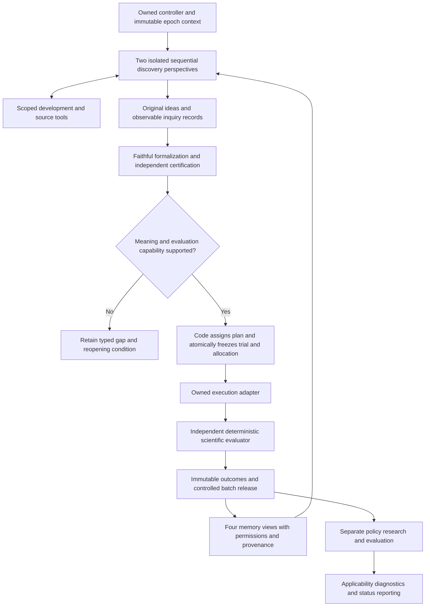

# Integrating the researcher, memories and scientific evaluation

October 24, 2026 — **PROPOSED ONLY.** This report recommends an integration; it does not adopt a new contract, authorize a paid run, or implement the proposed capabilities.

## Recommendation

Extend the existing local controller with a small provider adapter, a controlled research loop, four typed memory views, and an independently implemented scientific pipeline. Keep durable records and scientific authority in the owned application. Start with direct provider API/SDK calls; introduce additional orchestration infrastructure only for a demonstrated missing capability.

“Brain” is a useful informal name for the model plus the loop that supplies context and routes its tool requests. Anthropic uses the term this way while separating it from tools and durable session history ([V3](SOURCES.md)). It is not another indispensable AI component. Our missing capabilities are specific and already largely specified: open discovery, faithful formalization, research memory, scientific freeze and evaluation.

This is the best fit to the inspected constraints, not a benchmark-proven global optimum. The conclusion follows from the [system reconstruction](SYSTEM_MODEL.md), the [primary-source register](SOURCES.md), and the approved [retail contract](../../architecture/14_RETAIL_RESEARCH_CONTRACT.md). Provider quality, retrieval effectiveness, calibration, costs and economic usefulness still need measurement.

## What exists and what must be built

The controller already provides jobs, immutable context/artifact storage, scoped broker access, attempts, leases, operational release, generic schedules and recovery. Its current workers perform source-copy and arithmetic demonstrations. Those are useful infrastructure checks, but there is no connected open LLM research loop or complete scientific evaluator. The AmiBroker utility demonstrates a bounded data round trip, not general strategy evaluation. Detailed source links and limits are in the [system model](SYSTEM_MODEL.md#implementation-and-reuse-evidence).

The proposal preserves free `H_idea` invention and the five expressive claim forms of the accepted AST. It does not turn discovery into enumeration of a signal catalog. A finite implementation can support a subset of executable semantics initially, while retaining unsupported ideas accurately as gaps. A complete integration claim requires the full accepted scope and corresponding evidence; a first vertical slice must be labeled partial.

The diagram shows logical roles; it does not require separate services or separate models. Released information can influence later epochs only with inherited exposure. Nothing in this flow submits orders.

## 1. LLM researcher: direct adapter inside a bounded loop

### Choice of orchestration

| Option | Fit and benefit | Cost or unresolved issue | Recommendation |
|---|---|---|---|
| Existing controller plus direct provider API/SDK | Reuses current ownership, durable artifacts, retries and context boundary; a small loop can implement model-directed tool use | We must implement call bookkeeping, budget enforcement and provider normalization | **Start here**, consistent with D077 |
| General agent SDK around the same owned interfaces | Can package recurring loop/tracing behavior; OpenAI documents this as an alternative to application-managed tool calling | Must show that hidden state, handoffs, retries and memory preserve our boundaries; may duplicate the controller | Add only for a measured capability or maintenance benefit |
| Hosted managed-agent runtime | A possible supplier of durable sessions and execution infrastructure; newer Anthropic guidance describes this separation | Need validated export, access control, provenance, cancellation, costs and reproducible configuration; hosted history cannot become the sole scientific registry | A later adapter option, not a prerequisite |
| Broad autonomous platform with automatic skill/memory changes | Potential convenience for general tasks | Unreviewed changes can alter the generator, retrieval and exposure mid-epoch | Do not enable those behaviors for scientific runs; Hermes remains an optional bounded adapter under D041/D077 |

The source basis for model-directed tool interaction is A1 and V1/V5; choosing this repository's existing controller is a project engineering deduction. No provider or model is declared the winner without a framework-specific comparison.

### Proposed loop and adapter contract

1. The controller creates an epoch profile: approved contract IDs, frozen base context, data and memory versions, tool allowlist, model/prompt configuration, budget and stopping conditions.
2. Run the two accepted discovery perspectives sequentially. Give each the same permitted base snapshot and private scratch. Exchange completed artifacts only at the approved boundary. Two labels or two model vendors do not prove independence.
3. A provider call receives explicit messages and tool schemas. Its normalized response contains public output, requested tool calls, refusal/incomplete/error status, provider request ID and reported usage. Retain exact submitted/returned artifacts where available, with credentials excluded. Do not request or depend on private chain-of-thought.
4. The host validates and authorizes each requested operation. Initial tools are scoped source lookup, development-data measurements, memory lookup, capability inspection, idea submission and gap registration. No arbitrary shell, filesystem, network or evaluator-data access is exposed to the model.
5. Each returned observation is recorded before the next model call. A provider retry, timeout or partial response remains an attempt in the same causal history. Ambiguous delivery/usage is recorded as unknown; a local idempotency key does not promise exactly-once provider billing.
6. The host terminates or hands off according to the existing resource and scientific rules. It preserves unfinished and overflow ideas. No extra reasoning loop changes an inconclusive result into support.

Keep the immutable base snapshot separate from the growing run transcript. Each tool return adds an append-only observation and a derived context reference; it does not edit the original snapshot. Formalization and freeze must include every piece of information actually shown, including search snippets and returned metadata, not only the sources the model chooses to cite. Retain required provider continuation state inside the same role boundary; resetting the prompt must not reset exposure or budget history.

D079 already specifies two perspectives, at most 12 total model calls across discovery/challenge/formalization, 80,000 input-plus-output tokens, 30 minutes per epoch and eight frozen primary claims. These are ceilings, not targets. The host should reserve worst-case remaining output and currency allowance before dispatch and reconcile actual usage afterward. Separate the accepted batch/calibration compute caps from model caps. Unknown billing stays visible; a paid run requires its own currency cap and credentials. This report performs no paid research run and estimates no unmeasured savings.

## 2. Memory: one registry, four views with different authority

Use the existing single-writer SQLite direction, extending domain records and replayable projections rather than installing four unrelated memory products. Large blobs follow D078's staged, content-addressed storage contract. Current generic artifact tables are a foundation; they do not yet implement this domain model.

| Memory | What it retains | Write authority and use |
|---|---|---|
| Research Journal | Ideas, queries, observations, sources, abandoned paths, gaps, freezes, attempts and outcomes | Host records actual events; models may submit labeled drafts. Complete history remains the reference for audits and recovery |
| Market Model | Qualified findings, uncertainty, scope, evidence dependencies, contradictions and applicability | Only validated evidence/update rules can change evidential status. A model can propose a relation or explanation, not promote it to supported |
| Research Experience | Observed failures/successes and separately labeled interpretations about how to investigate | A reflection is an unverified heuristic with provenance until separately assessed. Retrieval and actual use are logged |
| Policy Experience | Separate policy trials, implementation assumptions, costs, fills, risks and incidents | Operational and simulation experience stays distinguishable from market evidence; a loss cannot rewrite an original scientific result |

Proposed common record fields are `record_id`, `record_type`, `schema_version`, `created_at`, `source_ids`, `parent_ids`, `scope`, `exposure_ids`, `authority/status`, and links to superseding or contradictory records. Type-specific records add availability time, trial/plan/model versions, uncertainty or validity as appropriate. These fields refine interfaces for review; they do not replace canonical definitions. Refer to immutable large inputs by hash rather than copying them into every record.

Start retrieval with explicit metadata filters and exact/text search over authorized records. Evaluate whether a full-text index is useful before adding it; embeddings or a separate vector store are optional subsequent indexes, not truth stores. They would need measured gains on the same memory test set and a versioned retrieval policy. A graph database is not required to retain dependency edges.

The retrieval sequence should be:

1. Resolve role, epoch, snapshot, time and exposure permissions **before** search and ranking. Disallowed records must not affect snippets, counts, suggestions or ranks returned to the model.
2. Retrieve a bounded bundle containing record IDs, original passages or typed facts, provenance, scope, uncertainty and relevant conflicts. Returning fewer tokens is an optimization to test, not evidence that all important context survived.
3. Persist the query, retrieval policy/version, returned bundle and actual context use. Any summary remains a derived artifact linked to its complete source ancestry.
4. Preserve raw records and earlier versions when a summary is corrected or an entry is retired. Absence of evidence, contradiction, staleness and invalidity remain different states.

A2–A4 and V2 motivate tests for feedback quality, source recovery, temporal changes and compression loss. They do not determine our memory authority. The latter comes from D014/D019 and the [generator feedback contract](../../architecture/13_GENERATOR_FEEDBACK_AND_EVALUATION.md). In particular, compressing a test result into “avoid this pattern” does not make its descendants unexposed.

## 3. Formalization and scientific evaluation: an owned deterministic core

Structured model output can make records easier to parse. It cannot certify meaning; OpenAI explicitly notes that schema-conforming output can contain mistakes ([V6](SOURCES.md)). Use a staged boundary:

| Stage | Required behavior | Refusal/gap condition |
|---|---|---|
| Preserve idea | Keep the original claim, scope, assumptions and uncertainty | No silent rewriting into a convenient supported template |
| Formalize | Produce `H_exec` with typed AST, units, missingness, timestamps, outcome horizon and an explicit semantic mapping to `H_idea` | Ambiguous meaning or missing data/primitive/estimator remains a typed gap |
| Certify | Evaluate primitives against independently fixed semantics and golden cases | Implementer-generated expected values cannot self-certify; new scientific meaning follows D084 review |
| Assign and freeze | Code assigns estimator, effect boundary, information requirement, family/multiplicity, partition, stopping and selection rules; freeze trial and allocation atomically | Missing closure or conflicting allocation blocks assessment |
| Execute | The owned backend evaluates the frozen expression and returns reproducible inputs, outputs and validity diagnostics | Corrupt data, unsupported paths or mismatched manifest produce technical invalidity, not a market negative |
| Evaluate | Independent code applies the frozen rule and records evidence with uncertainty and origin | No post-result threshold, estimator, seed or favorable-case selection |

Begin with the adopted mean/rate contrast candidate only where its assumptions and claim type fit. Implement the joint block resampling and sensitivity envelope exactly as specified, including aligned instruments, overlapping outcomes, undefined-draw handling and the registered numerical method. The candidate still needs conformance and calibration before scientific runtime adoption. Other AST forms can remain expressive but require their own valid estimator profiles; the contrast procedure is not a universal evaluator.

For the directional profile, the lower interval bound exceeding the practical boundary supports the defined effect; an upper bound below it is negative for that practically relevant effect; otherwise the result is inconclusive. Negative does not mean proof of exactly zero. A finite dataset can finish inconclusively at its fixed cutoff. There is no requirement to wait indefinitely for more observations.

Keep backend choice downstream of semantics. A small independent reference interpreter/fixture calculator should define expected behavior for conformance; it is not a replacement baseline hypothesis generator. Vectorbt remains the recorded primary backend candidate. The existing AmiBroker utility can become an additional adapter after equivalent timing, missingness, shared-cash, costs and path fixtures pass. Neither engine decides significance. If a policy changes fills, exits or capital interaction, resimulate it rather than filtering an old trade list.

### Why not adopt a research paper's complete agent system?

POPPER is a close methodological relative, but its conditional-validity and training-independence assumptions need explicit evidence. Its adaptive sequential inference also differs from our accepted fixed-batch design ([A5](SOURCES.md)). Replacing the latter would be a scientific change requiring its own review and approval. Dwork and Cawley–Talbot reinforce the need to assess adaptive selection, rather than treating repeated feedback as independent validation ([A6–A7](SOURCES.md)).

We therefore reuse design ideas about explicit experiments and external feedback while keeping the adopted evaluator. Exposure logging is necessary for honest claims; it is not a statistical cure. Unknown historical/model exposure remains unknown, even if all software checks pass.

## 4. Three distinct evaluation layers

| Layer | What to test | What passing permits |
|---|---|---|
| Agent and memory behavior | Tool permissions, exact provenance, budget enforcement, source retrieval, faithful mappings, preserved failures, contradiction handling, recovery and actual saved outcome | A bounded claim that the workflow performs these operations correctly |
| Scientific computation and calibration | Independent fixtures, freeze/allocation integrity, appropriate null/boundary/alternative/dependence worlds and the actual selection process at its declared stage | Only the validity/calibration scope supported by those tests |
| Economic usefulness and acceleration | Separately frozen policy, realistic costs/risk, admissible assessment, and matched prior workflow with uncertainty and failures retained | The corresponding economic or efficiency claim, only after evidence exists |

V4/V8 support transcript and outcome tests for agents. They do not authorize substituting LLM grades for scientific inference. Human review and an optional calibrated model rubric can help identify ambiguous formalization or poor explanations; neither may award empirical support. Testing must include unusual retained ideas, not reward converting everything into executable templates or generating easy rejections.

Use development cases for prompt/retrieval/model tuning and separately reserved assessment cases for a reported improvement. Log evaluated variants and failed/pending runs. A full-process calibration must rerun the actual discovery, selection and feedback opportunities; evaluating a fixed calculator alone cannot satisfy it. Preserve D081's staged approach: full causal attribution of generator improvement is not a prerequisite for a first informative historical study.

## 5. Monitoring and reporting integration

Connect the existing generic scheduler to the domain events already adopted in D087/D088. A completed-outcome event must verify maturity, availability and the bound plan before creating a due diagnostic job. A 15-minute bar cannot masquerade as a completed 24-hour outcome. Corrections retain checkpoint identity and causal history.

Authorized method comparisons start when their prerequisites are ready; otherwise persist the exact missing input and reopening condition. Weekly status reporting remains independent of scientific checkpoints and reports pending/blocked state even without new data. Use a durable, deduplicated delivery outbox and retain delivery failures. An LLM can render a source-bound report; a deterministic template must still be able to report status. The quantitative method and notification destination are unresolved inputs, not choices silently made by this proposal. No message or automation is created by this review.

## 6. AI Psychiatry: apply observable controls selectively

The explicitly invoked [AI Psychiatry skill](C:/Users/monoi/.codex/plugins/cache/openai-curated-remote/ai-psychiatry/0.6.0/skills/all-the-medicine/SKILL.md) was used to lock the research objective, reconstruct before recommending, track evidence and audit completion. The local package is a workflow-control source, not peer-reviewed proof of agent improvement. Its full control inventory and dispositions are in [research-state.json](research-state.json).

For the future researcher, reuse the principles already compatible with D086/D030: explicit purpose, observed finding and source, warranted conclusion, remaining uncertainty, next action, causal attempt history and bounded repair. Select a relevant control when an observable failure occurs. Do not prepend every diagnostic prompt to every call or demand private reasoning transcripts. Host code must enforce permissions, budgets and evidence authority even when a prompt fails.

Whether these additional prompts improve completion or only add latency is an empirical operational question. Compare the same task cases, tools and budget with and without the proposed prompt change; keep failures and cost. A material research-generator or retrieval change must be versioned and reviewed. Do not equate installing this plugin with completing the scientific framework or improving model weights.

## 7. Proposed delivery sequence and acceptance evidence

These are proposed implementation packages, not an instruction to start them now. Each package has a bounded outcome; later claims require their own evidence.

| Package | Deliverable | Acceptance and boundary |
|---|---|---|
| P1 — Domain records and storage closure | Versioned records for ideas, observations, gaps, four memory views, dependencies, frozen trials and allocations; blob recovery where needed | Projection replay, canonical-byte/hash fixtures, transaction conflicts and crash/backup recovery; cannot certify research from a persisted JSON object |
| P2 — Connected research and formalization | Direct provider adapter, scoped tools, two isolated perspectives, complete observed-context lineage and host-enforced budgets | Free ideas, faithful mappings or explicit gaps; refusal/partial/timeout cases; denied evaluator access; no silent meaning changes. A mock provider is only an infrastructure test |
| P3 — Scientific execution and narrow calibration | Owned AST execution adapter and the approved applicable estimator; independent cases; versioned calibration report | Existing D075/D081 requirements, including boundary/dependence worlds and uncertainty bounds. An unfinished calibration does not certify the evaluator |
| P4 — First genuine historical research slice | An actual freely invented idea traverses P1–P3 to a faithful report, with complete batch retention and later permitted feedback | A valid negative/inconclusive report is acceptable. A hand-written arithmetic example is not this result. Unsupported ideas remain visible; restricted coverage is explicit |
| P5 — Broader policy, memory and monitoring behavior | Additional certified semantics/estimators; separately assessed policy; D087/D088 domain adapters; retrieval improvements only as justified | Shared-cash/path/cost fixtures, scoped applicability and reporting tests, then economic/process assessments; no promotion to live trading |

P1–P3 have dependencies but can be developed with deterministic fixtures before paid calls. A reference example tests plumbing; it does not replace P4's freely invented idea. Initial versions of all four memory views belong in P1, even if policy experience has no real entries yet. Do not claim populated scientific knowledge merely because a table exists.

P4 still needs actual data/version/availability/rights checks, exact model/prompt settings, applicable computation profiles and a currency cap for paid execution. P5 needs cost and policy inputs and a bound diagnostic method. These are future run/readiness inputs, not blockers to delivering this proposal. No calendar schedule or implementation-cost estimate is asserted without measuring the work.

## 8. Change control, validation and rollback

| Proposed integration area | Existing authority and requirements | Decision treatment |
|---|---|---|
| Provider loop and tool access | D005/D034/D041/D077/D079; REQ-004/013/018/023 | Implement existing limits; exact provider/prompt and capabilities are explicit profiles. Material generator changes follow D026 |
| Four memories and retrieval | D014/D019/D070/D078/D083; REQ-007/008/013/016/028–030 | Preserve definitions; review/version material ranking, summarization or experience-use changes |
| Formalization and certification | D002–D004/D074/D084; REQ-002/003/011/026 | Independent certification within accepted semantics may be automatic; new meaning or uncertain membership requires review |
| Freeze, inference and separate policy | D006/D017/D021/D075/D081/D082; REQ-005/009/019/020/024/029 | Implement accepted profiles, calibrate before adoption; different inference rules require an explicitly approved scientific change |
| Diagnostics and reporting | D080/D087/D088; REQ-017/022/025 | Implement invocation/visibility, do not choose a quantitative method or capital authority implicitly |

Version schemas, provider configuration, prompts, retrieval policy, feature certificates, estimator profiles, backend adapters and the aggregate run manifest. Preserve original bytes and old definitions. Any migration needs explicit replay/compatibility checks and a backup before activation. A deployment/configuration rollback can restore a prior implementation; it cannot erase trials, failed attempts or information already seen.

The [validation plan](VALIDATION_AND_AUDIT.md) lists concrete counterexamples and maps this research deliverable to evidence. It distinguishes checks executed now from tests proposed for future implementation. Canonical architecture documents remain unchanged by this report. After an approved capability is implemented and verified, update its canonical coverage and Current State under the repository's maintenance process.

## Decision-ready conclusion

Recommend the local, owned integration above. It satisfies the architectural direction with the fewest additional dependencies and keeps future providers, retrieval indexes and execution backends replaceable. Evidence supports the mechanisms and identifies their limits; it does not establish performance of the unbuilt system.

The next implementation scope, if authorized, should be P1–P4 as a bounded end-to-end research milestone, with the stated gates and explicit partial coverage. Adding a generic “Brain” or attaching a model to the current demo alone would leave the central scientific and memory responsibilities unfinished.
